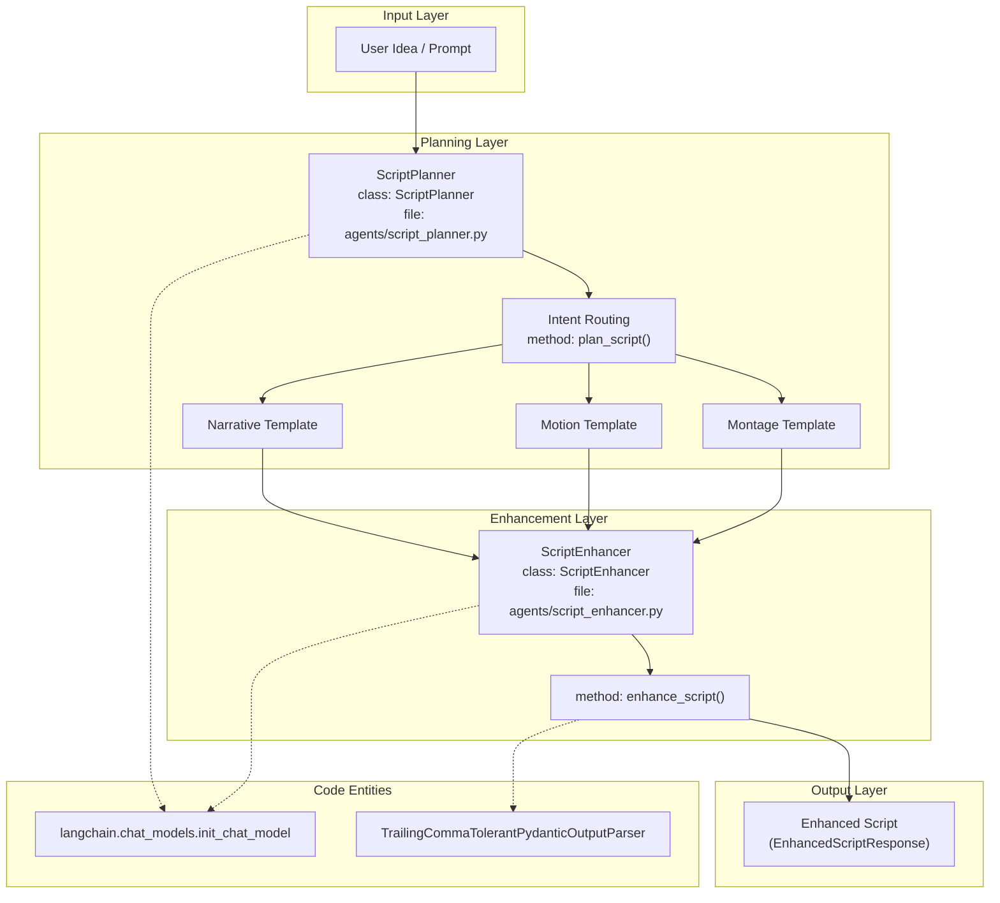
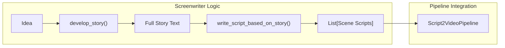

<!-- source: DeepWiki mcp.deepwiki.com · repo HKUDS/ViMax · page 5.2 Narrative Agents · fetched 2026-11-09 -->

# Narrative Agents

<details>
<summary>Relevant source files</summary>

The following files were used as context for generating this wiki page:

- [agents/screenwriter.py](agents/screenwriter.py)
- [agents/script_enhancer.py](agents/script_enhancer.py)
- [agents/script_planner.py](agents/script_planner.py)
- [interfaces/character.py](interfaces/character.py)

</details>


This document covers the specialized AI agents responsible for story development and script generation: **Screenwriter**, **ScriptPlanner**, **ScriptEnhancer**, and **GlobalInformationPlanner**. These agents transform high-level ideas into cinematic scripts with detailed descriptions, character consistency, and motion precision.

The Narrative Agents operate in the initial phase of the video generation pipeline. Their primary responsibility is to bridge the gap between a user's abstract concept and a structured, actionable script that downstream visual agents (like StoryboardArtist) can interpret.

---

## Purpose and Scope

The Narrative Agents handle the "writing" phase of the ViMax workflow. Their responsibilities include:

1.  **Screenwriter**: Expands basic ideas into full story narratives and segments them into scenes [agents/screenwriter.py:14-100]().
2.  **ScriptPlanner**: Analyzes user intent to select the appropriate script template (Narrative, Motion, or Montage) and generates a structured plan [agents/script_planner.py:329-430]().
3.  **ScriptEnhancer**: Polishes planned scripts by adding sensory details, ensuring continuity, and enforcing technical precision [agents/script_enhancer.py:10-56]().
4.  **GlobalInformationPlanner**: (Implicitly handled via character extraction and scene segmentation) Maintains consistent character traits and world-building details across the narrative.

**Sources:** [agents/screenwriter.py:1-110](), [agents/script_planner.py:1-432](), [agents/script_enhancer.py:1-123]()

---

## Script Planning Architecture

The script generation process is a multi-stage workflow that moves from abstract intent to refined cinematic language.



**Diagram: Script Planning and Enhancement Flow**

**Sources:** [agents/script_planner.py:329-430](), [agents/script_enhancer.py:74-121]()

---

## ScriptPlanner

The `ScriptPlanner` is the primary orchestrator for script development. It uses a specialized prompt that acts as an "Intent Router" to determine the style of video the user wants to create.

### Class Structure and Initialization

The class is initialized with LLM configuration and manages the selection of specific script templates [agents/script_planner.py:329-354]().

| Method | Role | Output Model |
| :--- | :--- | :--- |
| `plan_script()` | Main entry point; selects template and generates initial script | `PlannedScriptResponse` |
| `_get_prompt_template()` | Selects prompt based on detected intent | `ChatPromptTemplate` |

### Script Templates

The planner supports three distinct cinematic styles via prompt templates:

1.  **Narrative Script (`narrative_script_prompt_template`)**: Focuses on three-act structure, character arcs, and emotional depth. It enforces cinematic language and prohibits metaphors [agents/script_planner.py:13-81]().
2.  **Motion Script (`motion_script_prompt_template`)**: Designed for action sequences. It emphasizes "Technical Explicitness," trajectories, and kinetic clarity (e.g., specific vehicle makes, combat stances) [agents/script_planner.py:83-110]().
3.  **Montage Script**: (Internal logic) Focuses on a series of thematic shots with less emphasis on a single narrative arc.

### Key Guidelines and Constraints
*   **No Metaphors**: Explicitly forbidden to ensure the LLM generates visual descriptions that can be rendered (e.g., avoiding "ghostly touch") [agents/script_planner.py:33-34]().
*   **Dialogue Formatting**: Must use `Name: "Dialogue"` syntax [agents/script_planner.py:47]().
*   **No Camera Directions**: Prohibits jargon like "cut to" or "close up," favoring descriptive storyboard language [agents/script_planner.py:60]().

**Sources:** [agents/script_planner.py:13-110](), [agents/script_planner.py:329-432]()

---

## ScriptEnhancer

The `ScriptEnhancer` acts as a "Senior Screenplay Polishing" agent. It takes the output of the `ScriptPlanner` and refines it for consistency and sensory detail [agents/script_enhancer.py:10-56]().

### Core Capabilities
*   **Continuity Tightening**: Ensures character names, ages, and locations remain consistent across scenes [agents/script_enhancer.py:27]().
*   **Sensory Enrichment**: Adds grounded details regarding lighting, textures, sounds, and weather [agents/script_enhancer.py:26]().
*   **Precision Repetition**: Restates important objects (e.g., "the cockpit front seat of the two-seat F-18") frequently to remove ambiguity for the image generator [agents/script_enhancer.py:31-32]().
*   **Character Feature Injection**: Automatically repeats core voice and physical descriptions during dialogue sequences to maintain character identity [agents/script_enhancer.py:33-34]().

### Implementation Detail

The `enhance_script` method uses `PydanticOutputParser` to ensure the result is structured as an `EnhancedScriptResponse` [agents/script_enhancer.py:93-121]().

```python
class EnhancedScriptResponse(BaseModel):
    enhanced_script: str = Field(
        ...,
        description="A refined script version with clearer continuity, stronger concrete detail..."
    )
```

**Sources:** [agents/script_enhancer.py:67-121]()

---

## Screenwriter

While `ScriptPlanner` handles direct Idea-to-Script workflows, the `Screenwriter` class is used for more complex, multi-stage story development. It is a core component of the `Idea2VideoPipeline` [agents/screenwriter.py:1-100]().

### Workflow Methods

1.  **`develop_story(idea, user_requirement)`**: Expands a one-line idea into a logically coherent story world with a title, summary, and character introductions [agents/screenwriter.py:14-58]().
2.  **`write_script_based_on_story(story, user_requirement)`**: Adapts a full narrative text into a list of scenes. Each scene is defined as a "continuous dramatic action unit occurring at the same time and location" [agents/screenwriter.py:73-100]().



**Diagram: Screenwriter Story-to-Script Transformation**

**Sources:** [agents/screenwriter.py:14-100](), [pipelines/idea2video_pipeline.py:262-299]()

---

## Data Models and Communication

The agents communicate using structured Pydantic models to ensure the handoff between planning and rendering is seamless.

### Character Representations
When scripts are generated, characters are often described using the `CharacterInScene` model to maintain visual consistency.

| Field | Type | Description |
| :--- | :--- | :--- |
| `identifier_in_scene` | `str` | Name or unique ID (e.g., "Alice") |
| `static_features` | `str` | Constant physical traits (hair, eyes, build) |
| `dynamic_features` | `str` | Scene-specific traits (clothing, accessories) |

**Sources:** [interfaces/character.py:8-33]()

### Script Response Models
*   **`PlannedScriptResponse`**: The raw output from `ScriptPlanner`.
*   **`EnhancedScriptResponse`**: The polished output from `ScriptEnhancer` [agents/script_enhancer.py:67-72]().

---

## Summary of Agent Interactions

| Step | Agent | Code Entity | Task |
| :--- | :--- | :--- | :--- |
| 1 | **Screenwriter** | `develop_story` | Expands idea into a 3-act story narrative. |
| 2 | **Screenwriter** | `write_script_based_on_story` | Segments the story into logical scene units. |
| 3 | **ScriptPlanner** | `plan_script` | Determines cinematic style (Narrative/Motion) and writes the script. |
| 4 | **ScriptEnhancer** | `enhance_script` | Adds sensory details and repeats key descriptors for consistency. |

**Sources:** [agents/screenwriter.py:1-100](), [agents/script_planner.py:329-432](), [agents/script_enhancer.py:1-123]()

---

