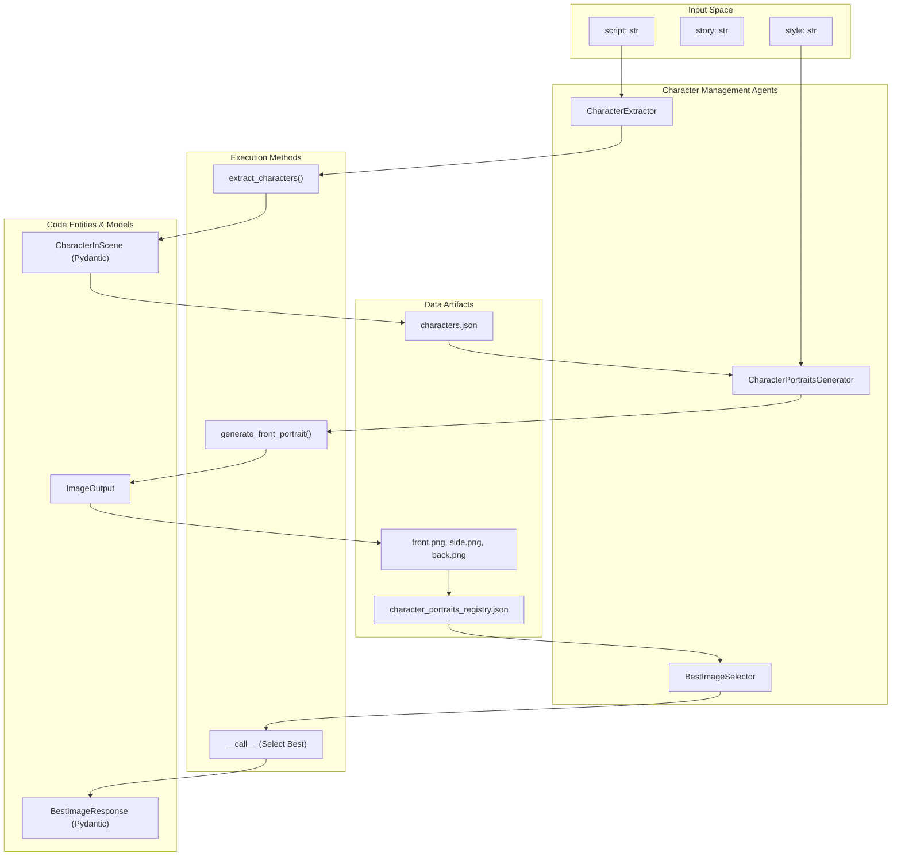
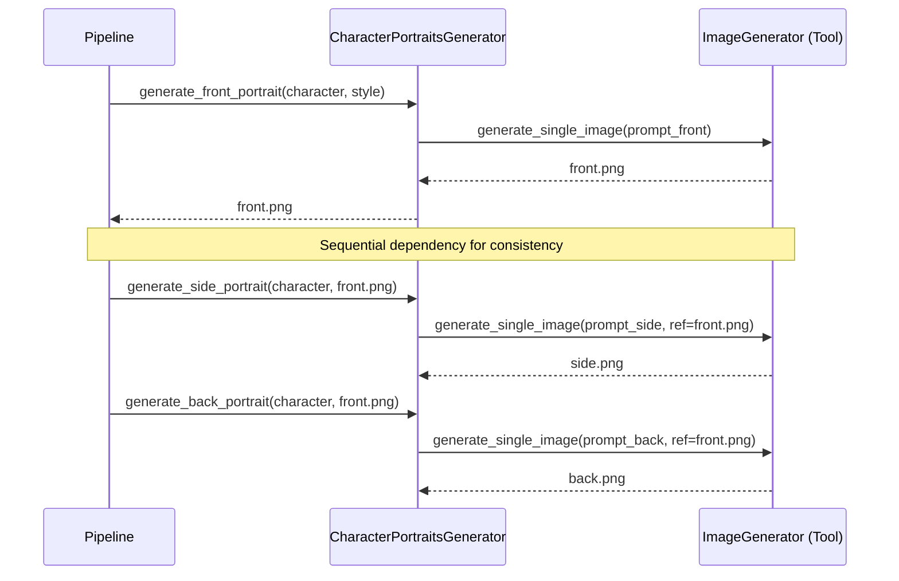

<!-- source: DeepWiki mcp.deepwiki.com · repo HKUDS/ViMax · page 5.3 Character Management Agents · fetched 2026-11-09 -->

# Character Management Agents

<details>
<summary>Relevant source files</summary>

The following files were used as context for generating this wiki page:

- [agents/best_image_selector.py](agents/best_image_selector.py)
- [agents/character_extractor.py](agents/character_extractor.py)
- [agents/character_portraits_generator.py](agents/character_portraits_generator.py)
- [agents/event_extractor.py](agents/event_extractor.py)

</details>


## Purpose and Scope

This document covers the specialized agents responsible for character management in the ViMax system: **CharacterExtractor**, **CharacterPortraitsGenerator**, and **BestImageSelector**. These agents extract character information from narrative text, generate visual reference assets, and evaluate image quality for visual consistency.

- For narrative development, see [5.2 Narrative Agents]()
- For visual planning and storyboarding, see [5.4 Visual Design Agents]()
- For character data model specifications, see [6.2 Character Models]()

The character management agents solve three critical problems:
1. **Character Identification**: Extracting character entities and categorizing features into static (appearance) and dynamic (attire/state) attributes from scripts [agents/character_extractor.py:16-48]().
2. **Visual Consistency**: Generating standardized multi-angle character portraits (front, side, back) to serve as reference images [agents/character_portraits_generator.py:15-31]().
3. **Quality Validation**: Selecting the most consistent candidate images using a vision-language model to verify character and spatial alignment [agents/best_image_selector.py:13-41]().

Sources: [agents/character_extractor.py:1-91](), [agents/character_portraits_generator.py:1-87](), [agents/best_image_selector.py:1-149]()

---

## System Architecture

The character management agents operate at the intersection between narrative understanding and visual synthesis.

### Data Flow and Code Entities



**Character Management Architecture: Extraction, Portrait Generation, and Selection**

Sources: [agents/character_extractor.py:65-89](), [agents/character_portraits_generator.py:33-87](), [agents/best_image_selector.py:62-148](), [interfaces.py:1-100]()

---

## CharacterExtractor

The `CharacterExtractor` agent analyzes scripts to extract relevant character information, distinguishing between permanent traits and scene-specific attire.

### Implementation Details
The class uses a `PydanticOutputParser` configured with the `ExtractCharactersResponse` model to ensure structured data [agents/character_extractor.py:78-85]().

**Key Functions:**
- `extract_characters(script: str)`: Asynchronously invokes the chat model with a system prompt that defines the role of a "top-tier movie script analysis expert" [agents/character_extractor.py:76-89]().

**Extraction Guidelines:**
- **Static Features**: Physical appearance, physique, and unchanging features [agents/character_extractor.py:44]().
- **Dynamic Features**: Attire, accessories, and changeable items [agents/character_extractor.py:44]().
- **Distinctiveness**: Different character appearances should be made distinct from each other within reasonable limits [agents/character_extractor.py:46]().

Sources: [agents/character_extractor.py:16-48](), [agents/character_extractor.py:65-91]()

---

## CharacterPortraitsGenerator

The `CharacterPortraitsGenerator` creates standardized visual reference assets. It generates three orthogonal views (front, side, back) on a 16:9 landscape canvas with a pure white background [agents/character_portraits_generator.py:15-31]().

### Portrait Generation Workflow



**Sequential Portrait Generation Sequence**

**Methods:**
- `generate_front_portrait()`: Generates the base reference. Prompt emphasizes full-body, centered framing, and natural expression [agents/character_portraits_generator.py:41-56]().
- `generate_side_portrait()`: Uses the front image as a reference to maintain identity. Character faces left [agents/character_portraits_generator.py:58-71]().
- `generate_back_portrait()`: Uses the front image as a reference. Explicitly ensures no facial features are visible [agents/character_portraits_generator.py:74-87]().

Sources: [agents/character_portraits_generator.py:15-87]()

---

## BestImageSelector

The `BestImageSelector` serves as a visual quality gate. It uses a Multimodal Large Language Model (MLLM) to compare multiple candidate images against reference images and a target description [agents/best_image_selector.py:13-41]().

### Evaluation Criteria
The agent assesses candidates based on three primary pillars:
1. **Character Consistency**: Gender, ethnicity, facial features, and body shape matching the reference [agents/best_image_selector.py:20]().
2. **Spatial Consistency**: Relative positions of characters and scene layout relative to references [agents/best_image_selector.py:21]().
3. **Description Accuracy**: Alignment with the `target_description` provided in the prompt [agents/best_image_selector.py:22]().

### Implementation: `__call__` Method
The selector processes images by converting local paths to Base64 strings for the MLLM [agents/best_image_selector.py:107-125]().

```python
async def __call__(
    self,
    reference_image_path_and_text_pairs: List[Tuple[str, str]],
    target_description: str,
    candidate_image_paths: List[str],
) -> str:
    # ... prepares HumanMessage with interleaved text and images ...
    # response = await chain.ainvoke(messages)
    # returns best_image_path
```

**Response Model:**
The agent returns a `BestImageResponse` containing the `best_image_index` and a `reason` for the selection [agents/best_image_selector.py:51-59]().

Sources: [agents/best_image_selector.py:13-59](), [agents/best_image_selector.py:82-148]()

---

## Integration and Error Handling

### Retry Logic
All three agents implement robust retry mechanisms using the `tenacity` library to handle transient API failures:
- `CharacterExtractor`: Retries 3 times on failure [agents/character_extractor.py:72-75]().
- `BestImageSelector`: Retries 3 times, logging the specific exception [agents/best_image_selector.py:78-81]().
- `EventExtractor` (related): Also employs a 3-attempt retry limit [agents/event_extractor.py:123-126]().

### Registry and Caching
Portraits are stored in a `character_portraits_registry.json` mapping. Downstream components like the `StoryboardArtist` and `CameraImageGenerator` use this registry to ensure that generated scenes feature the correct visual version of each character [agents/character_portraits_generator.py:10]().

Sources: [agents/character_extractor.py:72-75](), [agents/best_image_selector.py:78-81](), [agents/event_extractor.py:123-126]()

---

