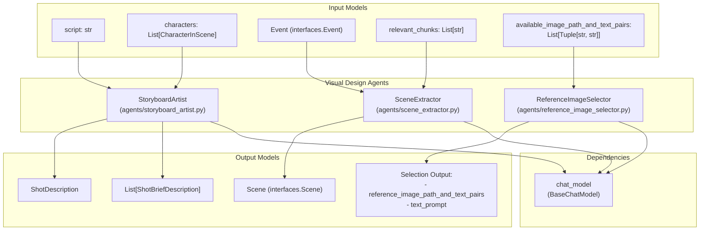
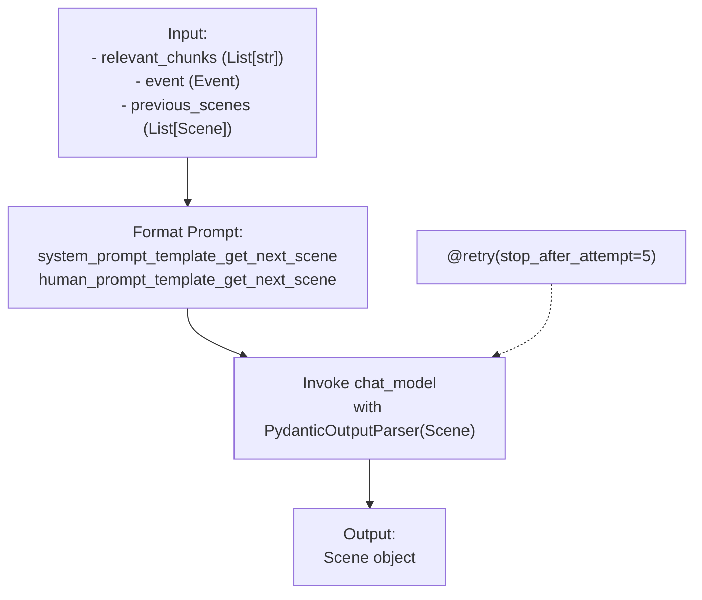

<!-- source: DeepWiki mcp.deepwiki.com · repo HKUDS/ViMax · page 5.4 Visual Design Agents · fetched 2026-11-09 -->

# Visual Design Agents

<details>
<summary>Relevant source files</summary>

The following files were used as context for generating this wiki page:

- [agents/reference_image_selector.py](agents/reference_image_selector.py)
- [agents/scene_extractor.py](agents/scene_extractor.py)
- [agents/storyboard_artist.py](agents/storyboard_artist.py)
- [pipelines/novel2movie_pipeline.py](pipelines/novel2movie_pipeline.py)
- [tests/test_novel2movie_pipeline_init.py](tests/test_novel2movie_pipeline_init.py)
- [tests/test_wrong_output_guards.py](tests/test_wrong_output_guards.py)
- [utils/text.py](utils/text.py)

</details>


## Purpose and Scope

This document covers the **Visual Design Agents** in the ViMax system, specifically the `StoryboardArtist`, `ReferenceImageSelector`, and `SceneExtractor`. These agents bridge narrative content and visual assets by designing shot-level storyboards, extracting screenplay scenes from literary text, and intelligently selecting reference images for consistent frame generation.

The `StoryboardArtist` transforms screenplay scripts into detailed shot-level visual plans, decomposing visual descriptions into first frames, last frames, and motion descriptions. The `ReferenceImageSelector` optimizes image generation by analyzing available reference images (character portraits, previous frames) and selecting the most relevant ones for each new frame. The `SceneExtractor` serves the long-form generation pipeline by converting novel events into structured screenplay scenes using RAG-based context.

---

## Agent Architecture Overview

**Visual Design Agent Class Hierarchy**



Sources: [agents/storyboard_artist.py:170-176](), [agents/reference_image_selector.py:82-130](), [agents/scene_extractor.py:62-74](), [pipelines/novel2movie_pipeline.py:46-69]()

---

## SceneExtractor Agent

The `SceneExtractor` is primarily utilized in the `Novel2MoviePipeline` to bridge the gap between compressed novel events and actionable screenplay scenes. It uses Retrieval-Augmented Generation (RAG) to ensure narrative fidelity.

### Scene Extraction Process

The `get_next_scene` method transforms a specific `Event` and its associated context fragments (retrieved from a FAISS index) into a structured `Scene`.

**Key Features**:
- **Contextual Awareness**: Accepts `previous_scenes` to maintain narrative continuity [agents/scene_extractor.py:84-85]().
- **RAG Integration**: Processes `relevant_chunks` of the novel text as context fragments [agents/scene_extractor.py:87-88]().
- **Structured Output**: Returns a `Scene` object containing environment sluglines, character lists with static/dynamic features, and screenplay script [agents/scene_extractor.py:110]().

**Scene Extraction Workflow**



Sources: [agents/scene_extractor.py:12-41](), [agents/scene_extractor.py:80-110]()

---

## StoryboardArtist Agent

The `StoryboardArtist` is a professional storyboard design agent that converts screenplay scripts into detailed shot-level visual plans. It operates in two primary modes:

1. **Storyboard Design**: Analyzes a scene script and produces a complete sequence of shot descriptions.
2. **Visual Decomposition**: Breaks down each shot into frame-level specifications (first frame, last frame, motion).

### Storyboard Design Process

The `design_storyboard()` method transforms a scene script into a structured storyboard with detailed shot descriptions.

**Key Prompt Instructions** (from [agents/storyboard_artist.py:16-53]()):
- **Cinematic Language**: Uses shot types (close-up, wide), angles, and camera movements deliberately.
- **Spatial Positioning**: Indicates where elements are within the frame (e.g., "left side of the frame").
- **Consistency**: Encloses character names in angle brackets (e.g., `<Alice>`) for visual descriptions but not in dialogue.
- **Camera Re-use**: Considers existing camera positions before introducing new ones.

### Visual Description Decomposition

The `decompose_visual_description()` method dissects a shot's visual description into three atomic components for image-to-video generation.

**Decomposition Guidelines** (from [agents/storyboard_artist.py:73-110]()):
1. **Static Frame Requirements**: First and last frames must be pure "snapshots" without ongoing actions.
2. **Motion Description**: Distinguishes between camera movement (e.g., dolly, pan) and on-screen element movement. It forbids using character names in motion descriptions, requiring visual feature references instead.
3. **Variation Classification**:
   - `"large"`: Significant changes like drone perspectives or wide-to-close transitions.
   - `"medium"`: New character introductions or facing direction changes.
   - `"small"`: Subtle expression or pose changes.

Sources: [agents/storyboard_artist.py:125-167](), [agents/storyboard_artist.py:213-257]()

---

## ReferenceImageSelector Agent

The `ReferenceImageSelector` implements intelligent reference image selection for image generation. It prevents the image generator from being overwhelmed by irrelevant assets by selecting only the most relevant portraits and previous frames.

### Reference Image Selection Process

The `select_reference_images_and_generate_prompt()` method analyzes available images and constructs optimized prompts.

**Selection Logic** (from [agents/reference_image_selector.py:49-57]()):
- **Angle Matching**: For character portraits, it selects the view (front, side, back) that matches the frame description.
- **Chronological Priority**: Prioritizes more recent images from prior frames for environmental consistency.
- **Redundancy Filtering**: Avoids selecting multiple images that depict the same visual information.
- **Cap**: Selects at most **8** optimal reference image descriptions.

**Multimodal Support**:
The agent supports both text-only descriptions [agents/reference_image_selector.py:13-58]() and multimodal inputs [agents/reference_image_selector.py:61-120]() where actual images are provided to the LLM for analysis.

**Implementation Example**:
```python
# Selection output model
class ReferenceImageSelectionResponse(BaseModel):
    selected_reference_image_idxs: List[int]
    text_prompt: str
    reason: str
```
Sources: [agents/reference_image_selector.py:60-79](), [agents/reference_image_selector.py:82-130]()

---

## Technical Integration and Utilities

### Safe Path Sanitization
Identifiers derived from LLM outputs are sanitized using `safe_path_component` to prevent directory traversal and filesystem errors.
- **Regex**: `re.sub(r"[^\w\-. ]", "_", str(name))` [utils/text.py:12]().
- **Normalization**: Strips leading dots and ensures a non-empty string [utils/text.py:13-14]().

### Integration in Novel2MoviePipeline
In the long-form video pipeline, these agents are orchestrated as follows:
1. `EventExtractor` defines the narrative segment.
2. `SceneExtractor` converts the segment to a screenplay `Scene` [pipelines/novel2movie_pipeline.py:64]().
3. `StoryboardArtist` (within the `Script2VideoPipeline`) plans the shots [pipelines/novel2movie_pipeline.py:68]().
4. `ReferenceImageSelector` ensures consistency during the parallel frame generation phase.

Sources: [pipelines/novel2movie_pipeline.py:46-69](), [utils/text.py:4-14]()

---

