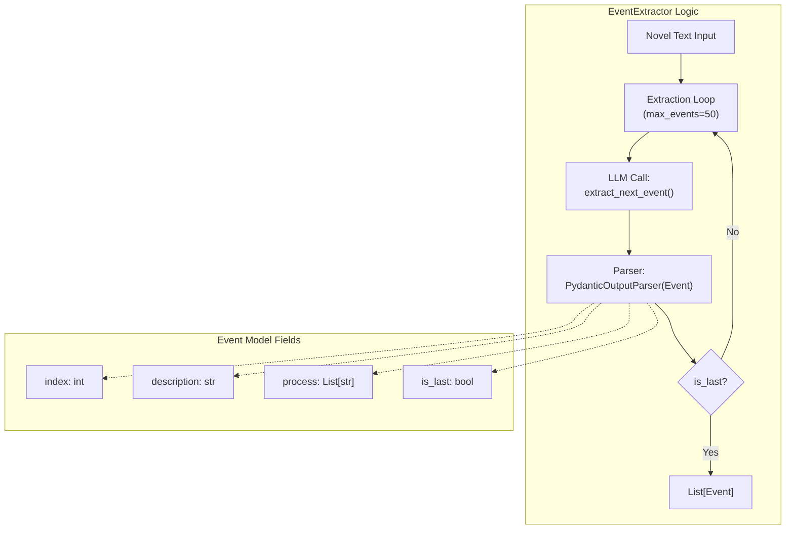
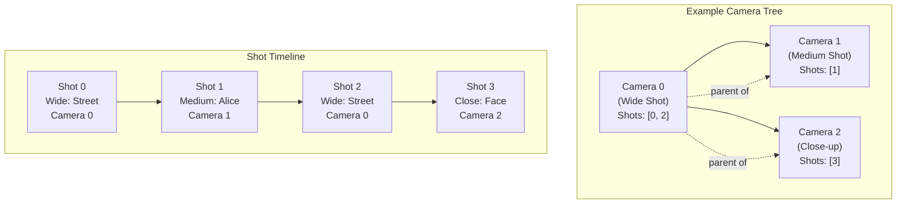
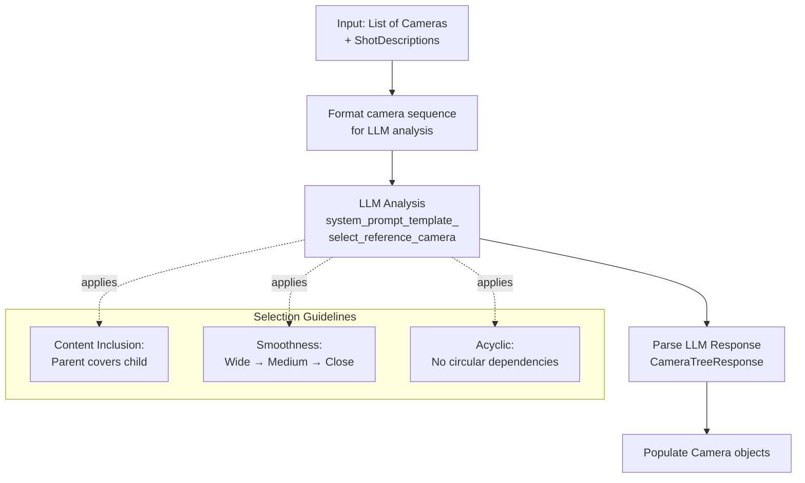
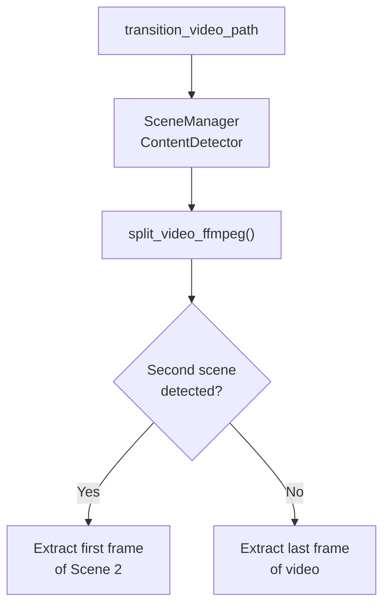

<!-- source: DeepWiki mcp.deepwiki.com · repo HKUDS/ViMax · page 5.5 Camera and Motion Agents · fetched 2026-11-09 -->

# Camera and Motion Agents

Relevant source files

The following files were used as context for generating this wiki page:

- [agents/camera_image_generator.py](agents/camera_image_generator.py)
- [agents/character_portraits_generator.py](agents/character_portraits_generator.py)
- [agents/event_extractor.py](agents/event_extractor.py)
- [utils/video.py](utils/video.py)

This document covers the `CameraImageGenerator` and `EventExtractor` agents. `CameraImageGenerator` is responsible for simulating multi-camera filming by constructing hierarchical camera relationships, generating smooth transitions between camera positions, and extracting frames from those transitions. `EventExtractor` is used in long-form generation to decompose novel text into a sequence of discrete, causal events.

---

## Overview

ViMax utilizes specialized agents to handle spatial and temporal structure. The `CameraImageGenerator` in [agents/camera_image_generator.py]() implements a hierarchical camera tree structure where child cameras (e.g., close-ups) derive their positioning and content from parent cameras (e.g., wider shots). This ensures visual continuity across different shot sizes.

The `EventExtractor` in [agents/event_extractor.py]() serves the `Novel2MoviePipeline` by breaking down dense prose into a structured sequence of events, providing the narrative foundation for subsequent storyboard and script generation.

**Primary Responsibilities:**

| Agent | Responsibility | Method | Purpose |
|-------|----------------|--------|---------|
| **CameraImageGenerator** | Camera Tree Construction | `construct_camera_tree()` | Establish parent-child relationships between cameras based on shot descriptions |
| | Transition Generation | `generate_transition_video()` | Create smooth camera movements between parent and child shots |
| | Frame Extraction | `get_new_camera_image()` | Extract target frames from transition videos using scene detection |
| **EventExtractor** | Event Decomposition | `__call__()` | Iteratively extract discrete narrative events from novel text |

Sources: [agents/camera_image_generator.py:109-126](), [agents/event_extractor.py:80-120]()

---

## Event Extraction for Long-Form Content

The `EventExtractor` class is a specialized literary analysis agent. It processes novel text iteratively to extract a sequence of `Event` objects, which include descriptions, process chains, and outcomes.

### Event Extraction Workflow

**Diagram: Event Extraction Process and Data Model**

The agent uses a strict prompt [agents/event_extractor.py:14-65]() that instructs the LLM to focus on critical plot points and maintain objectivity. It ensures logical continuity by providing previously extracted events back to the LLM in each iteration [agents/event_extractor.py:133-144]().

Sources: [agents/event_extractor.py:80-153](), [interfaces/camera.py]() (Note: Event model used here)

---

## Camera Tree Architecture

The camera tree is a directed acyclic graph (DAG) where each node represents a camera position, and edges represent content-inclusion relationships.

### Hierarchical Structure

**Diagram: Camera Tree and Shot Timeline Relationship**

Sources: [agents/camera_image_generator.py:122-150](), [interfaces/camera.py]()

### Camera Data Model

The `Camera` data structure represents a node in the camera tree:

| Field | Type | Description |
|-------|------|-------------|
| `idx` | `int` | Unique camera identifier [interfaces/camera.py]() |
| `active_shot_idxs` | `List[int]` | Shots filmed by this camera |
| `parent_cam_idx` | `Optional[int]` | Index of parent camera (None for root) [agents/camera_image_generator.py:70-74]() |
| `parent_shot_idx` | `Optional[int]` | Specific shot in parent camera that contains this camera's content [agents/camera_image_generator.py:75-79]() |
| `missing_info` | `Optional[str]` | Elements in child shot not visible in parent shot [agents/camera_image_generator.py:93-100]() |

Sources: [agents/camera_image_generator.py:69-106](), [interfaces/camera.py]()

---

## Camera Tree Construction Process

The `construct_camera_tree()` method uses an LLM to analyze all shots and determine optimal parent-child relationships based on cinematographic principles.

### Algorithm Workflow

**Diagram: Camera Tree Construction Algorithm**

The system prompt [agents/camera_image_generator.py:20-58]() provides guidelines such as preferring larger shot sizes as parents and ensuring temporal proximity between parent and child shots.

Sources: [agents/camera_image_generator.py:122-150](), [agents/camera_image_generator.py:20-58]()

---

## Transition and Extraction

### Transition Video Generation
When a child camera needs to transition from a parent camera, `generate_transition_video()` creates a bridge. It uses the parent's first frame as a reference and generates a video that cuts to the child shot description [agents/camera_image_generator.py:153-168]().

### Camera Image Extraction
After generating a transition video, the system extracts the final frame of the second shot (the child camera's position) using scene detection.

**Diagram: Camera Image Extraction via Scene Detection**

The `get_new_camera_image()` method [agents/camera_image_generator.py:171-200]() uses the `scenedetect` library to identify the shot boundary and `moviepy` to extract the frame [agents/camera_image_generator.py:16]().

Sources: [agents/camera_image_generator.py:153-200](), [utils/video.py:3-4]()

---

## Tool Integration

The `CameraImageGenerator` coordinates multiple external services:

| Function | Tool Type | Specific Entity |
|----------|-----------|-----------------|
| Camera Tree Logic | Chat Model | `self.chat_model` [agents/camera_image_generator.py:117]() |
| Transition Video | Video Generator | `self.video_generator` [agents/camera_image_generator.py:119]() |
| Frame Extraction | Video Processing | `scenedetect`, `moviepy` [agents/camera_image_generator.py:10,16]() |

Sources: [agents/camera_image_generator.py:109-120]()

---

