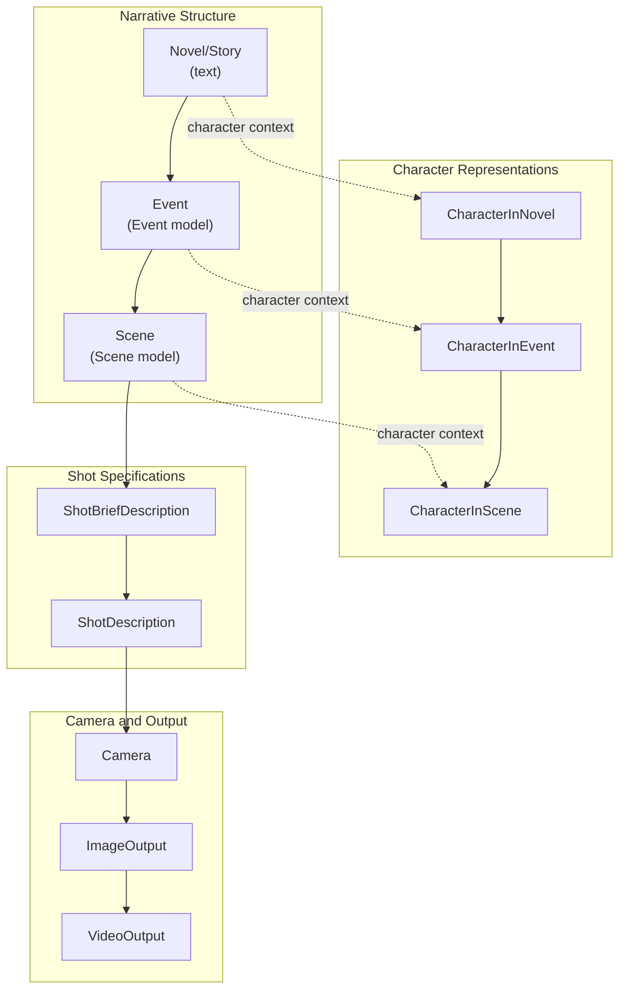

<!-- source: DeepWiki mcp.deepwiki.com · repo HKUDS/ViMax · page 6 Data Models and Interfaces · fetched 2026-11-09 -->

# Data Models and Interfaces

Relevant source files

The following files were used as context for generating this wiki page:

- [agent_runtime/context_compactor.py](agent_runtime/context_compactor.py)
- [agents/script_enhancer.py](agents/script_enhancer.py)
- [interfaces/character.py](interfaces/character.py)
- [interfaces/shot_description.py](interfaces/shot_description.py)
- [tests/test_crash_regressions.py](tests/test_crash_regressions.py)

This document describes the core data structures used throughout the ViMax system to represent scripts, characters, scenes, shots, and generated outputs. These models serve as the contracts between different agents and pipeline stages, enabling structured communication and maintaining consistency throughout the video generation process.

For details on how agents use these models, see [Agents](#5). For details on how pipelines orchestrate data flow, see [Pipelines](#4).

## Overview of Data Model Architecture

The ViMax system uses Pydantic-based data models to enforce type safety and validation. All models are defined in the `interfaces` package and imported by agents and pipelines. The models fall into four main categories:

1.  **Shot Descriptions**: Visual and audio specifications for individual shots. For details, see [Shot Descriptions](#6.1).
2.  **Character Representations**: Character information at different granularities (scene, event, novel). For details, see [Character Models](#6.2).
3.  **Scene and Event Models**: Narrative structure containers and camera tree metadata. For details, see [Camera and Event Models](#6.3).
4.  **Output Models**: Generated media assets (images and videos). For details, see [Output Models](#6.4).

### Model Hierarchy and Dependencies

**Sources:** [interfaces/shot_description.py:1-190](), [interfaces/character.py:1-102](), [interfaces/video_output.py:1-44]()

## Shot Description Models

Shot descriptions capture the visual and audio specifications for individual shots in a scene. The system uses two levels of detail to separate narrative planning from visual decomposition.

*   **`ShotBriefDescription`**: The initial output from the storyboard design process. It contains high-level visual descriptions and audio metadata [interfaces/shot_description.py:5-88]().
*   **`ShotDescription`**: Extends the brief version with detailed frame decomposition, including first frame (`ff_desc`) and last frame (`lf_desc`) descriptors, motion descriptions, and variation types [interfaces/shot_description.py:91-190]().

For detailed field definitions and variation type logic, see [Shot Descriptions](#6.1).

**Sources:** [interfaces/shot_description.py:5-190]()

## Character Representation Models

Characters are tracked at three different granularities as they flow through the narrative hierarchy. This ensures that a character's "static features" (like eye color) remain consistent while "dynamic features" (like clothing) can change across scenes.

*   **`CharacterInScene`**: Represents a character within a single scene [interfaces/character.py:8-48]().
*   **`CharacterInEvent`**: Represents a merged character identity across multiple scenes within a narrative event [interfaces/character.py:50-75]().
*   **`CharacterInNovel`**: The highest level of character tracking, maintaining a global registry across the entire story [interfaces/character.py:77-102]().

For details on character merging and feature tracking, see [Character Models](#6.2).

**Sources:** [interfaces/character.py:1-102]()

## Camera and Event Models

ViMax uses structured models to manage narrative segmentation and spatial consistency.

*   **`Event`**: A high-level narrative segment that may span multiple scenes.
*   **`Scene`**: A single screenplay segment with consistent time and location.
*   **`Camera`**: A model representing a specific viewpoint. The system organizes cameras into a tree to ensure that multiple shots filmed from the "same camera" maintain spatial consistency.

For details on the camera tree and event extraction, see [Camera and Event Models](#6.3).

**Sources:** [agents/global_information_planner.py:9](), [agents/scene_extractor.py:79-109]()

## Output Models

Output models provide a standardized interface for handling generated assets, regardless of whether they are stored as local files, memory bytes, or remote URLs.

*   **`VideoOutput`**: A wrapper for generated video clips that includes helper methods like `save()`, `save_url()`, and `save_bytes()` [interfaces/video_output.py:7-44]().
*   **`ImageOutput`**: Similar to VideoOutput, used for first/last frames and character portraits.
*   **Tool Protocols**: The system defines duck-typed interfaces for `ImageGenerator` and `VideoGenerator` to support multiple backends (e.g., Google Veo, Seedance, MiniMax).

For details on asset persistence and generator interfaces, see [Output Models](#6.4).

**Sources:** [interfaces/video_output.py:1-44]()

## Data Persistence and Session Management

Beyond Pydantic models, ViMax manages runtime state through the `AgentLoop` and `ContextCompactor`. The `ContextCompactor` generates a `CompactionResult` [agent_runtime/context_compactor.py:24-32]() to summarize long conversation histories, ensuring that the system can operate within the token limits of the underlying LLM.

**Sources:** [agent_runtime/context_compactor.py:24-112](), [tests/test_crash_regressions.py:9-20]()

---

