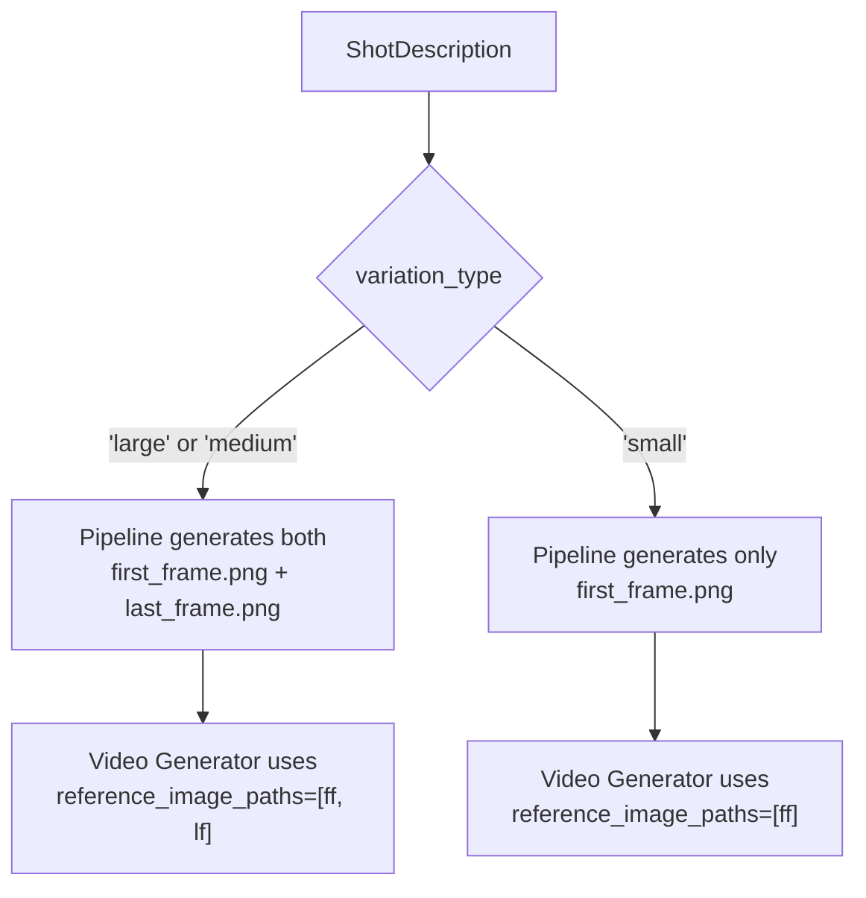
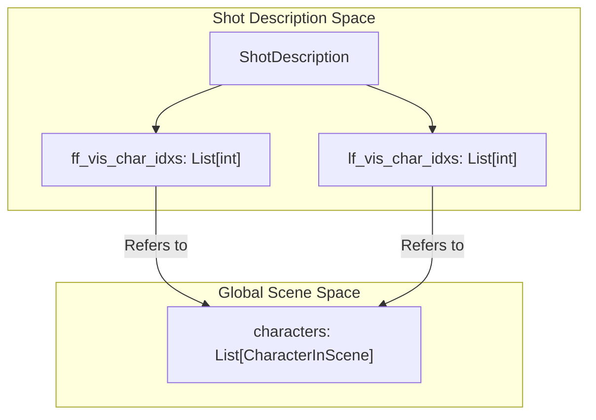

<!-- source: DeepWiki mcp.deepwiki.com · repo HKUDS/ViMax · page 6.1 Shot Descriptions · fetched 2026-11-09 -->

# Shot Descriptions

<details>
<summary>Relevant source files</summary>

The following files were used as context for generating this wiki page:

- [agent_runtime/context_compactor.py](agent_runtime/context_compactor.py)
- [interfaces/shot_description.py](interfaces/shot_description.py)
- [tests/test_crash_regressions.py](tests/test_crash_regressions.py)

</details>


## Purpose and Scope

This page documents the shot description data models used throughout the ViMax video generation pipeline. Shot descriptions are structured representations of individual video shots that specify visual content, camera positioning, character presence, motion, and audio. These models serve as the primary interface between the visual planning stages and the asset generation stages.

For information about character data models used within shots, see [6.2 Character Models](). For scene-level structures that contain multiple shots, see [6.3 Camera and Event Models](). For camera positioning and video output formats, see [6.4 Output Models]().

## Overview

ViMax defines two shot description models that structure video generation at different levels of detail:

| Model | Purpose | Complexity | Primary Use Case |
|-------|---------|------------|------------------|
| `ShotBriefDescription` | Compact shot representation | Low | Initial shot planning and storyboarding |
| `ShotDescription` | Detailed shot specification | High | Frame generation and video synthesis |

Both models are implemented as Pydantic `BaseModel` classes, providing validation, serialization, and clear field documentation. The models are defined in `interfaces/shot_description.py` [interfaces/shot_description.py:5-169]() and consumed throughout the pipeline.

**Key Usage Locations:**
- **Storyboard Design**: `StoryboardArtist` generates `ShotBriefDescription` instances during the planning phase.
- **Visual Decomposition**: The system converts `ShotBriefDescription` to `ShotDescription` to define frame-level details.
- **Frame Generation**: Consumes `ff_desc` (first frame) and `lf_desc` (last frame) fields.
- **Video Synthesis**: Uses `motion_desc` and `audio_desc` to guide temporal generation.
- **Camera Tree Construction**: Reads `visual_desc` and `cam_idx` to maintain spatial consistency across the sequence.

**Sources:** [interfaces/shot_description.py:5-169]()

## Model Architecture

### Class Hierarchy and Structure

```mermaid
graph TB
    subgraph "Pydantic Base"
        BaseModel["BaseModel<br/>(pydantic)"]
    end
    
    subgraph "Shot Description Models"
        ShotBriefDescription["ShotBriefDescription<br/>interfaces/shot_description.py:5"]
        ShotDescription["ShotDescription<br/>interfaces/shot_description.py:91"]
    end
    
    subgraph "Core Fields (Shared)"
        idx["idx: int<br/>Shot index in sequence"]
        is_last["is_last: bool<br/>End of sequence flag"]
        cam_idx["cam_idx: int<br/>Camera position index"]
        visual_desc["visual_desc: str<br/>Visual description"]
        audio_desc["audio_desc: str<br/>Audio description"]
    end
    
    subgraph "Brief-Only Fields"
        brief_simple["Simplified structure<br/>Single visual description"]
    end
    
    subgraph "Detailed-Only Fields"
        variation_type["variation_type: Literal<br/>large/medium/small"]
        variation_reason["variation_reason: str"]
        ff_desc["ff_desc: str<br/>First frame description"]
        ff_vis_char_idxs["ff_vis_char_idxs: List[int]<br/>Characters in first frame"]
        lf_desc["lf_desc: str<br/>Last frame description"]
        lf_vis_char_idxs["lf_vis_char_idxs: List[int]<br/>Characters in last frame"]
        motion_desc["motion_desc: str<br/>Motion between frames"]
    end
    
    BaseModel --> ShotBriefDescription
    BaseModel --> ShotDescription
    
    ShotBriefDescription --> idx
    ShotBriefDescription --> is_last
    ShotBriefDescription --> cam_idx
    ShotBriefDescription --> visual_desc
    ShotBriefDescription --> audio_desc
    ShotBriefDescription --> brief_simple
    
    ShotDescription --> idx
    ShotDescription --> is_last
    ShotDescription --> cam_idx
    ShotDescription --> visual_desc
    ShotDescription --> audio_desc
    ShotDescription --> variation_type
    ShotDescription --> variation_reason
    ShotDescription --> ff_desc
    ShotDescription --> ff_vis_char_idxs
    ShotDescription --> lf_desc
    ShotDescription --> lf_vis_char_idxs
    ShotDescription --> motion_desc
```



**Sources:** [interfaces/shot_description.py:5-169]()

## ShotBriefDescription

### Purpose

`ShotBriefDescription` provides a lightweight representation used during initial storyboard planning. It captures the essential visual and audio characteristics of a shot without the frame-level granularity required for image generation.

### Field Specification

| Field | Type | Required | Description |
|-------|------|----------|-------------|
| `idx` | `int` | Yes | Zero-indexed position in shot sequence [interfaces/shot_description.py:6-9]() |
| `is_last` | `bool` | Yes | Indicates final shot; triggers sequence termination [interfaces/shot_description.py:10-13]() |
| `cam_idx` | `int` | Yes | Camera position identifier for spatial consistency [interfaces/shot_description.py:16-19]() |
| `visual_desc` | `str` | Yes | Detailed visual description with character identifiers [interfaces/shot_description.py:20-27]() |
| `audio_desc` | `str` | Yes | Sound effects and dialogue specification [interfaces/shot_description.py:31-38]() |

**Sources:** [interfaces/shot_description.py:5-38]()

### Visual Description Format

The `visual_desc` field follows specific conventions used by both models [interfaces/shot_description.py:20-23, 104-106]():

1. **Character Identifiers**: All character names must be enclosed in angle brackets (e.g., `<Alice>`, `<Bob>`).
2. **Cinematography Details**: Includes shot type (e.g., "over-the-shoulder"), camera angle ("eye level"), and composition.
3. **Dialogue Integration**: Spoken content should be included with the character's features and the actual dialogue in quotes.

**Example Format:**
> "An over-the-shoulder shot at eye level, positioned behind <Alice>. The foreground, including <Alice>'s shoulder and head, is softly blurred, directing focus onto <Bob>'s face. <Bob>'s subtle reactions—shifting from surprise to delight—are clearly visible. The supermarket background is gently blurred with cool fluorescent lighting." [interfaces/shot_description.py:25-26]()

### Audio Description Format

The `audio_desc` field supports structured strings for sound and speech [interfaces/shot_description.py:31-38]():

- **Sound Effects**: Prefixed with `[Sound Effect]`.
- **Dialogue**: Prefixed with `[Speaker]` with format `Name (Emotion): Line`.

**Examples:**
- `[Sound Effect] Ambient sound (supermarket background noise, shopping cart wheels rolling)`
- `[Speaker] Alice (Happy): Hello, how are you?`

**Sources:** [interfaces/shot_description.py:34-35]()

## ShotDescription

### Purpose

`ShotDescription` extends the brief model with frame-level specifications required for image-to-video generation. It decomposes each shot into first frame (`ff_desc`), last frame (`lf_desc`), and motion components, enabling precise control over visual synthesis.

### Additional Fields

Beyond the shared fields from `ShotBriefDescription`, this model adds:

| Field | Type | Description |
|-------|------|-------------|
| `variation_type` | `Literal["large", "medium", "small"]` | Degree of content change between frames [interfaces/shot_description.py:111-114]() |
| `variation_reason` | `str` | Justification for variation classification [interfaces/shot_description.py:115-123]() |
| `ff_desc` | `str` | First frame visual specification [interfaces/shot_description.py:125-138]() |
| `ff_vis_char_idxs` | `List[int]` | Character indices visible in first frame [interfaces/shot_description.py:139-147]() |
| `lf_desc` | `str` | Last frame visual specification [interfaces/shot_description.py:148-155]() |
| `lf_vis_char_idxs` | `List[int]` | Character indices visible in last frame [interfaces/shot_description.py:156-160]() |
| `motion_desc` | `str` | Temporal changes and movement description [interfaces/shot_description.py:161-169]() |

**Sources:** [interfaces/shot_description.py:91-169]()

### Variation Type Classification

The `variation_type` determines how the video generation pipeline handles reference frames.

**Diagram: Variation Type Decision Logic**



**Variation Type Definitions [interfaces/shot_description.py:115-123]():**
- **Large**: Dramatic changes in content between the start and end of the shot (e.g., transition shots).
- **Medium**: Significant but not total changes (e.g., a new character entering the frame).
- **Small**: Minor changes (e.g., facial expressions, lip movement, or subtle camera jitter).

**Sources:** [interfaces/shot_description.py:111-123]()

## Frame-Level Specifications

### First Frame Description (`ff_desc`)

The first frame description establishes the initial visual state. It is highly detailed to provide the image generator with enough context for character and environment consistency [interfaces/shot_description.py:125-138]().

**Example Structure [interfaces/shot_description.py:128]():**
> "Medium shot of a supermarket aisle at eye level. Bob(a tall man wearing a blue shirt and jeans) is positioned on the right side of the frame... while Alice(a young woman with short hair, wearing a green dress) is on the left... Shelves line both sides... cool-toned fluorescent lighting..."

### Motion Description (`motion_desc`)

The motion description bridges first and last frames, specifying temporal changes such as camera movements (pan, tilt, zoom), character actions, and object movements [interfaces/shot_description.py:161-169]().

**Dialogue in Motion:**
Dialogue is also embedded here to ensure the video generator synchronizes lip movements or gestures with the spoken lines [interfaces/shot_description.py:164-167]().

**Sources:** [interfaces/shot_description.py:125-169]()

## Character Visibility Tracking

**Diagram: Character Index Resolution**



The `ff_vis_char_idxs` and `lf_vis_char_idxs` fields maintain indices into the global character list [interfaces/shot_description.py:139-160](). This allows the pipeline to:
- Select appropriate reference portraits for image generation.
- Ensure consistency of specific characters across different shots.

**Sources:** [interfaces/shot_description.py:139-160]()

## Implementation Details

### Stringification

The `ShotBriefDescription` class implements a `__str__` method to provide a human-readable (and LLM-readable) summary of the shot, which is often used in logs or as context in subsequent agent prompts [interfaces/shot_description.py:82-88]().

```python
def __str__(self):
    s = f"Shot {self.idx}:\n"
    s += f"Camera Index: {self.cam_idx}\n"
    s += f"Visual: {self.visual_desc}\n"
    if self.audio_desc:
        s += f"Audio: {self.audio_desc}"
    return s
```

### Context Compaction

Shot descriptions are critical pieces of context. The `ContextCompactor` in the agent runtime ensures that when conversation history becomes too long, these descriptions are preserved or summarized to maintain the agent's understanding of the planned video [agent_runtime/context_compactor.py:35-52]().

**Sources:** [interfaces/shot_description.py:82-88](), [agent_runtime/context_compactor.py:35-52](), [tests/test_crash_regressions.py:21-35]()

---

