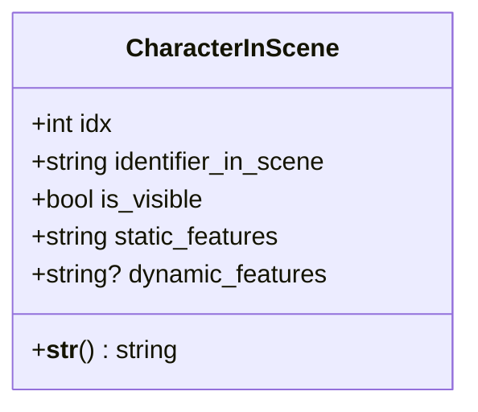
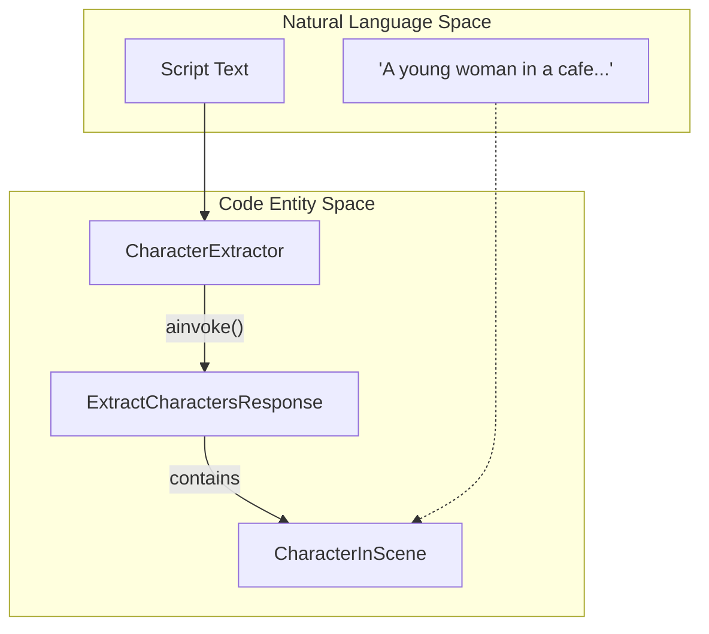
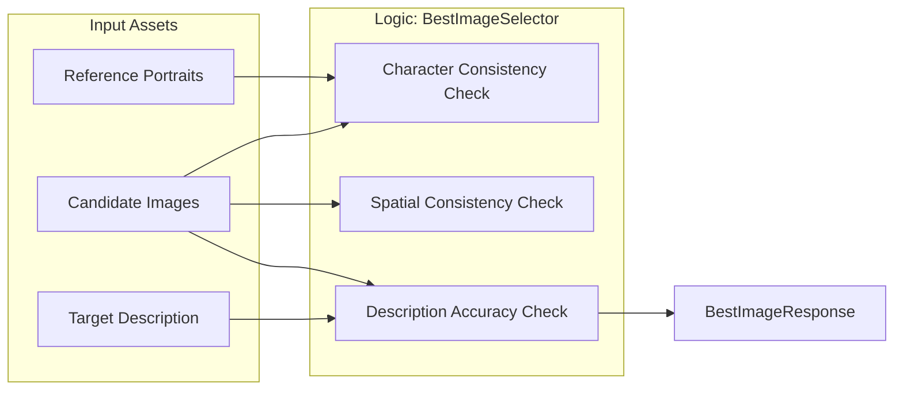

<!-- source: DeepWiki mcp.deepwiki.com · repo HKUDS/ViMax · page 6.2 Character Models · fetched 2026-11-09 -->

# Character Models

<details>
<summary>Relevant source files</summary>

The following files were used as context for generating this wiki page:

- [agents/best_image_selector.py](agents/best_image_selector.py)
- [agents/character_extractor.py](agents/character_extractor.py)
- [agents/script_enhancer.py](agents/script_enhancer.py)
- [interfaces/character.py](interfaces/character.py)

</details>


This document describes the Pydantic models and data structures used to represent characters in the ViMax video generation system. Character models enable consistent character tracking across scenes, portrait generation, and visual consistency checking via vision-language models.

---

## Overview

Character representation in ViMax follows a hierarchical structure that mirrors the narrative decomposition of the system (Novel -> Event -> Scene). Character features are categorized into **static features** (unchanging physical traits) and **dynamic features** (scene-specific attributes like clothing).

**Sources**: [interfaces/character.py:1-102](), [agents/character_extractor.py:1-91]()

---

## Data Models

### Character Representation Levels

ViMax defines three levels of character representation to maintain identity across different narrative granularities.

| Model | Narrative Level | Purpose |
|-------|-----------------|---------|
| `CharacterInNovel` | Novel / Long Story | Tracks character presence across multiple major events. |
| `CharacterInEvent` | Event / Chapter | Tracks character presence across multiple scenes within an event. |
| `CharacterInScene` | Scene / Script | Detailed visual description for frame generation and storyboard design. |

**Sources**: [interfaces/character.py:8-102]()

### CharacterInScene Model

The `CharacterInScene` model is the primary data structure used during the script-to-video pipeline. It contains the visual DNA required by image generators.


**Diagram: CharacterInScene Model Structure**

*   **`static_features`**: Describes physical appearance, physique, and relatively unchanging features (e.g., "long blonde hair", "slender build") [interfaces/character.py:20-26]().
*   **`dynamic_features`**: Describes attire, accessories, and key items (e.g., "red scarf", "black leather jacket") [interfaces/character.py:27-33]().

**Sources**: [interfaces/character.py:8-46]()

---

## Character Extraction and Enhancement

### CharacterExtractor Agent

The `CharacterExtractor` uses an LLM to analyze script text and populate a list of `CharacterInScene` objects. It is tasked with identifying real famous people (e.g., Elon Musk) and designing plausible visual features if the script is sparse.


**Diagram: Extraction Data Flow**

**Sources**: [agents/character_extractor.py:16-91]()

### Script Enhancement for Character Detail

The `ScriptEnhancer` agent polishes the narrative to ensure character consistency. It specifically enforces the repetition of core character descriptions (e.g., age, accent, role) in dialogue blocks to remove ambiguity for downstream visual agents.

**Sources**: [agents/script_enhancer.py:10-56]()

---

## Visual Consistency and Selection

### Character Portraits Registry

The system maintains a registry of generated portraits (Front, Side, Back) for each character. These are used as reference images to ensure the character looks the same across different camera angles.

| View | Generation Source | Role |
|------|-------------------|------|
| **Front** | `static_features` + `dynamic_features` | Primary identity reference. |
| **Side** | Front Image + `static_features` | Profile reference for spatial consistency. |
| **Back** | Front Image + `static_features` | Rear reference for over-the-shoulder shots. |

### BestImageSelector Agent

To maintain high quality, the `BestImageSelector` acts as a visual assessment expert. It compares multiple candidate images against reference portraits using a Vision-Language Model (VLM).


**Diagram: Visual Consistency Validation**

The `BestImageSelector` evaluates:
1.  **Character Consistency**: Alignment of gender, ethnicity, age, facial features, and hairstyle [agents/best_image_selector.py:20]().
2.  **Spatial Consistency**: Relative positions of characters and perspective [agents/best_image_selector.py:21]().
3.  **Description Accuracy**: Adherence to the shot's specific actions and scene elements [agents/best_image_selector.py:22]().

**Sources**: [agents/best_image_selector.py:13-61](), [agents/best_image_selector.py:82-148]()

---

## Implementation Details

### Serialization

Character models are serialized to JSON using Pydantic's `model_dump` and `model_validate` patterns to allow the pipeline to resume from checkpoints.

```python
# Example of character list response model
class ExtractCharactersResponse(BaseModel):
    characters: List[CharacterInScene] = Field(
        ..., description="A list of characters extracted from the script."
    )
```

**Sources**: [agents/character_extractor.py:58-63](), [interfaces/character.py:1-102]()

### Feature Separation Logic

The system strictly separates physical traits from personality to improve image generation prompt engineering:
*   **Static**: "Large eyes, high nose bridge" [agents/character_extractor.py:47]().
*   **Dynamic**: "Specific clothing colors" [agents/character_extractor.py:47]().
*   **Excluded**: Personality, roles, or relationships are stripped from visual features to avoid confusing the image generator [agents/character_extractor.py:45]().

**Sources**: [agents/character_extractor.py:38-48]()

---

