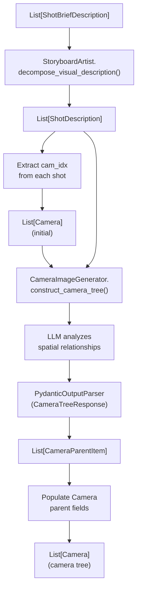
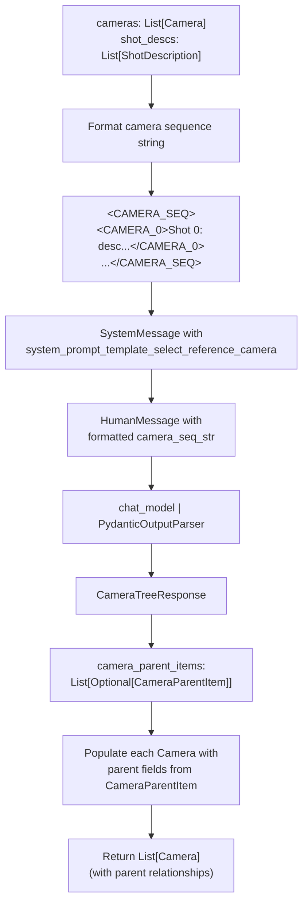
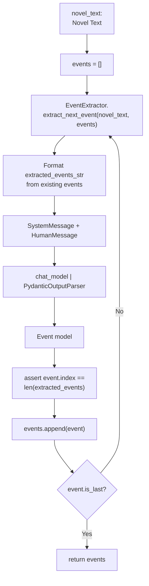

<!-- source: DeepWiki mcp.deepwiki.com · repo HKUDS/ViMax · page 6.3 Camera and Event Models · fetched 2026-11-09 -->

# Camera and Event Models

<details>
<summary>Relevant source files</summary>

The following files were used as context for generating this wiki page:

- [agents/camera_image_generator.py](agents/camera_image_generator.py)
- [agents/character_portraits_generator.py](agents/character_portraits_generator.py)
- [agents/event_extractor.py](agents/event_extractor.py)
- [utils/video.py](utils/video.py)

</details>


This page documents the `Camera`, `CameraParentItem`, and `Event` data structures, which are fundamental models for spatial positioning and narrative segmentation in ViMax. The `Camera` model enables the multi-camera filming simulation that maintains visual consistency across shots, while the `Event` model structures long-form narrative content.

**Scope**: This page covers the `Camera` model and its hierarchical tree structure used in multi-camera filming simulation, the `CameraParentItem` model used during camera tree construction, and the `Event` model for novel narrative segmentation. For shot-level descriptions, see page 6.1. For character models, see page 6.2. For output models, see page 6.4.

---

## Overview

ViMax uses two distinct hierarchical models for different purposes:

**Camera Tree Architecture**: The `Camera` model organizes shots into a parent-child hierarchy based on spatial relationships. Parent cameras have wider field-of-view shots that contain child camera shots. This enables smooth transitions and consistent backgrounds.

**Event Segmentation**: The `Event` model represents complete causal chains within narrative text, enabling structured extraction from novels.

**Camera Tree Data Flow**



Sources: `agents/camera_image_generator.py:122-150`

---

## Camera Model

### Purpose and Structure

The `Camera` model represents a virtual camera position that films multiple shots from the same spatial vantage point. Shots filmed by the same camera maintain consistent background and perspective, which is critical for visual continuity in multi-shot sequences.

**Camera Model Fields**

| Field | Type | Description |
|-------|------|-------------|
| `idx` | `int` | Unique camera identifier |
| `active_shot_idxs` | `List[int]` | Indices of shots filmed by this camera |
| `parent_cam_idx` | `Optional[int]` | Index of parent camera in the tree (None for root) |
| `parent_shot_idx` | `Optional[int]` | Specific shot index in parent camera that contains this camera's view |
| `reason` | `Optional[str]` | Explanation for parent-child relationship |
| `is_parent_fully_covers_child` | `Optional[bool]` | Whether parent shot contains all elements of child shot |
| `missing_info` | `Optional[str]` | Elements present in child but not fully captured in parent |

**Note**: The `Camera` model is defined in the `interfaces` module and imported in `agents/camera_image_generator.py:13`. Parent relationship fields are populated during tree construction in `agents/camera_image_generator.py:143-149`.

### Camera Initialization

Cameras are initially created by grouping shots with the same `cam_idx` value from `ShotDescription` objects. At initialization, only `idx` and `active_shot_idxs` fields are populated. The parent relationship fields (`parent_cam_idx`, `parent_shot_idx`, `reason`, `is_parent_fully_covers_child`, `missing_info`) remain `None` until the camera tree construction phase.

**Initialization Pattern**:
```python
# Pseudo-code representing logic in script2video_pipeline
for each shot_description in shot_descriptions:
    if shot_description.cam_idx is new:
        create Camera(idx=cam_idx, active_shot_idxs=[shot_idx])
    else:
        append shot_idx to existing Camera.active_shot_idxs
```

This grouping ensures that shots filmed from the same spatial position share a single `Camera` instance, which is essential for maintaining consistent backgrounds and perspectives.

---

## CameraParentItem Model

### Purpose and Structure

The `CameraParentItem` model is an intermediate data structure returned by the LLM during camera tree construction. It describes the parent-child relationship for a single camera.

**CameraParentItem Fields**

| Field | Type | Description |
|-------|------|-------------|
| `parent_cam_idx` | `Optional[int]` | Index of parent camera (None if root) |
| `parent_shot_idx` | `Optional[int]` | Index of the parent's shot that contains this camera |
| `reason` | `str` | Justification for the parent selection |
| `is_parent_fully_covers_child` | `Optional[bool]` | Whether parent fully encompasses child's content |
| `missing_info` | `Optional[str]` | Elements in child not covered by parent |

**Example Values**:
```python
CameraParentItem(
    parent_cam_idx=0,
    parent_shot_idx=2,
    reason="The parent shot's field of view covers the child shot's field of view (from medium shot to close-up)",
    is_parent_fully_covers_child=True,
    missing_info=None
)
```

Sources: `agents/camera_image_generator.py:69-100`

### CameraTreeResponse Wrapper

The LLM returns a `CameraTreeResponse` object containing a list of `CameraParentItem` objects, one for each camera:

```python
class CameraTreeResponse(BaseModel):
    camera_parent_items: List[Optional[CameraParentItem]] = Field(
        description="The parent camera items for each camera. If a camera has no parent, set this to None. The length of the list should be the same as the number of cameras.",
    )
```

The list length must match the number of cameras being analyzed.

Sources: `agents/camera_image_generator.py:102-106`

---

## Camera Tree Construction

### Construction Process

The `CameraImageGenerator.construct_camera_tree()` method builds the hierarchical camera structure:

**Camera Tree Construction Flow**



Sources: `agents/camera_image_generator.py:122-150`

### Prompt Structure

The construction prompt presents all cameras and their shots in a structured format:

```
<CAMERA_SEQ>
<CAMERA_0>
Shot 0: Medium shot of the street. Alice and Bob are walking towards each other.
Shot 2: Medium shot of the street. Alice and Bob hug each other.
</CAMERA_0>
<CAMERA_1>
Shot 1: Close-up of Alice's face. Her expression shifts from surprise to delight.
</CAMERA_1>
</CAMERA_SEQ>
```

The LLM analyzes shot sizes, content overlap, and spatial relationships to determine parent-child connections.

Sources: `agents/camera_image_generator.py:20-66`, `agents/camera_image_generator.py:130-136`

### Tree Construction Guidelines

The system prompt enforces several constraints on tree construction:

| Constraint | Description |
|------------|-------------|
| **Content Inclusion** | Parent camera must contain child camera's content in certain shots |
| **Transition Smoothness** | Prefer similar shot sizes (Wide→Medium or Medium→Close-up) |
| **Temporal Proximity** | Parent shot index should be close to child's first shot index |
| **Acyclic Structure** | No circular dependencies allowed |
| **Single Root** | Only one camera can exist without a parent |
| **First Camera is Root** | Camera 0 must be the root of the tree |

Sources: `agents/camera_image_generator.py:49-58`

### Field Population Logic

After LLM response, parent fields are copied from `CameraParentItem` to `Camera`:

```python
# logic within agents/camera_image_generator.py:143-149
for cam, parent_cam_item in zip(cameras, response.camera_parent_items):
    cam.parent_cam_idx = parent_cam_item.parent_cam_idx if parent_cam_item is not None else None
    cam.parent_shot_idx = parent_cam_item.parent_shot_idx if parent_cam_item is not None else None
    cam.reason = parent_cam_item.reason if parent_cam_item is not None else None
    cam.is_parent_fully_covers_child = parent_cam_item.is_parent_fully_covers_child if parent_cam_item is not None else None
    cam.missing_info = parent_cam_item.missing_info if parent_cam_item is not None else None
```

Sources: `agents/camera_image_generator.py:143-149`

---

## Event Model

### Purpose and Structure

The `Event` model represents a complete causal chain within a narrative. Events are extracted sequentially from novel text and serve as the bridge between prose and screenplay format.

**Event Model Fields**

| Field | Type | Description |
|-------|------|-------------|
| `index` | `int` | Sequential event number within the novel |
| `description` | `str` | High-level summary of the event |
| `process_chain` | `List[str]` | Step-by-step progression of the event |
| `timeframe` | `str` | When the event occurs |
| `characters` | `List[str]` | Characters involved in the event |
| `cause` | `str` | What triggers the event |
| `outcome` | `str` | Result of the event |
| `is_last` | `bool` | Whether this is the final event in the novel |

**Note**: The `Event` model is defined in the `interfaces` module and imported in `agents/event_extractor.py:12`.

### Event Extraction Process

The `EventExtractor` agent iteratively extracts events using a stateful approach:

**Event Extraction Flow**



Sources: `agents/event_extractor.py:100-153`

**Key Implementation Details**:
- System prompt: `system_prompt_template_extract_events` `agents/event_extractor.py:14-65`
- Human prompt: `human_prompt_template_extract_next_event` `agents/event_extractor.py:67-76`
- Retry decorator with 3 attempts `agents/event_extractor.py:123-126`
- Index validation ensures sequential extraction `agents/event_extractor.py:151`

### Process Chain Field

The `process_chain` field contains a detailed step-by-step account of the event's progression. This field is critical for maintaining narrative continuity when converting to scenes. Example structure:

```
Process Chain:
- A thief steals a gem from a museum, triggering the alarm
- Guards notice and begin the chase
- The thief rushes through narrow alleys with guards pursuing
- The chase concludes on a rooftop where the thief is captured
```

Sources: `agents/event_extractor.py:35-43`

### Event Context Management

Each extraction iteration receives all previously extracted events as context to maintain narrative coherence:

```python
extracted_events_str = "\n\n".join([str(e) for e in extracted_events])
```

Sources: `agents/event_extractor.py:133`

---

## Character Portraits and Visual References

While the camera tree maintains spatial consistency, character consistency is supported by `CharacterPortraitsGenerator`. This agent generates multi-view portraits (front, side, back) that serve as visual references for the image generation tools.

**Portrait Generation Prompt Templates**

| View | Template Purpose |
|------|------------------|
| **Front** | Generates full-body, front-view with white background and wide 16:9 aspect ratio. |
| **Side** | Generates side-view using the front-view as a reference image. |
| **Back** | Generates back-view using the front-view as a reference image, ensuring no facial features. |

Sources: `agents/character_portraits_generator.py:15-31`

---

## Summary

The `Camera` and `Event` models form the backbone of ViMax's narrative and spatial processing:

- **Events** represent high-level narrative segments extracted sequentially from novels via `EventExtractor`.
- **Cameras** represent spatial vantage points organized into a tree via `CameraImageGenerator.construct_camera_tree()`.
- **CameraParentItem** facilitates the mapping of spatial dependencies (e.g., Wide Shot as parent of Medium Shot).
- **Consistency** is maintained by using parent frames as anchors for child shots and character portraits as visual references.

These models enable the seamless transformation from prose narratives to structured video generation inputs while maintaining character consistency and narrative coherence.

---

