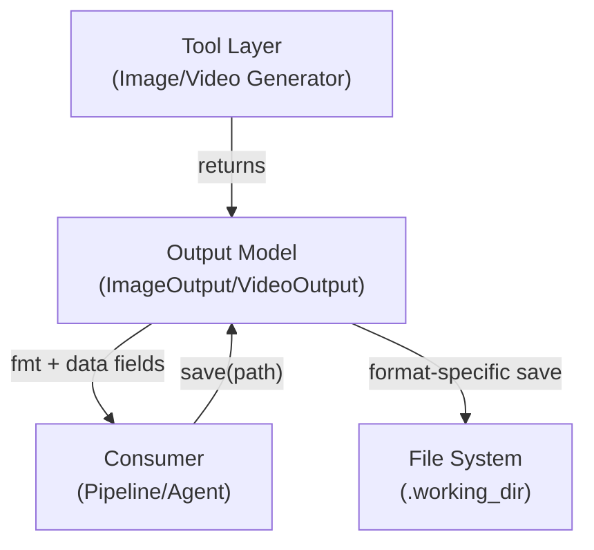
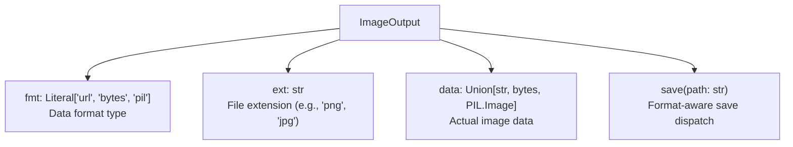
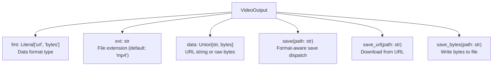
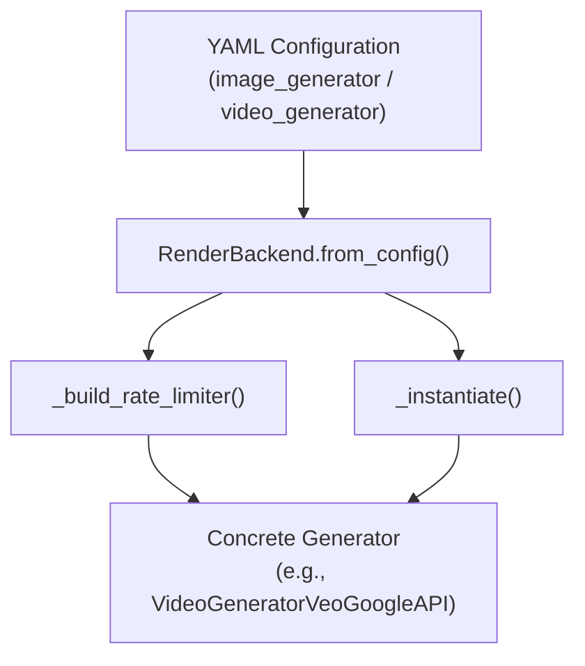
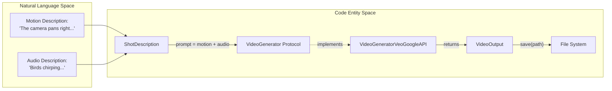

<!-- source: DeepWiki mcp.deepwiki.com · repo HKUDS/ViMax · page 6.4 Output Models · fetched 2026-11-09 -->

# Output Models

Relevant source files

The following files were used as context for generating this wiki page:

- [tests/test_generator_protocol.py](tests/test_generator_protocol.py)
- [tools/protocols.py](tools/protocols.py)
- [tools/render_backend.py](tools/render_backend.py)
- [tools/video_generator_doubao_seedance_yunwu_api.py](tools/video_generator_doubao_seedance_yunwu_api.py)
- [tools/video_generator_veo_google_api.py](tools/video_generator_veo_google_api.py)

## Purpose and Scope

This page documents the output data structures used throughout ViMax to represent generated visual artifacts. The `ImageOutput` and `VideoOutput` classes provide unified interfaces for handling image and video data in multiple formats (URLs, raw bytes, or PIL objects), enabling consistent data flow between generators, pipelines, and storage systems.

ViMax also defines structural typing contracts (Protocols) for rendering backends, ensuring that any new image or video generation service can be integrated into the pipeline as long as it adheres to the expected method signatures.

---

## Overview of Output Models

ViMax uses two primary output classes to encapsulate generated visual content:

| Output Class | Purpose | Supported Formats | Primary Generators |
|--------------|---------|-------------------|-------------------|
| `ImageOutput` | Encapsulates generated images | `"url"`, `"bytes"`, `"pil"` | `ImageGeneratorNanobananaGoogleAPI` |
| `VideoOutput` | Encapsulates generated videos | `"url"`, `"bytes"` | `VideoGeneratorVeoGoogleAPI`, `VideoGeneratorDoubaoSeedanceYunwuAPI` |

### Design Pattern: Format Abstraction

Both output classes follow a common pattern to abstract away the underlying data representation:

**Key Benefits:**
- Generators can return data in their native format without conversion.
- Consumers work with a uniform interface regardless of data source.
- Save operations are automatically dispatched to the correct implementation.

**Sources:** [interfaces/video_output.py:8-43](), [tools/video_generator_veo_google_api.py:124-129]()

---

## Tool Protocols

ViMax utilizes `typing.Protocol` to define duck-typed interfaces for rendering backends. This allows the system to remain agnostic of the specific API or model being used for generation.

### ImageGenerator Protocol
The `ImageGenerator` protocol requires a `generate_single_image` method. [tools/protocols.py:15-23]()

### VideoGenerator Protocol
The `VideoGenerator` protocol requires a `generate_single_video` method. [tools/protocols.py:27-35]()

Crucially, all video generators must accept arbitrary `**kwargs` in their `generate_single_video` method. This is because pipelines often pass metadata (like `progress=` callbacks) that specific generator backends might not need but must not crash on. [tests/test_generator_protocol.py:1-3](), [tests/test_generator_protocol.py:24-33]()

---

## ImageOutput Model

The `ImageOutput` class encapsulates generated image data and provides format-agnostic save operations.

### ImageOutput Structure

### Supported Formats

| Format | Data Type | Source | Save Behavior |
|--------|-----------|--------|---------------|
| `"pil"` | `PIL.Image.Image` | In-memory image processing, frame extraction | Direct `Image.save(path)` |
| `"bytes"` | `bytes` | Raw image data from API | Write bytes to file |
| `"url"` | `str` | Remote image URL | HTTP download to file |

---

## VideoOutput Model

The `VideoOutput` class provides a unified interface for handling video data in different formats (URL or raw bytes). [interfaces/video_output.py:8-13]()

### VideoOutput Structure

**Sources:** [interfaces/video_output.py:8-43]()

### Save Operations

The `VideoOutput.save()` method uses dynamic dispatch to select the appropriate save implementation: [interfaces/video_output.py:23-25]()

- **save_url()**: Uses `download_video()` utility to fetch remote videos with retry logic. [interfaces/video_output.py:27-36]()
- **save_bytes()**: Performs direct binary file write. [interfaces/video_output.py:38-42]()

---

## Concrete Video Generator Implementations

ViMax provides several backends that implement the `VideoGenerator` protocol.

### VideoGeneratorVeoGoogleAPI
This generator uses the Google Gemini/Veo API. It handles:
- **Text-to-Video (t2v)**: When 0 reference images are provided. [tools/video_generator_veo_google_api.py:50-51]()
- **First-Frame-to-Video (ff2v)**: When 1 reference image is provided. [tools/video_generator_veo_google_api.py:52-54]()
- **Polling Logic**: Since video generation is asynchronous, it polls the operation status until completion. [tools/video_generator_veo_google_api.py:100-104]()

### VideoGeneratorDoubaoSeedanceYunwuAPI
This generator uses the Doubao/Seedance API via the Yunwu provider. It supports:
- **First-and-Last-Frame-to-Video (flf2v)**: When 2 reference images are provided, it maps them to `first_frame` and `last_frame` roles in the API payload. [tools/video_generator_doubao_seedance_yunwu_api.py:68-87]()
- **Task Management**: It first creates a generation task [tools/video_generator_doubao_seedance_yunwu_api.py:29-128]() and then queries it for the result URL. [tools/video_generator_doubao_seedance_yunwu_api.py:132-184]()

---

## RenderBackend Factory

The `RenderBackend` class acts as a factory that instantiates concrete generator classes based on the system configuration. [tools/render_backend.py:23-27]()

**Sources:** [tools/render_backend.py:30-45](), [tools/render_backend.py:56-62]()

### Integration with Rate Limiters
The `RenderBackend` automatically wires up `RateLimiter` instances to the generators if `max_requests_per_minute` or `max_requests_per_day` are defined in the configuration. [tools/render_backend.py:48-53]()

---

## Data Flow: Natural Language to Code Entities

The following diagram maps the conceptual process of generating a video shot to the specific code entities involved in handling the output.

**Sources:** [tools/protocols.py:27-35](), [tools/video_generator_veo_google_api.py:32-40](), [interfaces/video_output.py:23-25]()

---

