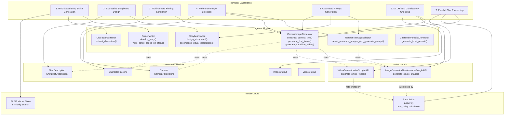

<!-- source: DeepWiki mcp.deepwiki.com · repo HKUDS/ViMax · page 7 Technical Capabilities · fetched 2026-11-09 -->

# Technical Capabilities

Relevant source files

The following files were used as context for generating this wiki page:

- [README_ZH.md](README_ZH.md)
- [agents/camera_image_generator.py](agents/camera_image_generator.py)
- [assets/vimax.png](assets/vimax.png)
- [readme.md](readme.md)
- [utils/video.py](utils/video.py)

This page provides an overview of the seven core technical capabilities that enable ViMax to generate long-form, consistent video content from narrative inputs. These capabilities address the fundamental challenges of AI-based video generation: maintaining consistency across long sequences, handling complex narratives, and automating professional production workflows.

For information about the overall system architecture and how these capabilities fit into the pipeline stages, see [System Architecture](#3). For implementation details of specific agents that provide these capabilities, see [Agents](#5).

---

## Overview of Core Capabilities

ViMax implements seven interconnected technical capabilities that work together to transform narrative content into video:

| Capability | Primary Function | Key Benefit |
|------------|-----------------|-------------|
| **RAG-based Long Script Generation** | Process novel-length content with scene segmentation | Handles unlimited script length while retaining plot details |
| **Expressive Storyboard Design** | Generate shot-level visual plans using cinematography language | Translates narrative into professional visual sequences |
| **Multi-camera Filming Simulation** | Maintain spatial consistency across camera angles | Creates immersive viewing experience with coherent scene geometry |
| **Intelligent Reference Image Selection** | Choose optimal reference frames from timeline history | Ensures character/environment consistency in long videos |
| **Automated Prompt Generation** | Generate image prompts with spatial reasoning | Arranges character-environment interactions accurately |
| **Consistency Checking with MLLM/VLM** | Validate generated frames against expectations | Filters out inconsistent outputs before video generation |
| **Parallel Shot Processing** | Batch-process shots from same camera position | Maximizes throughput for sequential shots |

---

## Capability Integration Flow

The following diagram illustrates how these seven technical capabilities integrate throughout the video generation pipeline:

**Technical Capabilities Integration in Pipeline Stages**

```mermaid
graph TD
    subgraph Input["Input Processing"]
        I1["Raw Ideas/Novels/Scripts"]
    end
    
    subgraph Cap1["1. RAG-based Long Script Generation"]
        C1A["EventExtractor<br/>with RAG retrieval"]
        C1B["SceneExtractor<br/>with context chunking"]
    end
    
    subgraph Cap2["2. Expressive Storyboard Design"]
        C2A["StoryboardArtist<br/>shot decomposition"]
        C2B["Cinematography rules<br/>shot templates"]
    end
    
    subgraph Cap3["3. Multi-camera Filming"]
        C3A["Camera hierarchy<br/>construction"]
        C3B["Spatial coherence<br/>validation"]
    end
    
    subgraph Cap4["4. Reference Image Selection"]
        C4A["Timeline analysis"]
        C4B["Best frame<br/>retrieval"]
    end
    
    subgraph Cap5["5. Automated Prompt Generation"]
        C5A["Spatial layout<br/>reasoning"]
        C5B["Prompt synthesis"]
    end
    
    subgraph Cap6["6. Consistency Checking"]
        C6A["Parallel image<br/>generation"]
        C6B["MLLM/VLM<br/>validation"]
    end
    
    subgraph Cap7["7. Parallel Processing"]
        C7A["Same-camera<br/>shot batching"]
        C7B["Concurrent video<br/>generation"]
    end
    
    subgraph Output["Video Output"]
        O1["Final concatenated<br/>video"]
    end
    
    I1 --> C1A
    C1A --> C1B
    C1B --> C2A
    C2A --> C2B
    C2B --> C3A
    C3A --> C3B
    C3B --> C4A
    C4A --> C4B
    C4B --> C5A
    C5A --> C5B
    C5B --> C6A
    C6A --> C6B
    C6B --> C7A
    C7A --> C7B
    C7B --> O1
```

Sources: [readme.md:74-86](), [readme.md:35-41]()

---

## Code Entity Mapping

The following diagram maps each technical capability to the specific code entities (agents, tools, and data structures) that implement it:

**Technical Capabilities to Code Implementation Mapping**

Sources: [agents/camera_image_generator.py:109-135](), [interfaces.py:1-200](), [utils/rate_limiter.py:6-30]()

---

## Detailed Capability Descriptions

### 7.1. RAG-based Long Script Generation

This capability enables ViMax to process novel-length narratives by using Retrieval-Augmented Generation (RAG) to maintain context across scene boundaries. The system segments long stories into discrete scenes while preserving plot continuity and character development.

**Key Implementation**: 
- **Event Extraction**: Uses FAISS and embeddings to manage long-form context during event and scene extraction.
- **Character Tracking**: The `CharacterExtractor` identifies and tracks character attributes across the narrative to ensure consistent descriptions.

For detailed information, see [RAG-based Long Script Generation](#7.1).

Sources: [readme.md:80-80](), [readme.md:59-59]()

---

### 7.2. Expressive Storyboard Design

The system translates narrative descriptions into cinematographic shot sequences using professional film language. This includes shot types (wide, medium, close-up), camera movements (pan, tilt, dolly), and narrative pacing rules.

**Key Implementation**: 
- The `StoryboardArtist` agent decomposes a scene script into a sequence of `ShotBriefDescription` objects [interfaces.py:13-13]().
- These are expanded into detailed `ShotDescription` objects containing first/last frame visual descriptions (`ff_desc`, `lf_desc`), motion descriptions, and audio descriptions.

For detailed information, see [Expressive Storyboard Design](#7.2).

Sources: [agents/camera_image_generator.py:20-58](), [interfaces.py:13-13]()

---

### 7.3. Multi-camera Filming Simulation

ViMax simulates a multi-camera production environment where multiple camera positions capture the same scene from different angles. This maintains spatial consistency—characters and objects remain in correct relative positions as the camera angle changes.

**Key Implementation**: 
- `CameraImageGenerator.construct_camera_tree()` [agents/camera_image_generator.py:122-126]() analyzes shot descriptions to build a hierarchical `Camera` tree.
- `CameraParentItem` [agents/camera_image_generator.py:69-101]() defines the relationship where a parent camera's field of view covers the child's, enabling spatial logic like "Wide Shot -> Medium Shot".
- Logical consistency is enforced to avoid circular dependencies and ensure the first camera is the root [agents/camera_image_generator.py:53-57]().

For detailed information, see [Multi-camera Filming Simulation](#7.3).

Sources: [agents/camera_image_generator.py:20-106]()

---

### 7.4. Intelligent Reference Image Selection

Maintaining character appearance and environmental consistency across long videos is achieved by automatically selecting the most appropriate reference images from previously generated frames.

**Key Implementation**: 
- The system analyzes character portraits and previously generated frames from the timeline.
- It identifies "missing information" when transitioning between camera views [agents/camera_image_generator.py:93-100]() to prompt the generator for specific details not present in the parent shot.

For detailed information, see [Intelligent Reference Image Selection](#7.4).

Sources: [agents/camera_image_generator.py:88-100](), [readme.md:84-84]()

---

### 7.5. Automated Image Generation and Prompting

The system automatically generates detailed prompts by reasoning about spatial relationships between characters and environmental elements.

**Key Implementation**: 
- Prompt engineering incorporates cinematic instructions like shot size and content inclusion relationships [agents/camera_image_generator.py:23-26]().
- The `ImageGenerator` implementations (e.g., Nanobanana Google/Yunwu) handle the low-level API calls to generate `ImageOutput` assets.

For detailed information, see [Automated Image Generation and Prompting](#7.5).

Sources: [agents/camera_image_generator.py:20-58](), [interfaces.py:13-13]()

---

### 7.6. Consistency Checking with MLLM/VLM

To address the stochastic nature of generation models, ViMax uses Multimodal Large Language Models (MLLM) to validate that generated frames match the intended storyboard and maintain consistency.

**Key Implementation**: 
- An AI-powered quality gate performs visual inspection of generated assets.
- If a frame fails consistency checks (e.g., character appearance changes significantly), the system can trigger retries or select alternative variants.

For detailed information, see [Consistency Checking with MLLM/VLM](#7.6).

Sources: [readme.md:69-86](), [README_ZH.md:146-162]()

---

### 7.7. High-efficiency Parallel Processing

ViMax uses an `asyncio`-based execution model to generate compatible shots and media assets concurrently, significantly accelerating production.

**Key Implementation**: 
- **Rate Limiting**: A `RateLimiter` manages API quota constraints across parallel tasks to prevent service exhaustion.
- **Batching**: Shots from the same camera position or independent scenes are processed in parallel batches.
- **Media Processing**: `utils.video.concatenate_video_files` [utils/video.py:26-44]() efficiently handles the final assembly of parallel-generated clips using `moviepy`.

For detailed information, see [High-efficiency Parallel Processing](#7.7).

Sources: [utils/video.py:26-44](), [readme.md:85-85]()

---

## Summary

These seven technical capabilities form an integrated system that addresses the core challenges of AI-based long-form video generation. Each capability builds upon the previous ones, creating a pipeline that transforms unstructured narrative input into professional-quality video output while maintaining temporal and visual consistency.

The subsequent pages in this section ([RAG-based Long Script Generation](#7.1) through [High-efficiency Parallel Processing](#7.7)) provide detailed technical documentation for each capability.

---

