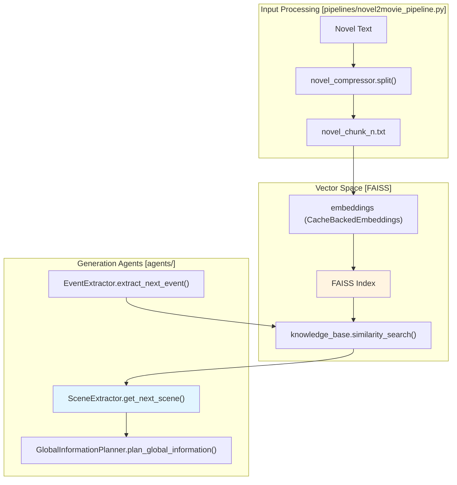
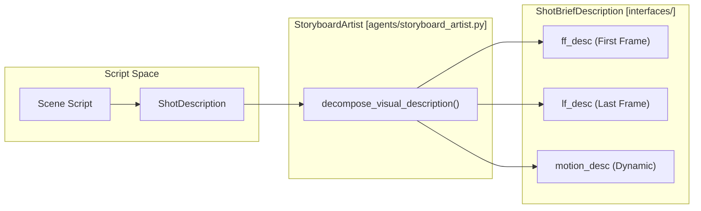

<!-- source: DeepWiki mcp.deepwiki.com · repo HKUDS/ViMax · page 7.1 RAG-based Long Script Generation · fetched 2026-11-09 -->

# RAG-based Long Script Generation

<details>
<summary>Relevant source files</summary>

The following files were used as context for generating this wiki page:

- [agents/storyboard_artist.py](agents/storyboard_artist.py)
- [pipelines/novel2movie_pipeline.py](pipelines/novel2movie_pipeline.py)
- [pyproject.toml](pyproject.toml)
- [tests/test_novel2movie_pipeline_init.py](tests/test_novel2movie_pipeline_init.py)
- [tests/test_wrong_output_guards.py](tests/test_wrong_output_guards.py)
- [utils/text.py](utils/text.py)
- [uv.lock](uv.lock)
- [vimax](vimax)

</details>


## Overview

The RAG-based Long Script Generation system enables ViMax to process novel-length narratives and transform them into structured multi-scene scripts while preserving plot continuity and character consistency. This capability is critical for the Novel2Video feature, allowing the system to handle content that far exceeds typical LLM context windows.

The system addresses three core challenges in long-form script generation:
1. **Context Window Limitations**: Processing narratives that exceed LLM token limits using chunking and retrieval.
2. **Plot Retention**: Maintaining narrative coherence and key plot points across segmented processing.
3. **Scene Segmentation**: Intelligently dividing continuous narrative into discrete screenplay scenes.

This page focuses on how Retrieval-Augmented Generation (RAG) enables these capabilities, particularly through the `Novel2MoviePipeline` and the `SceneExtractor` agent.

**Sources**: [pipelines/novel2movie_pipeline.py:1-70](), [agents/storyboard_artist.py:1-53]()

---

## RAG Architecture for Long Script Processing

The system employs Retrieval-Augmented Generation to overcome LLM context limitations when processing lengthy narratives. The `Novel2MoviePipeline` orchestrates the data flow from raw text to structured script artifacts.

### RAG Data Flow and Code Entity Mapping



**Implementation Details**:
- **Text Splitting**: The pipeline uses `RecursiveCharacterTextSplitter` with a `chunk_size` of 512 and `chunk_overlap` of 128 to prepare the knowledge base [pipelines/novel2movie_pipeline.py:164-165]().
- **Vector Storage**: It utilizes `FAISS` for similarity search and `CacheBackedEmbeddings` to minimize redundant embedding API calls [pipelines/novel2movie_pipeline.py:158-166]().
- **Retrieval**: For each extracted event, the system retrieves the top 5 most relevant chunks from the novel text to provide context for scene generation [pipelines/novel2movie_pipeline.py:171-175]().

**Sources**: [pipelines/novel2movie_pipeline.py:153-175](), [pyproject.toml:10-13]()

---

## Novel2MoviePipeline: Orchestrating the Workflow

The `Novel2MoviePipeline` class is the central coordinator for the RAG-based generation process. It manages the lifecycle of novel compression, event extraction, and RAG-enhanced scene decomposition.

### Initialization and Dependencies

The pipeline is initialized with a suite of specialized agents and services:

| Dependency | Purpose |
|------------|---------|
| `novel_compressor` | Splits and summarizes long text chunks [pipelines/novel2movie_pipeline.py:95-102]() |
| `event_extractor` | Identifies discrete narrative beats from compressed text [pipelines/novel2movie_pipeline.py:144-147]() |
| `embeddings` | Generates vector representations for FAISS [pipelines/novel2movie_pipeline.py:62-63]() |
| `scene_extractor` | Generates screenplay scenes using retrieved context [pipelines/novel2movie_pipeline.py:64-65]() |
| `global_information_planner` | Maintains character and environment consistency [pipelines/novel2movie_pipeline.py:65-66]() |

**Sources**: [pipelines/novel2movie_pipeline.py:47-69](), [tests/test_novel2movie_pipeline_init.py:35-48]()

---

## Retrieval and Context Injection

The core RAG logic resides in the `plan_text_artifacts` method, which bridges the gap between the full novel text and the scene-level generation.

### Context Retrieval Logic

For every event extracted by the `event_extractor`, the pipeline performs a similarity search against the FAISS index:

```python
# pipelines/novel2movie_pipeline.py:171-175
relevant_chunks = [
    doc.page_content 
    for doc in knowledge_base.similarity_search(
        next_event.description, 
        k=5
    )
]
```

### Context Formatting for LLM

The retrieved chunks are passed to the `SceneExtractor`, which formats them into a prompt structure. While the exact `SceneExtractor` implementation is external, the `Novel2MoviePipeline` prepares these `relevant_chunks` alongside the `Event` description and `previous_scenes` to ensure the LLM has local narrative context (the event), global context (the RAG chunks), and sequential context (prior scenes).

**Sources**: [pipelines/novel2movie_pipeline.py:171-185](), [interfaces:16-22]()

---

## Storyboard Design and Deconstruction

Once scenes are generated via RAG, they are deconstructed into visual shots. This is handled by the `StoryboardArtist` agent, which translates text descriptions into cinematic components.

### From Narrative to Visuals

The system deconstructs visual descriptions into three distinct parts to facilitate precise video generation:
1. **First Frame Description**: The static starting state of the shot [agents/storyboard_artist.py:79-80]().
2. **Last Frame Description**: The static ending state after motion [agents/storyboard_artist.py:81-82]().
3. **Motion Description**: The camera and subject movements connecting them [agents/storyboard_artist.py:82-83]().

### Visual Deconstruction Diagram



The `StoryboardArtist` uses a `PydanticOutputParser` to ensure the LLM output adheres to the `ShotDescription` and `ShotBriefDescription` models [agents/storyboard_artist.py:8-10]().

**Sources**: [agents/storyboard_artist.py:73-100](), [interfaces:9-10]()

---

## Character and Path Management

The system ensures that identifiers used during the RAG process are safe for filesystem storage, preventing path traversal or invalid character errors when saving artifacts.

### Safe Path Components

The `utils/text.py` module provides `safe_path_component`, which sanitizes LLM-derived names (like character or scene identifiers) for use in the `working_dir` [utils/text.py:4-14]().

- **Input**: "Alice / Bob .. Hidden"
- **Output**: "Alice___Bob_Hidden" (strips leading dots and replaces invalid characters) [utils/text.py:12-14]().

This is used extensively in `Novel2MoviePipeline` to organize chunks, events, and retrieved artifacts in the filesystem [pipelines/novel2movie_pipeline.py:90-157]().

**Sources**: [utils/text.py:1-15](), [pipelines/novel2movie_pipeline.py:25-45]()

---

## Summary of Data Flow

| Stage | Code Entity | Output Artifact |
|-------|-------------|-----------------|
| **Compression** | `novel_compressor` | `novel_compressed.txt` [pipelines/novel2movie_pipeline.py:122]() |
| **Extraction** | `event_extractor` | `event_{n}.json` [pipelines/novel2movie_pipeline.py:148]() |
| **Indexing** | `FAISS` | `knowledge_base` index [pipelines/novel2movie_pipeline.py:166]() |
| **Retrieval** | `knowledge_base.similarity_search` | `relevant_chunks` list [pipelines/novel2movie_pipeline.py:171]() |
| **Decomposition** | `StoryboardArtist` | `ShotDescription` models [agents/storyboard_artist.py:9]() |

**Sources**: [pipelines/novel2movie_pipeline.py:101-175](), [agents/storyboard_artist.py:73-83]()

---

