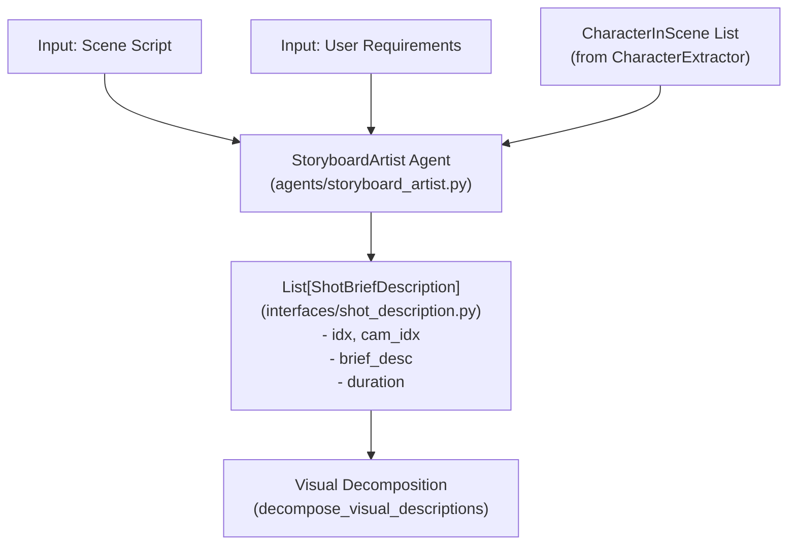
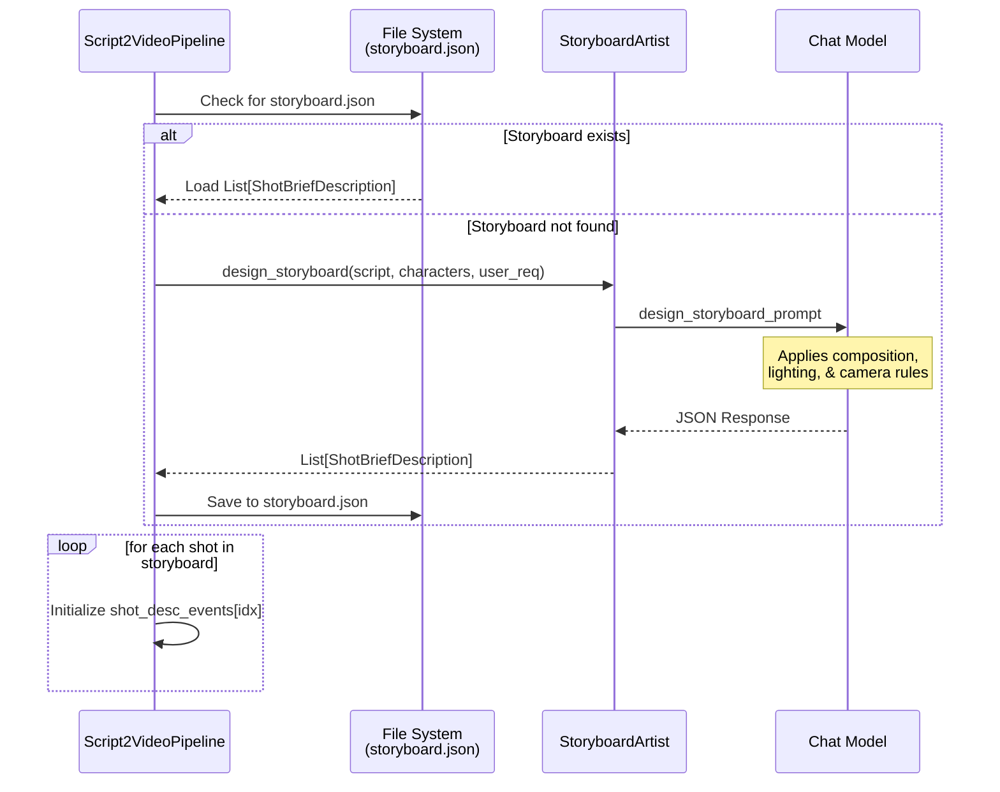

<!-- source: DeepWiki mcp.deepwiki.com · repo HKUDS/ViMax · page 7.2 Expressive Storyboard Design · fetched 2026-11-09 -->

# Expressive Storyboard Design

<details>
<summary>Relevant source files</summary>

The following files were used as context for generating this wiki page:

- [agents/screenwriter.py](agents/screenwriter.py)
- [agents/script_planner.py](agents/script_planner.py)
- [agents/storyboard_artist.py](agents/storyboard_artist.py)
- [pipelines/novel2movie_pipeline.py](pipelines/novel2movie_pipeline.py)
- [tests/test_novel2movie_pipeline_init.py](tests/test_novel2movie_pipeline_init.py)
- [tests/test_wrong_output_guards.py](tests/test_wrong_output_guards.py)
- [utils/text.py](utils/text.py)

</details>


This document explains ViMax's storyboard design system, which transforms narrative scripts into shot-level visual plans using cinematographic principles. The storyboard design process establishes the narrative rhythm, camera work, and visual composition that guide subsequent frame and video generation.

---

## Overview

The storyboard design process occurs early in the `Script2VideoPipeline` workflow, immediately after character extraction and before visual synthesis [pipelines/script2video_pipeline.py:596-623](). It analyzes the input script and breaks it down into individual shots, each with specific camera angles, movements, framing, and timing. This shot-level planning enables the system to apply professional cinematography language and create visual continuity across scene transitions.

**Sources:** [pipelines/script2video_pipeline.py:596-623](), [agents/storyboard_artist.py:18-23]()

---

## Storyboard Design Workflow

The storyboard design process transforms a narrative script into structured shot descriptions that specify camera work and timing.



**Diagram: Storyboard Design Data Flow**

**Sources:** [pipelines/script2video_pipeline.py:596-623](), [agents/storyboard_artist.py:15-53](), [interfaces/shot_description.py:1-20]()

---

## Core Agents and Implementation

### ScriptPlanner Agent
Before the storyboard is designed, the `ScriptPlanner` often expands a basic idea into a full narrative script. It uses specialized templates like `narrative_script_prompt_template` [agents/script_planner.py:13-81]() or `motion_script_prompt_template` [agents/script_planner.py:83-125]() to ensure the input to the storyboard artist is cinematically rich.

### StoryboardArtist Agent
The `StoryboardArtist` is a specialized AI agent that applies cinematographic knowledge to script analysis [agents/storyboard_artist.py:18-23](). It is instantiated in the `Script2VideoPipeline` [pipelines/script2video_pipeline.py:40]().

The agent's primary method is `design_storyboard()`, which follows these internal guidelines:
*   **Cinematic Language:** Uses close-ups for emotion and wide shots for context [agents/storyboard_artist.py:44]().
*   **Camera Reuse:** First considers if a shot can be filmed using an existing `cam_idx` before creating a new one [agents/storyboard_artist.py:45]().
*   **Spatial Reasoning:** Indicates the position of elements within the frame (e.g., "Character A is on the left side") [agents/storyboard_artist.py:47]().

**Sources:** [agents/script_planner.py:1-125](), [agents/storyboard_artist.py:15-53](), [pipelines/script2video_pipeline.py:40]()

---

## Data Models and Cinematographic Language

### ShotBriefDescription and ShotDescription
The storyboard process produces `ShotBriefDescription` objects, which are later expanded into full `ShotDescription` objects during the decomposition stage [pipelines/script2video_pipeline.py:627-638]().

| Field | Type | Role |
|-------|------|------|
| `idx` | `int` | Sequential shot index [interfaces/shot_description.py:10]() |
| `cam_idx` | `int` | Camera position identifier for spatial consistency [interfaces/shot_description.py:12]() |
| `brief_desc` | `str` | Initial cinematographic plan [interfaces/shot_description.py:13]() |
| `ff_desc` | `str` | Static first frame "snapshot" [agents/storyboard_artist.py:80]() |
| `lf_desc` | `str` | Static last frame "snapshot" [agents/storyboard_artist.py:81]() |
| `motion_desc` | `str` | Kinetic description of camera and element movement [agents/storyboard_artist.py:82]() |

### Cinematographic Application
The `StoryboardArtist` prompt enforces specific cinematic rules:
*   **Visual Continuity:** Ensures the sequence is logically smooth [agents/storyboard_artist.py:22]().
*   **Safety:** Replaces sensitive elements (e.g., using "ketchup" for blood) [agents/storyboard_artist.py:48]().
*   **Character Tracking:** Encloses character names in angle brackets (e.g., `<Alice>`) within visual descriptions for tracking [agents/storyboard_artist.py:47]().

**Sources:** [interfaces/shot_description.py:1-40](), [agents/storyboard_artist.py:41-53](), [pipelines/script2video_pipeline.py:627-638]()

---

## Design Storyboard Implementation Flow

The following sequence shows how the `Script2VideoPipeline` orchestrates the storyboard generation, including caching mechanisms.



**Diagram: Storyboard Design Implementation Flow**

**Sources:** [pipelines/script2video_pipeline.py:596-623](), [agents/storyboard_artist.py:15-69]()

---

## Integration with Character Information

The `StoryboardArtist` receives a `characters_str` derived from the `CharacterInScene` list [agents/storyboard_artist.py:62-64](). This ensures that the shot planning:
1.  References characters by their canonical identifiers.
2.  Indicates the direction characters are facing [agents/storyboard_artist.py:52]().
3.  Describes specific body parts when the shot focuses on a character [agents/storyboard_artist.py:51]().

**Sources:** [agents/storyboard_artist.py:31](), [agents/storyboard_artist.py:51-52](), [pipelines/script2video_pipeline.py:609-614]()

---

## Event Coordination and Parallelism

After storyboard generation, the pipeline creates synchronization events for each shot:

```python
for shot_brief_description in storyboard:
    self.shot_desc_events[shot_brief_description.idx] = asyncio.Event()
```

These events [pipelines/script2video_pipeline.py:620-622]() enable downstream processes to wait for shot descriptions before proceeding with frame generation. This pattern supports the high-efficiency parallel processing model of ViMax.

**Sources:** [pipelines/script2video_pipeline.py:620-622](), [tests/test_wrong_output_guards.py:72]()

---

## Relationship to Camera Tree Architecture

The `cam_idx` assigned during storyboard design is the foundation for the `Camera` tree structure [interfaces/camera.py:1-20](). Shots sharing a `cam_idx` are grouped together [tests/test_wrong_output_guards.py:42-45](). This allows the system to:
1.  Identify parent-child relationships between cameras [tests/test_wrong_output_guards.py:51-54]().
2.  Generate transition videos between shots captured from the same or related camera positions.

**Sources:** [interfaces/camera.py:1-20](), [tests/test_wrong_output_guards.py:39-55](), [pipelines/script2video_pipeline.py:472-478]()

---

