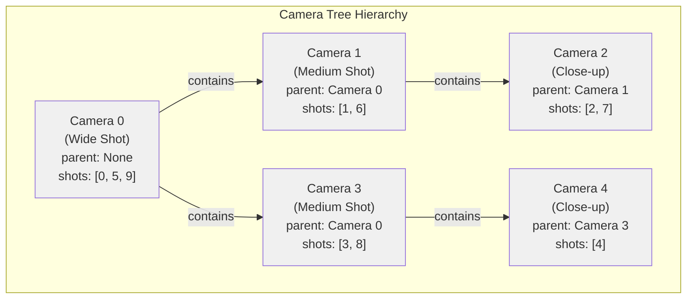
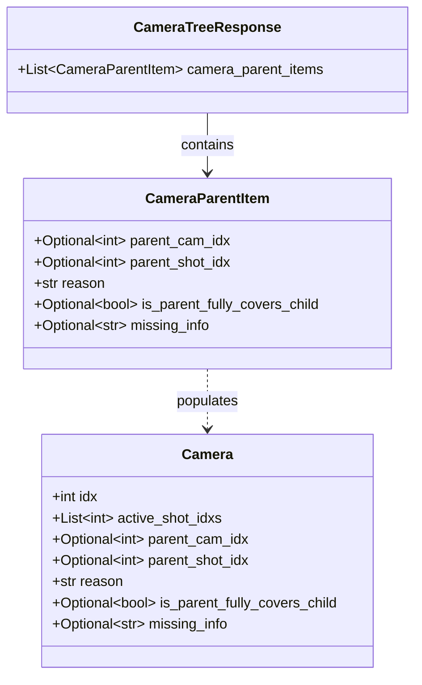
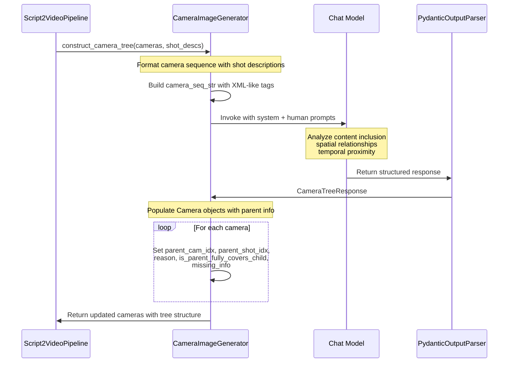
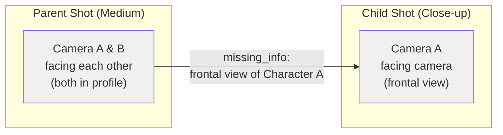
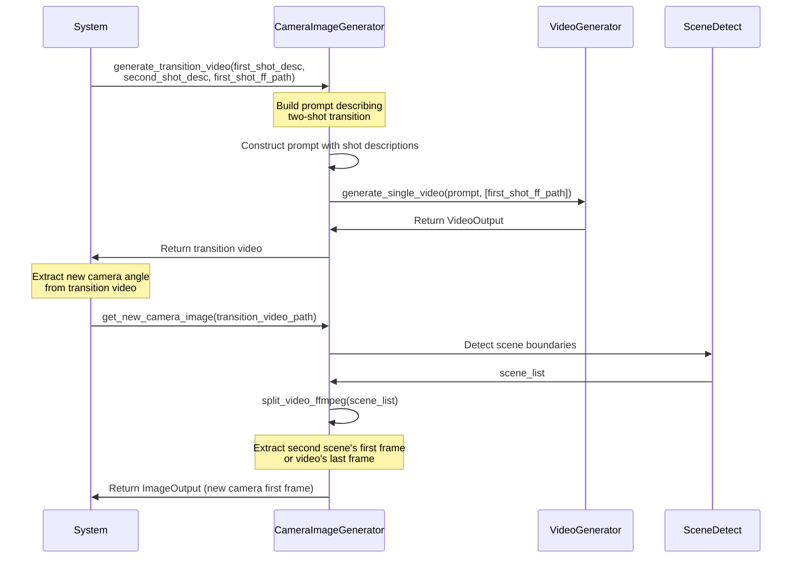
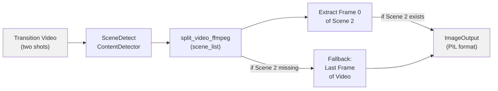
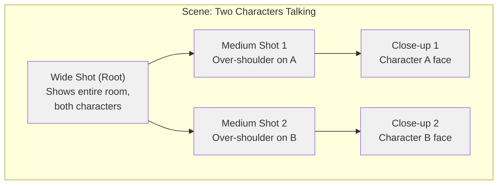

<!-- source: DeepWiki mcp.deepwiki.com · repo HKUDS/ViMax · page 7.3 Multi-camera Filming Simulation · fetched 2026-11-09 -->

# Multi-camera Filming Simulation

<details>
<summary>Relevant source files</summary>

The following files were used as context for generating this wiki page:

- [agent_runtime/context_compactor.py](agent_runtime/context_compactor.py)
- [agents/camera_image_generator.py](agents/camera_image_generator.py)
- [interfaces/shot_description.py](interfaces/shot_description.py)
- [tests/test_crash_regressions.py](tests/test_crash_regressions.py)
- [utils/video.py](utils/video.py)

</details>


This document explains how ViMax simulates multi-camera filming to create videos with spatial consistency across different camera angles. The system constructs a hierarchical camera tree that models content inclusion relationships, enabling seamless transitions between wide shots, medium shots, and close-ups while maintaining consistent character positioning and environments.

For information about how shots are planned and designed, see [7.2 Expressive Storyboard Design](). For details on reference image selection that leverages the camera tree, see [7.4 Intelligent Reference Image Selection]().

---

## Camera Tree Concept

The camera tree is a hierarchical data structure where each camera position is a node, and parent-child relationships represent content inclusion. A parent camera captures a broader field of view that encompasses one or more child cameras' narrower perspectives.

### Key Principles

| Principle | Description | Example |
|-----------|-------------|---------|
| **Content Inclusion** | Parent camera's field of view must contain child camera's content [agents/camera_image_generator.py:49-50]() | Wide shot of a room → Medium shot of two characters → Close-up of one character |
| **Transition Smoothness** | Adjacent camera levels should have similar shot sizes to enable smooth cuts [agents/camera_image_generator.py:51-51]() | Avoid jumping directly from extreme long shot to extreme close-up |
| **Temporal Proximity** | Parent cameras should be temporally close to their children [agents/camera_image_generator.py:52-52]() | Parent shot indices near child shot indices in the sequence |
| **Acyclic Structure** | The tree must have no circular dependencies [agents/camera_image_generator.py:53-53]() | Each camera has at most one parent |
| **Single Root** | Only one camera can exist without a parent, and the first camera must be the root [agents/camera_image_generator.py:55-57]() | Typically the establishing shot that shows the entire scene |

**Camera Tree Structure**



Sources: [agents/camera_image_generator.py:19-57]()

---

## Camera Tree Construction Process

The `CameraImageGenerator` class [agents/camera_image_generator.py:109-109]() constructs the camera tree by analyzing shot descriptions and determining parent-child relationships. This process is driven by an LLM that understands cinematic language and spatial relationships.

### Data Models

The camera tree construction uses several data models to represent the hierarchical structure:

**CameraParentItem Model**



Sources: [agents/camera_image_generator.py:69-105]()

### Construction Algorithm

The `construct_camera_tree()` method [agents/camera_image_generator.py:122-126]() implements the following workflow:

**Camera Tree Construction Flow**



Sources: [agents/camera_image_generator.py:121-150]()

### Input Format

The method formats camera data into an XML-like structure for LLM analysis:

```
<CAMERA_SEQ>
<CAMERA_0>
Shot 0: Medium shot of the street. Alice and Bob are walking towards each other.
Shot 2: Medium shot of the street. Alice and Bob hug each other.
</CAMERA_0>
<CAMERA_1>
Shot 1: Close-up of Alice's face. Her expression shifts from surprise to delight.
</CAMERA_1>
</CAMERA_SEQ>
```

The LLM analyzes this structure [agents/camera_image_generator.py:34-42]() and returns parent-child relationships with detailed reasoning.

Sources: [agents/camera_image_generator.py:128-134](), [agents/camera_image_generator.py:31-42]()

---

## LLM-Guided Parent Selection

The system uses a sophisticated prompt to guide the LLM in making optimal parent camera selections. The prompt encodes cinematic best practices and spatial reasoning rules.

### Selection Guidelines

The LLM follows these guidelines [agents/camera_image_generator.py:48-57]() when determining parent-child relationships:

| Guideline | Implementation |
|-----------|----------------|
| **Content Inclusion Check** | Compare keywords (characters, actions, setting) to ensure parent shot's field of view covers child shot |
| **Transition Smoothness Priority** | Prefer gradual shot size changes: Wide → Medium → Close-up. Avoid direct long-to-closeup transitions |
| **Temporal Proximity** | Select parent cameras with shot indices close to child camera's first shot |
| **Logical Consistency** | Ensure acyclic tree structure; select best match when multiple potential parents exist |
| **Field of View Overlap** | When broader perspective unavailable, choose shot with largest overlapping field of view |
| **Shot/Reverse Shot** | A shot can serve as parent of its reverse shot |
| **Root Camera Rule** | First camera must be the root of the tree |

### Missing Information Detection

A critical feature is the system's ability to detect what visual information is lost when transitioning from parent to child camera [agents/camera_image_generator.py:56-56]():



This `missing_info` field [agents/camera_image_generator.py:93-100]() enables the system to generate additional reference material when needed to ensure visual consistency.

Sources: [agents/camera_image_generator.py:49-56](), [agents/camera_image_generator.py:143-149]()

---

## Spatial Consistency Mechanisms

The camera tree enables three key mechanisms for maintaining spatial consistency across different camera angles:

### 1. Reference-Based Frame Generation

When generating the first frame for a child camera, the system can use frames from the parent camera as visual references. This ensures that characters, objects, and environments appear consistent when cutting between camera angles.

Sources: [agents/camera_image_generator.py:203-218]()

### 2. Transition Video Generation

When introducing a new camera angle, the system can generate a transition video that smoothly moves from the parent camera's perspective to the child camera's perspective:

**Transition Generation Workflow**



Sources: [agents/camera_image_generator.py:153-168](), [agents/camera_image_generator.py:171-200]()

### 3. Missing Information Compensation

When `is_parent_fully_covers_child` is `False`, the system knows that additional visual reference material is needed. The `missing_info` field [agents/camera_image_generator.py:93-100]() specifies what visual elements must be preserved or generated separately:

| Scenario | Missing Info | Compensation Strategy |
|----------|--------------|----------------------|
| Profile to frontal view | "Frontal view of Alice" | Generate character portrait as additional reference |
| Two-shot to single | "Character B's presence" | Include character portrait in reference set |
| Wide to detail | "Close-up texture details" | Generate high-resolution detail reference |

Sources: [agents/camera_image_generator.py:87-99]()

---

## Integration with Video Generation Pipeline

The camera tree is constructed during the `Script2VideoPipeline` execution and used throughout the shot generation process.

### Code Entity Mapping

The following table maps natural language concepts to concrete code entities:

| Concept | Code Entity | Location |
|---------|-------------|----------|
| Camera Tree Construction | `construct_camera_tree()` | [agents/camera_image_generator.py:122-126]() |
| Parent-Child Relationship | `CameraParentItem` | [agents/camera_image_generator.py:69-87]() |
| Tree Structure Response | `CameraTreeResponse` | [agents/camera_image_generator.py:102-106]() |
| Transition Generation | `generate_transition_video()` | [agents/camera_image_generator.py:153-168]() |
| New Angle Extraction | `get_new_camera_image()` | [agents/camera_image_generator.py:171-200]() |
| Video Concatenation | `concatenate_video_files()` | [utils/video.py:26-44]() |
| LLM Analysis Prompt | `system_prompt_template_select_reference_camera` | [agents/camera_image_generator.py:20-58]() |

Sources: [agents/camera_image_generator.py:1-219](), [utils/video.py:26-44]()

---

## Implementation Details

### Scene Detection and Video Splitting

The `get_new_camera_image()` method [agents/camera_image_generator.py:171-171]() uses PySceneDetect [agents/camera_image_generator.py:10-11]() to split transition videos and extract the second shot's first frame:

**Scene Detection Process**



The system uses `ContentDetector` [agents/camera_image_generator.py:11-11]() to identify shot boundaries based on frame content changes. If only one shot is detected (scene split failed), the last frame of the video is used as a fallback [agents/camera_image_generator.py:192-198]().

Sources: [agents/camera_image_generator.py:175-200]()

### Prompt Construction

The transition video prompt combines shot descriptions to guide the video generator:

```python
prompt = f"Two shots. The transition between the shots is a cut to. " \
         f"The style of the two shots should be consistent."
prompt += f"\nThe first shot description: {first_shot_visual_desc}."
prompt += f"\nThe second shot description: {second_shot_visual_desc}."
```

This ensures the generated video maintains visual consistency while showing the camera angle change.

Sources: [agents/camera_image_generator.py:160-162]()

### Video Concatenation

Final video assembly is handled by `concatenate_video_files` [utils/video.py:26-44](), which uses `moviepy` to join individual shot clips. It ensures that every `VideoFileClip` reader is closed even on failure to avoid exhausting file descriptors [utils/video.py:31-43]().

Sources: [utils/video.py:26-44]()

---

## Benefits and Use Cases

The camera tree architecture provides several key benefits:

1. **Spatial Consistency**: Characters and objects maintain consistent positions when cutting between angles because child cameras are spatially anchored to parent cameras.
2. **Efficient Reference Reuse**: Parent camera frames serve as references for child cameras, reducing visual drift.
3. **Cinematic Quality**: The LLM-guided parent selection ensures transitions follow professional cinematography practices (smooth progression through shot sizes).
4. **Missing Information Awareness**: By explicitly identifying what the parent shot lacks [agents/camera_image_generator.py:56-56](), the system can prioritize those details in child shot generation.

**Multi-Camera Coverage Example**



This structure allows the system to cut between any of these five camera angles while maintaining spatial consistency, simulating a professional multi-camera shoot.

Sources: [agents/camera_image_generator.py:19-57]()

---

