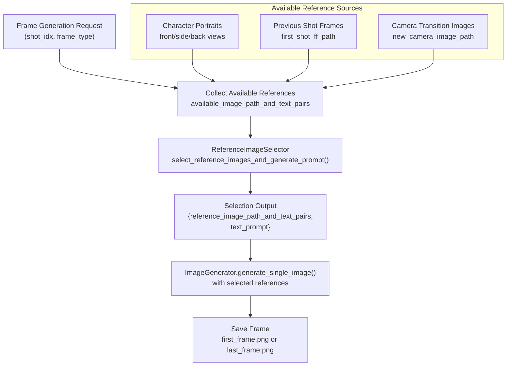
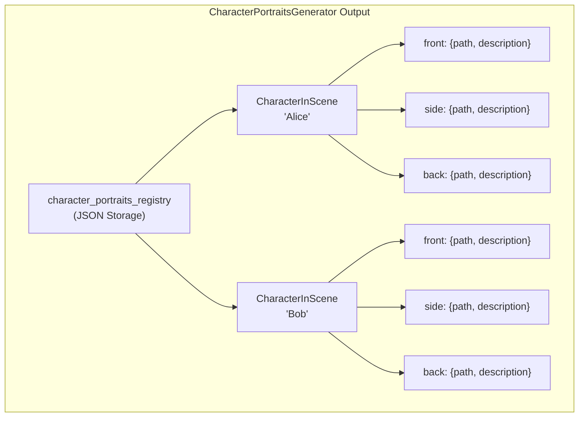
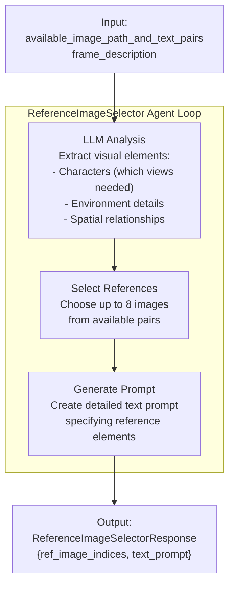
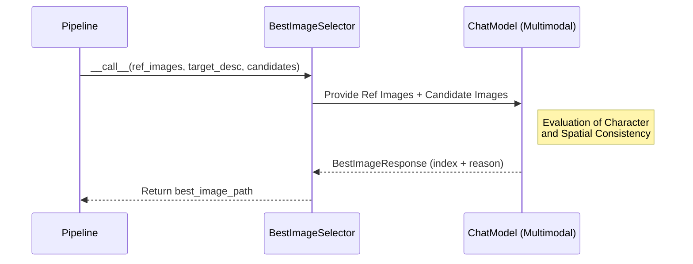

<!-- source: DeepWiki mcp.deepwiki.com · repo HKUDS/ViMax · page 7.4 Intelligent Reference Image Selection · fetched 2026-11-09 -->

# Intelligent Reference Image Selection

Relevant source files

The following files were used as context for generating this wiki page:

- [agents/best_image_selector.py](agents/best_image_selector.py)
- [agents/character_extractor.py](agents/character_extractor.py)
- [agents/reference_image_selector.py](agents/reference_image_selector.py)

This page documents the reference image selection system that enables ViMax to maintain visual consistency across long-form video generation. The `ReferenceImageSelector` agent intelligently chooses relevant reference images from available assets (character portraits, previous frames, camera transitions) and generates appropriate prompts for the image generator.

For information about the overall visual generation pipeline, see [Script2VideoPipeline](#4.2). For details on the camera tree structure that organizes shots, see [Camera Tree Architecture](#3.4). For the image generation process itself, see [Automated Image Generation and Prompting](#7.5).

## Purpose and Problem Statement

AI image generators require consistent visual references to maintain character appearances, environment details, and spatial relationships across multiple generated frames. Without intelligent reference selection, the system would either:
- Use too many irrelevant references, confusing the generator.
- Use too few references, causing visual inconsistency.
- Fail to select the most appropriate angle/view for each character.

The reference selection system solves this by analyzing the target frame description and selecting only the most relevant reference images with appropriate descriptive prompts.

**Sources:** [agents/reference_image_selector.py:18-22](), [agents/best_image_selector.py:18-22]()

## Reference Selection Workflow

The reference image selection process occurs before generating each new frame (first frame or last frame of a shot). It operates as part of the frame generation pipeline:

Title: Reference Selection Data Flow

**Sources:** [agents/reference_image_selector.py:44-57](), [agents/best_image_selector.py:84-87]()

## Data Sources for Reference Selection

### Character Portraits Registry

The system maintains a structured registry of character portraits. Each character typically has three views to ensure consistency from multiple angles. The `CharacterExtractor` initiates this by identifying static and dynamic features [agents/character_extractor.py:44-45]().

| View | Purpose | Description Format |
|------|---------|-------------------|
| `front` | Primary character reference | "A front-view portrait of {character_name}" |
| `side` | Profile shots | "A side-view portrait of {character_name}" |
| `back` | Rear-facing shots | "A back-view portrait of {character_name}" |

Title: Character Asset Mapping

**Sources:** [agents/reference_image_selector.py:35-40](), [agents/character_extractor.py:58-61]()

### Frame Database

Previously generated frames serve as spatial and compositional references. The system prioritizes more recent images to maintain narrative flow [agents/reference_image_selector.py:53-53]().

### Camera Transition Images

When switching camera angles, the system utilizes transition images. These capture the correct composition but may require character replacement via the selector's generated prompt [agents/reference_image_selector.py:19-22]().

## ReferenceImageSelector Agent

The `ReferenceImageSelector` agent is implemented in [agents/reference_image_selector.py:118]() and uses the chat model to analyze frame requirements and select appropriate references. It supports both text-only [agents/reference_image_selector.py:13-58]() and multimodal [agents/reference_image_selector.py:61-115]() inputs.

### Core Selection Logic

The agent follows strict guidelines to optimize the reference set:
1. **Composition Priority**: Prioritize images taken by the same camera [agents/reference_image_selector.py:52-52]().
2. **Recency**: Higher priority is given to images closer to the end of the sequence [agents/reference_image_selector.py:53-53]().
3. **Redundancy Filter**: Avoid duplicate information (e.g., if a scene image already shows a character's face, the portrait is redundant) [agents/reference_image_selector.py:54-54]().
4. **View Selection**: For portraits, select at most one view (front, side, or back) that matches the target frame description [agents/reference_image_selector.py:56-56]().
5. **Quantity Limit**: Select at most **8** optimal reference images [agents/reference_image_selector.py:57-57]().

Title: Selector Reasoning Architecture

**Sources:** [agents/reference_image_selector.py:122-132](), [agents/reference_image_selector.py:157-164]()

## Quality Gate: BestImageSelector

After the image generator produces multiple candidates, the `BestImageSelector` [agents/best_image_selector.py:62]() acts as a quality gate to ensure consistency.

It evaluates candidates based on three criteria:
1. **Character Consistency**: Aligning gender, ethnicity, age, facial features, etc., with the reference image [agents/best_image_selector.py:20-20]().
2. **Spatial Consistency**: Relative positions of characters and layout [agents/best_image_selector.py:21-21]().
3. **Description Accuracy**: Adherence to the target text description [agents/best_image_selector.py:22-22]().

Title: Consistency Validation Gate

**Sources:** [agents/best_image_selector.py:51-59](), [agents/best_image_selector.py:133-140]()

## Implementation Details

### Response Models

The system uses Pydantic models to ensure robust parsing of LLM outputs:

*   **ReferenceImageSelectorResponse**: Returns the selected indices and the generated prompt [agents/reference_image_selector.py:122-132]().
*   **BestImageResponse**: Returns the index of the winning candidate and the justification [agents/best_image_selector.py:51-59]().

### Prompt Construction

The `ReferenceImageSelector` generates a prompt that explicitly references the selected images. For example, it might state: "The character's appearance should reference Image 0, while the background lighting should match Image 2" [agents/reference_image_selector.py:44-44]().

**Sources:** [agents/reference_image_selector.py:13-58](), [agents/best_image_selector.py:13-41]()

---

