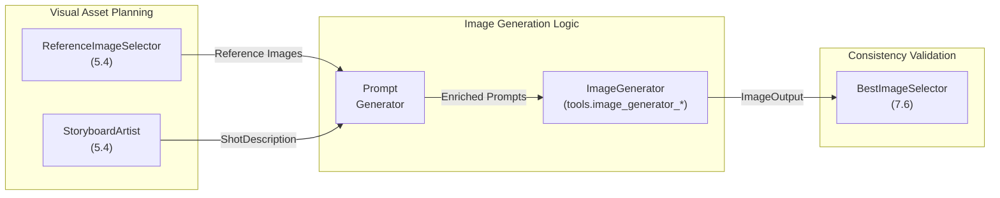
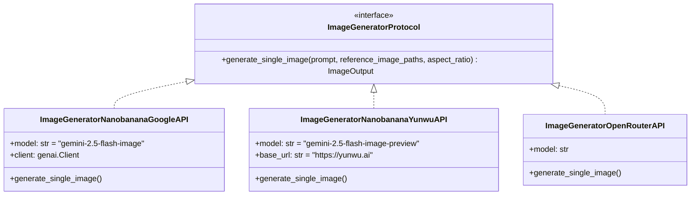
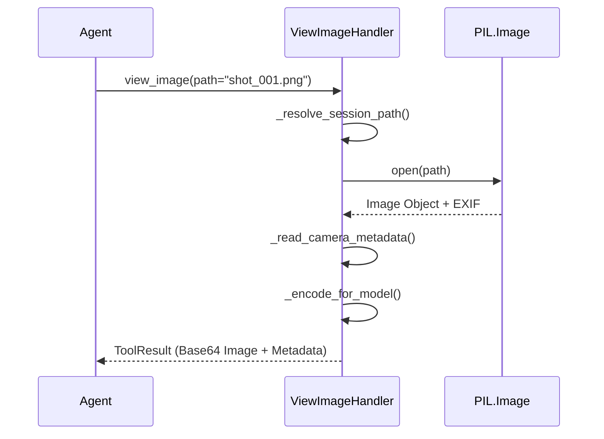

<!-- source: DeepWiki mcp.deepwiki.com · repo HKUDS/ViMax · page 7.5 Automated Image Generation and Prompting · fetched 2026-11-09 -->

# Automated Image Generation and Prompting

Relevant source files

The following files were used as context for generating this wiki page:

- [agent_runtime/image_tools.py](agent_runtime/image_tools.py)
- [agent_runtime/models.py](agent_runtime/models.py)
- [tests/test_openrouter_image_generator.py](tests/test_openrouter_image_generator.py)
- [tools/image_generator_nanobanana_google_api.py](tools/image_generator_nanobanana_google_api.py)
- [tools/image_generator_nanobanana_yunwu_api.py](tools/image_generator_nanobanana_yunwu_api.py)

## Purpose and Scope

This page documents the **Automated Image Generation and Prompting** capability, which translates storyboard descriptions and reference assets into visual frames. This system bridges the gap between creative planning and asset production by intelligently arranging spatial interactions between characters and environments. It utilizes specialized prompt engineering to maintain visual consistency across a timeline by leveraging first/last frame descriptors and specific variation types.

**Sources**: [readme.md:321-324](), [interfaces/shot_description.py:1-40]()

---

## Position in the Generation Pipeline

The Automated Image Generation capability operates primarily within the `Script2VideoPipeline`. It receives structured prompts from the `StoryboardArtist` agent and reference images from the `ReferenceImageSelector`, then generates multiple candidate images for each shot using backends like Gemini or OpenRouter.

**Sources**: [readme.md:321-327](), [readme.md:389-392](), [interfaces/image_output.py:1-15]()

---

## Prompt Engineering and Data Models

The system relies on the `ShotDescription` and `ShotBriefDescription` models to encapsulate the visual requirements of a frame.

### Key Prompt Descriptors
- **First/Last Frame Descriptors**: Used to ensure continuity between shots. The system describes the starting and ending state of a scene to guide the image generator in creating transition-ready frames.
- **Variation Types**: The system can request variations (e.g., different angles, lighting, or character poses) to provide the `BestImageSelector` with diverse candidates.

| Field | Model | Purpose |
|-------|-------|---------|
| `visual_description` | `ShotDescription` | Detailed text describing the scene composition. |
| `variation_type` | `ShotDescription` | Defines if the shot is a "standard", "wide", or "close-up" variation. |
| `reference_images` | `ShotDescription` | List of paths to character/environment references. |

**Sources**: [interfaces/shot_description.py:5-35]()

---

## Image Generator Implementations

ViMax supports multiple image generation backends through a duck-typed protocol. The primary implementations use Google's Gemini API (via Nanobanana) and OpenRouter.

### Implementation Classes

**Sources**: [tools/image_generator_nanobanana_google_api.py:18-37](), [tools/image_generator_nanobanana_yunwu_api.py:15-39](), [tests/test_openrouter_image_generator.py:11-15]()

---

## Image Generation Workflow

The generation process involves strict orientation guards and retry logic to ensure the output meets cinematic standards (typically 16:9 landscape).

### Technical Data Flow

1.  **Request**: The pipeline calls `generate_single_image` with a prompt and reference paths [tools/image_generator_nanobanana_google_api.py:31-37]().
2.  **Rate Limiting**: The `RateLimiter` ensures the system stays within API quotas [tools/image_generator_nanobanana_google_api.py:46-47]().
3.  **API Call**: Reference images are opened as PIL objects and sent along with the prompt to the model [tools/image_generator_nanobanana_google_api.py:49-59]().
4.  **Orientation Guard**: The `landscape_guard_requested` and `ensure_not_portrait` functions validate that the generated image is not vertically oriented [tools/image_generator_nanobanana_google_api.py:88-94]().
5.  **Output**: Returns an `ImageOutput` object containing the PIL data and metadata [tools/image_generator_nanobanana_google_api.py:96]().

**Sources**: [tools/image_generator_nanobanana_google_api.py:31-96](), [tools/image_orientation.py:1-20]()

---

## Spatial Reasoning and Visual Inspection

ViMax includes a `ViewImageHandler` that allows the Agent Loop (MLLM) to "see" and reason about generated images. This is crucial for spatial arrangement logic.

### Image Inspection Logic

When the agent calls the `view_image` tool, the system:
1.  Resolves the image path within the session workspace [agent_runtime/image_tools.py:26]().
2.  Loads and encodes the image for the model using `_encode_for_model` [agent_runtime/image_tools.py:29-33]().
3.  Extracts camera metadata (focal length, lens model) from EXIF tags to help the agent understand the spatial composition [agent_runtime/image_tools.py:131-150]().

**Sources**: [agent_runtime/image_tools.py:17-60](), [agent_runtime/image_tools.py:131-150]()

---

## Error Handling and Retry Policies

Image generation is prone to transient API errors and orientation mismatches. ViMax uses `tenacity` for robust retries.

- **Retryable Errors**: 429 (Rate Limit), 500 (Server Error), and `ValueError` regarding portrait orientation [tests/test_openrouter_image_generator.py:71-74]().
- **Non-Retryable Errors**: 401 (Unauthorized) or invalid reference image paths [tests/test_openrouter_image_generator.py:75-76]().
- **Exponential Backoff**: Implementation uses a multiplier of 1, with a maximum wait of 10 seconds between attempts [tools/image_generator_nanobanana_google_api.py:30]().

**Sources**: [tools/image_generator_nanobanana_google_api.py:30](), [tests/test_openrouter_image_generator.py:71-76]()

---

## Summary of Prompting Strategy

The system's prompting strategy is designed for **Consistency** and **Cinematic Quality**:
- **Reference-Guided**: Prompts are always accompanied by visual references to maintain character identity [tools/image_generator_nanobanana_google_api.py:59]().
- **Landscape Enforcement**: The system automatically appends "landscape image" to prompts if not explicitly specified to ensure 16:9 compatibility [tests/test_openrouter_image_generator.py:45]().
- **Metadata Awareness**: By reading EXIF data, the system can track the "virtual lens" used in generation, allowing for consistent focal lengths across a scene [agent_runtime/image_tools.py:144-150]().

**Sources**: [tools/image_generator_nanobanana_google_api.py:59](), [tests/test_openrouter_image_generator.py:45](), [agent_runtime/image_tools.py:144-150]()

---

