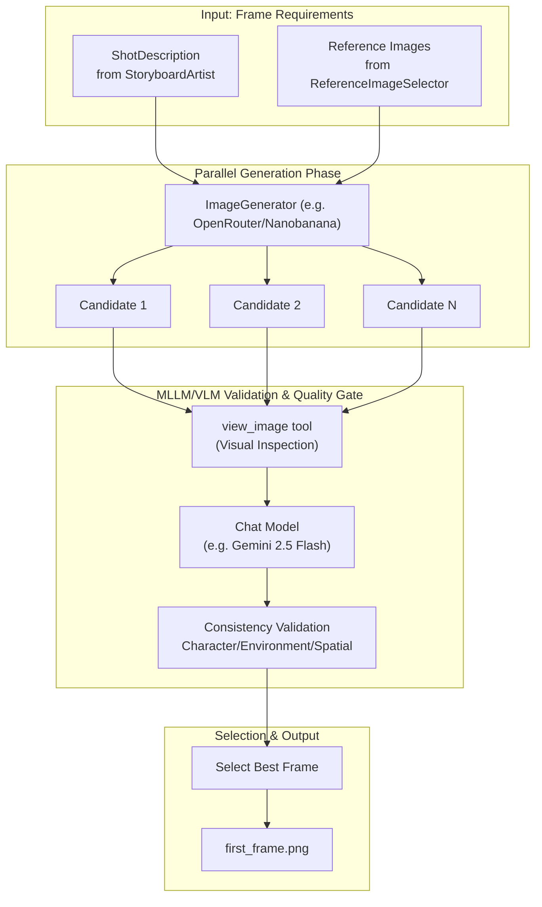
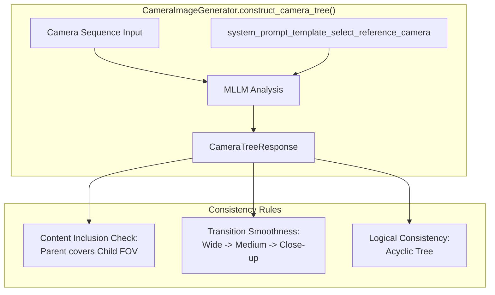
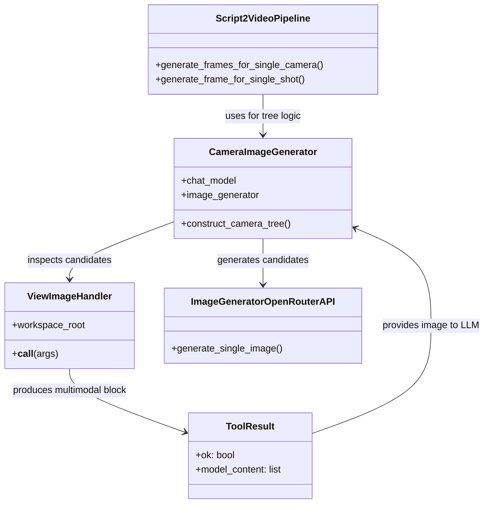

<!-- source: DeepWiki mcp.deepwiki.com · repo HKUDS/ViMax · page 7.6 Consistency Checking with MLLM/VLM · fetched 2026-11-09 -->

# Consistency Checking with MLLM/VLM

Relevant source files

The following files were used as context for generating this wiki page:

- [agent_runtime/image_tools.py](agent_runtime/image_tools.py)
- [agent_runtime/models.py](agent_runtime/models.py)
- [agents/camera_image_generator.py](agents/camera_image_generator.py)
- [tests/test_openrouter_image_generator.py](tests/test_openrouter_image_generator.py)
- [utils/video.py](utils/video.py)

## Purpose and Scope

This document describes ViMax's consistency checking approach, which addresses a critical quality control challenge in AI video generation. ViMax employs a multi-variant generation strategy with MLLM/VLM-based validation to ensure visual consistency: *"Generate multiple images in parallel and select the best consistent image as the first frame through MLLM/VLM to imitate the workflow of human creators"*.

This capability solves a fundamental problem: even when provided with correct character references, position specifications, and environment prompts, image generators may produce inconsistent or unusable outputs due to their stochastic nature. The system mimics human video production workflows where multiple takes are reviewed and the best one is selected.

**Sources:** [readme.md:232-235](), [readme.md:305-307]()

---

## The Consistency Problem

AI image generators are non-deterministic systems that may produce varied outputs even with identical inputs. The system identifies "Consistency Check" as one of the core challenges:

> "Sometimes, the image generator may generate unusable images even if it is given the correct characters, position, environment reference image and prompts."

### Consistency Challenges and Impact

| Challenge | Impact | Example Scenario |
|-----------|--------|------------------|
| **Character Inconsistency** | Generated characters don't match reference portraits | Character's clothing or facial features change between shots |
| **Environment Mismatch** | Background elements contradict scene descriptions | Wrong setting or missing key environment elements |
| **Position Errors** | Characters placed incorrectly relative to each other | Character positions violate spatial logic defined in storyboard |
| **Technical Quality** | Fundamentally flawed or corrupted generations | Distorted anatomy, rendering artifacts, or portrait-oriented outputs |

**Sources:** [readme.md:230-244](), [readme.md:305-307](), [tests/test_openrouter_image_generator.py:71-76]()

---

## Technical Implementation

### Multi-Variant Generation Strategy

The consistency checking system operates during frame generation. While the exact selection logic is abstracted within specialized agents, the system supports generating multiple candidates in parallel to find the best consistent frame.

**Title: Multi-Variant Generation and MLLM/VLM Selection Flow**

**Sources:** [readme.md:305-307](), [agent_runtime/image_tools.py:17-60](), [agents/camera_image_generator.py:109-126]()

### AI-Powered Quality Gate: `view_image`

A core component of the consistency checking system is the `ViewImageHandler`, which acts as a bridge between the filesystem and the MLLM. This tool allows the agent to "see" the generated candidates for visual inspection.

**Key Functionalities of the Quality Gate:**
- **Visual Inspection**: The `view_image` tool loads images from the session workspace, encodes them for the model, and provides them as multimodal blocks for the next LLM turn [agent_runtime/image_tools.py:17-60]().
- **Metadata Extraction**: It reads camera metadata (focal length, lens model) and image dimensions to ensure technical compliance [agent_runtime/image_tools.py:41-53]().
- **Resolution Management**: Images are automatically resized and compressed to fit within model context limits while maintaining high detail for inspection [agent_runtime/image_tools.py:97-126]().

**Sources:** [agent_runtime/image_tools.py:17-60](), [agent_runtime/image_tools.py:97-126]()

---

## MLLM/VLM Validation Framework

The validation leverages multimodal language models to evaluate generated candidates against textual and visual requirements.

### Camera Position Tree Analysis
Consistency is also checked at a structural level through the `CameraImageGenerator`. It constructs a "camera position tree" to ensure spatial consistency between different camera angles [agents/camera_image_generator.py:25-58]().

**Title: Spatial Consistency Validation (Camera Tree)**

**Sources:** [agents/camera_image_generator.py:20-58](), [agents/camera_image_generator.py:122-135]()

### Automated Retry and Filtering
The system implements automated filtering and retry logic for common consistency failures:
- **Aspect Ratio Filtering**: If a generator produces a portrait-oriented frame (9:16) when a landscape frame (16:9) is required, the system triggers a retry [tests/test_openrouter_image_generator.py:71-76]().
- **Error Handling**: The `ImageGeneratorOpenRouterAPI` distinguishes between transient errors (retryable) and permanent client errors [tests/test_openrouter_image_generator.py:63-76]().

**Sources:** [tests/test_openrouter_image_generator.py:63-76](), [agent_runtime/image_tools.py:36-37]()

---

## Integration with Pipeline Components

### Data Flow for Quality Validation

The consistency checking logic is integrated into the generation flow, where multiple entities collaborate to ensure the final output is coherent.

**Title: Entity Relationship in Consistency Validation**

**Sources:** [agents/camera_image_generator.py:109-126](), [agent_runtime/image_tools.py:17-60](), [agent_runtime/models.py:21-31](), [tests/test_openrouter_image_generator.py:33-49]()

### Working Directory Artifacts
Consistency is maintained by referencing existing artifacts. The pipeline checks for the existence of `first_frame.png` or `video.mp4` before attempting regeneration, allowing for iterative refinement [utils/video.py:8-23]().

**Sources:** [utils/video.py:8-23](), [agent_runtime/image_tools.py:63-80]()

---

## Summary of Quality Gate Dimensions

| Dimension | Mechanism | Source |
|-----------|-----------|--------|
| **Visual Fidelity** | MLLM inspection via `view_image` | [agent_runtime/image_tools.py:54-60]() |
| **Spatial Continuity** | Camera Position Tree Construction | [agents/camera_image_generator.py:25-58]() |
| **Format Compliance** | Aspect ratio and orientation check | [tests/test_openrouter_image_generator.py:71-76]() |
| **Content Inclusion** | Parent/Child FOV overlap analysis | [agents/camera_image_generator.py:50-51]() |
| **Technical Metadata** | EXIF/Metadata extraction | [agent_runtime/image_tools.py:131-150]() |

**Sources:** [agent_runtime/image_tools.py:54-60](), [agents/camera_image_generator.py:25-58](), [tests/test_openrouter_image_generator.py:71-76]()

---

