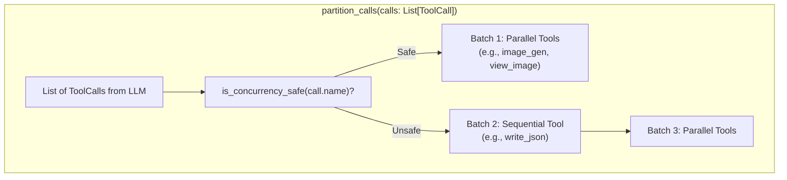

<!-- source: DeepWiki mcp.deepwiki.com · repo HKUDS/ViMax · page 7.7 High-efficiency Parallel Processing · fetched 2026-11-09 -->

# High-efficiency Parallel Processing

<details>
<summary>Relevant source files</summary>

The following files were used as context for generating this wiki page:

- [agent_runtime/loop.py](agent_runtime/loop.py)
- [agent_runtime/tools.py](agent_runtime/tools.py)
- [prompts/workflow.md](prompts/workflow.md)
- [tests/test_agent_loop.py](tests/test_agent_loop.py)
- [tests/test_agent_tools.py](tests/test_agent_tools.py)
- [tests/test_openrouter_video_generator.py](tests/test_openrouter_video_generator.py)

</details>


This document describes ViMax's parallel processing architecture, focusing on the `asyncio`-based execution model, event coordination patterns, and concurrency-safe tool execution. The system leverages asynchronous patterns to reduce video generation latency by processing independent tasks—such as shot-level image generation—concurrently while maintaining strict sequential ordering for temporal dependencies.

## Overview of Asynchronous Execution

ViMax is built on an asynchronous core that manages complex workflows across multiple AI agents and external service providers. The execution model is designed to maximize throughput while respecting the rate limits of external APIs (LLMs, image generators, and video generators).

### Execution Flow and Concurrency

The system uses `asyncio` to orchestrate the "Agent Loop" and "Pipeline" execution. While narrative planning is often sequential due to logical dependencies (e.g., a script must exist before a storyboard), the rendering phase utilizes parallelization for visual asset generation.

**Sources:** [agent_runtime/loop.py:20-21](), [agent_runtime/tools.py:3-12]()

---

## Agent Loop Event Coordination

The `AgentLoop` class serves as the primary coordinator for interactive sessions. it manages the lifecycle of a user request through a series of asynchronous events.

### Event Stream Architecture

The `stream_events` method in `AgentLoop` implements an `AsyncIterator` that yields structured events to the UI (TUI or Web UI). This allows for real-time feedback during long-running parallel operations.

```mermaid
sequenceDiagram
    participant UI as "Web UI / TUI"
    participant Loop as "AgentLoop (loop.py)"
    participant LLM as "OpenAICompatibleLLM"
    participant Executor as "ToolExecutor"

    UI->>Loop: stream_events(user_input)
    Loop->>LLM: complete(runtime_messages)
    LLM-->>Loop: AssistantMessage (ToolCalls)
    
    loop Tool Execution Round
        Loop->>Executor: execute(ToolCall)
        activate Executor
        Executor-->>Loop: yield "tool_start"
        Note over Executor: Running Async Tool...
        Executor-->>Loop: yield "tool_progress"
        Executor-->>Loop: yield "tool_result"
        deactivate Executor
    end
    
    Loop->>UI: yield "done"
```

**Sources:** [agent_runtime/loop.py:43-45](), [agent_runtime/loop.py:68-71](), [agent_runtime/loop.py:98-100]()

### Progress and Terminal Streaming

To maintain high efficiency without blocking the main loop, `ToolRuntimeContext` provides methods to emit progress and terminal output from within background tasks.

| Method | Code Entity | Purpose |
|---|---|---|
| `emit_progress` | `ToolRuntimeContext.emit_progress` | Sends stage updates (e.g., "generating_images") to the UI. |
| `emit_terminal` | `ToolRuntimeContext.emit_terminal` | Streams stdout/stderr from subprocesses (e.g., FFmpeg). |
| `is_cancelled` | `ToolRuntimeContext.is_cancelled` | Checks if the user has requested to abort the current turn. |

**Sources:** [agent_runtime/tools.py:41-47](), [agent_runtime/tools.py:49-55](), [agent_runtime/tools.py:61-66]()

---

## Concurrency-Safe Tool Batching

The `ToolRegistry` and `ToolExecutor` manage how tools are executed relative to one another. ViMax distinguishes between tools that can run in parallel and those that must run atomically.

### Concurrency Metadata

Tools are defined using the `ToolSpec` class, which includes a `concurrency_safe` boolean.

```python
@dataclass(slots=True)
class ToolSpec:
    name: str
    handler: ToolHandler
    concurrency_safe: bool = False # Key for parallelization
```

**Sources:** [agent_runtime/tools.py:29-37]()

### Partitioning Strategy

When an LLM requests multiple tool calls in a single turn, the `ToolRegistry` partitions these calls into batches based on their safety profile.



**Sources:** [agent_runtime/tools.py:137-148]()

---

## Parallel Shot Generation Logic

In the `script2video` and `idea2video` pipelines, the system optimizes the generation of visual assets (keyframes and video clips) by identifying shots that share a `Camera` position.

### Batch Identification

The system identifies consecutive shots sharing the same `Camera` instance. These shots are processed as a batch where image generation (the most time-consuming part of first-frame creation) happens concurrently.

| Optimization Stage | Implementation Detail |
|---|---|
| **Batching** | Group `ShotDescription` by `Camera` identity. |
| **Parallel I2I/T2I** | Use `asyncio.gather` for multiple `ImageGenerator` calls. |
| **Validation** | Parallel MLLM/VLM consistency checks for the entire batch. |

**Sources:** [prompts/workflow.md:10-15](), [prompts/workflow.md:35-40]()

### Parallel Image Generation Implementation

The system uses `asyncio.create_task` and a `Queue` pattern in the `AgentLoop` to handle concurrent tool execution while streaming progress events for each task simultaneously.

```python
# Conceptual implementation in agent_runtime/loop.py
for call in assistant.tool_calls:
    progress_queue = asyncio.Queue()
    task = asyncio.create_task(self.tool_executor.execute(call, control, progress_callback=on_progress))
    # Wait for completion while yielding progress
    while not task.done():
        yield await asyncio.wait_for(progress_queue.get(), timeout=0.1)
```

**Sources:** [agent_runtime/loop.py:98-113]()

---

## Performance and Rate Limiting

To prevent overwhelming external providers, parallel processing is constrained by configuration-defined rate limits.

### Rate Limit Management

The configuration system (e.g., `script2video.yaml`) defines quotas for different service types.

| Service Type | Config Key | Purpose |
|---|---|---|
| **LLM** | `chat_model.rate_limit` | Limits concurrent narrative planning requests. |
| **Image Gen** | `image_generator.rate_limit` | Limits concurrent shot keyframe generations. |
| **Video Gen** | `video_generator.rate_limit` | Limits concurrent video clip generations. |

If `rate_limit` is set to `null`, the system attempts maximum concurrency allowed by the `ToolRegistry` partitioning.

**Sources:** [agent_runtime/tools.py:141-148](), [tests/test_agent_tools.py:14-25]()

### Video Generator Integration

The video generation implementations, such as `VideoGeneratorOpenRouterAPI`, utilize asynchronous polling to avoid blocking threads while waiting for long-running video synthesis jobs.

**Sources:** [tests/test_openrouter_video_generator.py:14-23](), [tests/test_openrouter_video_generator.py:42-50]()

---

## Summary of Parallel Benefits

The combination of `asyncio` coordination and concurrency-safe tool batching results in significant performance improvements:

1.  **Reduced Latency:** Keyframes for an entire scene can be generated in the time it takes for the single slowest image generation.
2.  **Interactive Feedback:** The event-driven architecture ensures the UI remains responsive even during heavy parallel processing.
3.  **Resource Utilization:** Efficiently uses available API quotas by saturating the `max_concurrent_requests` allowed by the provider.
4.  **Robustness:** Tool-level error handling ensures that a failure in one parallel shot generation task does not necessarily crash the entire pipeline.

**Sources:** [agent_runtime/loop.py:72-77](), [agent_runtime/tools.py:162-163]()

---

