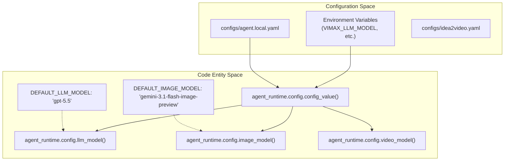
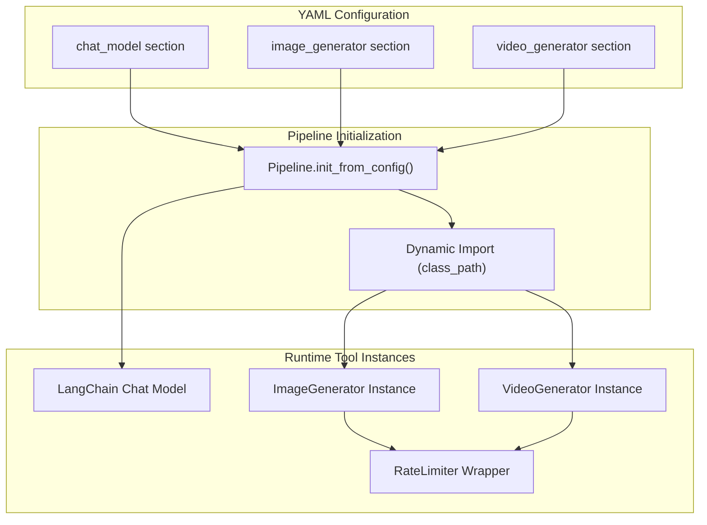

<!-- source: DeepWiki mcp.deepwiki.com · repo HKUDS/ViMax · page 8 Configuration System · fetched 2026-11-09 -->

# Configuration System

<details>
<summary>Relevant source files</summary>

The following files were used as context for generating this wiki page:

- [agent_runtime/__init__.py](agent_runtime/__init__.py)
- [agent_runtime/config.py](agent_runtime/config.py)
- [agent_runtime/tool_executor.py](agent_runtime/tool_executor.py)
- [configs/idea2video.yaml](configs/idea2video.yaml)
- [configs/script2video.yaml](configs/script2video.yaml)
- [main_idea2video.py](main_idea2video.py)
- [main_script2video.py](main_script2video.py)

</details>


## Purpose and Scope

The Configuration System defines how ViMax pipelines and agents are initialized, parameterized, and connected to external services through YAML configuration files and environment variables. This page documents the configuration file structure, the hierarchical resolution mechanism, and the loading flow that bridges YAML declarations to runtime objects.

For details on the loading mechanism and environment variable overrides, see [Configuration Architecture](#8.1). For comprehensive settings references, see [idea2video.yaml Reference](#8.2) and [script2video.yaml Reference](#8.3). For rate limiting logic, see [Rate Limiting Configuration](#8.4). For service provider setup, see [Service Provider Configuration](#8.5).

---

## Configuration Architecture

ViMax uses a layered configuration approach. While pipeline-specific YAML files define the workflow structure and rate limits, a central `agent.local.yaml` file and environment variables provide global service credentials and model selections.

### Configuration Resolution Chain

The system resolves configuration values using the following priority (highest to lowest):
1. **Environment Variables**: e.g., `VIMAX_API_KEY` or `VIMAX_LLM_MODEL`.
2. **Local Configuration**: Values defined in `configs/agent.local.yaml`.
3. **Pipeline Configuration**: Values defined in `configs/idea2video.yaml` or `configs/script2video.yaml`.
4. **Hardcoded Defaults**: Defined in `agent_runtime/config.py`.

### Code Entity Association

The following diagram bridges the configuration keys to the internal resolution logic and default values.



**Sources:** [agent_runtime/config.py:10-20](), [agent_runtime/config.py:36-46](), [agent_runtime/config.py:49-51]()

---

## Configuration File Overview

ViMax utilizes two primary YAML files to control pipeline-specific behaviors:

| Configuration File | Purpose | Primary Pipeline |
|-------------------|---------|---------|
| `configs/idea2video.yaml` | Configures the full idea-to-video workflow including story development and character extraction. | `Idea2VideoPipeline` |
| `configs/script2video.yaml` | Configures scene-level video generation from structured scripts. | `Script2VideoPipeline` |

**Sources:** [configs/idea2video.yaml:1-33](), [configs/script2video.yaml:1-34]()

---

## Service Configuration Loading

The loading flow transforms YAML declarations into functional tool and model instances used by the agents.



### Core Configuration Sections

#### chat_model Section
Defines the LLM parameters. ViMax defaults to using OpenRouter as a gateway to access models like Gemini 2.5.
* **Key Fields**: `model`, `model_provider`, `api_key`, `base_url`.
* **Sources**: [configs/idea2video.yaml:1-6](), [agent_runtime/config.py:49-63]()

#### image_generator & video_generator Sections
Control the visual synthesis backends. These sections use a `class_path` to dynamically load the tool implementation.
* **Default Image**: `tools.ImageGeneratorNanobananaGoogleAPI`
* **Default Video**: `tools.VideoGeneratorVeoGoogleAPI`
* **Sources**: [configs/idea2video.yaml:13-24](), [configs/script2video.yaml:14-25]()

---

## Rate Limiting and Working Directories

### Rate Limiting Strategy
ViMax enforces quotas at the service level. Parameters include `max_requests_per_minute` and `max_requests_per_day`. Setting these to `null` disables the limiter for that specific service.
* **Idea2Video Chat Limit**: 500 req/min [configs/idea2video.yaml:9]()
* **Video Generation Limit**: 2 req/min [configs/idea2video.yaml:28]()

### Working Directory Structure
The `working_dir` parameter defines where artifacts (story, frames, videos) are persisted.
* **Idea2Video Default**: `.working_dir/idea2video` [configs/idea2video.yaml:32]()
* **Script2Video Default**: `.working_dir/script2video` [configs/script2video.yaml:33]()

---

## Usage in Code

Pipelines are typically initialized via the `init_from_config` factory method, which abstracts the complexity of parsing and instantiation.

```python
# Example from main_idea2video.py
pipeline = Idea2VideoPipeline.init_from_config(
    config_path="configs/idea2video.yaml")
```

**Sources:** [main_idea2video.py:22-23](), [main_script2video.py:29]()

---

## Child Pages
- [Configuration Architecture](#8.1) — Detailed loading logic and resolution order.
- [idea2video.yaml Reference](#8.2) — Settings for the full idea-to-video pipeline.
- [script2video.yaml Reference](#8.3) — Settings for script-based generation.
- [Rate Limiting Configuration](#8.4) — Quota management and limiter behavior.
- [Service Provider Configuration](#8.5) — Configuring LLM, Image, and Video backends.

---

