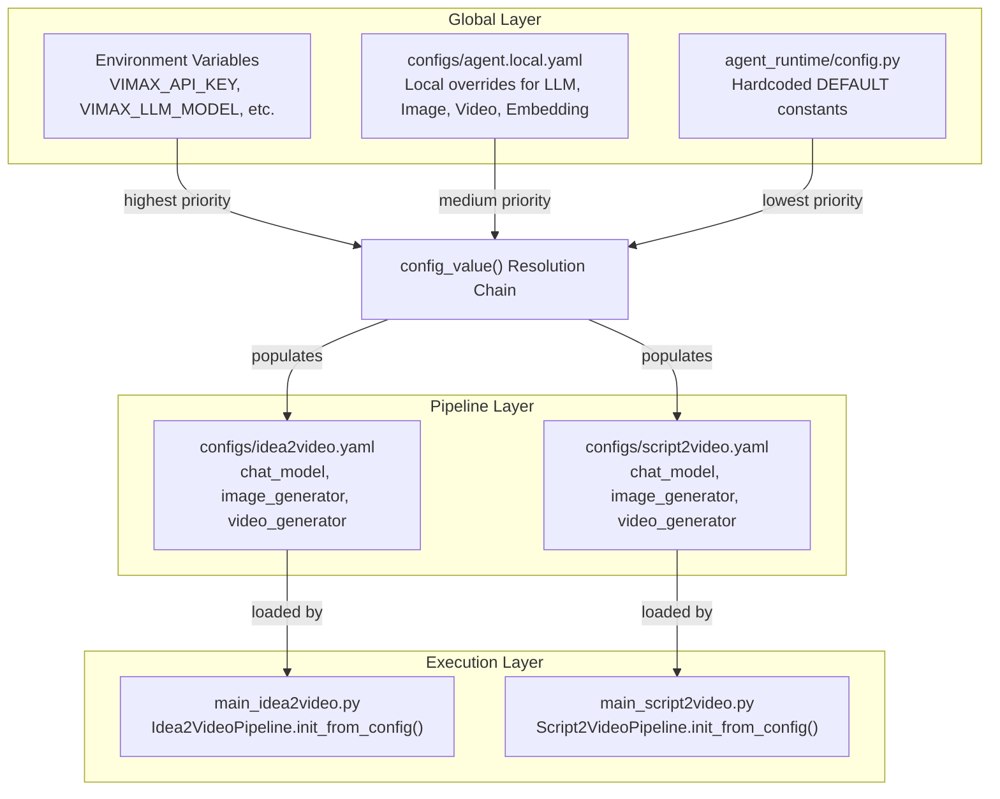
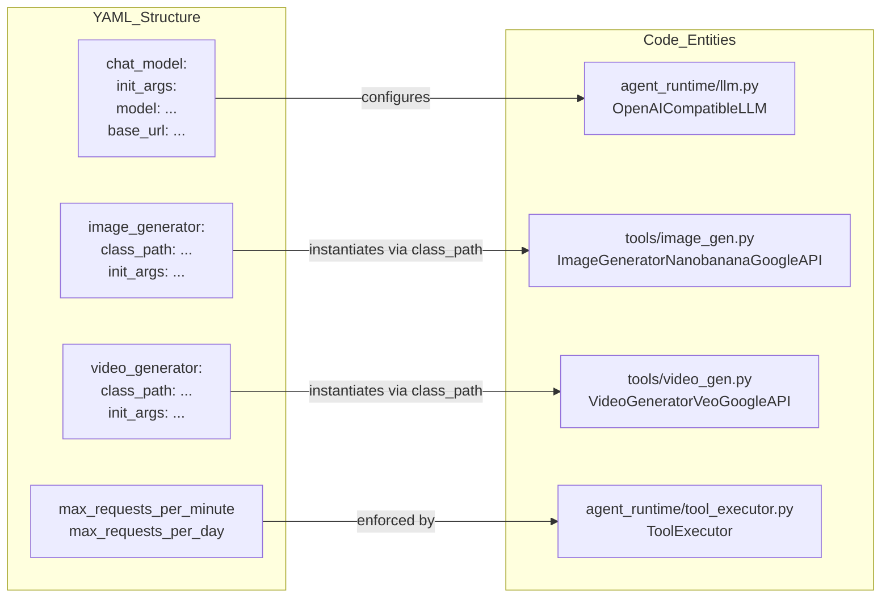
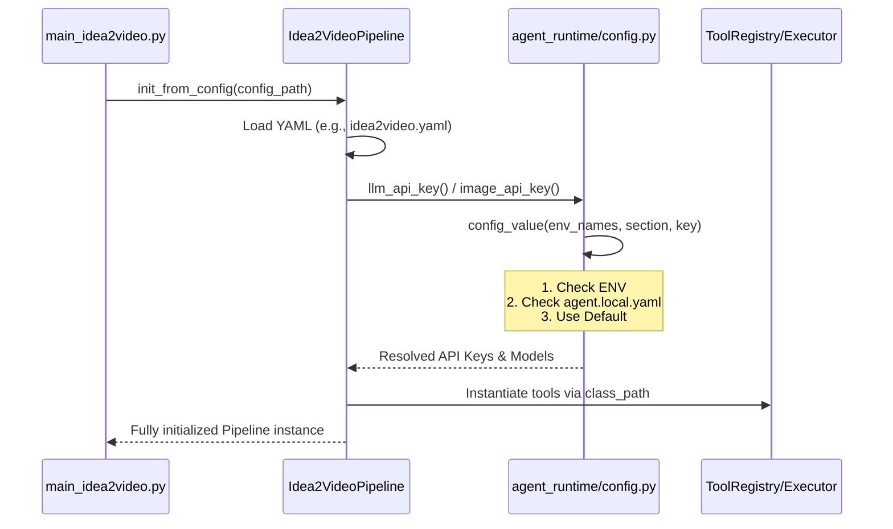

<!-- source: DeepWiki mcp.deepwiki.com · repo HKUDS/ViMax · page 8.1 Configuration Architecture · fetched 2026-11-09 -->

# Configuration Architecture

<details>
<summary>Relevant source files</summary>

The following files were used as context for generating this wiki page:

- [agent_runtime/__init__.py](agent_runtime/__init__.py)
- [agent_runtime/config.py](agent_runtime/config.py)
- [agent_runtime/tool_executor.py](agent_runtime/tool_executor.py)
- [configs/idea2video.yaml](configs/idea2video.yaml)
- [configs/script2video.yaml](configs/script2video.yaml)
- [main_idea2video.py](main_idea2video.py)
- [main_script2video.py](main_script2video.py)

</details>


## Purpose and Scope

This document explains the YAML-based configuration system that controls ViMax pipeline behavior through external service configuration and working directory specification. The configuration architecture provides a declarative approach to selecting AI service backends (chat models, image generators, video generators) without requiring code modifications. This page covers the structure of configuration files, the `init_from_config` pattern, and the `config_value` resolution chain that manages environment variable overrides and local configuration files.

**Sources:** [configs/script2video.yaml:1-21](), [configs/idea2video.yaml:1-22](), [agent_runtime/config.py:36-46]()

---

## Configuration Hierarchy

The ViMax configuration system operates on three primary levels, ranging from global defaults to runtime-specific overrides.

**Figure: Configuration System Hierarchy**



**Sources:** [agent_runtime/config.py:10-20](), [agent_runtime/config.py:36-46](), [configs/idea2video.yaml:1-22](), [main_idea2video.py:21-24]()

### Level 1: Resolution Chain (`config_value`)

The core of the configuration system is the `config_value` function in `agent_runtime/config.py`. It implements a prioritized lookup strategy for configuration parameters:

1.  **Environment Variables**: It checks a list of provided environment names (e.g., `VIMAX_LLM_API_KEY`). If found, this value is used immediately [agent_runtime/config.py:37-40]().
2.  **Local Configuration**: It checks `configs/agent.local.yaml` for a specific section and key [agent_runtime/config.py:41-45]().
3.  **Hardcoded Defaults**: If neither of the above is found, it returns a hardcoded default value (e.g., `gpt-5.5` for LLMs) [agent_runtime/config.py:46]().

### Level 2: Pipeline Configuration (YAML)

Each pipeline uses a specific YAML file to define its runtime environment. These files specify the `class_path` for tools and the `working_dir` for artifacts.

| Configuration File | Pipeline Entry Point | Primary Use Case |
|-------------------|---------------------|------------------|
| `configs/idea2video.yaml` | `main_idea2video.py` | Transform raw ideas into videos [main_idea2video.py:22-23]() |
| `configs/script2video.yaml` | `main_script2video.py` | Generate videos from existing scripts [main_script2video.py:29-30]() |

**Sources:** [configs/idea2video.yaml:1-32](), [configs/script2video.yaml:1-33]()

---

## The `agent.local.yaml` Mechanism

The `configs/agent.local.yaml` file is used for user-specific overrides that should not be committed to the main repository. The function `load_agent_config` uses `@lru_cache` to efficiently load this file once per execution [agent_runtime/config.py:22-33]().

**Example `agent.local.yaml` structure:**
```yaml
llm:
  model: "google/gemini-2.0-flash"
  api_key: "sk-..."
image:
  model: "dalle-3"
video:
  base_url: "https://api.provider.com/v1"
```

**Sources:** [agent_runtime/config.py:23-33](), [agent_runtime/config.py:41-43]()

---

## Configuration Structure

ViMax configurations define three essential tool components plus a working directory.

**Figure: Configuration-to-Code Mapping**



**Sources:** [configs/script2video.yaml:1-31](), [agent_runtime/tool_executor.py:24-29]()

### Service Provider Configuration

Pipelines configure their backends through `init_args`. Note that `api_key` fields are often left blank in the YAML to allow the `config_value` resolution chain to pull from environment variables or `agent.local.yaml` [configs/idea2video.yaml:5,15,25]().

#### Chat Model
Configures the LLM for agents. It supports `max_requests_per_minute` and `max_requests_per_day` for rate limiting [configs/idea2video.yaml:1-10]().

#### Image & Video Generators
These use `class_path` for dynamic instantiation. For example, `tools.ImageGeneratorNanobananaGoogleAPI` is mapped to a specific implementation class [configs/idea2video.yaml:13-14]().

**Sources:** [configs/idea2video.yaml:1-30](), [configs/script2video.yaml:1-31]()

---

## Configuration Loading Flow

Pipelines are instantiated using the `init_from_config` class method pattern.

**Figure: Runtime Initialization Sequence**



**Sources:** [main_idea2video.py:22-24](), [agent_runtime/config.py:36-46](), [agent_runtime/tool_executor.py:24-29]()

---

## Environment Variable Reference

The system looks for specific environment variables to override settings. These are defined in the wrapper functions within `agent_runtime/config.py`:

| Setting | Environment Variable(s) | Default Value |
|---------|-------------------------|---------------|
| LLM Model | `VIMAX_LLM_MODEL` | `gpt-5.5` |
| LLM API Key | `VIMAX_LLM_API_KEY`, `VIMAX_API_KEY` | (empty) |
| Image Model | `VIMAX_IMAGE_MODEL` | `gemini-3.1-flash-image-preview` |
| Video Model | `VIMAX_VIDEO_MODEL` | `veo3.1-fast` |
| Video Base URL | `VIMAX_VIDEO_BASE_URL` | `https://openrouter.ai/api/v1` |
| Embedding Model | `VIMAX_EMBEDDING_MODEL` | `text-embedding-3-small` |

**Sources:** [agent_runtime/config.py:10-20](), [agent_runtime/config.py:50-115]()

---

## Tool Execution and Rate Limiting

The `ToolExecutor` class uses the configuration to manage the execution of tool calls. It tracks telemetry such as `duration_ms` and ensures that arguments are validated against the `ToolRegistry` before execution [agent_runtime/tool_executor.py:24-46]().

Rate limits defined in the pipeline YAMLs (e.g., `max_requests_per_minute: 2` for video generation) are enforced to prevent API quota exhaustion [configs/idea2video.yaml:28-29]().

**Sources:** [agent_runtime/tool_executor.py:24-46](), [configs/idea2video.yaml:28-29]()

---

