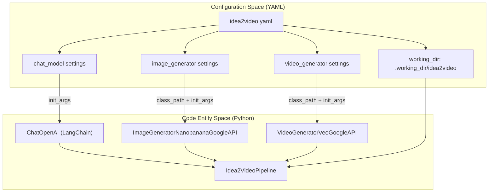
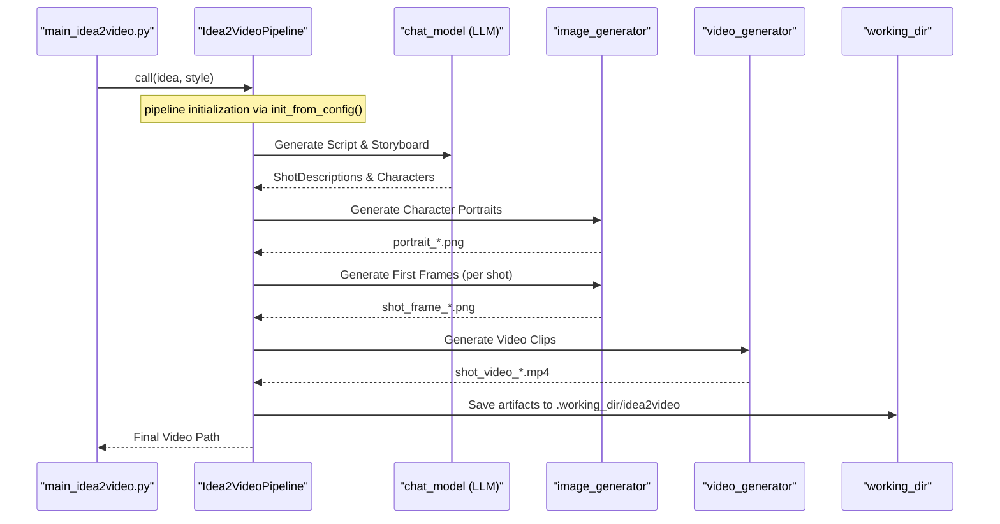

<!-- source: DeepWiki mcp.deepwiki.com · repo HKUDS/ViMax · page 8.2 idea2video.yaml Reference · fetched 2026-11-09 -->

# idea2video.yaml Reference

Relevant source files

The following files were used as context for generating this wiki page:

- [configs/idea2video.yaml](configs/idea2video.yaml)
- [configs/script2video.yaml](configs/script2video.yaml)
- [main_idea2video.py](main_idea2video.py)
- [main_script2video.py](main_script2video.py)

This document provides a complete technical reference for the `idea2video.yaml` configuration file, which governs the end-to-end pipeline from a natural language idea to a finished video. It details the service providers, model parameters, and rate-limiting controls that orchestrate the Idea2Video workflow.

## Purpose and Scope

The `idea2video.yaml` file defines the execution environment for the `Idea2VideoPipeline` [pipelines/idea2video_pipeline.py:2-2](). It serves as the central manifest for:

- **LLM Orchestration**: Configuring the chat model used by narrative and planning agents.
- **Visual Asset Generation**: Specifying the backends for image and video synthesis.
- **Throughput Control**: Defining rate limits (RPM/RPD) for every external service to prevent API exhaustion.
- **Persistence**: Setting the working directory for intermediate artifacts and final outputs.

**Sources:** [configs/idea2video.yaml:1-33](), [main_idea2video.py:22-23]()

## Configuration Loading Architecture

The configuration is loaded via the `init_from_config` method, which bridges the YAML definitions to concrete Python objects.

**Diagram: Mapping Configuration to Code Entities**

**Sources:** [configs/idea2video.yaml:1-33](), [main_idea2video.py:21-24]()

## chat_model Configuration

The `chat_model` block configures the primary LLM interface used by narrative agents like `ScriptPlanner` and `ScriptEnhancer`.

### Parameters
| Key | Type | Description |
|:---|:---|:---|
| `model` | string | The specific model identifier (e.g., `google/gemini-2.5-flash-lite-preview-09-2025`) [configs/idea2video.yaml:3]() |
| `model_provider` | string | The API protocol (usually `openai` for compatible endpoints) [configs/idea2video.yaml:4]() |
| `api_key` | string | API authentication token [configs/idea2video.yaml:5]() |
| `base_url` | string | The service endpoint (e.g., OpenRouter) [configs/idea2video.yaml:6]() |

### Rate Limits
| Key | Default | Description |
|:---|:---|:---|
| `max_requests_per_minute` | 500 | Throttle for chat API calls [configs/idea2video.yaml:9]() |
| `max_requests_per_day` | 2000 | Daily quota for chat API calls [configs/idea2video.yaml:10]() |

**Sources:** [configs/idea2video.yaml:1-10]()

## Visual Generator Configuration

ViMax uses a duck-typed generator pattern where the `class_path` determines which tool implementation is instantiated.

### image_generator
Configures the backend for character portraits and shot keyframes.
- **Default Class**: `tools.ImageGeneratorNanobananaGoogleAPI` [configs/idea2video.yaml:13]()
- **RPM/RPD**: 10 requests/min, 500 requests/day [configs/idea2video.yaml:18-19]()

### video_generator
Configures the backend for animating images into motion clips.
- **Default Class**: `tools.VideoGeneratorVeoGoogleAPI` [configs/idea2video.yaml:23]()
- **RPM/RPD**: 2 requests/min, 10 requests/day [configs/idea2video.yaml:28-29]()

**Sources:** [configs/idea2video.yaml:12-30]()

## Data Flow and Service Interaction

The following diagram illustrates how the `Idea2VideoPipeline` uses the configured entities during a typical execution run.

**Diagram: Runtime Interaction Flow**

**Sources:** [main_idea2video.py:21-27](), [configs/idea2video.yaml:32]()

## Comparison: Idea2Video vs. Script2Video

While both pipelines share similar structures, their configurations differ in rate limits and default working directories to reflect the complexity of their respective tasks.

| Feature | `idea2video.yaml` | `script2video.yaml` |
|:---|:---|:---|
| **Chat RPM** | 500 [configs/idea2video.yaml:9]() | `null` (Disabled) [configs/script2video.yaml:9]() |
| **Video RPD** | 10 [configs/idea2video.yaml:29]() | 50 [configs/script2video.yaml:30]() |
| **Working Dir** | `.working_dir/idea2video` [configs/idea2video.yaml:32]() | `.working_dir/script2video` [configs/script2video.yaml:33]() |

The higher chat rate limit in `idea2video.yaml` is due to the intensive narrative planning stages (ScriptPlanner, ScriptEnhancer) that are absent when starting directly from a script.

**Sources:** [configs/idea2video.yaml:1-33](), [configs/script2video.yaml:1-34]()

---

