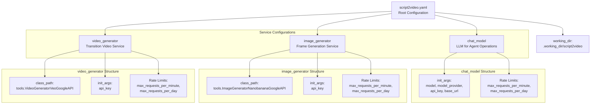
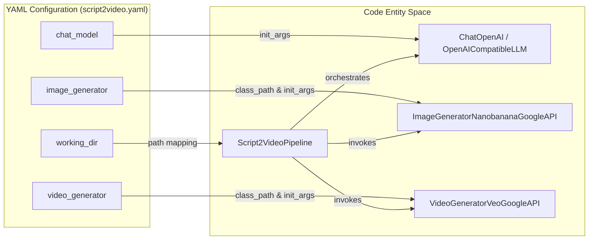
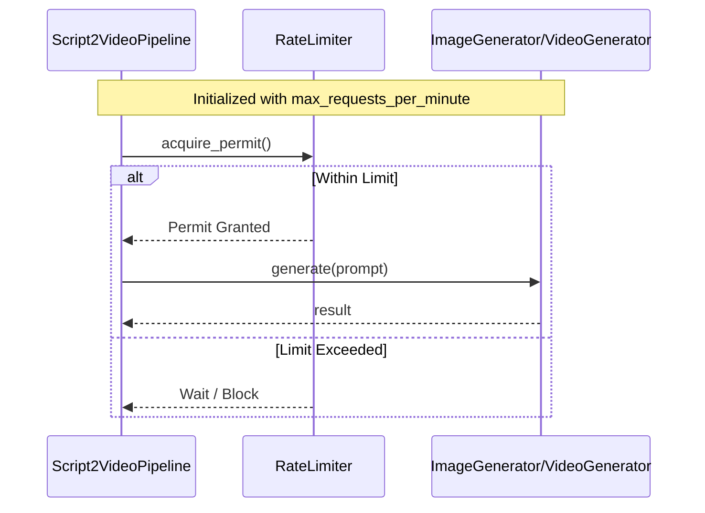

<!-- source: DeepWiki mcp.deepwiki.com · repo HKUDS/ViMax · page 8.3 script2video.yaml Reference · fetched 2026-11-09 -->

# script2video.yaml Reference

<details>
<summary>Relevant source files</summary>

The following files were used as context for generating this wiki page:

- [configs/idea2video.yaml](configs/idea2video.yaml)
- [configs/script2video.yaml](configs/script2video.yaml)
- [main_idea2video.py](main_idea2video.py)
- [main_script2video.py](main_script2video.py)

</details>


This page provides a complete reference for all configuration options in the `configs/script2video.yaml` file. This configuration file controls the behavior of the `Script2VideoPipeline`, which converts structured scene scripts into video sequences through storyboard design, shot decomposition, and parallel frame/video generation.

For configuration of the end-to-end idea-to-video workflow, see [idea2video.yaml Reference](). For architectural details on how configuration files are loaded, see [Configuration Architecture](). For service-specific configuration patterns, see [Service Provider Configuration]().

**Sources:** [configs/script2video.yaml:1-34]()

---

## Configuration Structure Overview

The `script2video.yaml` file defines three primary service configurations (chat model, image generator, video generator) and a working directory. Each service configuration includes initialization arguments and rate limiting parameters.



**Diagram:** Configuration hierarchy showing all top-level sections and their nested structures

**Sources:** [configs/script2video.yaml:1-34]()

---

## Configuration Sections

### chat_model

The `chat_model` section configures the language model used by all AI agents in the `Script2VideoPipeline`. This includes agents that require natural language understanding and generation for storyboard planning and character extraction.

| Field | Type | Required | Description |
|-------|------|----------|-------------|
| `init_args.model` | string | Yes | Model identifier passed to the API provider |
| `init_args.model_provider` | string | Yes | Provider type (`"openai"` for OpenRouter/OpenAI compatibility) |
| `init_args.api_key` | string | Yes | Authentication key for the API service |
| `init_args.base_url` | string | Yes | API endpoint URL |
| `max_requests_per_minute` | integer or null | No | Maximum API calls per minute (null = unlimited) |
| `max_requests_per_day` | integer or null | No | Maximum API calls per day (null = unlimited) |

#### Default Configuration

```yaml
chat_model:
  init_args:
    model: google/gemini-2.5-flash-lite-preview-09-2025
    model_provider: openai
    api_key:
    base_url: https://openrouter.ai/api/v1
  max_requests_per_minute: null
  max_requests_per_day: null
```

**Key Points:**
- **No rate limiting by default:** Both rate limit fields are set to `null` [configs/script2video.yaml:9-10](), allowing unrestricted API calls.
- **OpenRouter gateway:** Uses `openrouter.ai` as an aggregator to access Gemini models through OpenAI-compatible API [configs/script2video.yaml:4-6]().
- **Empty API key:** Must be populated before execution (see [Configuration Basics]()).

**Sources:** [configs/script2video.yaml:1-10]()

---

### image_generator

The `image_generator` section configures the service used for generating still frames (first and last frames of shots, reference character portraits).

| Field | Type | Required | Description |
|-------|------|----------|-------------|
| `class_path` | string | Yes | Fully-qualified Python class implementing the image generation interface |
| `init_args.api_key` | string | Yes | Authentication key for the image generation service |
| `max_requests_per_minute` | integer or null | No | Maximum API calls per minute (null = unlimited) |
| `max_requests_per_day` | integer or null | No | Maximum API calls per day (null = unlimited) |

#### Default Configuration

```yaml
image_generator:
  class_path: tools.ImageGeneratorNanobananaGoogleAPI
  init_args:
    api_key:
  max_requests_per_minute: 2
  max_requests_per_day: 50
```

**Key Points:**
- **Conservative rate limits:** Restricted to 2 requests/minute and 50 requests/day [configs/script2video.yaml:19-20](), reflecting API quotas.
- **Google Nanobanana API:** Uses Google's image synthesis service via the `ImageGeneratorNanobananaGoogleAPI` class [configs/script2video.yaml:13-14]().
- **Class path loading:** The string-based `class_path` enables runtime swapping of image generation providers.

**Sources:** [configs/script2video.yaml:13-20]()

---

### video_generator

The `video_generator` section configures the service used for generating video transitions between shots.

| Field | Type | Required | Description |
|-------|------|----------|-------------|
| `class_path` | string | Yes | Fully-qualified Python class implementing the video generation interface |
| `init_args.api_key` | string | Yes | Authentication key for the video generation service |
| `max_requests_per_minute` | integer or null | No | Maximum API calls per minute (null = unlimited) |
| `max_requests_per_day` | integer or null | No | Maximum API calls per day (null = unlimited) |

#### Default Configuration

```yaml
video_generator:
  class_path: tools.VideoGeneratorVeoGoogleAPI
  init_args:
    api_key:
  max_requests_per_minute: 2
  max_requests_per_day: 50
```

**Key Points:**
- **Rate limits:** Matches the image generator with 2 requests/minute and 50 requests/day [configs/script2video.yaml:29-30]().
- **Google Veo API:** Uses Google's video synthesis service via the `VideoGeneratorVeoGoogleAPI` class [configs/script2video.yaml:23-24]().

**Sources:** [configs/script2video.yaml:23-30]()

---

### working_dir

The `working_dir` field specifies the filesystem directory where all pipeline outputs and intermediate artifacts are stored.

```yaml
working_dir: .working_dir/script2video
```

**Sources:** [configs/script2video.yaml:33-34]()

---

## Configuration Loading and Data Flow

The following diagram maps the configuration file structure to the code entities that consume them during initialization.



**Diagram:** Mapping YAML configuration keys to specific code classes and instances.

**Sources:** [configs/script2video.yaml:1-34](), [main_script2video.py:28-30]()

---

## Configuration Comparison: script2video.yaml vs idea2video.yaml

The following table highlights key differences between the two configuration files.

| Section | script2video.yaml | idea2video.yaml | Rationale |
|---------|-------------------|-----------------|-----------|
| **chat_model rate limits** | `null` (unlimited) | 500 req/min, 2000 req/day | `Script2Video` processes existing scripts; `Idea2Video` requires more LLM calls for story expansion [configs/script2video.yaml:9-10](), [configs/idea2video.yaml:9-10]() |
| **image_generator rate limits** | 2 req/min, 50 req/day | 10 req/min, 500 req/day | `Idea2Video` typically handles larger batches of character/scene assets [configs/script2video.yaml:19-20](), [configs/idea2video.yaml:18-19]() |
| **video_generator rate limits** | 2 req/min, 50 req/day | 2 req/min, 10 req/day | `Idea2Video` default has a stricter daily quota for full-story generation [configs/script2video.yaml:29-30](), [configs/idea2video.yaml:28-29]() |
| **working_dir** | `.working_dir/script2video` | `.working_dir/idea2video` | Separation of pipeline artifacts [configs/script2video.yaml:33](), [configs/idea2video.yaml:32]() |

**Sources:** [configs/script2video.yaml:1-34](), [configs/idea2video.yaml:1-33]()

---

## Rate Limiting Logic

The system uses these configuration values to wrap tools in rate-limiting decorators or handlers.



**Diagram:** Execution flow for rate-limited service calls based on YAML settings.

**Sources:** [configs/script2video.yaml:17-20](), [configs/script2video.yaml:27-30]()

---

## Best Practices

1.  **API Key Management:** Always keep the `api_key` fields empty in the YAML file if you plan to share the codebase. Populate them via environment variables or a local `agent.local.yaml` override.
2.  **Conservative Bursting:** For video generation, keep `max_requests_per_minute` low (e.g., 2) as video generation services often have high latency and strict concurrency limits [configs/script2video.yaml:29]().
3.  **Working Directory:** Ensure the `working_dir` is on a drive with sufficient space, as high-resolution video generation can quickly consume gigabytes of storage [configs/script2video.yaml:33]().

**Sources:** [configs/script2video.yaml:1-34](), [main_script2video.py:28-30]()

---

