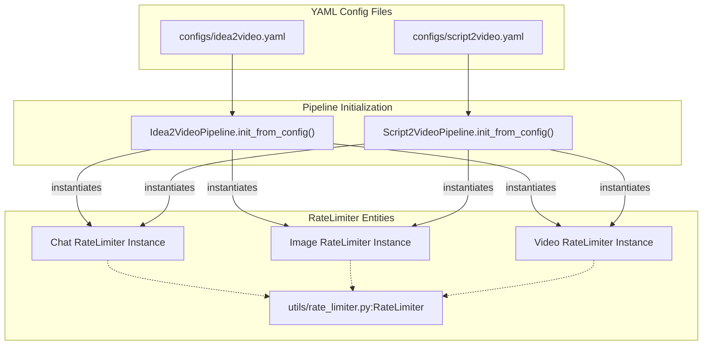
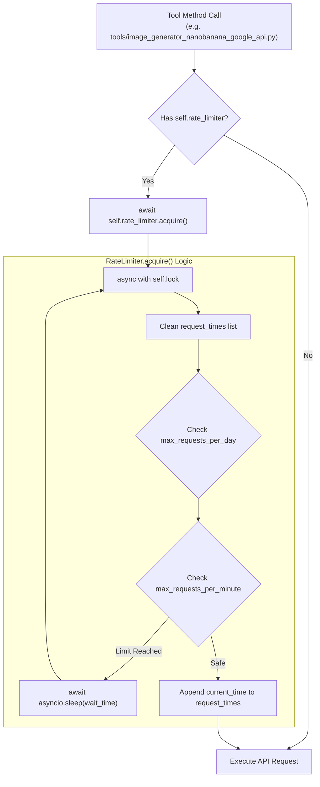

<!-- source: DeepWiki mcp.deepwiki.com · repo HKUDS/ViMax · page 8.4 Rate Limiting Configuration · fetched 2026-11-09 -->

# Rate Limiting Configuration

<details>
<summary>Relevant source files</summary>

The following files were used as context for generating this wiki page:

- [configs/idea2video.yaml](configs/idea2video.yaml)
- [configs/script2video.yaml](configs/script2video.yaml)
- [main_idea2video.py](main_idea2video.py)
- [main_script2video.py](main_script2video.py)
- [tests/test_hygiene_guards.py](tests/test_hygiene_guards.py)
- [utils/rate_limiter.py](utils/rate_limiter.py)

</details>


This document describes the rate limiting system in ViMax, which controls the frequency of API requests to external services (chat models, image generators, and video generators). Rate limiting prevents quota exhaustion, avoids HTTP 429 errors, and enables predictable resource consumption across different deployment scenarios.

---

## Configuration Structure

Rate limiting is configured in YAML files through service-specific parameters. Each external service (chat model, image generator, video generator) can have independent rate limits.

### YAML Configuration Format

Rate limits are specified under each service configuration section:

```yaml
service_name:
  init_args:
    # Service initialization parameters
  max_requests_per_minute: <integer or null>
  max_requests_per_day: <integer or null>
```

Setting a parameter to `null` disables that specific limit. If both parameters are `null`, rate limiting is completely disabled for that service.

**Sources:** [configs/script2video.yaml:7-10](), [configs/script2video.yaml:17-20](), [configs/script2video.yaml:27-30](), [configs/idea2video.yaml:7-10](), [configs/idea2video.yaml:16-19](), [configs/idea2video.yaml:26-29]()

---

## Rate Limiting Parameters

### max_requests_per_minute

Maximum number of API requests allowed per 60-second rolling window. The system enforces a minimum delay between consecutive requests calculated as `60.0 / max_requests_per_minute` seconds [utils/rate_limiter.py:34-35]().

**Enforcement Behavior:**
- When the limit is reached, the system blocks and waits until the oldest request in the window expires [utils/rate_limiter.py:78-80]().
- It also ensures a `min_delay` between consecutive requests to smooth out traffic [utils/rate_limiter.py:81-85]().
- Console output displays: `"Rate limit reached (X requests/min). Waiting Y.Zs..."` [utils/rate_limiter.py:80-80]().

### max_requests_per_day

Maximum number of API requests allowed per 24-hour (86400 seconds) rolling window. Provides protection against daily quota exhaustion [utils/rate_limiter.py:68-71]().

**Enforcement Behavior:**
- When the limit is reached, the system blocks and waits until the oldest request in the 24-hour window expires [utils/rate_limiter.py:71-71]().
- Console output displays: `"Daily rate limit reached (X requests/day). Waiting Y.Z hours..."` [utils/rate_limiter.py:73-73]().

### Null Values

Setting either parameter to `null` disables that limit. If both are `null`, the `acquire()` method returns immediately without blocking [utils/rate_limiter.py:50-52]().

**Sources:** [utils/rate_limiter.py:14-38](), [utils/rate_limiter.py:50-94]()

---

## Operational Mode Configurations

ViMax uses different rate limit profiles for different operational modes, reflecting the distinct resource consumption patterns of each workflow.

### Idea2Video Configuration

Optimized for high-volume creative brainstorming and character reference generation.

| Service | max_requests_per_minute | max_requests_per_day |
| :--- | :--- | :--- |
| Chat Model | 500 | 2000 |
| Image Generator | 10 | 500 |
| Video Generator | 2 | 10 |

**Sources:** [configs/idea2video.yaml:9-29]()

### Script2Video Configuration

Optimized for production-ready rendering of established scripts.

| Service | max_requests_per_minute | max_requests_per_day |
| :--- | :--- | :--- |
| Chat Model | null (Disabled) | null (Disabled) |
| Image Generator | 2 | 50 |
| Video Generator | 2 | 50 |

**Sources:** [configs/script2video.yaml:9-30]()

---

## Configuration Flow Architecture

The following diagram bridges the YAML configuration space to the `RateLimiter` class instances within the runtime.



**Diagram: Rate Limiter Configuration and Initialization Flow**

**Sources:** [main_idea2video.py:22-23](), [main_script2video.py:29-29](), [utils/rate_limiter.py:6-18]()

---

## Runtime Enforcement

### Acquire Pattern

Before making API calls, services check if a rate limiter is configured and call `acquire()`. The `RateLimiter` uses an `asyncio.Lock` to ensure thread-safe tracking of request timestamps [utils/rate_limiter.py:31-31]().



**Diagram: Rate Limiting Enforcement Flow**

**Sources:** [utils/rate_limiter.py:39-94](), [utils/rate_limiter.py:56-56]()

### Locking Behavior

The `RateLimiter` implementation is designed to be "hygiene-friendly." It only holds the `asyncio.Lock` while checking limits and recording timestamps [utils/rate_limiter.py:45-49](). It explicitly releases the lock before `await asyncio.sleep()`, allowing other concurrent tasks to check their status instead of blocking the entire event loop [tests/test_hygiene_guards.py:22-31]().

---

## Implementation Reference

### Key Classes and Methods

| Component | Location | Purpose |
|-----------|----------|---------|
| `RateLimiter` | [utils/rate_limiter.py:6-12]() | Controls API request frequency based on rolling windows. |
| `RateLimiter.acquire` | [utils/rate_limiter.py:39-94]() | Blocks execution until a request slot is available. |
| `RateLimiter.min_delay` | [utils/rate_limiter.py:33-37]() | Calculates forced spacing between requests (60/RPM). |
| `request_times` | [utils/rate_limiter.py:30-30]() | Internal list tracking timestamps of successful `acquire` calls. |

### Configuration Resolution

The pipeline entry points (e.g., `main_idea2video.py`) load these settings via `init_from_config` [main_idea2video.py:22-23](). If limits are set to `null` in the YAML, the `RateLimiter` is initialized with `None` values, effectively disabling the logic [utils/rate_limiter.py:50-52]().

**Sources:** [utils/rate_limiter.py:1-94](), [main_idea2video.py:21-24](), [main_script2video.py:28-30]()

---

