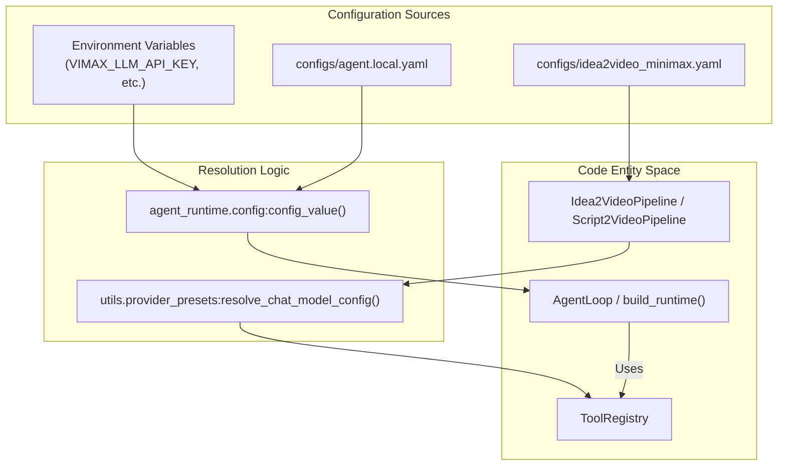
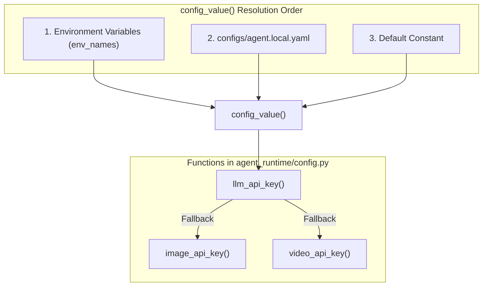

<!-- source: DeepWiki mcp.deepwiki.com · repo HKUDS/ViMax · page 8.5 Service Provider Configuration · fetched 2026-11-09 -->

# Service Provider Configuration

<details>
<summary>Relevant source files</summary>

The following files were used as context for generating this wiki page:

- [agent_runtime/__init__.py](agent_runtime/__init__.py)
- [agent_runtime/config.py](agent_runtime/config.py)
- [agent_runtime/tool_executor.py](agent_runtime/tool_executor.py)
- [configs/idea2video_minimax.yaml](configs/idea2video_minimax.yaml)
- [configs/script2video_minimax.yaml](configs/script2video_minimax.yaml)
- [tests/__init__.py](tests/__init__.py)
- [tests/test_provider_presets.py](tests/test_provider_presets.py)
- [utils/provider_presets.py](utils/provider_presets.py)

</details>


## Purpose and Scope

This document explains how to configure the core external service providers in ViMax: chat models (LLMs), image generators, video generators, embedding models, and rerankers. Each service provider is configured through YAML files—primarily `configs/agent.local.yaml` for the agentic loop and pipeline-specific YAMLs (e.g., `idea2video_minimax.yaml`) for direct pipeline execution.

For information about rate limiting parameters and strategies, see [Rate Limiting Configuration (8.4)](). For the overall structure of configuration files, see [Configuration Architecture (8.1)]().

---

## Configuration Structure Overview

ViMax uses a dual configuration system. The **Agent Runtime** relies on `agent_runtime/config.py` to resolve values from environment variables or `configs/agent.local.yaml`. The **Direct Pipelines** use standalone YAML files that specify class paths and initialization arguments.

### Service Configuration Data Flow



**Diagram: Configuration Resolution and Entity Mapping**

Sources: [agent_runtime/config.py:36-46](), [utils/provider_presets.py:34-47](), [agent_runtime/loop.py:1-20]()

---

## Chat Model Configuration

The `chat_model` section configures the LLM used for story development, character extraction, and agent reasoning. ViMax includes a **Provider Preset System** to simplify configuration for common providers like MiniMax.

### Provider Presets (MiniMax Example)
The system allows using a `model_provider` alias which automatically fills in base URLs and default models. For instance, setting `model_provider: minimax` triggers the following preset:
* **Base URL**: `https://api.minimax.io/v1` [utils/provider_presets.py:21]()
* **Environment Key**: `MINIMAX_API_KEY` [utils/provider_presets.py:22]()
* **Default Model**: `MiniMax-M3` [utils/provider_presets.py:23]()

### Configuration Fields

| Field | Type | Description |
|-------|------|-------------|
| `model` | string | Model identifier (e.g., `MiniMax-M3`, `gpt-4o`) |
| `model_provider` | string | Provider type: `openai`, `minimax`, `google` |
| `api_key` | string | API authentication key (falls back to env vars) |
| `base_url` | string | API endpoint (auto-resolved for presets) |
| `temperature` | float | Sampling temperature (clamped per provider range) |

### Example: MiniMax Configuration
```yaml
chat_model:
  init_args:
    model: MiniMax-M3
    model_provider: minimax
    api_key:  # Leave empty to use MINIMAX_API_KEY env var
  max_requests_per_minute: 500
```

Sources: [utils/provider_presets.py:19-31](), [configs/idea2video_minimax.yaml:10-17]()

---

## Image and Video Generator Configuration

Generators are configured via `class_path` for dynamic instantiation.

### Image Generators
| Class Path | Implementation Detail |
|------------|-----------------------|
| `tools.ImageGeneratorNanobananaGoogleAPI` | Uses Google Gemini via Nanobanana relay. |

### Video Generators
| Class Path | Implementation Detail |
|------------|-----------------------|
| `tools.VideoGeneratorVeoGoogleAPI` | Uses Google Veo API. |

### Example Configuration (Idea2Video)
```yaml
image_generator:
  class_path: tools.ImageGeneratorNanobananaGoogleAPI
  init_args:
    api_key: your_key
  max_requests_per_minute: 10

video_generator:
  class_path: tools.VideoGeneratorVeoGoogleAPI
  init_args:
    api_key: your_key
  max_requests_per_minute: 2
```

Sources: [configs/idea2video_minimax.yaml:19-31](), [agent_runtime/config.py:65-74]()

---

## Embedding and Reranker Services

For RAG-based workflows (e.g., long script generation), ViMax requires embedding and reranking services. These are primarily configured via `agent.local.yaml` or environment variables.

### Default Settings
* **Embedding Model**: `text-embedding-3-small` (Provider: `openai`) [agent_runtime/config.py:17-18]()
* **Reranker Model**: `BAAI/bge-reranker-v2-m3` [agent_runtime/config.py:19]()

### Environment Variables
* `VIMAX_EMBEDDING_API_KEY`: API key for embedding service. [agent_runtime/config.py:91]()
* `VIMAX_RERANKER_BASE_URL`: Custom endpoint for reranker (e.g., local TEI server). [agent_runtime/config.py:99]()

---

## Implementation Details: Configuration Resolution

The `agent_runtime.config` module provides a tiered resolution strategy for all service parameters.



**Diagram: Tiered Configuration Resolution in `agent_runtime/config.py`**

### Key Resolution Functions
* **`config_value(section, key, env_names, default)`**: The core utility that checks environment variables first, then the local YAML file, and finally returns a hardcoded default. [agent_runtime/config.py:36-46]()
* **`resolve_chat_model_config(init_args)`**: Specifically for LLMs, it converts provider aliases (like `minimax`) into standard `openai` provider types with the correct `base_url` for LangChain compatibility. [utils/provider_presets.py:34-87]()
* **`api_provider_from_base_url(base_url)`**: Infers the transport gateway (e.g., `openrouter`, `yunwu`) based on the URL string. [agent_runtime/config.py:118-124]()

Sources: [agent_runtime/config.py:36-115](), [utils/provider_presets.py:34-87]()

---

## Configuration Best Practices

### API Key Fallbacks
The system is designed with a hierarchy for API keys to minimize configuration overhead. `image_api_key()` and `video_api_key()` will automatically fall back to `llm_api_key()` if they are not explicitly set. [agent_runtime/config.py:74](), [agent_runtime/config.py:115]()

### Temperature Clamping
When using providers like MiniMax, the system automatically clamps the `temperature` to the supported range (e.g., 0.0 to 1.0) to prevent API errors. [utils/provider_presets.py:73-82]()

### Rate Limit Nullification
Setting `max_requests_per_minute` or `max_requests_per_day` to `null` in YAML disables the rate limiter for that specific service, allowing for maximum throughput if the provider has no quotas. [configs/script2video_minimax.yaml:16-17]()

Sources: [agent_runtime/config.py:74](), [utils/provider_presets.py:73-82](), [configs/script2video_minimax.yaml:16-17]()

---

