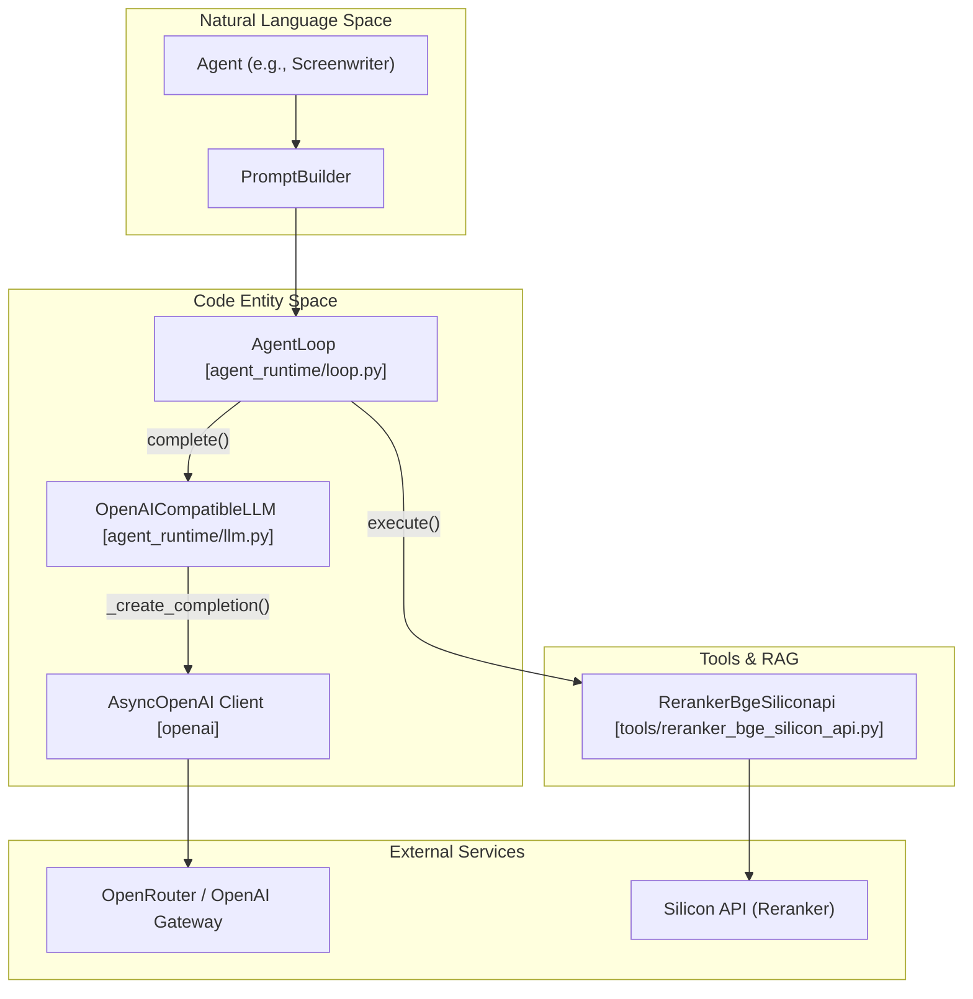
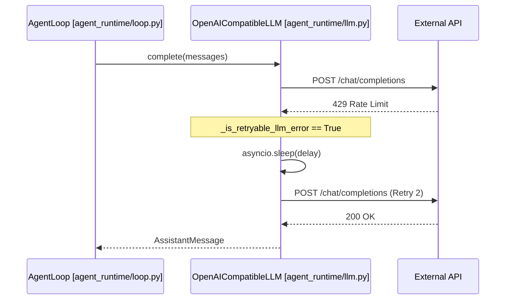

<!-- source: DeepWiki mcp.deepwiki.com · repo HKUDS/ViMax · page 9.2 LLM and Chat Services · fetched 2026-11-09 -->

# LLM and Chat Services

Relevant source files

The following files were used as context for generating this wiki page:

- [agent_runtime/__init__.py](agent_runtime/__init__.py)
- [agent_runtime/config.py](agent_runtime/config.py)
- [agent_runtime/llm.py](agent_runtime/llm.py)
- [agent_runtime/tool_executor.py](agent_runtime/tool_executor.py)
- [tests/test_robustness.py](tests/test_robustness.py)
- [tools/image_generator_doubao_seedream_yunwu_api.py](tools/image_generator_doubao_seedream_yunwu_api.py)
- [tools/reranker_bge_silicon_api.py](tools/reranker_bge_silicon_api.py)

## Purpose and Scope

This document covers the Large Language Model (LLM) and chat service integration in ViMax, including:

- **LangChain Integration**: Unified abstraction for agent communication.
- **OpenAI-Compatible Wrapper**: Implementation of `OpenAICompatibleLLM` in `agent_runtime/llm.py` [agent_runtime/llm.py:43-50]().
- **Configuration Management**: Centralized settings via `agent_runtime/config.py` and YAML files [agent_runtime/config.py:1-135]().
- **Retry and Error Handling**: Robustness strategies for API failures and rate limits [agent_runtime/llm.py:21-33]().
- **External Services**: Integration with OpenRouter, OpenAI, and Silicon API for reranking [tools/reranker_bge_silicon_api.py:8-17]().

---

## Architecture and Data Flow

ViMax uses a tiered architecture to bridge high-level agent logic with low-level API communication. The `OpenAICompatibleLLM` class serves as the primary engine for the `AgentLoop`.

### LLM Integration Flow

The following diagram illustrates how natural language prompts from agents are processed through the runtime into API calls.

**Sources:** [agent_runtime/llm.py:43-52](), [agent_runtime/loop.py:18](), [tools/reranker_bge_silicon_api.py:8-17](), [agent_runtime/prompts.py:19]()

---

## OpenAICompatibleLLM Wrapper

The `OpenAICompatibleLLM` class is the core interface for chat completions. It is designed to be provider-agnostic by following the OpenAI API specification, enabling support for OpenAI, OpenRouter, and other compatible gateways [agent_runtime/llm.py:43-50]().

### Key Features
- **Initialization**: Automatically loads configuration (model, base URL, API key) from environment variables or `agent.local.yaml` [agent_runtime/llm.py:44-50]().
- **Automatic Retries**: Implements a retry mechanism for status codes `429` (Rate Limit) and `>=500` (Server Error) with exponential backoff [agent_runtime/llm.py:21-29, 72-80]().
- **Shape Validation**: Includes `LLMResponseShapeError` to handle malformed responses from various providers [agent_runtime/llm.py:32-33, 109-122]().
- **Tool Support**: Extracts and parses `tool_calls` from assistant messages for agentic workflows [agent_runtime/llm.py:95-106]().

### Implementation Details

| Function | Description |
|:---|:---|
| `complete()` | High-level method that attempts completion with varying tool choices [agent_runtime/llm.py:52-69](). |
| `_create_completion_with_retries()` | Manages the retry loop using `LLM_MAX_ATTEMPTS` [agent_runtime/llm.py:71-80](). |
| `_assistant_message_from_response()` | Converts raw API responses into a structured `AssistantMessage` [agent_runtime/llm.py:95-106](). |

**Sources:** [agent_runtime/llm.py:16-106]()

---

## Configuration System

ViMax uses a hierarchical configuration system managed in `agent_runtime/config.py`. It prioritizes environment variables over local YAML settings.

### Configuration Resolution Order
1. **Environment Variables**: e.g., `VIMAX_LLM_API_KEY` [agent_runtime/config.py:37-40]().
2. **YAML File**: `configs/agent.local.yaml` [agent_runtime/config.py:24, 41-45]().
3. **Defaults**: Hardcoded fallback values [agent_runtime/config.py:10-20]().

### LLM and Reranker Defaults

| Service | Model Key | Default Value |
|:---|:---|:---|
| Chat LLM | `llm.model` | `gpt-5.5` [agent_runtime/config.py:10]() |
| Base URL | `llm.base_url` | `https://yunwu.ai/v1` [agent_runtime/config.py:12]() |
| Reranker | `reranker.model` | `BAAI/bge-reranker-v2-m3` [agent_runtime/config.py:19]() |
| Embedding | `embedding.model` | `text-embedding-3-small` [agent_runtime/config.py:17]() |

**Sources:** [agent_runtime/config.py:1-115]()

---

## Robustness and Error Handling

ViMax implements strict error boundaries to ensure the `AgentLoop` can persist even if an LLM call fails.

### Retry Logic
The system uses the `tenacity` library for most tool-based API calls and a custom loop for the primary LLM client.

- **LLM Retries**: 3 attempts with backoff (1s, 4s) [agent_runtime/llm.py:16-18]().
- **Tool Retries**: Tools like `RerankerBgeSiliconapi` and `ImageGeneratorDoubaoSeedreamYunwuAPI` use `wait_exponential` and `stop_after_attempt(3)` [tools/reranker_bge_silicon_api.py:21-27](), [tools/image_generator_doubao_seedream_yunwu_api.py:25-31]().

### Error Handling Diagram

**Sources:** [agent_runtime/llm.py:21-29, 72-80](), [tests/test_robustness.py:51-56]()

---

## Specialized Chat Services

### Reranking with Silicon API
The `RerankerBgeSiliconapi` class provides a specialized chat-adjacent service for document ranking in RAG workflows. It uses a `POST /rerank` endpoint rather than the standard chat completion endpoint [tools/reranker_bge_silicon_api.py:35-54]().

### Image Generation via Chat-like APIs
Some image providers (e.g., Doubao Seedream via Yunwu) use a payload structure similar to LLM requests, requiring an API key and model identifier, and returning a URL [tools/image_generator_doubao_seedream_yunwu_api.py:49-74]().

**Sources:** [tools/reranker_bge_silicon_api.py:8-83](), [tools/image_generator_doubao_seedream_yunwu_api.py:13-75]()

---

