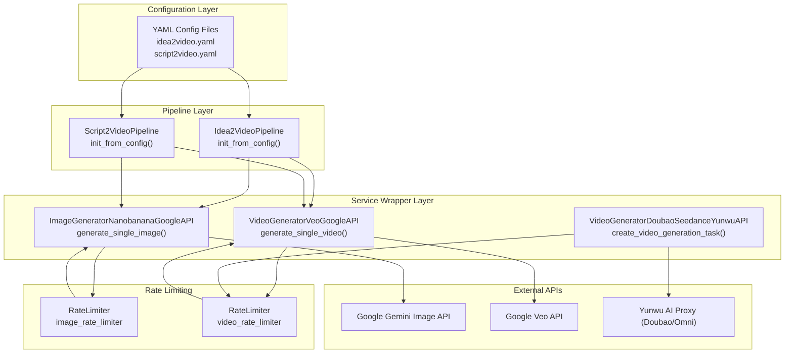
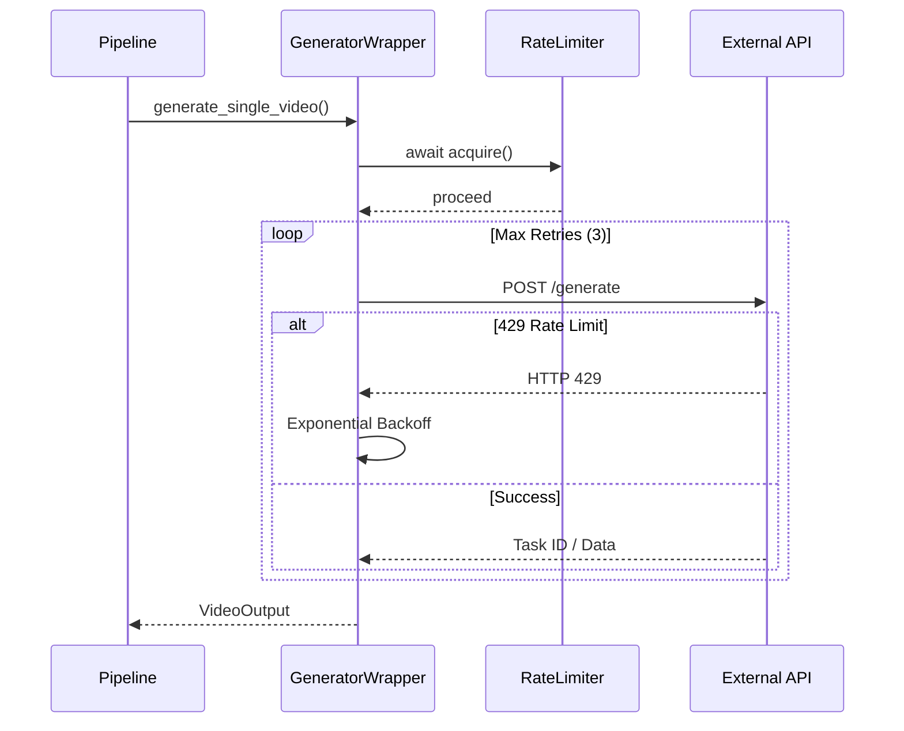

<!-- source: DeepWiki mcp.deepwiki.com · repo HKUDS/ViMax · page 9.3 Image and Video Generation Services · fetched 2026-11-09 -->

# Image and Video Generation Services

Relevant source files

The following files were used as context for generating this wiki page:

- [tests/test_generator_protocol.py](tests/test_generator_protocol.py)
- [tests/test_hang_guards.py](tests/test_hang_guards.py)
- [tools/image_generator_nanobanana_google_api.py](tools/image_generator_nanobanana_google_api.py)
- [tools/image_generator_nanobanana_yunwu_api.py](tools/image_generator_nanobanana_yunwu_api.py)
- [tools/video_generator_doubao_seedance_yunwu_api.py](tools/video_generator_doubao_seedance_yunwu_api.py)
- [tools/video_generator_omni_yunwu_api.py](tools/video_generator_omni_yunwu_api.py)
- [tools/video_generator_veo_google_api.py](tools/video_generator_veo_google_api.py)
- [utils/image.py](utils/image.py)
- [utils/retry.py](utils/retry.py)

This document covers the external image and video generation API services used by ViMax for synthesizing visual content. It documents the wrapper classes for Google (Nanobanana, Veo), Doubao (Seedance), Omni, and OpenRouter, focusing on their generation modes, rate limiting integration, and protocol compliance.

For information about the AI agents that use these services (e.g., `CharacterPortraitsGenerator`, `CameraImageGenerator`), see [Character Management Agents](5.3) and [Camera and Motion Agents](5.5). For LLM services used for text generation and reasoning, see [LLM and Chat Services](9.2). For post-processing video operations, see [Video Processing Stack](9.4).

---

## Service Architecture Overview

ViMax abstracts visual generation through a set of tool wrappers that implement common interfaces. These services are instantiated through configuration files and injected with `RateLimiter` instances to manage API quota consumption.

### Supported Service Providers

| Service Category | Implementations | Key Models |
| :--- | :--- | :--- |
| **Image Generation** | `ImageGeneratorNanobananaGoogleAPI` `ImageGeneratorNanobananaYunwuAPI` | `gemini-2.5-flash-image` |
| **Video Generation** | `VideoGeneratorVeoGoogleAPI` `VideoGeneratorVeoYunwuAPI` `VideoGeneratorDoubaoSeedanceYunwuAPI` `VideoGeneratorOmniYunwuAPI` `VideoGeneratorOpenRouterAPI` | `veo-3.1-generate-preview` `doubao-seedance-1-0` `omni-flash` |

### Service Integration Pattern

**Diagram: Service instantiation and multi-provider architecture**

Sources: [pipelines/idea2video_pipeline.py:36-116](), [pipelines/script2video_pipeline.py:49-125](), [tools/video_generator_doubao_seedance_yunwu_api.py:9-26]()

---

## Image Generation Services

### ImageGeneratorNanobanana (Google & Yunwu)

ViMax supports Google's Nanobanana image generation directly via the Google SDK or through the Yunwu proxy.

**Class Locations:** 
- [tools/image_generator_nanobanana_google_api.py:18-28]()
- [tools/image_generator_nanobanana_yunwu_api.py:15-30]()

#### Generation Workflow
The `generate_single_image` method follows a standard flow:
1. **Rate Limiting:** Acquires a slot from the `RateLimiter` [tools/image_generator_nanobanana_google_api.py:46-47]().
2. **Reference Processing:** Opens local paths as `PIL.Image` objects [tools/image_generator_nanobanana_google_api.py:49]().
3. **API Call:** Sends text and images to `generate_content` with `response_modalities=["IMAGE"]` [tools/image_generator_nanobanana_google_api.py:57-66]().
4. **Orientation Guard:** Optionally enforces landscape orientation using `ensure_not_portrait` [tools/image_generator_nanobanana_google_api.py:88-94]().

#### Yunwu Proxy Differences
The Yunwu implementation `ImageGeneratorNanobananaYunwuAPI` configures the `genai.Client` with a custom `base_url` and `api_version="v1beta"` to route through the proxy service [tools/image_generator_nanobanana_yunwu_api.py:22-28]().

---

## Video Generation Services

### VideoGeneratorVeo (Google & Yunwu)

Wraps the Google Veo API for high-quality video preview generation.

**Class Location:** [tools/video_generator_veo_google_api.py:13-30]()

#### Generation Modes
Veo selects the model based on the reference count:
- **0 Images:** Text-to-Video (T2V) [tools/video_generator_veo_google_api.py:50-51]().
- **1 Image:** First-Frame-to-Video (FF2V) [tools/video_generator_veo_google_api.py:52-54]().
- **2 Images:** First+Last-Frame interpolation (FLF2V). *Note: The public Gemini API often requires falling back to FF2V for 2 images if not allowlisted* [tools/video_generator_veo_google_api.py:55-68]().

### Doubao Seedance (Yunwu API)

The `VideoGeneratorDoubaoSeedanceYunwuAPI` implements an asynchronous task-based workflow.

**Class Location:** [tools/video_generator_doubao_seedance_yunwu_api.py:9-26]()

1. **Task Creation:** `create_video_generation_task` sends a POST request to Yunwu with base64 encoded images [tools/video_generator_doubao_seedance_yunwu_api.py:29-128]().
2. **Polling:** `query_video_generation_task` polls the status endpoint until `succeeded` or `failed` [tools/video_generator_doubao_seedance_yunwu_api.py:132-184]().
3. **Download:** The resulting URL is downloaded and wrapped in a `VideoOutput`.

### Omni (Yunwu API)

`VideoGeneratorOmniYunwuAPI` supports up to 3 reference images and specific features like `enable_upsample`.

**Class Location:** [tools/video_generator_omni_yunwu_api.py:12-37]()

#### Payload Construction
Omni uses a numeric `type` field in the payload:
- `type: 1`: Text-to-video.
- `type: 2`: Image-to-video (1-2 images).
- `type: 3`: Multi-image-to-video (3 images).
[tools/video_generator_omni_yunwu_api.py:70-78]()

---

## Technical Patterns and Protocols

### The VideoGenerator Protocol
Every video generator must accept `**kwargs` in its `generate_single_video` method. This is because pipelines pass `progress=` callbacks which not all backends utilize, but all must accept to avoid `TypeError` [tests/test_generator_protocol.py:1-3]().

### Rate Limiting and Retry Logic
All services integrate with `utils.rate_limiter.RateLimiter`.

**Diagram: Request lifecycle with rate limiting and retry logic**

Sources: [tools/image_generator_nanobanana_google_api.py:55-72](), [tools/video_generator_veo_google_api.py:78-98](), [utils/retry.py:23-29]()

### Error Handling Guards
The system includes regression tests to ensure that polling loops and download retries are bounded. 
- `download_image` and `download_video` give up after a persistent network error to prevent hanging the suite [tests/test_hang_guards.py:36-49]().
- Client errors (4xx) fail fast and are not retried [tests/test_hang_guards.py:50-66]().

Sources: [utils/retry.py:14-29](), [tests/test_hang_guards.py:134-176]()

### Utility Functions
- **Base64 Conversion:** `image_path_to_b64` is used to prepare images for JSON payloads in Yunwu and Omni APIs [utils/image.py:29-39]().
- **Download Retry:** `download_retry` decorator handles transient network failures during asset retrieval [utils/image.py:11-26]().

Sources: [utils/image.py:1-61](), [utils/retry.py:7-12]()

---

