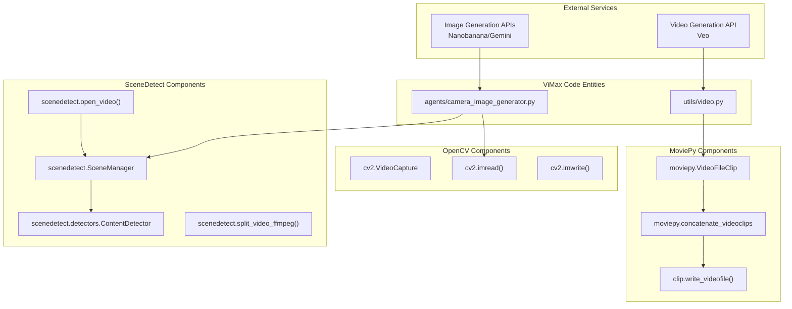
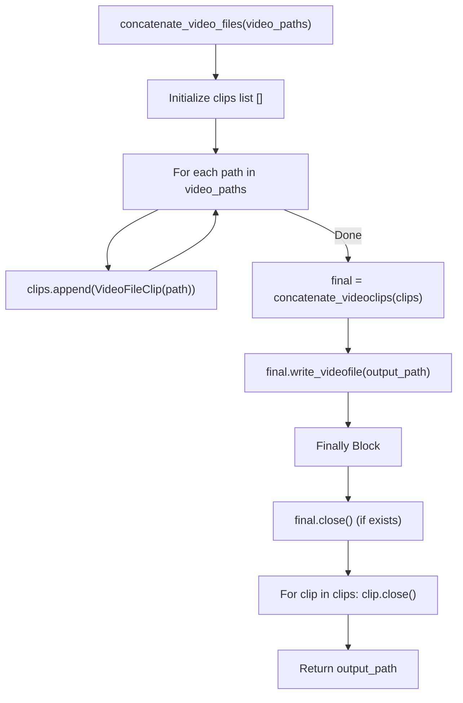
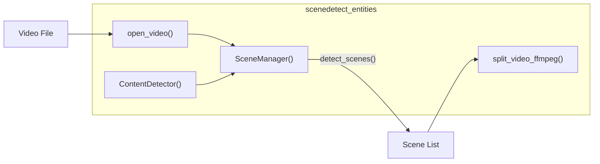

<!-- source: DeepWiki mcp.deepwiki.com · repo HKUDS/ViMax · page 9.4 Video Processing Stack · fetched 2026-11-09 -->

# Video Processing Stack

Relevant source files

The following files were used as context for generating this wiki page:

- [agents/camera_image_generator.py](agents/camera_image_generator.py)
- [pyproject.toml](pyproject.toml)
- [utils/video.py](utils/video.py)
- [uv.lock](uv.lock)
- [vimax](vimax)

## Overview

ViMax uses three local video processing tools for video assembly, frame manipulation, and scene analysis: MoviePy (version ≥2.2.1), OpenCV (`opencv-python`), and SceneDetect (version ≥0.6.7.1 with opencv extras). These dependencies handle video concatenation, frame-level processing, and automated scene boundary detection without requiring external API calls.

The core implementation for video utility functions is located in `utils/video.py`, which provides robust methods for downloading and concatenating video assets.

**Sources:** [pyproject.toml:15-17](), [pyproject.toml:21](), [utils/video.py:1-45]()

---

## Architecture and Pipeline Integration

The video processing stack operates during the Visual Synthesis & Assembly stage and supports the Script Understanding stage. All three tools run locally without external API dependencies.

**Video Processing Stack Architecture**

**Sources:** [utils/video.py:3](), [agents/camera_image_generator.py:3](), [agents/camera_image_generator.py:10-11](), [agents/camera_image_generator.py:16]()

---

## MoviePy (≥2.2.1)

MoviePy provides the video editing framework for assembling generated clips into final video sequences. ViMax uses MoviePy for video composition and timeline management, specifically through the `VideoFileClip` and `concatenate_videoclips` utilities.

### Core API Surface in ViMax

| Function/Class | Module | Purpose |
|----------------|--------|---------|
| `VideoFileClip` | `moviepy` | Load video files generated by video backends |
| `concatenate_videoclips` | `moviepy` | Join multiple clips into a single sequence |
| `clip.write_videofile()` | `moviepy` | Export the final concatenated video to disk |
| `clip.close()` | `moviepy` | Release file handles and ffmpeg subprocesses |

### Robust Concatenation Logic

ViMax implements a specialized wrapper `concatenate_video_files` in `utils/video.py` to handle potential resource leaks. Each `VideoFileClip` instance maintains an open file handle and an ffmpeg subprocess. To prevent exhausting file descriptors during long multi-scene runs, ViMax explicitly closes every clip in a `finally` block.

**Concatenation Flow**

**Sources:** [utils/video.py:26-44](), [pyproject.toml:15]()

---

## OpenCV (opencv-python)

OpenCV (`cv2` module) provides low-level video and image processing. ViMax uses OpenCV for frame extraction, dimension standardization, and as a backend for scene detection.

### Integration with Camera Image Generation

The `CameraImageGenerator` agent utilizes OpenCV to process visual assets. This includes reading generated images for analysis and interacting with video streams.

| Function | Purpose |
|----------|---------|
| `cv2.imread()` | Load images generated by visual agents for processing |
| `cv2.VideoCapture()` | (via SceneDetect) Open video streams for analysis |

**Sources:** [agents/camera_image_generator.py:3](), [pyproject.toml:17]()

---

## SceneDetect (≥0.6.7.1)

SceneDetect provides automated scene boundary detection. In ViMax, this is used to analyze video content and potentially split videos based on visual changes.

### Core Components used in `camera_image_generator.py`

- **`open_video`**: Opens a video file for analysis.
- **`SceneManager`**: The primary coordinator for the detection process.
- **`ContentDetector`**: An algorithm that detects scene changes by comparing the content of adjacent frames.
- **`split_video_ffmpeg`**: A utility to physically split video files based on detected scene boundaries.

**Scene Detection Logic**

**Sources:** [agents/camera_image_generator.py:10-11](), [pyproject.toml:21]()

---

## Utility Functions: `utils/video.py`

This file serves as the centralized bridge between the raw libraries and the ViMax pipeline requirements.

### Video Downloading
The `download_video` function uses the `requests` library to stream video content from a URL to a local path. It is decorated with `@download_retry` to handle transient network failures.

- **Timeout**: Uses a connect timeout of 10s and a read timeout of 300s.
- **Streaming**: Downloads in chunks of 8192 bytes to manage memory efficiently.

### Video Concatenation
The `concatenate_video_files` function wraps MoviePy's concatenation logic. It defaults to the `libx264` codec and `medium` preset for encoding.

**Sources:** [utils/video.py:7-24](), [utils/video.py:26-44]()

---

## Dependency Configuration

The video stack dependencies are managed via `pyproject.toml`. ViMax requires Python 3.12 or higher.

| Dependency | Version | Purpose |
|------------|---------|---------|
| `moviepy` | `^2.2.1` | Video assembly and editing |
| `opencv-python` | (latest) | Image and frame processing |
| `scenedetect[opencv]`| `^0.6.7.1` | Automated scene detection |
| `pillow` | `^11.3.0` | Image manipulation (PIL) |

**Sources:** [pyproject.toml:6](), [pyproject.toml:15-18](), [pyproject.toml:21]()

---

