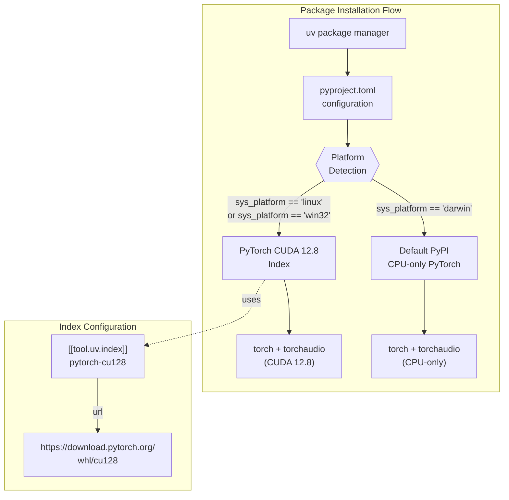
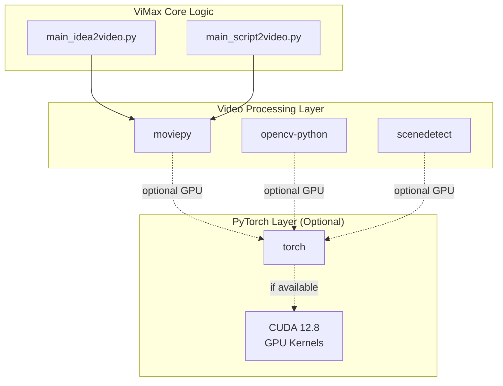
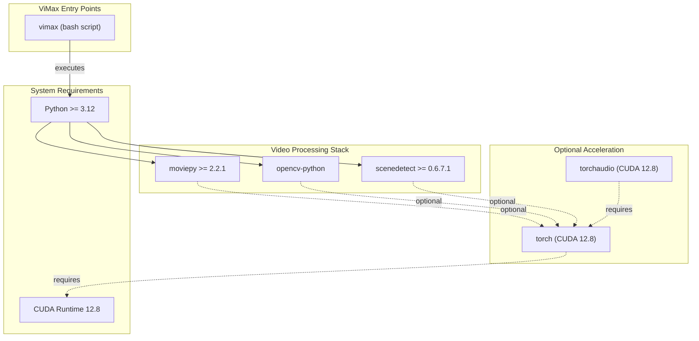

<!-- source: DeepWiki mcp.deepwiki.com · repo HKUDS/ViMax · page 9.5 PyTorch and GPU Acceleration · fetched 2026-11-09 -->

# PyTorch and GPU Acceleration

<details>
<summary>Relevant source files</summary>

The following files were used as context for generating this wiki page:

- [pyproject.toml](pyproject.toml)
- [uv.lock](uv.lock)
- [vimax](vimax)

</details>


This document explains how ViMax configures PyTorch with CUDA 12.8 support for optional GPU acceleration. It covers the platform-specific dependency installation strategy, the role of GPU acceleration in the video processing pipeline, and how the system handles environments without GPU support.

**Scope**: This page focuses on PyTorch installation configuration and GPU acceleration. For video processing library usage, see [9.4 Video Processing Stack](). For the overall dependency architecture, see [9.1 Dependency Overview]().

---

## Purpose and Role in ViMax

PyTorch serves as an **optional dependency** in ViMax, providing GPU acceleration capabilities for video processing operations. While ViMax's core video generation workflow relies on external APIs (e.g., Google GenAI, OpenAI, MiniMax), PyTorch enables GPU-accelerated processing for:

- Video decoding and encoding operations in `moviepy` [pyproject.toml:15-15]()
- Scene detection algorithms in `scenedetect` [pyproject.toml:21-21]()
- Tensor operations for video frame manipulation via `opencv-python` [pyproject.toml:17-17]()

The system is designed to function correctly whether or not GPU acceleration is available, making PyTorch optional rather than required for basic operation.

**Sources**: [pyproject.toml:7-23]()

---

## CUDA 12.8 Configuration Architecture

ViMax uses a sophisticated dependency configuration strategy to ensure PyTorch is installed with CUDA 12.8 support on compatible platforms while maintaining cross-platform compatibility.

### Dependency Resolution Strategy



**Diagram: PyTorch Installation Decision Flow**

The configuration uses `uv`'s advanced dependency resolution features to conditionally install platform-appropriate PyTorch builds based on runtime environment detection [pyproject.toml:25-38]().

**Sources**: [pyproject.toml:25-38]()

---

## Platform-Specific Build Configuration

### Configuration in pyproject.toml

The PyTorch dependency configuration uses three key mechanisms:

#### 1. Source Override with Platform Markers

```toml
[tool.uv.sources]
torch = [
  { index = "pytorch-cu128", marker = "sys_platform == 'linux' or sys_platform == 'win32'" },
]
torchaudio = [
  { index = "pytorch-cu128", marker = "sys_platform == 'linux' or sys_platform == 'win32'" },
]
```

[pyproject.toml:25-31]()

The `marker` field uses PEP 508 environment markers to conditionally select the dependency source:
- **Linux and Windows**: Install from the `pytorch-cu128` index (CUDA-enabled builds).
- **macOS**: Fall back to default PyPI index (CPU-only builds).

#### 2. Custom PyPI Index for CUDA Builds

```toml
[[tool.uv.index]]
name = "pytorch-cu128"
url = "https://download.pytorch.org/whl/cu128"
explicit = true
```

[pyproject.toml:35-38]()

| Field | Value | Purpose |
|-------|-------|---------|
| `name` | `pytorch-cu128` | Identifier referenced in `[tool.uv.sources]` |
| `url` | `https://download.pytorch.org/whl/cu128` | PyTorch's official CUDA 12.8 wheel repository |
| `explicit` | `true` | Requires explicit opt-in via source declarations; prevents accidental usage |

**Sources**: [pyproject.toml:25-38]()

---

## GPU Acceleration Usage Patterns

### Where GPU Acceleration Applies



**Diagram: GPU Acceleration Integration Points**

PyTorch GPU acceleration is utilized at three integration points:

1. **Video Encoding/Decoding** (`moviepy`): GPU-accelerated H.264/H.265 codec operations during video concatenation [pyproject.toml:15-15]().
2. **Frame Processing** (`opencv-python`): GPU-accelerated image transformations and color space conversions [pyproject.toml:17-17]().
3. **Scene Detection** (`scenedetect`): GPU-accelerated frame comparison and histogram analysis [pyproject.toml:21-21]().

**Sources**: [pyproject.toml:15-21]()

---

## Installation and Verification

### Installation Process

When installing ViMax using `uv`:

```bash
# uv automatically resolves platform-specific dependencies
uv sync
```

The package manager:
1. Detects the current platform (`sys_platform`) [pyproject.toml:27-27]().
2. Selects the appropriate PyTorch source based on platform markers [pyproject.toml:25-31]().
3. Downloads PyTorch wheels from either the CUDA index or default PyPI [pyproject.toml:35-38]().
4. Installs all dependencies with compatible versions as specified in `uv.lock` [uv.lock:1-11]().

### Verifying GPU Support

To verify that PyTorch is installed with CUDA support:

```python
import torch

# Check if CUDA is available
print(f"CUDA available: {torch.cuda.is_available()}")

# If available, print GPU information
if torch.cuda.is_available():
    print(f"CUDA version: {torch.version.cuda}")
    print(f"GPU count: {torch.cuda.device_count()}")
    print(f"GPU name: {torch.cuda.get_device_name(0)}")
```

**Sources**: [pyproject.toml:25-38](), [uv.lock:1-11]()

---

## Platform Support Matrix

| Platform | PyTorch Build | CUDA Version | Installation Source |
|----------|---------------|--------------|---------------------|
| **Linux (x86_64)** | GPU-enabled | CUDA 12.8 | `pytorch-cu128` index |
| **Windows (x86_64)** | GPU-enabled | CUDA 12.8 | `pytorch-cu128` index |
| **macOS (Intel)** | CPU-only | N/A | Default PyPI |
| **macOS (Apple Silicon)** | CPU-only | N/A | Default PyPI |

### Platform-Specific Considerations

**Linux and Windows**:
- Requires NVIDIA GPU with Compute Capability support for CUDA 12.8.
- GPU drivers must support CUDA 12.8 (typically Driver version ≥ 525.60.13 on Linux, ≥ 527.41 on Windows).
- Falls back to CPU execution if GPU is not available or drivers are incompatible.

**macOS**:
- PyTorch is installed without CUDA support as it is excluded from the `pytorch-cu128` index source [pyproject.toml:27-27]().
- All operations run on CPU or use Apple's MPS (Metal Performance Shaders) if supported by the underlying library, though ViMax does not explicitly configure MPS.

**Sources**: [pyproject.toml:25-31]()

---

## Dependency Chain



**Diagram: PyTorch Dependency Hierarchy**

This diagram shows how PyTorch integrates into ViMax's dependency stack as an optional acceleration layer rather than a core requirement.

**Sources**: [pyproject.toml:6-23](), [pyproject.toml:25-31](), [vimax:1-113]()

---

## Troubleshooting

### Common Issues

#### Issue: `torch.cuda.is_available()` returns `False` on Linux/Windows

**Symptoms**: PyTorch is installed but GPU is not detected.

**Causes**:
1. GPU drivers are outdated.
2. CUDA runtime is not properly installed on the host system.
3. PyTorch CPU version was installed instead of the CUDA version (check `uv.lock` resolution).

**Resolution**:
```bash
# Verify PyTorch was installed from CUDA index
uv pip show torch

# Expected: Should reference the pytorch-cu128 index in the source metadata.
```

#### Issue: `uv sync` fails to resolve torch dependency

**Symptoms**: Dependency resolution error mentioning torch version conflicts or index unreachable.

**Resolution**:
Check connectivity to `https://download.pytorch.org/whl/cu128` [pyproject.toml:37-37](). Ensure `uv` is up to date to handle `tool.uv.index` configurations.

**Sources**: [pyproject.toml:35-38](), [uv.lock:1-11]()

---

## Summary

ViMax's PyTorch configuration demonstrates a production-ready approach to optional GPU acceleration:

1. **Platform-aware installation**: Automatically installs CUDA-enabled builds on Linux/Windows and CPU-only builds on macOS [pyproject.toml:25-31]().
2. **Explicit opt-in**: Uses `uv`'s custom index feature with `explicit = true` to prevent unintended CUDA installations from other sources [pyproject.toml:38-38]().
3. **Graceful degradation**: Functions correctly on CPU-only systems without GPU support.
4. **Version pinning**: Targets specific CUDA version (12.8) for reproducible environments [pyproject.toml:37-37]().

**Sources**: [pyproject.toml:1-44]()

---

