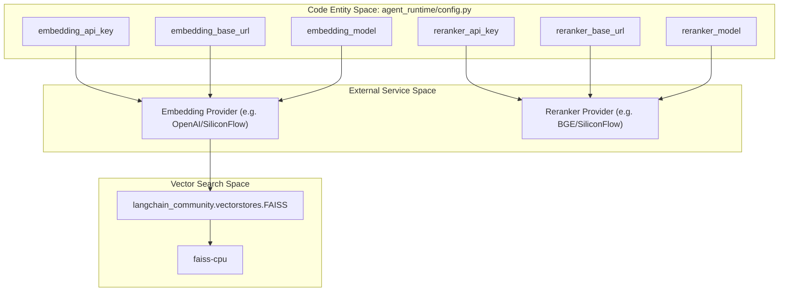
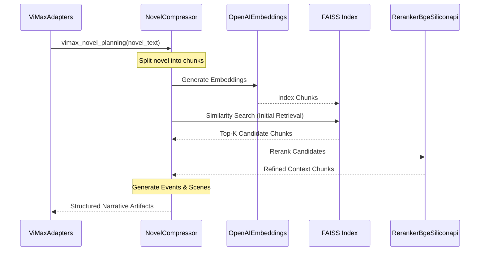

<!-- source: DeepWiki mcp.deepwiki.com · repo HKUDS/ViMax · page 9.6 Vector Search with FAISS · fetched 2026-11-09 -->

# Vector Search with FAISS

<details>
<summary>Relevant source files</summary>

The following files were used as context for generating this wiki page:

- [agent_runtime/vimax_adapters.py](agent_runtime/vimax_adapters.py)
- [pyproject.toml](pyproject.toml)
- [uv.lock](uv.lock)
- [vimax](vimax)

</details>


## Purpose and Scope

This document describes how ViMax uses FAISS (Facebook AI Similarity Search) for vector-based content retrieval within the RAG (Retrieval-Augmented Generation) system. FAISS enables efficient similarity search over embedded content, supporting the processing of long-form narratives by retrieving relevant context from previously processed scenes and narrative elements.

In the ViMax architecture, FAISS is primarily utilized during the **Novel2Video** workflow to manage long-context consistency by indexing novel chunks and retrieved events.

**Sources:** [pyproject.toml:10](), [agent_runtime/vimax_adapters.py:67-81]()

---

## FAISS in ViMax Architecture

FAISS serves as the vector search engine within ViMax's RAG infrastructure, providing fast similarity search capabilities for narrative consistency and context retrieval. The library is integrated as a core dependency and primarily supports agents like `NovelCompressor` and `SceneExtractor` in maintaining plot coherence across long-form content.

### Dependency Configuration

FAISS is declared as a project dependency in `pyproject.toml` using the CPU-optimized version to ensure broad compatibility across environments without requiring specific GPU drivers for search operations.

```toml
dependencies = [
    "faiss-cpu>=1.12.0",
    "langchain>=0.3.26",
    "langchain-community>=0.3.27",
    "langchain-openai>=0.3.27",
    ...
]
```

**Sources:** [pyproject.toml:10-14]()

---

## Embedding and Reranker Service Configuration

ViMax integrates FAISS with external embedding and reranking services configured via the agent runtime. These services are defined in `agent_runtime/config.py` and utilized by adapters to initialize retrieval tools.

### Service Integration Map



**Sources:** [agent_runtime/config.py:30](), [agent_runtime/vimax_adapters.py:13-30]()

---

## Asset Retrieval in Novel2Video

The `vimax_novel_planning` tool is the primary entry point for FAISS-backed retrieval. When processing a novel, the system generates structured text artifacts including `relevant_chunks` and `events` which are indexed for retrieval.

### Novel Planning Data Flow

The following diagram illustrates how the `ViMaxAdapters` orchestrate novel planning using FAISS and Reranker services.



**Sources:** [agent_runtime/vimax_adapters.py:67-81](), [agent_runtime/vimax_adapters.py:13-26]()

---

## Implementation Details

### Embedding Generation
ViMax uses `langchain_openai.OpenAIEmbeddings` to generate vectors. Even when using non-OpenAI providers (like SiliconFlow or OpenRouter), the system uses this wrapper with custom `base_url` and `api_key` configurations.

### Reranking
To improve retrieval precision beyond simple vector similarity, ViMax includes a specialized reranker tool: `RerankerBgeSiliconapi`. This is used to refine the results returned by FAISS before they are passed to the LLM context window.

### Tool Registration
The FAISS-backed planning capabilities are exposed to the Agent Loop via `ToolSpec` objects in `build_vimax_adapter_specs`. Specifically, `vimax_novel_planning` handles the heavy lifting of novel compression and scene planning.

**Sources:** [agent_runtime/vimax_adapters.py:13](), [agent_runtime/vimax_adapters.py:26](), [agent_runtime/vimax_adapters.py:67-81]()

---

## Performance Considerations

### CPU vs GPU Acceleration
The default configuration uses `faiss-cpu` [pyproject.toml:10](). While the system utilizes GPU acceleration for video generation and PyTorch operations [pyproject.toml:25-38](), the vector search index is kept on the CPU to minimize VRAM contention during the rendering phases.

### Storage and Persistence
FAISS indices and their associated metadata are typically stored within the session's workspace directory. The `ViMaxAdapters` class manages the resolution of these session paths using the `session_index`.

**Sources:** [agent_runtime/vimax_adapters.py:99-111](), [pyproject.toml:10]()

---

## Summary

FAISS provides the vector search foundation for ViMax's RAG-enhanced content generation. Key functions include:

1.  **Semantic Search:** Enables similarity-based retrieval of novel chunks during `vimax_novel_planning`.
2.  **Service Integration:** Leverages LangChain and specialized rerankers (`RerankerBgeSiliconapi`) for high-precision context retrieval.
3.  **Efficiency:** Uses `faiss-cpu` to provide fast search without competing for GPU resources needed by video generators.
4.  **Workflow Support:** Directly enables the processing of long prose into structured `events` and `scenes` required for the downstream video pipeline.

**Sources:** [agent_runtime/vimax_adapters.py:26-81](), [pyproject.toml:10]()

---

