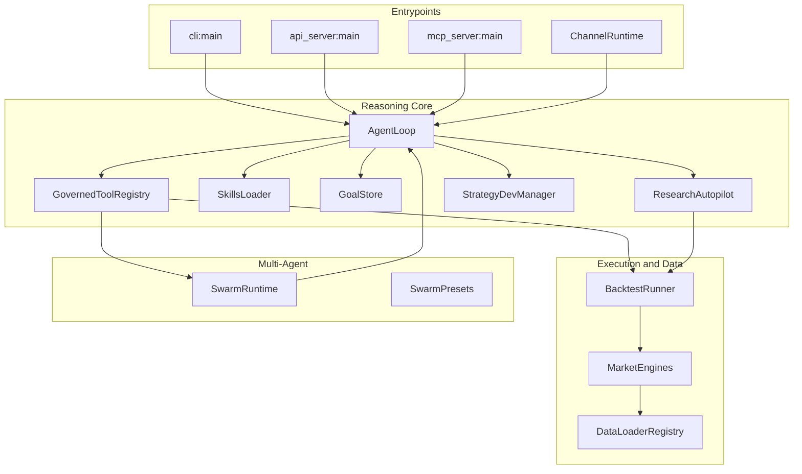
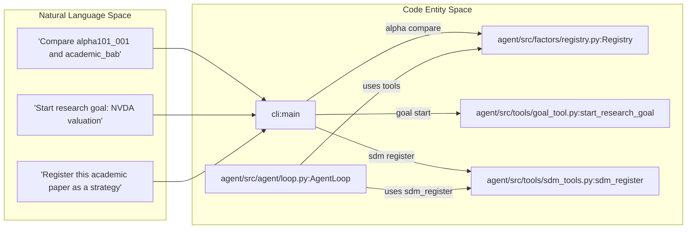

<!-- source: DeepWiki mcp.deepwiki.com · repo HKUDS/Vibe-Trading · page 1 Vibe-Trading Overview · fetched 2026-11-09 -->

# Vibe-Trading Overview

Relevant source files

The following files were used as context for generating this wiki page:

- [.github/dependabot.yml](.github/dependabot.yml)
- [.gitignore](.gitignore)
- [CHANGELOG.md](CHANGELOG.md)
- [README.md](README.md)
- [README_ar.md](README_ar.md)
- [README_es.md](README_es.md)
- [README_id.md](README_id.md)
- [README_ja.md](README_ja.md)
- [README_ko.md](README_ko.md)
- [README_zh.md](README_zh.md)
- [agent/SKILL.md](agent/SKILL.md)
- [agent/mcp_server.py](agent/mcp_server.py)
- [agent/requirements.txt](agent/requirements.txt)
- [agent/src/api/custom_provider_routes.py](agent/src/api/custom_provider_routes.py)
- [agent/src/providers/endpoint_guard.py](agent/src/providers/endpoint_guard.py)
- [agent/src/skills/options-strategy/SKILL.md](agent/src/skills/options-strategy/SKILL.md)
- [agent/src/tools/fund_nav_tool.py](agent/src/tools/fund_nav_tool.py)
- [agent/tests/test_custom_provider_routes.py](agent/tests/test_custom_provider_routes.py)
- [agent/tests/test_fund_nav_tool.py](agent/tests/test_fund_nav_tool.py)
- [agent/tests/test_gitignore_runtime_files.py](agent/tests/test_gitignore_runtime_files.py)
- [agent/tests/test_packaging_dependencies.py](agent/tests/test_packaging_dependencies.py)
- [agent/tests/test_provider_endpoint_guard.py](agent/tests/test_provider_endpoint_guard.py)
- [agent/tests/test_readme_counts.py](agent/tests/test_readme_counts.py)
- [pyproject.toml](pyproject.toml)
- [requirements-channels-lock.txt](requirements-channels-lock.txt)
- [requirements-lock.txt](requirements-lock.txt)
- [tools/requirements-loader-health.txt](tools/requirements-loader-health.txt)

Vibe-Trading is an AI-powered multi-agent finance workspace designed to transform natural language requests into executable trading strategies, quantitative research, and portfolio analysis [README.md:9-13](). It leverages a ReAct (Reasoning and Acting) agent architecture equipped with 90+ specialized skills and dozens of atomic tools to navigate global markets including A-shares, US/HK equities, India equities (NSE/BSE), crypto, futures, and forex [README.md:59-66](), [agent/SKILL.md:4](), [agent/SKILL.md:114]().

The system is designed with a "zero-config" philosophy for data, utilizing 29 major data sources (Tushare, yfinance, OKX, AkShare, CCXT, Futu, mootdx, Eastmoney, Sina, Stooq, Yahoo, Longbridge, and more) with automatic fallback routing to ensure reliable access to market data without complex initial setup [agent/SKILL.md:4](), [agent/SKILL.md:56-62](), [README.md:55](), [CHANGELOG.md:54-73]().

### System Architecture

The Vibe-Trading ecosystem consists of a Python-based agentic core and a modern React 19 frontend [README.md:20-22](), [pyproject.toml:22](), [frontend/package.json:27-28](). The architecture is modular, separating the reasoning engine (`AgentLoop`), the execution environment (`Backtesting`), the collaborative multi-agent layer (`Swarm`), the IM delivery layer (`Channels`), and the **Institutional Research Reliability and Agent Governance Layer (IRR-AGL)** which provides cross-cutting safety and integrity checks [README.md:53-54](), [agent/SKILL.md:163-183]().

#### High-Level Component Interaction
The following diagram illustrates how user intent flows from the entrypoints through the reasoning core to external tools and data sources, governed by the IRR-AGL layer and delivered via IM channels.

**Vibe-Trading System Flow**

Sources: [agent/SKILL.md:34-40](), [README.md:53-64](), [pyproject.toml:69-71](), [agent/mcp_server.py:72](), [agent/SKILL.md:4](), [CHANGELOG.md:54-73]()

### Key Concepts

*   **ReAct Agent Loop**: The central reasoning brain that iteratively reasons about a task and selects the appropriate tool or skill to execute [README.md:62]().
*   **Research Goals**: A durable research tracking system that persists claims, acceptance criteria, and evidence across sessions via the `GoalStore` [README.md:63](), [agent/SKILL.md:56]().
*   **Research Autopilot**: An end-to-end loop that automates the transition from hypothesis to signal engine and backtests, feeding metrics back into the hypothesis registry [README.md:64]().
*   **Strategy Development Manager (SDM)**: A lifecycle manager that converts research and papers into registered, monitored factors and strategies with automated decay scanning [README.md:59]().
*   **Skills (90+ Specialist Skills)**: High-level financial capabilities (e.g., `elliott-wave`, `strategy-dev-manager`, `qveris`, `deep-company-series`) defined in `SKILL.md` files [agent/SKILL.md:4](), [agent/SKILL.md:114-123]().
*   **Tools**: Low-level functions that allow the agent to interact with the system, such as `backtest`, `sdm_register`, and `paper_trade_step` [README.md:59-64](), [agent/SKILL.md:67-75]().
*   **Swarm Intelligence**: A DAG-based orchestration system that allows multiple specialized agents to collaborate using 30 pre-defined team configurations [agent/SKILL.md:92-103]().
*   **Alpha Zoo**: A library of 478 pre-built quantitative alphas across five collections (`qlib158`, `alpha101`, `gtja191`, `academic`, `fundamental`) [README.md:57](), [agent/SKILL.md:105-112]().
*   **Shadow Account**: A subsystem that extracts implicit trading rules from broker trade journals, backtests them, and generates behavioral bias reports [agent/SKILL.md:67-75]().
*   **IM Channel Runtime**: A delivery layer supporting 16 message adapters (Telegram, Slack, Discord, etc.) for research delivery and interaction [README.md:64](), [agent/SKILL.md:163-183]().
*   **Connector-First Trading**: A unified architecture for live trading through broker connectors protected by a committed mandate and order guard [README.md:65](), [agent/SKILL.md:56-62]().
*   **IRR-AGL Governance**: A reliability stack that introduces `GovernedToolRegistry`, `ArtifactStore`, and reliability scorecards [README.md:53]().

### Code Entity Mapping

This diagram bridges the natural language space to specific codebase entities and entrypoints.

**Logical to Code Mapping**

Sources: [README.md:57-64](), [agent/SKILL.md:112](), [pyproject.toml:70](), [agent/mcp_server.py:192-201]()

### Major Subsystems

| Subsystem | Primary Responsibility | Key Directories / Files |
| :--- | :--- | :--- |
| **Agent Core** | Orchestrates reasoning, tool use, and context management. | `agent/src/agent/` [README.md:62]() |
| **Backtesting** | Executes strategy code across multiple market engines. | `agent/backtest/` [agent/SKILL.md:76]() |
| **Swarm** | Manages multi-agent workflows and inter-agent communication. | `agent/src/swarm/` [agent/SKILL.md:92]() |
| **Alpha Zoo** | Provides pre-built quantitative factors and benchmarking. | `agent/src/factors/` [agent/SKILL.md:105]() |
| **Strategy Dev (SDM)** | Paper ingestion, strategy monitoring, and decay scanning. | `agent/src/skills/sdm/`, `agent/src/tools/sdm_tools.py` [agent/SKILL.md:163]() |
| **IM Channels** | Delivery runtime for message adapters (Telegram, Discord, etc.). | `agent/src/channels/` [agent/SKILL.md:163]() |
| **Research Goals** | Persists claims, criteria, and evidence rows for complex tasks. | `agent/src/session/`, `agent/src/tools/goal_tool.py` [agent/SKILL.md:56]() |
| **Scheduled Research** | Background executor for cron/interval-based research jobs. | `agent/src/scheduled_research/` [README.md:66]() |
| **Live Trading** | Manages broker connectors, mandates, and trade enforcement. | `agent/src/trading/`, `agent/src/live/` [README.md:65]() |
| **Governance (IRR-AGL)** | Enforces research reliability and tool safety policies. | `agent/src/governance/`, `agent/src/reliability/` [README.md:53]() |
| **Shadow Account** | Trade journal parsing and rule extraction. | `agent/src/shadow_account/` [agent/SKILL.md:67]() |
| **API/Server** | Exposes capabilities via REST, SSE, and MCP. | `agent/api_server.py`, `agent/mcp_server.py` [pyproject.toml:97-98]() |
| **Frontend** | React 19 web application for visualization and interaction. | `frontend/src/` [README.md:22]() |

Sources: [README.md:53-65](), [agent/SKILL.md:4-18]()

### Sub-Topics & Child Pages

The following child pages provide deeper coverage for each subsystem:

*   **[Getting Started & Configuration](#1.1)** — Environment configuration, `EnvConfig` schema, API keys, CLI installation via `pyproject.toml`, onboarding wizard, and data source setup.
*   **[System Entrypoints: CLI, API Server, and MCP Server](#1.2)** — The `vibe-trading` CLI command tree, FastAPI `api_server.py`, MCP server implementation, and channel integration.
*   **[Desktop App (Electron) and Deployment Packaging](#1.3)** — Electron main process (`main.ts`), backend manager and watchdog, secure credentials, update verification, packaging scripts, and Docker/ZimaOS deployment.

Sources: [README.md:31-43](), [pyproject.toml:96-98](), [agent/mcp_server.py:1-40]()

---

