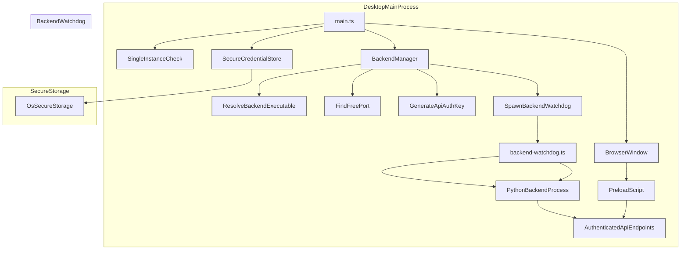
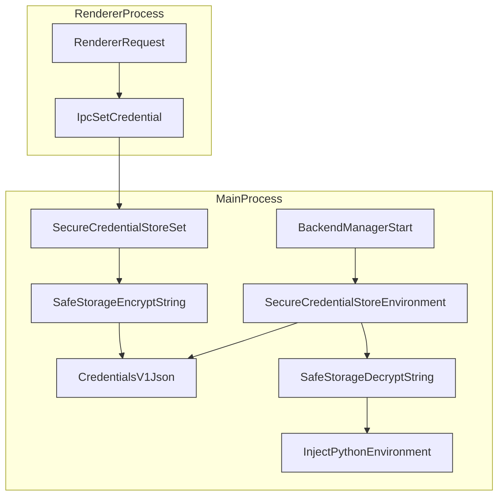
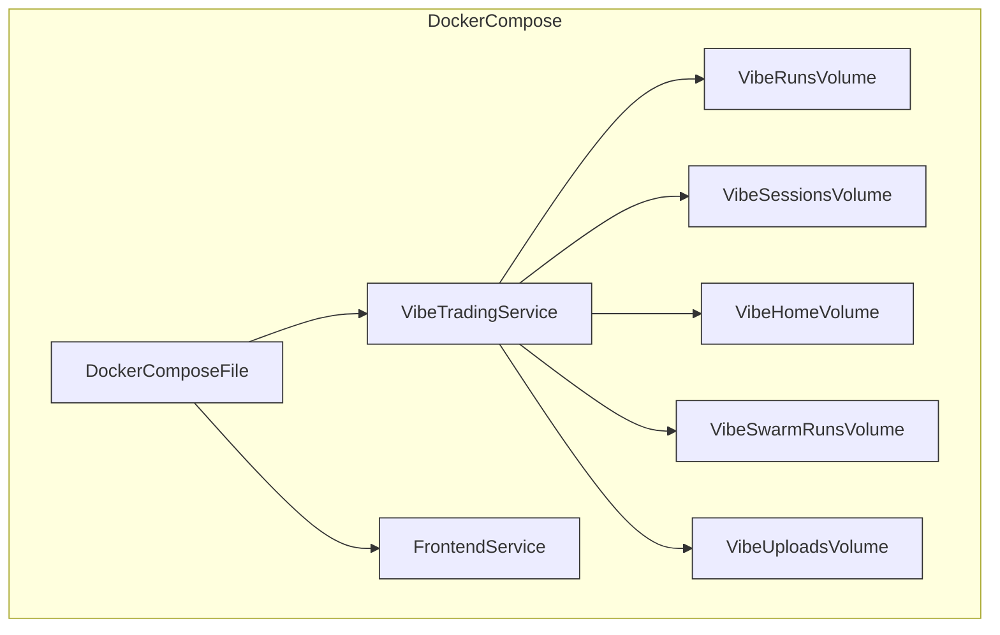

<!-- source: DeepWiki mcp.deepwiki.com · repo HKUDS/Vibe-Trading · page 1.3 Desktop App (Electron) and Deployment Packaging · fetched 2026-11-09 -->

# Desktop App (Electron) and Deployment Packaging

Relevant source files

The following files were used as context for generating this wiki page:

- [.github/workflows/desktop-windows.yml](.github/workflows/desktop-windows.yml)
- [Dockerfile](Dockerfile)
- [agent/src/tools/taiwan_stock_data_tool.py](agent/src/tools/taiwan_stock_data_tool.py)
- [agent/tests/test_load_skill_paging.py](agent/tests/test_load_skill_paging.py)
- [agent/tests/test_taiwan_stock_data_tool.py](agent/tests/test_taiwan_stock_data_tool.py)
- [desktop/electron/README.md](desktop/electron/README.md)
- [desktop/electron/THREAT_MODEL.md](desktop/electron/THREAT_MODEL.md)
- [desktop/electron/UPDATE_SAFETY.md](desktop/electron/UPDATE_SAFETY.md)
- [desktop/electron/WINDOWS_PACKAGING.md](desktop/electron/WINDOWS_PACKAGING.md)
- [desktop/electron/package-lock.json](desktop/electron/package-lock.json)
- [desktop/electron/package.json](desktop/electron/package.json)
- [desktop/electron/scripts/build-backend.ps1](desktop/electron/scripts/build-backend.ps1)
- [desktop/electron/scripts/prepare-electron.mjs](desktop/electron/scripts/prepare-electron.mjs)
- [desktop/electron/scripts/process-sentinel.mjs](desktop/electron/scripts/process-sentinel.mjs)
- [desktop/electron/scripts/process-utils.ps1](desktop/electron/scripts/process-utils.ps1)
- [desktop/electron/scripts/smoke-lifecycle.mjs](desktop/electron/scripts/smoke-lifecycle.mjs)
- [desktop/electron/scripts/smoke-parent-death.mjs](desktop/electron/scripts/smoke-parent-death.mjs)
- [desktop/electron/scripts/test-packaging-preparation.mjs](desktop/electron/scripts/test-packaging-preparation.mjs)
- [desktop/electron/scripts/test-process-utils.ps1](desktop/electron/scripts/test-process-utils.ps1)
- [desktop/electron/scripts/test-update-safety.mjs](desktop/electron/scripts/test-update-safety.mjs)
- [desktop/electron/src/backend-manager.ts](desktop/electron/src/backend-manager.ts)
- [desktop/electron/src/backend-watchdog.ts](desktop/electron/src/backend-watchdog.ts)
- [desktop/electron/src/update-recovery.ts](desktop/electron/src/update-recovery.ts)
- [desktop/electron/src/update-verification.ts](desktop/electron/src/update-verification.ts)
- [docker-compose.yml](docker-compose.yml)
- [frontend/package-lock.json](frontend/package-lock.json)
- [frontend/package.json](frontend/package.json)

This page details the Vibe-Trading desktop application built with Electron, covering its architecture, key components, secure credential management, update verification/recovery, and Windows packaging workflows. It also covers containerized deployment using Docker, `docker-compose`, and ZimaOS-compatible container architectures.

## Electron Desktop Application Architecture

The Electron application (`desktop/electron/`) acts as a native desktop host for the Vibe-Trading FastAPI backend and React frontend. It enforces a single application instance, manages the Python backend lifecycle via a parent-death watchdog, and secures sensitive user credentials.

### Core Runtime Components

The application is structured around several main modules located in `desktop/electron/src/`:
- **`main.ts`**: The main process entry point. It enforces single-instance execution [desktop/electron/src/main.ts:100-106](), initializes the `BackendManager` [desktop/electron/src/main.ts:110-111](), configures `SecureCredentialStore` [desktop/electron/src/main.ts:112-113](), and mounts the React frontend inside a sandboxed `BrowserWindow` [desktop/electron/src/main.ts:120-121]().
- **`preload.ts`**: Runs in the renderer context prior to web content loading, exposing a restricted IPC bridge while maintaining `contextIsolation` and disabling `nodeIntegration` [desktop/electron/src/preload.ts:1-10]().
- **`backend-manager.ts`**: Manages the discovery of the Python executable [desktop/electron/src/backend-manager.ts:87-90](), allocates an ephemeral loopback port [desktop/electron/src/backend-manager.ts:93-94](), spawns the watchdog process [desktop/electron/src/backend-manager.ts:136-137](), redirects standard output/error to rotating logs [desktop/electron/src/backend-manager.ts:96-100](), and handles graceful shutdown calls to `/system/shutdown` [desktop/electron/src/backend-manager.ts:173-189]().
- **`backend-watchdog.ts`**: A dedicated helper process that monitors the parent Electron PID and IPC channel, performing robust process-tree cleanup (`taskkill /T /F` on Windows) if Electron exits unexpectedly [desktop/electron/src/backend-watchdog.ts:100-106]().

Title: Electron Desktop Architecture and Process Lifecycle
Sources: [desktop/electron/src/main.ts](), [desktop/electron/src/backend-manager.ts](), [desktop/electron/src/backend-watchdog.ts](), [desktop/electron/src/preload.ts](), [desktop/electron/THREAT_MODEL.md]()

## Secure Credential Storage

The `SecureCredentialStore` class handles encryption and secure retrieval of sensitive API tokens and credentials.
- **Encryption**: Utilizes Electron's `safeStorage` API to encrypt secrets via native operating system mechanisms (such as DPAPI on Windows) [desktop/electron/src/secure-credentials.ts:1-1]().
- **Storage**: Encrypted key-value pairs are stored in `credentials.v1.json` within the user data directory [desktop/electron/src/secure-credentials.ts:77-79]().
- **Allowlist**: An explicit allowlist (`ENV_CREDENTIALS`) controls which environmental variables are eligible for secure storage [desktop/electron/src/secure-credentials.ts:12-33]().
- **Migration**: On initial boot, legacy plaintext credentials located in `~/.vibe-trading/.env` and `~/.vibe-trading/qveris.json` are migrated into encrypted storage and automatically scrubbed [desktop/electron/src/secure-credentials.ts:89-94]().
- **Injection**: Decrypted secrets are injected exclusively into the child backend's environment variables at startup and are never exposed to the renderer process [desktop/electron/src/secure-credentials.ts:116-122]().

Title: Secure Credential Management Data Flow
Sources: [desktop/electron/src/secure-credentials.ts](), [desktop/electron/THREAT_MODEL.md]()

## Update Verification and Recovery

Although the current desktop build does not run an active auto-updater feed, it includes dormant, fail-closed components designed for future signed-update verification and recovery:
- **`update-verification.ts`**: Validates update candidates against semantic version rules, SHA-256 integrity checksums, and Windows Authenticode signatures using an explicit allowlist of publisher certificate hashes [desktop/electron/src/update-verification.ts:10-11, 100-113]().
- **`update-recovery.ts`**: Manages an interruption-recovery journal to track staged installation steps, allowing clean rollback or recovery in the event of an abrupt termination [desktop/electron/src/update-recovery.ts:1-10]().
- **`UPDATE_SAFETY.md`**: Defines the rigorous policy requirements, rejection matrices, and recovery flows [desktop/electron/UPDATE_SAFETY.md]().

These policies are verified during test runs via `npm run test:update-safety` [desktop/electron/package.json:14]().

Sources: [desktop/electron/src/update-verification.ts](), [desktop/electron/src/update-recovery.ts](), [desktop/electron/UPDATE_SAFETY.md](), [desktop/electron/package.json]()

## Windows Packaging Scripts and Workflow

The Windows packaging workflow is orchestrated via PowerShell scripts and `electron-builder`, configured in `desktop/electron/package.json` [desktop/electron/package.json:33-88]() and automated by GitHub Actions [.github/workflows/desktop-windows.yml:43-135]().

### Packaging Steps
1. **Frontend Build**: Compiles the React application static bundle [desktop/electron/WINDOWS_PACKAGING.md:33-35]().
2. **Runtime Preparation**: Downloads and verifies the official Windows x64 Electron distribution package (`prepare:electron`) [desktop/electron/WINDOWS_PACKAGING.md:38-39]().
3. **Embedded Python Assembly**: Executes `scripts/build-backend.ps1`, which downloads a checksum-pinned CPython 3.12.10 embeddable archive, locks Python dependencies via `requirements-windows-lock.txt`, and pulls the required native DLL and font assets for WeasyPrint PDF generation [desktop/electron/scripts/build-backend.ps1:15-26, 114-117]().
4. **Installer Compilation**: Runs `electron-builder` (`installer:win:review`) to generate an unsigned NSIS review installer under `desktop/electron/release/` [desktop/electron/WINDOWS_PACKAGING.md:44-53](). Signed releases require explicit Authenticode signing credentials (`installer:win:signed`) [desktop/electron/WINDOWS_PACKAGING.md:103-107]().

Sources: [desktop/electron/WINDOWS_PACKAGING.md](), [desktop/electron/scripts/build-backend.ps1](), [.github/workflows/desktop-windows.yml](), [desktop/electron/package.json]()

## Process-Boundary Threat Model (`THREAT_MODEL.md`)

The threat model outlines boundaries and security mitigations across the desktop environment:
- **Loopback Binding**: The FastAPI backend binds exclusively to `127.0.0.1` on a dynamically assigned ephemeral port [desktop/electron/THREAT_MODEL.md:63-65]().
- **Authentication**: A 256-bit cryptographically secure token (`API_AUTH_KEY`) is generated per launch, injected into the backend, and appended as a Bearer token for requests originating from the validated local renderer origin [desktop/electron/THREAT_MODEL.md:66-71]().
- **Renderer Sandboxing**: Context isolation is enforced, Node.js integration is disabled, and in-window navigation is strictly restricted to the local backend origin [desktop/electron/THREAT_MODEL.md:77-85]().
- **Executable Resolution**: Backend executables are resolved through rigid path checks (`VIBE_TRADING_EXECUTABLE` override or exact resource layout locations) to prevent arbitrary binary execution [desktop/electron/THREAT_MODEL.md:91-104]().

Sources: [desktop/electron/THREAT_MODEL.md]()

## Docker, Docker-Compose, and ZimaOS Deployment

Vibe-Trading provides containerized deployment options via a multi-stage `Dockerfile` [Dockerfile:1-120]() and `docker-compose.yml` [docker-compose.yml:1-89](), which also serves as the deployment blueprint for ZimaOS and similar self-hosted container platforms.

### Service Configuration and Hardening
- **`vibe-trading` Service**: Builds from the project root [docker-compose.yml:3()], exposing port `8899` [docker-compose.yml:4-5]() and configuring container environment parameters [docker-compose.yml:6-15]().
- **Volume Mounts**: Named volumes preserve state across container re-creations:
  - `vibe-runs` (`/app/agent/runs`) [docker-compose.yml:21]()
  - `vibe-sessions` (`/app/agent/sessions`) [docker-compose.yml:22]()
  - `vibe-home` (`/home/vibe/.vibe-trading`) [docker-compose.yml:24-27]()
  - `vibe-swarm-runs` (`/app/agent/.swarm/runs`) [docker-compose.yml:28]()
  - `vibe-uploads` (`/app/agent/uploads`) [docker-compose.yml:29]()
- **Runtime Hardening (VT-007)**: Drops all capabilities except `SETUID` and `SETGID` (required for unprivileged runner privilege dropping), enables `no-new-privileges`, mounts a read-only root filesystem (`read_only: true`), and allocates temporary scratch filesystems via `tmpfs` [docker-compose.yml:41-60]().

Title: Docker and Container Deployment Architecture
Sources: [docker-compose.yml](), [Dockerfile]()

---

