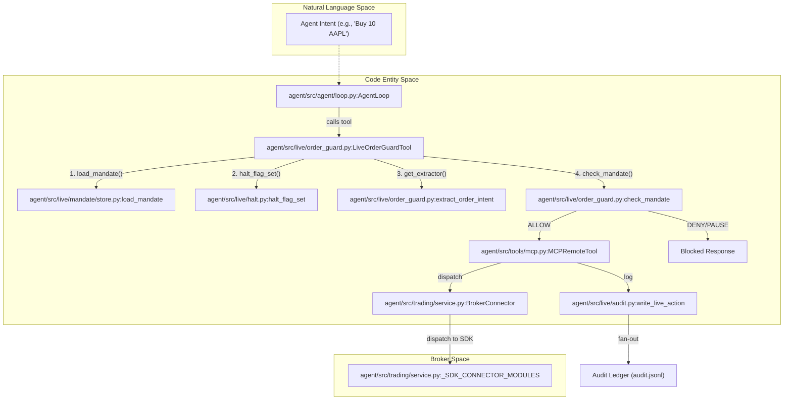
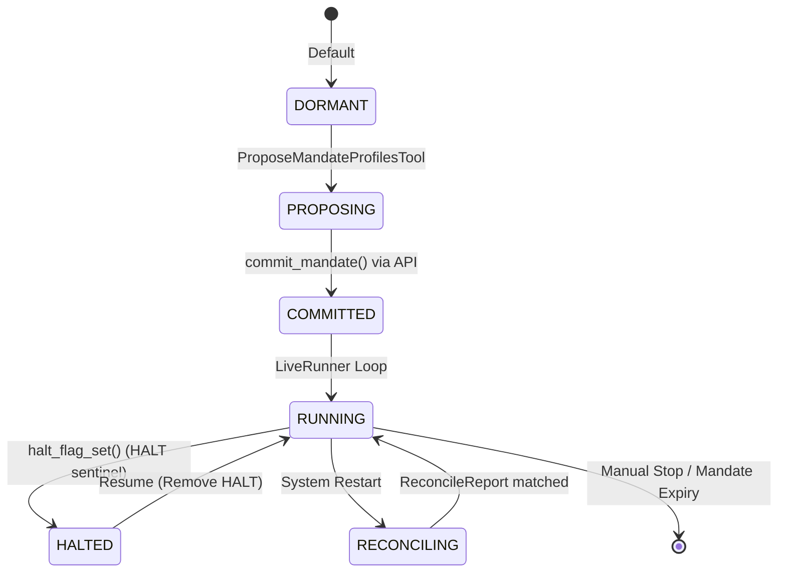

<!-- source: DeepWiki mcp.deepwiki.com · repo HKUDS/Vibe-Trading · page 10 Live Trading System · fetched 2026-11-09 -->

# Live Trading System

Relevant source files

The following files were used as context for generating this wiki page:

- [agent/backtest/loaders/longbridge.py](agent/backtest/loaders/longbridge.py)
- [agent/src/live/advisory/__init__.py](agent/src/live/advisory/__init__.py)
- [agent/src/live/enforcement.py](agent/src/live/enforcement.py)
- [agent/src/live/order_guard.py](agent/src/live/order_guard.py)
- [agent/src/live/registry.py](agent/src/live/registry.py)
- [agent/src/trading/connectors/longbridge/sdk.py](agent/src/trading/connectors/longbridge/sdk.py)
- [agent/src/trading/connectors/robinhood/extractor.py](agent/src/trading/connectors/robinhood/extractor.py)
- [agent/src/trading/profiles.py](agent/src/trading/profiles.py)
- [agent/src/trading/service.py](agent/src/trading/service.py)
- [agent/tests/test_advisory.py](agent/tests/test_advisory.py)
- [agent/tests/test_enforcement_l6.py](agent/tests/test_enforcement_l6.py)
- [agent/tests/test_killswitch_blocks_orders.py](agent/tests/test_killswitch_blocks_orders.py)
- [agent/tests/test_limit_price_notional.py](agent/tests/test_limit_price_notional.py)
- [agent/tests/test_longbridge_loader.py](agent/tests/test_longbridge_loader.py)
- [agent/tests/test_longbridge_loader_daily_week_aliases.py](agent/tests/test_longbridge_loader_daily_week_aliases.py)
- [agent/tests/test_longbridge_period_hour_case.py](agent/tests/test_longbridge_period_hour_case.py)
- [agent/tests/test_mandate_enforcement.py](agent/tests/test_mandate_enforcement.py)
- [agent/tests/test_robinhood_live_account_binding.py](agent/tests/test_robinhood_live_account_binding.py)
- [agent/tests/test_sdk_connectors.py](agent/tests/test_sdk_connectors.py)

The Live Trading System in Vibe-Trading implements a **Connector-first** architecture designed for agentic execution with high-assurance safety boundaries. Unlike backtesting, the live system operates under a strict **Mandate/Consent model**, where every trade must pass through a fail-closed enforcement gate before reaching a broker.

The system supports local connectivity (e.g., IBKR TWS) and remote agentic connectivity (e.g., Robinhood OAuth) through a unified `TradingProfile` registry [agent/src/trading/profiles.py:33-53](). It features an autonomous loop for persistent strategy execution, a global "Kill Switch" for emergency halts [agent/src/live/order_guard.py:161-166](), a detailed audit ledger for regulatory and debugging transparency, and a dedicated paper trading simulation engine.

### System Architecture

The following diagram illustrates the flow from an agent's intent to broker execution, highlighting the enforcement and audit layers.

**Live Execution Flow: Intent to Broker**

Sources: [agent/src/live/registry.py:1-11](), [agent/src/live/order_guard.py:8-35](), [agent/src/live/order_guard.py:121-123](), [agent/src/trading/service.py:16-26]()

---

### Core Components

#### 1. Mandate, Consent, and Order Guard
The safety of the live system is anchored in the **Mandate**. This is a structurally signed JSON document that defines "Hard Caps" (quantitative ceilings) and "Universe Constraints" (allowed symbols/asset classes).

*   **Mandate Model**: Defined as frozen dataclasses to ensure immutability during the execution lifecycle [agent/src/live/mandate/model.py:1-7](). The `Mandate` object includes `HardCaps`, `UniverseConstraint`, and `ConsentMeta` [agent/src/live/mandate/model.py:114-140]().
*   **Order Guard**: The `LiveOrderGuardTool` wraps all order-placing tools. It executes a 6-step fail-closed check: loading the mandate, checking for expiry, verifying the kill switch, extracting order intent, reading current positions/balance, and finally validating the trade against limits [agent/src/live/order_guard.py:8-17]().
*   **Consent Model**: Mandates require explicit user consent. Proposals must be acknowledged by the user via commit functions that are deliberately isolated from the agent tool registry to prevent self-authorization by a model [agent/src/live/mandate/commit.py:1-12]().
*   **Advisory Layer**: An observational risk assessment layer (`PreTradeAdvisoryInterface`) that sits outside the mandate gate, allowing external services to render a "risk opinion" without blocking execution [agent/src/live/advisory/__init__.py:1-9](), [agent/src/live/advisory/__init__.py:121-128]().

For details, see [Mandate, Consent, and Order Guard](#10.1).

#### 2. Broker Connectors and Trading Profiles
Vibe-Trading supports numerous brokers via a registry of `TradingProfile` objects [agent/src/trading/profiles.py:27]().

*   **Supported Brokers**: IBKR, Robinhood, Tiger, Longbridge, Alpaca, OKX, Binance, Futu, Dhan, Shoonya, Trading212, MT5, eToro, Zerodha, KIS, Upbit, Toss, and Scalable [agent/src/trading/profiles.py:33-53]().
*   **SDK Connectors**: Connectors like Tiger, Longbridge, Alpaca, OKX, Binance, Futu, Dhan, Shoonya, Zerodha, KIS, Upbit, Toss, Trading212, MT5, and eToro use a uniform `broker_sdk` transport interface for operations like `get_positions` and `get_account` [agent/src/trading/service.py:18-34]().
*   **Tool Classification**: Tools are classified into a 3-tier ladder: annotations, curated maps (`_BROKER_CURATED_MAPS`), and default-deny. Any tool not explicitly marked as `READ` is treated as `WRITE` and forced through the `LiveOrderGuardTool` [agent/src/live/registry.py:5-10](), [agent/src/live/registry.py:51-72]().

For details, see [Broker Connectors and Persistent Runner](#10.2).

#### 3. Paper Trading Engine
The paper trading subsystem provides a secure, sandboxed execution environment that mimics live broker behavior without risking real capital.

*   **Deterministic Matching**: Implements a deterministic daily-close matching engine using an accounts ledger (`accounts.db`) [agent/src/tools/paper_trade/]().
*   **Paper-Capped Connectors**: Features specialized paper connectors that physically refuse live order placement, preventing accidental capital exposure during paper runs.
*   **Calendar and Rules**: Incorporates corporate actions, CN A-share limit constraints, state hashing, and structured wire contracts (`paper_trade_step`).

For details, see [Paper Trading Engine](#10.3).

---

### Live Runtime State Machine

The following diagram maps the runtime states and the transitions managed by the API server and the runner loop.

**Runtime State & Control**

Sources: [agent/src/live/order_guard.py:136-157](), [agent/src/live/mandate/commit.py:105-120](), [agent/src/live/runtime/runner.py:1-27]()

### Operational Safety Tools

| Feature | Code Entity | Description |
| :--- | :--- | :--- |
| **Kill Switch** | `halt_flag_set` | Checks for the existence of a `HALT` sentinel file to block execution [agent/src/live/order_guard.py:152-157](). |
| **Audit Ledger** | `write_live_action` | Records every decision (ALLOW/DENY/PAUSE) to `audit.jsonl` with redaction [agent/src/live/order_guard.py:22-26](). |
| **Mandate Store** | `load_mandate` | Loads the immutable `Mandate` from the user-side protected store [agent/src/live/mandate/store.py:42-43](). |
| **Trade Counter** | `increment_daily_count` | Enforced by `LiveOrderGuardTool` using a persisted daily counter [agent/src/live/order_guard.py:19-22](). |
| **Advisory Review** | `AdvisoryOrchestrator` | Sequential execution of observational risk assessments [agent/src/live/advisory/__init__.py:175-185](). |

Sources: [agent/src/live/order_guard.py:1-35](), [agent/src/live/mandate/model.py:38-66](), [agent/src/live/advisory/__init__.py:1-22]()

---

### Child Pages
*   [Mandate, Consent, and Order Guard](#10.1) — Consent state machine and pre-trade enforcement: Mandate model, commit_mandate, propose_mandate tool, LiveOrderGuard fail-closed checks, SDK order gate, daily trade counts, pending actions, audit ledger, advisory interface.
*   [Broker Connectors and Persistent Runner](#10.2) — TradingProfile registry and connectors, trading/service.py, LiveRunner loop, sweep latch, flatten-on-halt, live_routes and CLI connector commands.
*   [Paper Trading Engine](#10.3) — agent/src/tools/paper_trade/: deterministic daily-close matching engine, accounts ledger, rules and schema, calendar and corporate actions, CN A-share limits, state hashing, and paper-capped connectors.

---

