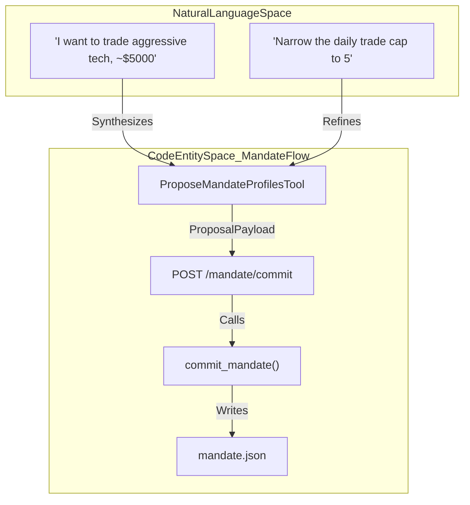
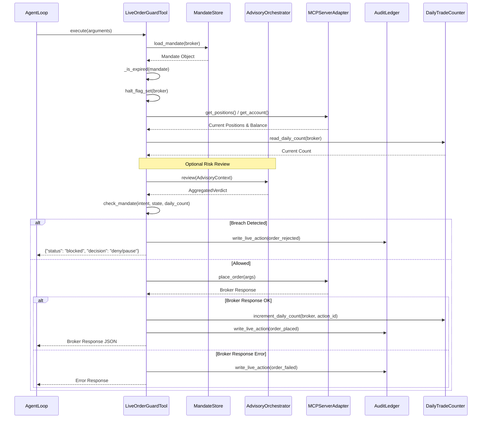

<!-- source: DeepWiki mcp.deepwiki.com · repo HKUDS/Vibe-Trading · page 10.1 Mandate, Consent, and Order Guard · fetched 2026-11-09 -->

# Mandate, Consent, and Order Guard

Relevant source files

The following files were used as context for generating this wiki page:

- [agent/src/live/__init__.py](agent/src/live/__init__.py)
- [agent/src/live/advisory/__init__.py](agent/src/live/advisory/__init__.py)
- [agent/src/live/audit.py](agent/src/live/audit.py)
- [agent/src/live/classification.py](agent/src/live/classification.py)
- [agent/src/live/daily_count.py](agent/src/live/daily_count.py)
- [agent/src/live/enforcement.py](agent/src/live/enforcement.py)
- [agent/src/live/mandate/__init__.py](agent/src/live/mandate/__init__.py)
- [agent/src/live/mandate/commit.py](agent/src/live/mandate/commit.py)
- [agent/src/live/mandate/model.py](agent/src/live/mandate/model.py)
- [agent/src/live/mandate/store.py](agent/src/live/mandate/store.py)
- [agent/src/live/order_guard.py](agent/src/live/order_guard.py)
- [agent/src/live/paths.py](agent/src/live/paths.py)
- [agent/src/live/pending_action.py](agent/src/live/pending_action.py)
- [agent/src/live/sdk_order_gate.py](agent/src/live/sdk_order_gate.py)
- [agent/src/tools/propose_mandate_tool.py](agent/src/tools/propose_mandate_tool.py)
- [agent/src/trading/connectors/alpaca/sdk.py](agent/src/trading/connectors/alpaca/sdk.py)
- [agent/src/trading/connectors/robinhood/extractor.py](agent/src/trading/connectors/robinhood/extractor.py)
- [agent/tests/test_advisory.py](agent/tests/test_advisory.py)
- [agent/tests/test_alpaca_position_sign.py](agent/tests/test_alpaca_position_sign.py)
- [agent/tests/test_alpaca_timeframe_map.py](agent/tests/test_alpaca_timeframe_map.py)
- [agent/tests/test_consent_commit.py](agent/tests/test_consent_commit.py)
- [agent/tests/test_daily_count.py](agent/tests/test_daily_count.py)
- [agent/tests/test_enforcement_l6.py](agent/tests/test_enforcement_l6.py)
- [agent/tests/test_killswitch_blocks_orders.py](agent/tests/test_killswitch_blocks_orders.py)
- [agent/tests/test_limit_price_notional.py](agent/tests/test_limit_price_notional.py)
- [agent/tests/test_mandate_commit_security.py](agent/tests/test_mandate_commit_security.py)
- [agent/tests/test_mandate_enforcement.py](agent/tests/test_mandate_enforcement.py)
- [agent/tests/test_mandate_forex.py](agent/tests/test_mandate_forex.py)
- [agent/tests/test_robinhood_live_account_binding.py](agent/tests/test_robinhood_live_account_binding.py)
- [agent/tests/test_sdk_order_gate.py](agent/tests/test_sdk_order_gate.py)

The **Mandate, Consent, and Order Guard** system provides a fail-closed enforcement layer for live trading [agent/src/live/order_guard.py:1-9](). It ensures that no trade is executed unless it explicitly adheres to a user-authorized "Mandate" containing quantitative and structural limits. The system operates on a "default-deny" principle, where every order-placing tool is intercepted by a pre-trade gate that validates intent against the committed mandate [agent/src/live/order_guard.py:101-167]().

## Mandate Data Model and Consent

A **Mandate** is a structured document that defines the boundaries of autonomous trading for a specific broker. It is stored in a `mandate.json` file within the broker's runtime directory `~/.vibe-trading/live/<broker>/` [agent/src/live/paths.py:10-13](). The mandate is an immutable contract loaded read-only at boot [agent/src/live/mandate/model.py:113-117]().

### Key Components
*   **HardCaps**: Quantitative ceilings including `account_funding_usd`, `max_order_notional_usd`, `max_total_exposure_usd`, `max_leverage`, `allowed_instruments`, and `max_trades_per_day` [agent/src/live/mandate/model.py:37-64]().
*   **UniverseConstraint**: Structural filters for discovery including `asset_classes` (e.g., `us_equity`, `crypto`), `min_market_cap_usd`, `min_avg_daily_volume_usd`, and an `exclude_symbols` denylist [agent/src/live/mandate/model.py:67-87]().
*   **ConsentMeta**: Provenance proving human authorization, containing `created_at`, `consent_token_sha256`, `broker`, `account_ref`, and an `expires_at` timestamp [agent/src/live/mandate/model.py:90-110]().
*   **`flatten_on_halt`**: A boolean flag indicating whether a kill-switch trip should flatten open positions in addition to cancelling resting orders. Defaults to `False` (cancel-only) [agent/src/live/mandate/model.py:130-139]().

### The Write Path: `commit_mandate()`
To prevent the agent from self-authorizing, the mandate store exposes no write path to the agent's tool registry [agent/src/live/mandate/store.py:3-8](). The sole write path is the `commit_mandate()` function [agent/src/live/mandate/commit.py:6-12](), which is called by the API surface (e.g., `POST /mandate/commit`) [agent/src/live/mandate/commit.py:6-9](). It requires a `consent_ack=True` flag originated from the UI and re-validates the selected profile against the original ceilings [agent/src/live/mandate/commit.py:166-172](). Security regressions ensure that `proposal_id` cannot be used for path traversal [agent/tests/test_mandate_commit_security.py:80-102]().

### Natural Language to Mandate Flow
The agent uses the `ProposeMandateProfilesTool` to synthesize 2-4 candidate mandate profiles clamped to account ceilings [agent/src/tools/propose_mandate_tool.py:3-8](). These are returned as a `mandate.proposal` payload [agent/src/tools/propose_mandate_tool.py:138-141](). When a user selects a profile, the frontend triggers the commit via the API [agent/src/live/mandate/commit.py:107-115]().

Title: Natural Language to Mandate Workflow

Sources: [agent/src/live/mandate/model.py:1-139](), [agent/src/live/mandate/commit.py:1-172](), [agent/src/tools/propose_mandate_tool.py:1-163](), [agent/src/live/paths.py:1-52](), [agent/tests/test_mandate_commit_security.py:17-115]()

## Pre-Trade Enforcement: LiveOrderGuardTool

The `LiveOrderGuardTool` is a security wrapper that intercepts all "WRITE" or "UNKNOWN" tools for a live broker [agent/src/live/order_guard.py:3-6](). It executes a 6-step fail-closed check before any broker call [agent/src/live/order_guard.py:8-17]().

### The 6-Step Gate Lifecycle
1.  **Load Mandate**: Checks for a valid `mandate.json` and schema version match [agent/src/live/order_guard.py:135-141]().
2.  **Expiry Check**: Past `consent.expires_at` results in a DENY [agent/src/live/order_guard.py:143-149]().
3.  **Halt Check**: Checks if the kill switch (halt flag) is set [agent/src/live/order_guard.py:151-156]().
4.  **Extract Intent**: Normalizes tool arguments into an `OrderIntent` using broker-specific extractors [agent/src/live/order_guard.py:158-165]().
5.  **Read State**: Snapshots positions and balance via broker READ tools [agent/src/live/order_guard.py:178-180]().
6.  **Check Mandate**: Validates the intent against the mandate via `check_mandate()` [agent/src/live/enforcement.py:6-7](). Returns `ALLOW`, `DENY` (structural), or `PAUSE_FOR_REAUTH` (quantitative) [agent/src/live/order_guard.py:16-17]().

### Breach Event Kinds
Breaches are categorized by the `check_mandate` logic [agent/src/live/enforcement.py:67-71]():
*   **Universe**: Trading an asset class or symbol outside the allowed universe (`BREACH_KIND_UNIVERSE`) [agent/src/live/enforcement.py:79]().
*   **Instrument**: Violating instrument type restrictions (e.g., trying to trade options when only equity is allowed) (`BREACH_KIND_INSTRUMENT`) [agent/src/live/enforcement.py:80]().
*   **Quantitative**: Exceeding notional limits, total exposure, leverage, or daily trade counts (`BREACH_KIND_QUANTITATIVE`) [agent/src/live/enforcement.py:81]().

Sources: [agent/src/live/order_guard.py:1-180](), [agent/src/live/enforcement.py:1-180](), [agent/src/live/halt.py:1-62]()

## SDK Order Gate and Pending Action Recovery

For direct-SDK connectors (e.g., Alpaca, OKX, Binance, Futu, Tiger), orders are placed via normal Python calls, not through an MCP tool. The `src.live.sdk_order_gate` module provides a function-based gate, `execute_live_order()`, that enforces the same fail-closed ceremony as `LiveOrderGuardTool` before any order reaches the broker [agent/src/live/sdk_order_gate.py:1-18]().

### SDK Gate Lifecycle
The `execute_live_order` function performs the following checks:
1.  **Load Mandate**: Denies if no valid mandate or schema version mismatch [agent/src/live/sdk_order_gate.py:106-107]().
2.  **Expiry**: Denies if `consent.expires_at` is in the past, routing to re-authorization [agent/src/live/sdk_order_gate.py:109-118]().
3.  **Halt Flag**: Denies if the kill switch is tripped [agent/src/live/sdk_order_gate.py:120-124]().
4.  **Notional Normalization**: For quantity-based orders, the notional is priced using connector quotes or data loaders. If unpriceable, it denies the order [agent/src/live/sdk_order_gate.py:126-134]().
5.  **Read Positions and Balance**: Retrieves current positions and account balance using the connector's own read functions [agent/src/live/sdk_order_gate.py:136-137]().
6.  **Check Mandate**: Calls `check_mandate()` to determine if the order is allowed, denied (structural), or paused for re-authorization (quantitative) [agent/src/live/sdk_order_gate.py:149-157]().

### Pending Actions and Recovery
The SDK gate includes a mechanism for handling pending actions, particularly for brokers like Alpaca. If a `place_order` call fails to return a response (e.g., due to a network timeout), a `PendingAction` record is created [agent/src/live/sdk_order_gate.py:184-187](). This record allows for recovery and revalidation of the order status on subsequent attempts, preventing duplicate orders or lost state [agent/src/live/pending_action.py:1-11](). The `daily_order_lock` ensures that only one process can attempt recovery or place an order at a time for a given broker [agent/src/live/sdk_order_gate.py:94-98]().

Sources: [agent/src/live/sdk_order_gate.py:1-187](), [agent/src/live/pending_action.py:1-177](), [agent/tests/test_sdk_order_gate.py:1-184]()

## Daily Trade Counts and Order Lock

The system maintains a `trade_counter.json` file per broker to enforce the `max_trades_per_day` limit [agent/src/live/daily_count.py:1-7](). 
*   **Atomic Increment**: The counter is incremented only after a successful broker response via `increment_daily_count()` [agent/src/live/daily_count.py:125-171]().
*   **Cross-Process Lock**: `daily_order_lock(broker)` provides platform-specific advisory locking (`fcntl` on POSIX, `msvcrt` on Windows) to prevent concurrent order races [agent/src/live/daily_count.py:20-27]().
*   **Deduplication**: `action_id` parameter ensures that retry loops or duplicate event arrivals do not double-count transactions within the same UTC calendar day [agent/src/live/daily_count.py:125-142]().

Sources: [agent/src/live/daily_count.py:1-204](), [agent/tests/test_daily_count.py:1-127]()

## Audit Ledger and Transparency

Every live action is recorded in an immutable, append-only ledger at `~/.vibe-trading/live/audit.jsonl` [agent/src/live/audit.py:3-5]().

### Three-Sink Fan-out
The `write_live_action` function distributes the audit record to three destinations [agent/src/live/audit.py:14-20]():
1.  **Compliance Ledger**: The primary `audit.jsonl` file [agent/src/live/audit.py:68-70]().
2.  **Per-Run Trace**: Appended to the active session's trace directory [agent/src/live/audit.py:54-61]().
3.  **SSE Relay**: Emitted as a `live.action` event via a callback for real-time UI updates [agent/src/live/audit.py:66]().

### Redaction and Accountability
Every record is scrubbed through redaction utilities to remove OAuth tokens or PII before persistence [agent/src/live/audit.py:22-26](). Accountability is maintained by linking every order to a mandate snapshot and consent reference [agent/src/live/audit.py:10-12]().

Sources: [agent/src/live/audit.py:1-149](), [agent/src/live/order_guard.py:23-26]()

## Pre-Trade Advisory Interface

The system supports an optional advisory layer that provides risk opinions through the `PreTradeAdvisoryInterface` [agent/src/live/advisory/__init__.py:1-10](). This layer provides a broker-agnostic hook for external services to render a risk opinion on a proposed order.

### Advisory Principles
*   **Purely Observational**: Advisory verdicts never block, deny, or alter order execution [agent/src/live/advisory/__init__.py:6-7]().
*   **Fail-Open**: Any provider exception is caught and converted to `Verdict.REVIEW_UNAVAILABLE` [agent/src/live/advisory/__init__.py:13-14]().
*   **Opt-In**: Activated only when the `VIBE_TRADING_ENABLE_ADVISORY` environment variable is set to a truthy value [agent/src/live/advisory/__init__.py:15-16]().
*   **Worst-Case Aggregation**: The `AdvisoryOrchestrator` aggregates multiple providers using the most severe verdict [agent/src/live/advisory/__init__.py:148-152]().

### Verdict Types
Verdicts align with the advisory contract:
*   `APPROVE`
*   `APPROVE_WITH_CONCERNS`
*   `REJECT`
*   `REVIEW_UNAVAILABLE`

Sources: [agent/src/live/advisory/__init__.py:1-200](), [agent/src/live/order_guard.py:46-51](), [agent/tests/test_advisory.py:1-40]()

## System Control Flow and Sequence

Title: Pre-Trade Gate Execution Flow

Sources: [agent/src/live/order_guard.py:111-180](), [agent/src/live/audit.py:107-149](), [agent/src/live/daily_count.py:65](), [agent/src/live/advisory/__init__.py:1-22]()

---

