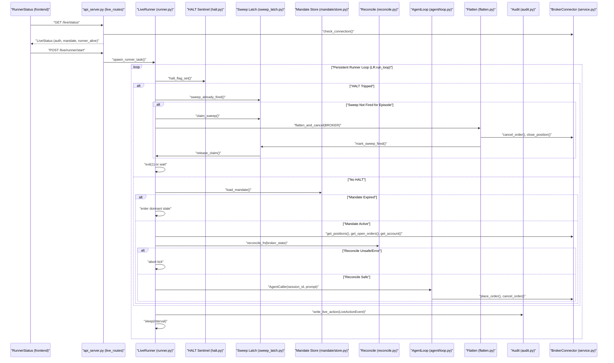

<!-- source: DeepWiki mcp.deepwiki.com · repo HKUDS/Vibe-Trading · page 10.2 Broker Connectors and Persistent Runner · fetched 2026-11-09 -->

# Broker Connectors and Persistent Runner

<details>
<summary>Relevant source files</summary>

The following files were used as context for generating this wiki page:

- [agent/backtest/loaders/longbridge.py](agent/backtest/loaders/longbridge.py)
- [agent/src/api/live_routes.py](agent/src/api/live_routes.py)
- [agent/src/factors/zoo/qlib158/wvma10.py](agent/src/factors/zoo/qlib158/wvma10.py)
- [agent/src/factors/zoo/qlib158/wvma20.py](agent/src/factors/zoo/qlib158/wvma20.py)
- [agent/src/factors/zoo/qlib158/wvma30.py](agent/src/factors/zoo/qlib158/wvma30.py)
- [agent/src/factors/zoo/qlib158/wvma5.py](agent/src/factors/zoo/qlib158/wvma5.py)
- [agent/src/factors/zoo/qlib158/wvma60.py](agent/src/factors/zoo/qlib158/wvma60.py)
- [agent/src/live/registry.py](agent/src/live/registry.py)
- [agent/src/live/runtime/flatten.py](agent/src/live/runtime/flatten.py)
- [agent/src/live/runtime/runner.py](agent/src/live/runtime/runner.py)
- [agent/src/live/runtime/sweep_latch.py](agent/src/live/runtime/sweep_latch.py)
- [agent/src/skills/trade-journal/SKILL.md](agent/src/skills/trade-journal/SKILL.md)
- [agent/src/tools/trading_connector_tool.py](agent/src/tools/trading_connector_tool.py)
- [agent/src/trading/connectors/dhan/sdk.py](agent/src/trading/connectors/dhan/sdk.py)
- [agent/src/trading/connectors/etoro/__init__.py](agent/src/trading/connectors/etoro/__init__.py)
- [agent/src/trading/connectors/etoro/classification.py](agent/src/trading/connectors/etoro/classification.py)
- [agent/src/trading/connectors/etoro/client.py](agent/src/trading/connectors/etoro/client.py)
- [agent/src/trading/connectors/etoro/copy_trading.py](agent/src/trading/connectors/etoro/copy_trading.py)
- [agent/src/trading/connectors/etoro/instruments.py](agent/src/trading/connectors/etoro/instruments.py)
- [agent/src/trading/connectors/etoro/profiles.py](agent/src/trading/connectors/etoro/profiles.py)
- [agent/src/trading/connectors/etoro/sdk.py](agent/src/trading/connectors/etoro/sdk.py)
- [agent/src/trading/connectors/etoro/trading.py](agent/src/trading/connectors/etoro/trading.py)
- [agent/src/trading/connectors/futu/__init__.py](agent/src/trading/connectors/futu/__init__.py)
- [agent/src/trading/connectors/futu/profiles.py](agent/src/trading/connectors/futu/profiles.py)
- [agent/src/trading/connectors/futu/sdk.py](agent/src/trading/connectors/futu/sdk.py)
- [agent/src/trading/connectors/ibkr/local.py](agent/src/trading/connectors/ibkr/local.py)
- [agent/src/trading/connectors/longbridge/sdk.py](agent/src/trading/connectors/longbridge/sdk.py)
- [agent/src/trading/connectors/okx/sdk.py](agent/src/trading/connectors/okx/sdk.py)
- [agent/src/trading/connectors/shoonya/sdk.py](agent/src/trading/connectors/shoonya/sdk.py)
- [agent/src/trading/profiles.py](agent/src/trading/profiles.py)
- [agent/src/trading/service.py](agent/src/trading/service.py)
- [agent/src/trading/types.py](agent/src/trading/types.py)
- [agent/tests/conftest.py](agent/tests/conftest.py)
- [agent/tests/factors/test_qlib158_wvma_abs_numerator.py](agent/tests/factors/test_qlib158_wvma_abs_numerator.py)
- [agent/tests/test_agent_config.py](agent/tests/test_agent_config.py)
- [agent/tests/test_api_live_runtime.py](agent/tests/test_api_live_runtime.py)
- [agent/tests/test_channel_media_roots.py](agent/tests/test_channel_media_roots.py)
- [agent/tests/test_config_root_sandbox.py](agent/tests/test_config_root_sandbox.py)
- [agent/tests/test_dhan_period_reject.py](agent/tests/test_dhan_period_reject.py)
- [agent/tests/test_etoro_connector.py](agent/tests/test_etoro_connector.py)
- [agent/tests/test_etoro_live_actions.py](agent/tests/test_etoro_live_actions.py)
- [agent/tests/test_etoro_runtime.py](agent/tests/test_etoro_runtime.py)
- [agent/tests/test_futu_account_currency.py](agent/tests/test_futu_account_currency.py)
- [agent/tests/test_futu_check_status_envelope.py](agent/tests/test_futu_check_status_envelope.py)
- [agent/tests/test_futu_connector_period_hour_case.py](agent/tests/test_futu_connector_period_hour_case.py)
- [agent/tests/test_futu_extended_reads.py](agent/tests/test_futu_extended_reads.py)
- [agent/tests/test_futu_position_cost_bases.py](agent/tests/test_futu_position_cost_bases.py)
- [agent/tests/test_ibkr_local.py](agent/tests/test_ibkr_local.py)
- [agent/tests/test_longbridge_loader.py](agent/tests/test_longbridge_loader.py)
- [agent/tests/test_longbridge_loader_daily_week_aliases.py](agent/tests/test_longbridge_loader_daily_week_aliases.py)
- [agent/tests/test_longbridge_period_hour_case.py](agent/tests/test_longbridge_period_hour_case.py)
- [agent/tests/test_okx_bar_map.py](agent/tests/test_okx_bar_map.py)
- [agent/tests/test_position_read_error_envelope.py](agent/tests/test_position_read_error_envelope.py)
- [agent/tests/test_runtime_flatten.py](agent/tests/test_runtime_flatten.py)
- [agent/tests/test_runtime_runner.py](agent/tests/test_runtime_runner.py)
- [agent/tests/test_sdk_connectors.py](agent/tests/test_sdk_connectors.py)
- [agent/tests/test_shoonya_empty_string_numeric.py](agent/tests/test_shoonya_empty_string_numeric.py)
- [agent/tests/test_shoonya_interval_map.py](agent/tests/test_shoonya_interval_map.py)
- [agent/tests/test_sweep_latch.py](agent/tests/test_sweep_latch.py)
- [agent/tests/test_trade_journal_currency_pools.py](agent/tests/test_trade_journal_currency_pools.py)

</details>


Vibe-Trading implements a **Connector-first architecture** to interface with live and paper brokerage environments. This subsystem decouples high-level agent reasoning from low-level broker transport protocols, ensuring all transactions are authenticated, audited, governed by mandate constraints, and monitored by a persistent runtime loop capable of autonomous reconciliation, safety checks, and emergency halt sweeps.

---

### Purpose and Scope

This page covers the implementation details of Vibe-Trading's live and paper trading infrastructure. The scope encompasses:
*   The `TradingProfile` registry supporting 16+ broker connectors via `local_tws`, `remote_mcp`, and `broker_sdk` transports [agent/src/trading/service.py:18-35]().
*   Unified broker service operations exposed through `agent/src/trading/service.py` and agent tools in `agent/src/tools/trading_connector_tool.py` [agent/src/trading/service.py:1-46]().
*   The persistent background runner (`LiveRunner` in `agent/src/live/runtime/runner.py`) executing fixed fail-closed tick lifecycles [agent/src/live/runtime/runner.py:1-16]().
*   Restart-persistent preemptive sweep latches (`sweep_latch.py`) and flatten-on-halt semantics [agent/src/live/runtime/sweep_latch.py:1-8]().
*   API endpoints under `src/api/live_routes.py` and CLI connector commands for managing connections and authentication [agent/src/trading/service.py:1]().

Sources: [agent/src/trading/service.py:1-46](), [agent/src/live/runtime/runner.py:1-16](), [agent/src/live/runtime/sweep_latch.py:1-8]()

---

### TradingProfile Registry and Supported Connectors

The system manages connections using `TradingProfile` objects defined in `agent/src/trading/profiles.py` [agent/src/trading/profiles.py:1-20](). Each profile specifies its target transport mechanism (`broker_sdk`, `local_tws`, or `remote_mcp`), operating environment (`paper` or `live`), and list of capabilities.

| Broker | Transport | Key SDK / Module | Profiles Registered |
| :--- | :--- | :--- | :--- |
| **IBKR** | `local_tws` | `ib_async` (`src.trading.connectors.ibkr.local`) | `ibkr-paper-local`, `ibkr-live-readonly-local` [agent/src/trading/connectors/ibkr/local.py:1-28]() |
| **Robinhood** | `remote_mcp` | Agentic Trading OAuth / TAP proxy | `robinhood-paper-mcp`, `robinhood-live-mcp` [agent/tests/test_sdk_connectors.py:47-64]() |
| **Tiger** | `broker_sdk` | `tigeropen` (`src.trading.connectors.tiger.sdk`) | `tiger-paper-sdk`, `tiger-live-sdk-readonly` [agent/tests/test_sdk_connectors.py:47-64]() |
| **Longbridge** | `broker_sdk` | `longbridge` (`src.trading.connectors.longbridge.sdk`) | `longbridge-paper-sdk`, `longbridge-live-sdk-readonly` [agent/tests/test_sdk_connectors.py:47-64]() |
| **Alpaca** | `broker_sdk` | `alpaca-py` (`src.trading.connectors.alpaca.sdk`) | `alpaca-paper-sdk`, `alpaca-live-sdk-readonly` [agent/tests/test_sdk_connectors.py:47-64]() |
| **OKX** | `broker_sdk` | `okx` (`src.trading.connectors.okx.sdk`) | `okx-paper-sdk`, `okx-live-sdk-readonly` [agent/tests/test_sdk_connectors.py:47-64]() |
| **Binance** | `broker_sdk` | `binance` (`src.trading.connectors.binance.sdk`) | `binance-paper-sdk`, `binance-live-sdk-readonly` [agent/tests/test_sdk_connectors.py:47-64]() |
| **Futu** | `broker_sdk` | `futu-api` (`src.trading.connectors.futu.sdk`) | `futu-paper-sdk`, `futu-live-sdk-readonly` [agent/src/trading/connectors/futu/sdk.py:1-25]() |
| **Dhan** | `broker_sdk` | `dhanhq` (`src.trading.connectors.dhan.sdk`) | `dhan-paper-sdk`, `dhan-live-sdk-readonly` [agent/tests/test_sdk_connectors.py:47-64]() |
| **Shoonya** | `broker_sdk` | `NorenApi` (`src.trading.connectors.shoonya.sdk`) | `shoonya-paper-sdk`, `shoonya-live-sdk-readonly` [agent/tests/test_sdk_connectors.py:47-64]() |
| **Zerodha** | `broker_sdk` | `kiteconnect` (`src.trading.connectors.zerodha.sdk`) | `zerodha-paper-sdk`, `zerodha-live-sdk-readonly` [agent/tests/test_sdk_connectors.py:47-64]() |
| **eToro** | `broker_sdk` | `requests` (`src.trading.connectors.etoro.sdk`) | `etoro-paper-sdk`, `etoro-paper-trade`, `etoro-live-sdk-readonly`, `etoro-live-trade` [agent/tests/test_etoro_connector.py:64-71]() |
| **Toss** | `broker_sdk` | `toss` (`src.trading.connectors.toss.sdk`) | `toss-live-sdk-readonly` [agent/tests/test_sdk_connectors.py:47-64]() |
| **Upbit** | `broker_sdk` | `upbit` (`src.trading.connectors.upbit.sdk`) | `upbit-paper-sdk`, `upbit-paper-trade`, `upbit-live-sdk-readonly` [agent/tests/test_sdk_connectors.py:47-64]() |
| **Trading 212** | `broker_sdk` | REST API (`src.trading.connectors.trading212.sdk`) | `trading212-paper-sdk`, `trading212-live-readonly` |

Brokers lacking a runtime paper/live discriminator (such as Longbridge, Dhan, and Shoonya) strictly forbid registering live order-placing profiles (`*-live-trade`), mitigating accidental real-money order execution [agent/tests/test_sdk_connectors.py:67-78]().

Sources: [agent/src/trading/profiles.py:1-20](), [agent/src/trading/connectors/ibkr/local.py:1-28](), [agent/tests/test_sdk_connectors.py:47-78](), [agent/src/trading/connectors/futu/sdk.py:1-25](), [agent/tests/test_etoro_connector.py:64-71]()

---

### `trading/service.py` and Service Operations

The `src.trading.service` module provides a unified abstraction layer that dispatches trading calls across diverse broker transports. 

#### Direct SDK Dispatch Map
Direct-SDK transport connectors are mapped in `_SDK_CONNECTOR_MODULES`, exposing uniform read and configuration interfaces (`build_config`, `check_status`, `get_account_snapshot`, `get_positions`, `get_open_orders`, `get_quote`, `get_historical_bars`) [agent/src/trading/service.py:14-35]().

```python
_SDK_CONNECTOR_MODULES = {
    "mstock": "src.trading.connectors.mstock.sdk",
    "tiger": "src.trading.connectors.tiger.sdk",
    "longbridge": "src.trading.connectors.longbridge.sdk",
    "alpaca": "src.trading.connectors.alpaca.sdk",
    "okx": "src.trading.connectors.okx.sdk",
    "binance": "src.trading.connectors.binance.sdk",
    "futu": "src.trading.connectors.futu.sdk",
    "dhan": "src.trading.connectors.dhan.sdk",
    "shoonya": "src.trading.connectors.shoonya.sdk",
    "zerodha": "src.trading.connectors.zerodha.sdk",
    "kis": "src.trading.connectors.kis.sdk",
    "upbit": "src.trading.connectors.upbit.sdk",
    "toss": "src.trading.connectors.toss.sdk",
    "trading212": "src.trading.connectors.trading212.sdk",
    "mt5": "src.trading.connectors.mt5.sdk",
    "etoro": "src.trading.connectors.etoro.sdk",
}
```
*[agent/src/trading/service.py:18-35]()

#### Credential Isolation and Vault Integration
When connection-scoped calls are made, `_sdk_config` loads credentials securely from the OS keyring via `ConnectionStore`, ensuring raw secrets never traverse MCP or Web request payloads [agent/src/trading/service.py:81-120](). Per-call overrides are filtered against strict per-connector allowlists (`_OVERRIDE_ALLOWLIST_ATTRS`) to prevent unauthorized parameter injection [agent/src/trading/service.py:48-78]().

Sources: [agent/src/trading/service.py:14-148]()

---

### Persistent LiveRunner Loop (`LiveRunner`)

The `LiveRunner` class in `agent/src/live/runtime/runner.py` manages persistent background live-trading loops [agent/src/live/runtime/runner.py:1-16](). It transforms interactive chat consent sessions into autonomous background workers.

#### Execution Lifecycle (Per Tick)
On each timer or trigger tick, the runner executes a strict fail-closed order of operations:
1.  **Halt Check**: `halt_flag_set()` verifies whether an operator or emergency trigger has tripped a global or broker-specific halt [agent/src/live/halt.py:1-30]().
2.  **Proactive Expiry**: `ConsentMeta.expires_at` is evaluated every tick; expired mandates immediately revoke trading authority before any agent interaction [agent/src/live/runtime/runner.py:10-17]().
3.  **Reconciliation**: The injected `reconcile_fn` compares internal state with broker realities. Unsafe or ambiguous responses (e.g., mid-order crash state) immediately abort the tick [agent/src/live/runtime/runner.py:24-30]().
4.  **Autonomous Turn**: If authorized and safe, an injected async `AgentCaller` evaluates market data against the pinned mandate [agent/src/live/runtime/runner.py:107-110]().
5.  **Audit Ledger**: Every action and outcome code (`TICK_HALTED`, `TICK_EXPIRED`, `TICK_RECONCILE_UNSAFE`, `TICK_INVOKED`) is durably written to `LiveActionEvent` [agent/src/live/runtime/runner.py:44-72]().

Sources: [agent/src/live/runtime/runner.py:1-132](), [agent/src/live/halt.py:1-30]()

---

### Sweep Latch and Flatten-on-Halt

When a halt sentinel is tripped, the runner initiates a preemptive flatten-on-halt sweep via `flatten_and_cancel` [agent/src/live/runtime/flatten.py:1-20](). To prevent redundant cancellations or re-flattening across runner restarts (where in-memory flags are lost), the `sweep_latch` module binds the sweep's execution to the specific halt *episode* timestamp on disk [agent/src/live/runtime/sweep_latch.py:1-10]().

*   `sweep_already_fired(broker)` checks if a latch file matching the current halt timestamp exists [agent/src/live/runtime/sweep_latch.py:50-56]().
*   `mark_sweep_fired(broker)` records the latch upon completing the flatten sweep [agent/src/live/runtime/sweep_latch.py:50-56]().
*   Fresh halt episodes update the sentinel timestamp, automatically re-arming the latch [agent/tests/test_sweep_latch.py:77-86]().

Sources: [agent/src/live/runtime/sweep_latch.py:1-60](), [agent/tests/test_sweep_latch.py:77-86]()

---

### Live Routes and CLI Connector Commands

#### API Endpoints (`live_routes.py`)
Live operations are exposed through FastAPI endpoints under `src/api/live_routes.py`:
*   `GET /live/status` — Reports connection states, active mandates, and runner liveness.
*   `POST /live/runner/start` and `POST /live/runner/stop` — Control background runner execution.
*   `POST /live/halt` — Manually trips the emergency halt sentinel.

#### CLI Connector Commands
The `vibe-trading` CLI provides administrative control over broker profiles and tokens:
*   `vibe-trading connector check <profile>` — Verifies SDK/API reachability and credential configuration.
*   `vibe-trading connector authorize <profile>` — Handles interactive OAuth flows (e.g., Robinhood) inside a TTY session [agent/src/live/registry.py:143-163]().

Sources: [agent/src/api/live_routes.py:100-109](), [agent/src/live/registry.py:143-163]()

---

### Architecture Diagrams

#### Connector and Safety Architecture
This diagram bridges natural language concepts of broker connectivity and credential isolation to concrete codebase entities.

Title: "Connector and Safety Architecture"
```mermaid
graph TD
    subgraph "NaturalLanguageSpace" ["Natural Language Space"]
        "UserStrategy"["User Strategy"]
        "BrokerEntity"["Broker (Dhan/T212/RH/eToro/IBKR)"]
        "SafetyGate"["Safety Gate"]
        "CredentialIsolation"["Credential Isolation"]
    end

    subgraph "CodeEntitySpace" ["Code Entity Space"]
        "TP[TradingProfile]"["TradingProfile (profiles.py)"]
        "TS[trading.service]"["trading/service.py (check_connection, get_positions)"]
        "LOG[LiveOrderGuardTool]"["LiveOrderGuardTool (order_guard.py)"]
        "M[Mandate]"["Mandate (mandate/model.py)"]
        "RC[ToolRegistry]"["Tool Registry (registry.py)"]
        "CL[classify_tool]"["classify_tool (classification.py)"]
        "TF[tap_forward]"["tap_forward.py (forward)"]
        "SDK[SDKConnector]"["SDK Connector (etoro/sdk.py, ibkr/local.py, futu/sdk.py, etc.)"]
        "OSVault[OSCredentialVault]"["OS Credential Vault (connections.py)"]
    end

    "UserStrategy" --> "TS"
    "TS" --> "TP"
    "TP" --> "SDK"
    "SDK" --> "BrokerEntity"
    "TS" -- "Wraps Mutating Tools" --> "LOG"
    "LOG" -- "Checks" --> "M"
    "RC" -- "Uses" --> "CL"
    "CL" -- "Assigns ToolClass" --> "LOG"
    "SDK" -- "Opt-in" --> "TF"
    "TF" -- "Redacts Keys" --> "CredentialIsolation"
    "TS" -- "Loads credentials from" --> "OSVault"
    "TP" -- "Defines connector type" --> "SDK"
```
Sources: [agent/src/trading/service.py:1-26](), [agent/src/live/registry.py:1-56](), [agent/src/trading/connectors/etoro/sdk.py:1-13](), [agent/src/trading/connectors/ibkr/local.py:1-13](), [agent/src/trading/connectors/futu/sdk.py:1-13](), [agent/src/trading/tap_forward.py:1-22](), [agent/src/trading/connections.py:1-13]()

#### LiveRunner Operational Flow
This diagram details the periodic tick execution sequence within `LiveRunner`.

Title: "LiveRunner Operational Loop and Frontend Integration"

Sources: [agent/src/api/live_routes.py:100-109](), [agent/src/live/runtime/runner.py:300-301](), [agent/src/live/runtime/runner.py:350-351](), [agent/src/live/runtime/runner.py:360-361](), [agent/src/live/runtime/runner.py:140-163](), [agent/src/live/runtime/runner.py:370-371](), [agent/src/live/runtime/runner.py:400-401](), [agent/src/live/runtime/sweep_latch.py:1-20](), [agent/src/live/halt.py:1-30](), [agent/src/live/runtime/flatten.py:1-10]()

---

