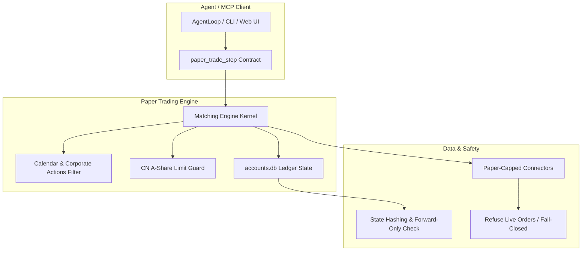
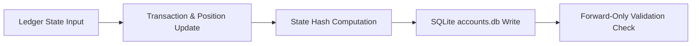
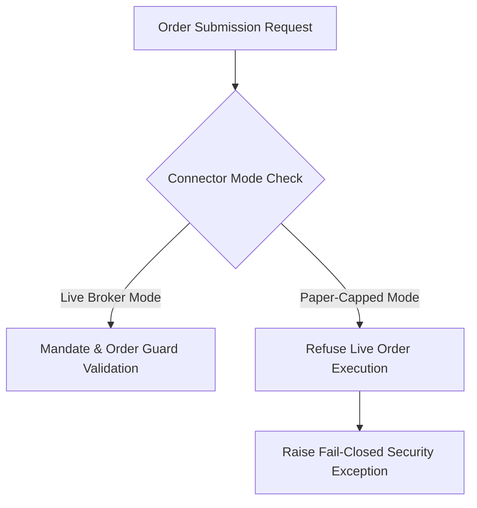

<!-- source: DeepWiki mcp.deepwiki.com · repo HKUDS/Vibe-Trading · page 10.3 Paper Trading Engine · fetched 2026-11-09 -->

# Paper Trading Engine

Relevant source files

The following files were used as context for generating this wiki page:

- [CHANGELOG.md](CHANGELOG.md)
- [MANIFEST.in](MANIFEST.in)
- [README.md](README.md)
- [README_ar.md](README_ar.md)
- [README_es.md](README_es.md)
- [README_id.md](README_id.md)
- [README_ja.md](README_ja.md)
- [README_ko.md](README_ko.md)
- [README_zh.md](README_zh.md)
- [agent/SKILL.md](agent/SKILL.md)
- [agent/backtest/correlation.py](agent/backtest/correlation.py)
- [agent/mcp_server.py](agent/mcp_server.py)
- [agent/src/portfolio/compatibility.py](agent/src/portfolio/compatibility.py)
- [agent/src/tools/background_tools.py](agent/src/tools/background_tools.py)
- [agent/src/tools/paper_trade/accounts.py](agent/src/tools/paper_trade/accounts.py)
- [agent/src/tools/pdf_report.py](agent/src/tools/pdf_report.py)
- [agent/tests/test_background_tools.py](agent/tests/test_background_tools.py)
- [agent/tests/test_correlation.py](agent/tests/test_correlation.py)
- [agent/tests/test_paper_accounts.py](agent/tests/test_paper_accounts.py)
- [agent/tests/test_paper_capped_connectors_refuse_live.py](agent/tests/test_paper_capped_connectors_refuse_live.py)
- [agent/tests/test_pdf_report_arabic.py](agent/tests/test_pdf_report_arabic.py)
- [agent/tests/test_portfolio_compatibility.py](agent/tests/test_portfolio_compatibility.py)
- [agent/tests/test_readme_counts.py](agent/tests/test_readme_counts.py)
- [desktop/electron/requirements-windows-lock.txt](desktop/electron/requirements-windows-lock.txt)
- [frontend/src/components/charts/CorrelationMatrix.tsx](frontend/src/components/charts/CorrelationMatrix.tsx)
- [frontend/src/components/charts/__tests__/CorrelationMatrix.test.tsx](frontend/src/components/charts/__tests__/CorrelationMatrix.test.tsx)

## Purpose and Scope

The Paper Trading Engine is a deterministic, daily-close matching subsystem housed under `agent/src/tools/paper_trade/`. It enables AI agents, MCP clients, and end-users to execute strategies and evaluate order flows against completed daily market bars without connecting to a live broker. Designed for strict verification and forward-only execution, the engine maintains state in a local SQLite ledger (`accounts.db`), enforces market calendars, corporate actions, and exchange-specific price limits (such as China A-share daily bands), and incorporates fail-closed paper-capped connectors that categorically refuse live order routing.

Sources: [README.md:55-57](), [agent/mcp_server.py:9-30](), [agent/SKILL.md:67-83]()

---

## 1. Subsystem Architecture and Execution Flow

The paper trading workflow bridges the agent's reasoning loop with persistent simulation state. Orders generated via tool calls or strategy scripts are processed against historical or real-time daily close feeds, ensuring zero market impact and complete reproducibility.

*Figure 1: Paper Trading Engine architecture data flow.*

Sources: [README.md:55-57](), [agent/mcp_server.py:9-30]()

---

## 2. Accounts Ledger (`accounts.db`) & State Hashing

State persistence is managed via an SQLite accounts ledger (`accounts.db`). Each paper account tracks cash balances, open positions, realized/unrealized PnL, and a cryptographic state hash.

- **Forward-Only Progression**: Accounts can only advance forward in time with each settlement step. Backdating or mutating historical ledger entries is prohibited by integrity checks.
- **State Hashing**: Every ledger update computes a cryptographic hash of the account state. This prevents concurrent modification races and ensures auditability across research runs.
- **CLI & API Integration**: Exposed via `vibe-trading paper` commands, REST endpoints, and WebUI components.

*Figure 2: Accounts ledger update and state hashing pipeline.*

Sources: [README.md:55-57](), [agent/SKILL.md:67-83]()

---

## 3. `paper_trade_step` Wire Contract

The primary interface for agents and MCP clients is the `paper_trade_step` tool contract. It takes an account ID, target allocations or order specifications, and the execution date, returning matched fills and updated portfolio metrics.

- **Input Parameters**: `account_id`, `orders` (list of limit/market specs), `execution_date`.
- **Execution Model**: Deterministic daily-close matching. Orders submitted during a session are evaluated against the closing price of the specified date.
- **Handling Incomplete Data**: If a session has not yet closed or pricing data is missing, the engine explicitly reports that settlement cannot occur yet, preventing fabricated fills or backward date jumps.

Sources: [README.md:55-57](), [agent/mcp_server.py:9-30](), [README_zh.md:55-58]()

---

## 4. Calendar, Corporate Actions & CN A-Share Limits

To preserve trading realism, the engine models exchange calendars, corporate actions, and regulatory constraints:

- **Market Calendars**: Respects regional holiday schedules and settlement conventions across supported venues (US, HK, China A-shares, etc.).
- **Corporate Actions**: Adjusts historical cost bases and position quantities for stock splits, dividends, and rights issues.
- **CN A-Share Limits**: Enforces strict percentage boundaries on Chinese mainland equities:
  - Standard board stocks: ±10% limit bands.
  - STAR Market (科创板) and ChiNext (创业板): ±20% limit bands.
  - Beijing Stock Exchange (北交所): ±30% limit bands.
  - Orders violating upper/lower circuit limits during matching are rejected or clipped according to exchange rules.

Sources: [README.md:55-57](), [agent/backtest/correlation.py:20-93]()

---

## 5. Paper-Capped Connectors and Live Order Refusal

The paper trading subsystem integrates with broker profiles through paper-capped connectors. These connectors wrap real broker authentication profiles but override dispatch methods to ensure safety.

- **Fail-Closed Guarantee**: If a session is initialized in paper mode or bound to a paper-capped connector, any attempt to invoke live order routing raises an exception and halts execution.
- **Testing and Verification**: Unit tests (`agent/tests/test_paper_capped_connectors_refuse_live.py`) explicitly verify that live order functions throw refusal errors when paper constraints are active.

*Figure 3: Paper-capped connector fail-closed order refusal flow.*

Sources: [agent/tests/test_paper_capped_connectors_refuse_live.py]()

---

