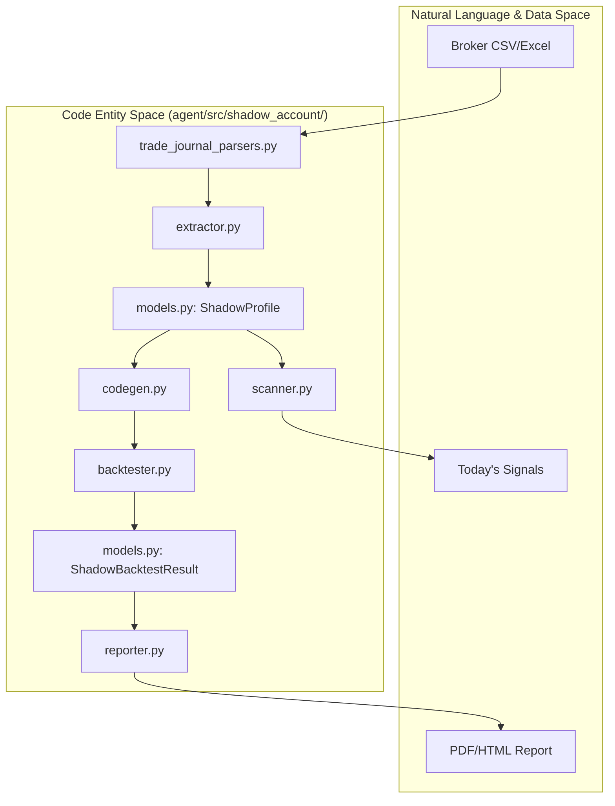
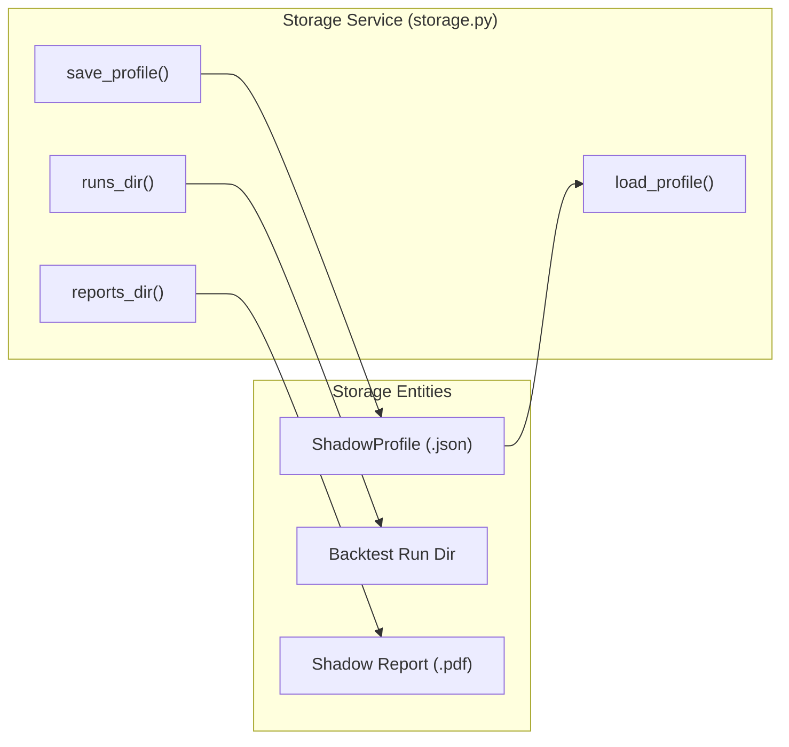

<!-- source: DeepWiki mcp.deepwiki.com · repo HKUDS/Vibe-Trading · page 11 Shadow Account System · fetched 2026-11-09 -->

# Shadow Account System

Relevant source files

The following files were used as context for generating this wiki page:

- [.github/workflows/docker-build.yml](.github/workflows/docker-build.yml)
- [agent/requirements-channels.txt](agent/requirements-channels.txt)
- [agent/src/shadow_account/backtester.py](agent/src/shadow_account/backtester.py)
- [agent/src/shadow_account/codegen.py](agent/src/shadow_account/codegen.py)
- [agent/src/shadow_account/extractor.py](agent/src/shadow_account/extractor.py)
- [agent/src/shadow_account/fonts.py](agent/src/shadow_account/fonts.py)
- [agent/src/shadow_account/models.py](agent/src/shadow_account/models.py)
- [agent/src/shadow_account/pdf_fallback.py](agent/src/shadow_account/pdf_fallback.py)
- [agent/src/shadow_account/reporter.py](agent/src/shadow_account/reporter.py)
- [agent/src/shadow_account/scanner.py](agent/src/shadow_account/scanner.py)
- [agent/src/shadow_account/templates/shadow_report.html](agent/src/shadow_account/templates/shadow_report.html)
- [agent/src/shadow_account/templates/signal_engine.py.j2](agent/src/shadow_account/templates/signal_engine.py.j2)
- [agent/src/tools/shadow_account_tool.py](agent/src/tools/shadow_account_tool.py)
- [agent/src/tools/trade_journal_parsers.py](agent/src/tools/trade_journal_parsers.py)
- [agent/src/tools/trade_journal_tool.py](agent/src/tools/trade_journal_tool.py)
- [agent/tests/test_backtest_runner_security.py](agent/tests/test_backtest_runner_security.py)
- [agent/tests/test_docker_workflow_publish_guard.py](agent/tests/test_docker_workflow_publish_guard.py)
- [agent/tests/test_futu_excel_serial_dates.py](agent/tests/test_futu_excel_serial_dates.py)
- [agent/tests/test_generic_split_datetime.py](agent/tests/test_generic_split_datetime.py)
- [agent/tests/test_journal_unsupported_filter.py](agent/tests/test_journal_unsupported_filter.py)
- [agent/tests/test_shadow_account.py](agent/tests/test_shadow_account.py)
- [agent/tests/test_shadow_attribution.py](agent/tests/test_shadow_attribution.py)
- [agent/tests/test_shadow_codegen_security.py](agent/tests/test_shadow_codegen_security.py)
- [agent/tests/test_shadow_currency_disclosure.py](agent/tests/test_shadow_currency_disclosure.py)
- [agent/tests/test_shadow_result_cache.py](agent/tests/test_shadow_result_cache.py)
- [agent/tests/test_shadow_scanner.py](agent/tests/test_shadow_scanner.py)
- [agent/tests/test_ths_excel_serial_dates.py](agent/tests/test_ths_excel_serial_dates.py)
- [agent/tests/test_trade_journal.py](agent/tests/test_trade_journal.py)
- [agent/tests/test_trade_journal_analysis_type.py](agent/tests/test_trade_journal_analysis_type.py)
- [agent/tests/test_trade_journal_fifo.py](agent/tests/test_trade_journal_fifo.py)
- [agent/tests/test_trade_journal_invalid_datetime.py](agent/tests/test_trade_journal_invalid_datetime.py)
- [agent/tests/test_trade_journal_parser_accounting_negatives.py](agent/tests/test_trade_journal_parser_accounting_negatives.py)
- [agent/tests/test_trade_journal_reversal_fees.py](agent/tests/test_trade_journal_reversal_fees.py)
- [agent/tests/test_trade_journal_strict_json.py](agent/tests/test_trade_journal_strict_json.py)
- [agent/tests/test_trade_journal_suffixed_us_market.py](agent/tests/test_trade_journal_suffixed_us_market.py)
- [agent/tests/test_trade_journal_timestamp_order.py](agent/tests/test_trade_journal_timestamp_order.py)
- [agent/tests/test_windows_lock_no_sentinel.py](agent/tests/test_windows_lock_no_sentinel.py)

The **Shadow Account System** is a specialized subsystem designed to bridge a trader's historical performance with systematic backtesting. It extracts implicit trading rules from broker trade journals, transforms them into executable Python strategies, and generates behavioral bias reports comparing "shadow" (systematic) performance against "real" (realized) performance.

The system is exposed to the agent via four primary tools: `extract_shadow_strategy` [agent/src/tools/shadow_account_tool.py:78-157](), `run_shadow_backtest` [agent/src/tools/shadow_account_tool.py:161-239](), `render_shadow_report` [agent/src/tools/shadow_account_tool.py:243-309](), and `scan_shadow_signals` [agent/src/tools/shadow_account_tool.py:313-375]().

### System Architecture

The Shadow Account pipeline follows a linear progression from raw data to behavioral insights:

1.  **Ingestion**: Multi-broker CSV/Excel parsing and FIFO trade pairing [agent/src/shadow_account/extractor.py:88-93]().
2.  **Extraction**: ML-based clustering and decision-tree rule induction [agent/src/shadow_account/extractor.py:4-7]().
3.  **Simulation**: Jinja2-based code generation and multi-market backtesting [agent/src/shadow_account/codegen.py:1-10]().
4.  **Reporting**: Delta-PnL attribution, behavioral bias detection, and PDF/HTML generation [agent/src/shadow_account/reporter.py:1-17]().
5.  **Scanning**: Deterministic evaluation of extracted rules against recent market data via `scan_today_signals` [agent/src/shadow_account/scanner.py:22-29]().

#### Component Interaction Diagram
This diagram maps the high-level stages to the specific Python modules and data contracts (`ShadowProfile`, `ShadowBacktestResult`) that facilitate communication between them.

Sources: [agent/src/shadow_account/models.py:1-5](), [agent/src/shadow_account/__init__.py:1-53](), [agent/src/shadow_account/models.py:49-78](), [agent/src/shadow_account/models.py:99-111]()

---

### Trade Journal Parsing and Strategy Extraction

The extraction pipeline begins by parsing broker exports (e.g., Futu, EastMoney, THS) into standardized `TradeRecord` objects via `parse_file` [agent/src/shadow_account/extractor.py:88-90](). These records are processed using a First-In-First-Out (FIFO) algorithm via `pair_trades_fifo` to generate roundtrip trades [agent/src/shadow_account/extractor.py:93-96]().

Strategy extraction in `extractor.py` involves feature engineering, ML clustering, rule induction, and Jinja2-based code generation validated for security against remote code execution [agent/src/shadow_account/extractor.py:1-18](), [agent/src/shadow_account/extractor.py:105-144](), [agent/src/shadow_account/codegen.py:1-10](), [agent/src/shadow_account/models.py:12-17](), [agent/src/shadow_account/templates/signal_engine.py.j2:32-40](), [agent/tests/test_backtest_runner_security.py:1-170](), [agent/tests/test_shadow_codegen_security.py]().

For details, see [Trade Journal Parsing and Strategy Extraction](#11.1).

Sources: [agent/src/shadow_account/extractor.py:1-18](), [agent/src/shadow_account/extractor.py:105-144](), [agent/src/shadow_account/codegen.py:1-10](), [agent/src/shadow_account/models.py:12-17](), [agent/src/shadow_account/templates/signal_engine.py.j2:32-40](), [agent/tests/test_backtest_runner_security.py:1-170](), [agent/tests/test_shadow_codegen_security.py]()

---

### Shadow Backtester and Report Generation

Once a `ShadowProfile` is extracted, the system runs counterfactual simulations. The `backtester.py` module selects representative symbols from liquid baskets [agent/src/shadow_account/backtester.py:40-45]() and executes multi-market backtests grouped by settlement currency [agent/src/shadow_account/backtester.py:96-120](), [agent/src/shadow_account/backtester.py:164-175]().

The system generates behavioral bias reports via `reporter.py` including delta-PnL attribution, visualizations, and CJK font handling [agent/src/shadow_account/backtester.py:1-15](), [agent/src/shadow_account/reporter.py:1-17](), [agent/src/shadow_account/models.py:85-111](), [agent/src/shadow_account/fonts.py:57-93](), [agent/src/shadow_account/backtester.py:96-120](), [agent/src/shadow_account/backtester.py:129-159](), [agent/tests/test_shadow_attribution.py:1-128]().

For details, see [Shadow Backtester and Report Generation](#11.2).

Sources: [agent/src/shadow_account/backtester.py:1-15](), [agent/src/shadow_account/reporter.py:1-17](), [agent/src/shadow_account/models.py:85-111](), [agent/src/shadow_account/fonts.py:57-93](), [agent/src/shadow_account/backtester.py:96-120](), [agent/src/shadow_account/backtester.py:129-159](), [agent/tests/test_shadow_attribution.py:1-128]()

---

### Data Persistence and Safety

The Shadow Account system utilizes a dedicated directory structure under `~/.vibe-trading/` to isolate user trade data and generated artifacts.

| Directory | Content Type | Entity Reference |
| :--- | :--- | :--- |
| `shadow_accounts/` | JSON profiles | `profiles_dir()` [agent/src/shadow_account/storage.py:28-31]() |
| `shadow_runs/` | Backtest artifacts | `runs_dir()` [agent/src/shadow_account/storage.py:34-37]() |
| `shadow_reports/` | PDF/HTML outputs | `reports_dir()` [agent/src/shadow_account/storage.py:40-43]() |
| `fonts/` | CJK Font cache | `fonts_dir()` [agent/src/shadow_account/fonts.py:27-31]() |

Persistence is managed via `ShadowProfile.to_dict()` [agent/src/shadow_account/models.py:79-81]() and `load_profile()` [agent/src/shadow_account/storage.py:66-112](), which reconstruct the frozen dataclasses from JSON storage. Idempotency is maintained by hashing the source journal via `hash_journal` [agent/src/shadow_account/storage.py:51-58](). Cached backtest results are also managed to prevent redundant computations [agent/tests/test_shadow_result_cache.py]().

#### Data Flow and Storage Diagram
This diagram illustrates how data is persisted across the local filesystem using identifiers from `storage.py`.

Sources: [agent/src/shadow_account/storage.py:1-60](), [agent/src/shadow_account/models.py:79-81](), [agent/src/shadow_account/fonts.py:27-31](), [agent/tests/test_shadow_result_cache.py]()

---

