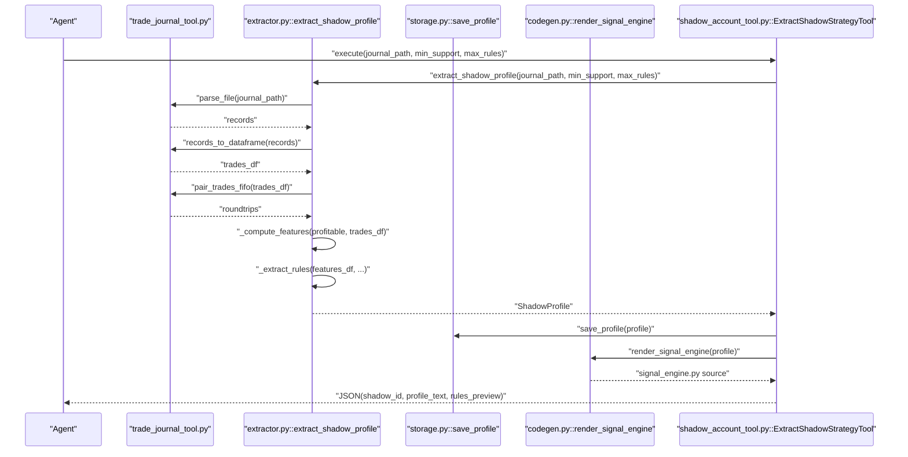

<!-- source: DeepWiki mcp.deepwiki.com · repo HKUDS/Vibe-Trading · page 11.1 Trade Journal Parsing and Strategy Extraction · fetched 2026-11-09 -->

# Trade Journal Parsing and Strategy Extraction

<details>
<summary>Relevant source files</summary>

The following files were used as context for generating this wiki page:

- [.github/workflows/docker-build.yml](.github/workflows/docker-build.yml)
- [agent/requirements-channels.txt](agent/requirements-channels.txt)
- [agent/src/shadow_account/backtester.py](agent/src/shadow_account/backtester.py)
- [agent/src/shadow_account/codegen.py](agent/src/shadow_account/codegen.py)
- [agent/src/shadow_account/extractor.py](agent/src/shadow_account/extractor.py)
- [agent/src/shadow_account/fonts.py](agent/src/shadow_account/fonts.py)
- [agent/src/shadow_account/models.py](agent/src/shadow_account/models.py)
- [agent/src/shadow_account/pdf_fallback.py](agent/src/shadow_account/pdf_fallback.py)
- [agent/src/shadow_account/reporter.py](agent/src/shadow_account/reporter.py)
- [agent/src/shadow_account/scanner.py](agent/src/shadow_account/scanner.py)
- [agent/src/shadow_account/templates/shadow_report.html](agent/src/shadow_account/templates/shadow_report.html)
- [agent/src/shadow_account/templates/signal_engine.py.j2](agent/src/shadow_account/templates/signal_engine.py.j2)
- [agent/src/tools/shadow_account_tool.py](agent/src/tools/shadow_account_tool.py)
- [agent/src/tools/trade_journal_parsers.py](agent/src/tools/trade_journal_parsers.py)
- [agent/src/tools/trade_journal_tool.py](agent/src/tools/trade_journal_tool.py)
- [agent/tests/test_backtest_runner_security.py](agent/tests/test_backtest_runner_security.py)
- [agent/tests/test_docker_workflow_publish_guard.py](agent/tests/test_docker_workflow_publish_guard.py)
- [agent/tests/test_futu_excel_serial_dates.py](agent/tests/test_futu_excel_serial_dates.py)
- [agent/tests/test_generic_split_datetime.py](agent/tests/test_generic_split_datetime.py)
- [agent/tests/test_journal_unsupported_filter.py](agent/tests/test_journal_unsupported_filter.py)
- [agent/tests/test_shadow_account.py](agent/tests/test_shadow_account.py)
- [agent/tests/test_shadow_attribution.py](agent/tests/test_shadow_attribution.py)
- [agent/tests/test_shadow_codegen_security.py](agent/tests/test_shadow_codegen_security.py)
- [agent/tests/test_shadow_currency_disclosure.py](agent/tests/test_shadow_currency_disclosure.py)
- [agent/tests/test_shadow_result_cache.py](agent/tests/test_shadow_result_cache.py)
- [agent/tests/test_shadow_scanner.py](agent/tests/test_shadow_scanner.py)
- [agent/tests/test_ths_excel_serial_dates.py](agent/tests/test_ths_excel_serial_dates.py)
- [agent/tests/test_trade_journal.py](agent/tests/test_trade_journal.py)
- [agent/tests/test_trade_journal_analysis_type.py](agent/tests/test_trade_journal_analysis_type.py)
- [agent/tests/test_trade_journal_fifo.py](agent/tests/test_trade_journal_fifo.py)
- [agent/tests/test_trade_journal_invalid_datetime.py](agent/tests/test_trade_journal_invalid_datetime.py)
- [agent/tests/test_trade_journal_parser_accounting_negatives.py](agent/tests/test_trade_journal_parser_accounting_negatives.py)
- [agent/tests/test_trade_journal_reversal_fees.py](agent/tests/test_trade_journal_reversal_fees.py)
- [agent/tests/test_trade_journal_strict_json.py](agent/tests/test_trade_journal_strict_json.py)
- [agent/tests/test_trade_journal_suffixed_us_market.py](agent/tests/test_trade_journal_suffixed_us_market.py)
- [agent/tests/test_trade_journal_timestamp_order.py](agent/tests/test_trade_journal_timestamp_order.py)
- [agent/tests/test_windows_lock_no_sentinel.py](agent/tests/test_windows_lock_no_sentinel.py)

</details>


The Trade Journal Parsing and Strategy Extraction system is a specialized pipeline within the Shadow Account subsystem. It enables the platform to ingest raw broker export files, reconstruct the user's trading history using FIFO logic, and apply machine learning techniques to extract executable trading rules. These rules are then transformed into a `SignalEngine` via automated code generation for counterfactual backtesting and behavioral analysis.

## System Architecture and Data Flow

The extraction process transitions from raw, unstructured broker data to structured Python code that can be executed by the backtesting engine.

### Logical Data Flow
1. **Parsing**: Raw files (CSV/Excel) are loaded and normalized into `TradeRecord` objects [agent/src/tools/trade_journal_parsers.py:102-126]().
2. **Pairing**: Individual trade executions are paired into roundtrips using a First-In-First-Out (FIFO) algorithm to compute per-roundtrip PnL [agent/src/tools/trade_journal_tool.py:76-110]().
3. **Clustering & Extraction**: Profitable roundtrips are analyzed using KMeans clustering and Decision Tree path extraction to form `ShadowRule` objects [agent/src/shadow_account/extractor.py:1-18]().
4. **Code Generation**: Rules are injected into a Jinja2 template to create a `signal_engine.py` for the backtester [agent/src/shadow_account/templates/signal_engine.py.j2:1-134]().

### Code Entity Mapping
The following diagram maps the logical extraction stages to specific classes and functions in the codebase, bridging natural language spaces to code entity spaces.

**Extraction Pipeline Mapping**
```mermaid
graph TD
    subgraph NaturalLanguageSpace
        A["BrokerExportFile"]
        B["TradingStyleProfile"]
        C["InvestmentRules"]
    end

    subgraph CodeEntitySpace
        direction TB
        A -->|load_dataframe()| LD[agent/src/tools/trade_journal_parsers.py::load_dataframe]
        LD -->|detect_format()| DF[agent/src/tools/trade_journal_parsers.py::detect_format]
        DF -->|parse_file()| PF[agent/src/tools/trade_journal_parsers.py::parse_file]
        PF -->|records_to_dataframe()| RTD[agent/src/tools/trade_journal_parsers.py::records_to_dataframe]
        RTD -->|pair_trades_fifo()| PTF[agent/src/tools/trade_journal_tool.py::pair_trades_fifo]
        PTF -->|extract_shadow_profile()| ESP[agent/src/shadow_account/extractor.py::extract_shadow_profile]
        ESP -->|render_signal_engine()| RSE[agent/src/shadow_account/codegen.py::render_signal_engine]
        RSE -->|signal_engine.py.j2| SE_J2[agent/src/shadow_account/templates/signal_engine.py.j2]
    end

    subgraph DataStructures
        DS1["TradeRecord"]
        DS2["ShadowProfile"]
        DS3["ShadowRule"]
    end

    PF -.-> DS1
    ESP -.-> DS2
    DS2 -.-> DS3
    SE_J2 -.-> SignalEngineClass[SignalEngine]
```
Sources: [agent/src/tools/trade_journal_parsers.py:102-126](), [agent/src/tools/trade_journal_tool.py:76-110](), [agent/src/shadow_account/extractor.py:65-145](), [agent/src/shadow_account/codegen.py:1-114](), [agent/src/shadow_account/templates/signal_engine.py.j2:1-134]()

## Trade Journal Parsing

The system supports multiple brokers (e.g., Futu, EastMoney, Tonghuashun) through format detection and specific parsing utilities.

### Multi-Broker CSV/Excel Parsing
The `trade_journal_parsers.py` module handles the ingestion of various broker export formats.
The `load_dataframe` function [agent/src/tools/trade_journal_parsers.py:130-161]() loads CSV or Excel files, attempting multiple encodings for CSV files (`utf-8-sig`, `utf-8`, `utf-16`, `gbk`, `gb2312`).
The `detect_format` function [agent/src/tools/trade_journal_parsers.py:173-203]() identifies the broker format based on column name signatures, supporting `tonghuashun`, `eastmoney`, `futu`, and a `generic` format.
Each specific parser normalizes raw data into `TradeRecord` instances [agent/src/tools/trade_journal_parsers.py:102-126](). These parsers handle serial date conversions and currency token stripping [agent/src/tools/trade_journal_parsers.py:25-27](). Corporate action rows (e.g., stock dividends, splits, interest) are explicitly filtered out [agent/src/tools/trade_journal_parsers.py:85-98]().

Sources: [agent/src/tools/trade_journal_parsers.py:25-161](), [agent/src/tools/trade_journal_parsers.py:173-203]()

### FIFO Pairing Implementation
The `pair_trades_fifo` function in `trade_journal_tool.py` is critical for calculating realized PnL and holding periods. It maintains deques of open long and short positions for each symbol [agent/src/tools/trade_journal_tool.py:108-110]().

* **Buy/Cover Side**: Handles long entries or covers open short lots [agent/src/tools/trade_journal_tool.py:127-167]().
* **Sell Side**: Matches sell quantities against existing long lots in FIFO order [agent/src/tools/trade_journal_tool.py:118-160]().
* **Cost Basis**: Apportions fees proportionally across matched quantities and calculates net PnL [agent/src/tools/trade_journal_tool.py:138-155]().
* **Caliber Adjustment**: An optional `adjust` callable can be provided via `build_frame_adjust` to restate legs to a unified price caliber, avoiding fake losses from splits or dividends [agent/src/tools/trade_journal_tool.py:39-70]() [agent/src/tools/trade_journal_tool.py:89-95]().

Sources: [agent/src/tools/trade_journal_tool.py:39-167]()

## Strategy Extraction Logic

The extraction logic focuses on identifying alpha by analyzing profitable roundtrips and user behavioral patterns.

### Rule Discovery
The system extracts `ShadowRule` instances by executing:
1. **Feature Engineering**: Computing features such as `holding_days`, `pnl_pct`, `entry_hour`, and `entry_weekday` [agent/src/shadow_account/extractor.py:40-41](). Price-context features (e.g., `entry_rsi14`, `prior_5d_return`) are fetched via the backtest loader registry [agent/src/shadow_account/extractor.py:43-51]().
2. **Clustering**: Using KMeans to group profitable roundtrips into 2–5 clusters [agent/src/shadow_account/extractor.py:4-5]().
3. **Rule Induction**: Running a Decision Tree (`max_depth=3`) on each cluster to extract path-based entry conditions [agent/src/shadow_account/extractor.py:5-6]().
4. **Translation**: Converting structured conditions into human-readable text via an `llm_translator` or deterministic fallback [agent/src/shadow_account/extractor.py:70-80]().

### Behavior Diagnostics
The system detects psychological biases using numeric evidence [agent/src/tools/trade_journal_tool.py:1-10]() (e.g., disposition effect and overtrading metrics).

Sources: [agent/src/shadow_account/extractor.py:1-145](), [agent/src/tools/trade_journal_tool.py:1-10]()

## Code Generation and Security Hardening

The `codegen.py` module transforms a `ShadowProfile` into executable Python code for counterfactual backtesting.

### SignalEngine Generation
The `render_signal_engine` function uses the `signal_engine.py.j2` template to produce a `SignalEngine` class [agent/src/shadow_account/templates/signal_engine.py.j2:32-134](). The generated engine implements conditional entry logic evaluating hour windows, RSI, and prior returns [agent/src/shadow_account/templates/signal_engine.py.j2:83-134]().

### Security Hardening and AST Scrubber
Generated `signal_engine.py` files are strictly validated upon loading by the backtest runner [agent/tests/test_backtest_runner_security.py:1-43](). The test suite verifies that `_load_module_from_file` rejects:
* Top-level or class-level executable statements [agent/tests/test_backtest_runner_security.py:17-65]().
* Forbidden operations within method bodies, such as network calls, file writing, process execution (`os.system`, `subprocess`), or imports from the `src.trading` live subsystem [agent/tests/test_backtest_runner_security.py:98-149]().

Sources: [agent/src/shadow_account/templates/signal_engine.py.j2:32-134](), [agent/tests/test_backtest_runner_security.py:1-149]()

## Tool Integration

The extraction logic is exposed to the ReAct agent via BaseTool wrappers inside `shadow_account_tool.py`.

**Shadow Account Tool Interaction**

Sources: [agent/src/shadow_account/extractor.py:65-145](), [agent/src/tools/shadow_account_tool.py:80-158]()

---

