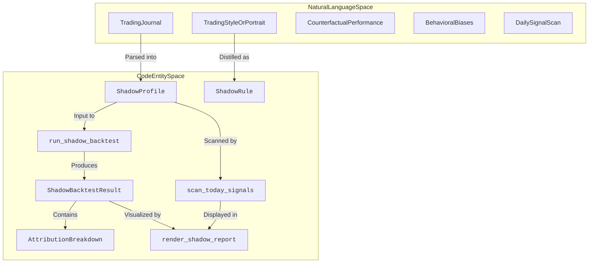
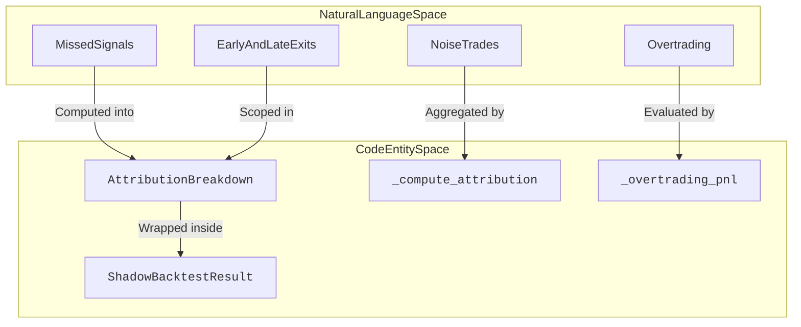
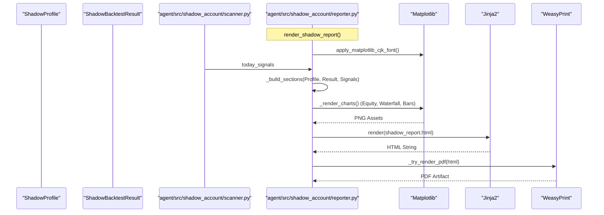

<!-- source: DeepWiki mcp.deepwiki.com · repo HKUDS/Vibe-Trading · page 11.2 Shadow Backtester and Report Generation · fetched 2026-11-09 -->

# Shadow Backtester and Report Generation

Relevant source files

The following files were used as context for generating this wiki page:

- [CODE_OF_CONDUCT.md](CODE_OF_CONDUCT.md)
- [SECURITY.md](SECURITY.md)
- [agent/backtest/loaders/mt5_loader.py](agent/backtest/loaders/mt5_loader.py)
- [agent/src/core/runner.py](agent/src/core/runner.py)
- [agent/src/shadow_account/__init__.py](agent/src/shadow_account/__init__.py)
- [agent/src/shadow_account/backtester.py](agent/src/shadow_account/backtester.py)
- [agent/src/shadow_account/codegen.py](agent/src/shadow_account/codegen.py)
- [agent/src/shadow_account/extractor.py](agent/src/shadow_account/extractor.py)
- [agent/src/shadow_account/fonts.py](agent/src/shadow_account/fonts.py)
- [agent/src/shadow_account/models.py](agent/src/shadow_account/models.py)
- [agent/src/shadow_account/pdf_fallback.py](agent/src/shadow_account/pdf_fallback.py)
- [agent/src/shadow_account/reporter.py](agent/src/shadow_account/reporter.py)
- [agent/src/shadow_account/scanner.py](agent/src/shadow_account/scanner.py)
- [agent/src/shadow_account/storage.py](agent/src/shadow_account/storage.py)
- [agent/src/shadow_account/templates/shadow_report.html](agent/src/shadow_account/templates/shadow_report.html)
- [agent/src/shadow_account/templates/signal_engine.py.j2](agent/src/shadow_account/templates/signal_engine.py.j2)
- [agent/src/tools/shadow_account_tool.py](agent/src/tools/shadow_account_tool.py)
- [agent/tests/test_akshare_loader.py](agent/tests/test_akshare_loader.py)
- [agent/tests/test_backtest_runner_security.py](agent/tests/test_backtest_runner_security.py)
- [agent/tests/test_mt5_interval_lowercase.py](agent/tests/test_mt5_interval_lowercase.py)
- [agent/tests/test_mt5_loader.py](agent/tests/test_mt5_loader.py)
- [agent/tests/test_mt5_loader_week_month_reject.py](agent/tests/test_mt5_loader_week_month_reject.py)
- [agent/tests/test_runner_env.py](agent/tests/test_runner_env.py)
- [agent/tests/test_shadow_account.py](agent/tests/test_shadow_account.py)
- [agent/tests/test_shadow_attribution.py](agent/tests/test_shadow_attribution.py)
- [agent/tests/test_shadow_codegen_security.py](agent/tests/test_shadow_codegen_security.py)
- [agent/tests/test_shadow_currency_disclosure.py](agent/tests/test_shadow_currency_disclosure.py)
- [agent/tests/test_shadow_result_cache.py](agent/tests/test_shadow_result_cache.py)
- [agent/tests/test_shadow_scanner.py](agent/tests/test_shadow_scanner.py)
- [agent/tests/test_trade_journal_fifo.py](agent/tests/test_trade_journal_fifo.py)
- [agent/tests/test_user_state_paths.py](agent/tests/test_user_state_paths.py)

The Shadow Account system provides a counterfactual analysis framework that evaluates a user's historical trading performance against a "Shadow Profile" (a set of rules distilled from their own successful trades). This subsystem handles the execution of multi-market backtests using these distilled rules, calculates behavioral bias attributions (delta-PnL), evaluates real-time opportunities via scanning, and generates comprehensive HTML/PDF reports.

## System Architecture and Data Flow

The shadow backtesting pipeline bridges the gap between raw trade journals and actionable behavioral insights. It transforms structured `ShadowRule` objects into executable Python code, runs them across global markets, and aggregates the results into a visual report.

### Logic to Entity Mapping

The following diagram illustrates how natural language concepts in the trading journal space map to specific code entities within the `shadow_account` module.

**Diagram: Journal to Code Mapping**

Sources: [agent/src/shadow_account/models.py:20-111](), [agent/src/shadow_account/backtester.py:96-175](), [agent/src/shadow_account/reporter.py:56-102](), [agent/src/shadow_account/extractor.py:64-145](), [agent/src/shadow_account/scanner.py:22-44]()

### Behavioral Analysis to Code Mapping

A second bridging diagram connects high-level behavioral bias categories and reporting concepts to their respective code modules and metric structures.

**Diagram: Behavioral Bias to Attribution Entities**

Sources: [agent/src/shadow_account/models.py:85-117](), [agent/src/shadow_account/backtester.py:1-16](), [agent/tests/test_shadow_attribution.py:1-128]()

---

## Shadow Backtester

The `backtester.py` module acts as a driver that orchestrates the execution of shadow rules across multiple asset classes [agent/src/shadow_account/backtester.py:1-16]().

### Execution Lifecycle
1. **Market Selection**: The system picks representative tickers for target markets (`china_a`, `hk`, `us`, `crypto`) using `select_multi_market_codes` [agent/src/shadow_account/backtester.py:53-81](). It prioritizes the user's `source_market` and falls back to predefined liquid baskets like `_LIQUID_BASKETS` [agent/src/shadow_account/backtester.py:43-48]().
2. **Code Generation**: It invokes `write_run_dir` [agent/src/shadow_account/codegen.py:193-200]() which utilizes Jinja2 templates via `render_signal_engine` [agent/src/shadow_account/codegen.py:97-114]() and `render_config` [agent/src/shadow_account/codegen.py:156-191]() to render a full backtest environment. The generated `signal_engine.py` is validated using `ast.parse` to ensure it defines a valid `SignalEngine` class [agent/src/shadow_account/codegen.py:117-153]().
3. **Backtest Invocation**: The `run_shadow_backtest` function [agent/src/shadow_account/backtester.py:164-182]() drives the process. It groups selected codes by settlement currency using `_group_selection_by_currency` [agent/src/shadow_account/backtester.py:96-120]() and then calls an internal `run_backtest_fn` (typically `src.tools.backtest_tool.run_backtest`) for each currency pool.
4. **Result Aggregation**: Artifacts (metrics JSON and equity CSVs) are parsed and summarized into a `ShadowBacktestResult` [agent/src/shadow_account/models.py:103-117](). The `_headline_index` function [agent/src/shadow_account/backtester.py:128-159]() determines which currency pool's results are used for headline metrics and attribution, prioritizing the `source_market`'s currency.

### Delta-PnL Attribution
The attribution logic calculates the difference between the user's realized PnL and the shadow's potential PnL, structured into mutually exclusive buckets defined in `AttributionBreakdown` [agent/src/shadow_account/models.py:85-100]():
* **Missed Signals (`missed_signals_pnl`)**: Residual PnL from signals the shadow would have taken but the user missed.
* **Noise Trades (`noise_trades_pnl`)**: PnL from trades matching no shadow rules.
* **Early/Late Exits (`early_exit_pnl`, `late_exit_pnl`)**: PnL lost by exiting winners too soon or holding losers too long compared to `holding_days_range` [agent/tests/test_shadow_attribution.py:80-105]().
* **Overtrading (`overtrading_pnl`)**: Excess costs or missed opportunities from high-frequency deviations, calculated without double-counting early exits [agent/tests/test_shadow_attribution.py:108-129]().
* **Currency Scoping**: For mixed-currency journals, `excluded_currencies` tracks roundtrips in non-matching currencies, keeping them separate from the pool's real PnL [agent/src/shadow_account/models.py:97-99](), [agent/tests/test_shadow_attribution.py:59-70]().

Sources: [agent/src/shadow_account/backtester.py:1-182](), [agent/src/shadow_account/models.py:85-117](), [agent/src/shadow_account/codegen.py:97-200](), [agent/tests/test_shadow_attribution.py:1-178]()

---

## Today Signals Scanner

The `scanner.py` module provides a deterministic research scanner to evaluate Shadow rules against recent market data.

* **Data Fetching**: Retrieves recent OHLCV bars for liquid baskets using loader protocols [agent/src/shadow_account/scanner.py:17-29]().
* **Feature Evaluation**: Computes real-time features like `entry_rsi14`, `momentum`, and `volume_ratio` to check against rule conditions [agent/src/shadow_account/scanner.py:169-200]().
* **Causal RSI**: Implements a causal Wilder-EWM RSI formula to prevent lookahead bias during scanning [agent/src/shadow_account/scanner.py:203-218]().
* **Market Coverage**: Scans across `SUPPORTED_MARKETS` with configurable caps per market [agent/src/shadow_account/scanner.py:53-74]().

Sources: [agent/src/shadow_account/scanner.py:1-218](), [agent/src/shadow_account/models.py:17-18]()

---

## Report Generation and Visualization

The `reporter.py` module generates an 8-section report comparing "You vs Your Shadow," utilizing Jinja2 for HTML templating and Matplotlib for visual analytics.

### Reporting Pipeline
**Diagram: Report Generation Sequence**

Sources: [agent/src/shadow_account/reporter.py:56-102](), [agent/src/shadow_account/fonts.py:96-127](), [agent/src/shadow_account/scanner.py:22-44]()

### Key Components
* **Visualizations**: `_render_charts` generates equity curves, per-market performance bars, and attribution waterfall charts as embedded PNG assets [agent/src/shadow_account/reporter.py:154-177]().
* **Font Management (`fonts.py`)**: Manages CJK font discovery and fallback to ensure Chinese characters render correctly in PDF/PNG exports. It probes system paths (e.g., PingFang, Microsoft YaHei, STHeiti) or downloads Noto Sans CJK when necessary [agent/src/shadow_account/fonts.py:34-93]().
* **Metrics Partitioning**: `_split_metrics` separates numeric performance data from error strings, preventing formatting crashes on failed runner metrics [agent/src/shadow_account/reporter.py:138-149]().
* **Templates**: Uses `shadow_report.html` alongside Jinja2 filters to layout the multi-section diagnostic report.

Sources: [agent/src/shadow_account/reporter.py:1-177](), [agent/src/shadow_account/fonts.py:1-143](), [agent/src/shadow_account/templates/shadow_report.html:1-100]()

---

## Persistence and Storage

The `storage.py` module manages the file-system layout for shadow artifacts under `~/.vibe-trading/` [agent/src/shadow_account/storage.py:1-43]().

| Directory | Content | File Entity |
| :--- | :--- | :--- |
| `shadow_accounts/` | JSON files containing `ShadowProfile` data | `profiles_dir()` [agent/src/shadow_account/storage.py:28-31]() |
| `shadow_runs/` | Backtest run directories containing artifacts | `runs_dir()` [agent/src/shadow_account/storage.py:34-37]() |
| `shadow_reports/` | Rendered HTML and PDF reports | `reports_dir()` [agent/src/shadow_account/storage.py:40-43]() |

The system uses `hash_journal` (SHA1) to guarantee idempotency and prevent redundant extractions for identical trade journals [agent/src/shadow_account/storage.py:51-58](). `load_profile` reconstructs frozen `ShadowProfile` and `ShadowRule` instances from disk [agent/src/shadow_account/storage.py:76-112]().

Sources: [agent/src/shadow_account/storage.py:1-129](), [agent/src/shadow_account/models.py:20-78]()

---

## Code Generation, Security Hardening, and Tests

Dynamic code generation in the shadow subsystem is protected by rigorous validation and sandbox boundaries:
* **Static AST Validation**: The `validate_generated` function inspects the AST of generated `SignalEngine` code to ensure required structures exist and prohibits executable top-level or class-level statements [agent/src/shadow_account/codegen.py:117-153](), [agent/tests/test_backtest_runner_security.py:17-65]().
* **Method Body Sandboxing**: Security regression tests verify that forbidden operations within generated methods (`os.system`, `subprocess.run`, `eval`, `exec`, network modules, or imports of `src.trading.service`) are strictly blocked [agent/tests/test_backtest_runner_security.py:88-149]().
* **Runtime Isolation**: Shadow runs are isolated in unique subdirectories under `shadow_runs/<shadow_id>/` [agent/src/shadow_account/storage.py:34-37](). The runner creates an ephemeral `HOME` directory re-exposing only necessary loader paths (`cache`, `data-bridge`, `qveris.json`) while scrubbing sensitive environment variables and API keys [agent/src/core/runner.py:33-45](), [agent/src/core/runner.py:147-167](), [agent/tests/test_runner_env.py:60-88](). On POSIX systems, `RLIMIT_AS` and `RLIMIT_NOFILE` enforce strict memory and file descriptor ceilings [agent/src/core/runner.py:48-52](), [agent/src/core/runner.py:96-116]().

Sources: [agent/src/shadow_account/codegen.py:117-153](), [agent/src/shadow_account/storage.py:34-37](), [agent/tests/test_backtest_runner_security.py:1-182](), [agent/src/core/runner.py:33-167](), [agent/tests/test_runner_env.py:60-88]()

---

