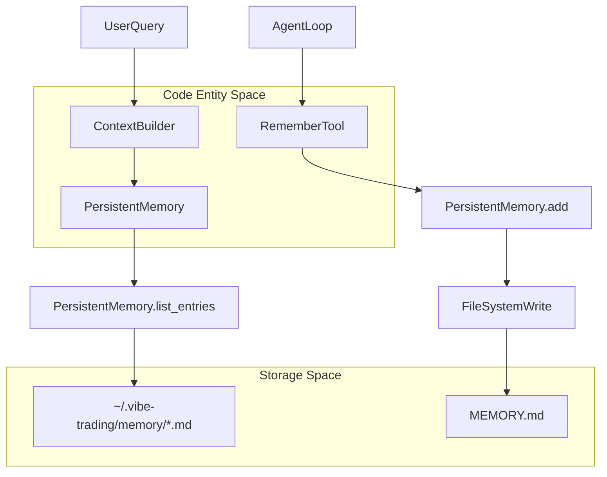
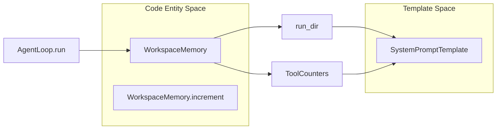

<!-- source: DeepWiki mcp.deepwiki.com · repo HKUDS/Vibe-Trading · page 12 Persistent Memory and Context Management · fetched 2026-11-09 -->

# Persistent Memory and Context Management

Relevant source files

The following files were used as context for generating this wiki page:

- [agent/src/memory/compression.py](agent/src/memory/compression.py)
- [agent/src/memory/hierarchy.py](agent/src/memory/hierarchy.py)
- [agent/src/memory/lifecycle.py](agent/src/memory/lifecycle.py)
- [agent/src/memory/persistent.py](agent/src/memory/persistent.py)
- [agent/src/memory/semantic_links.py](agent/src/memory/semantic_links.py)
- [agent/src/tools/remember_tool.py](agent/src/tools/remember_tool.py)
- [agent/tests/memory/test_lifecycle_index_cleanup.py](agent/tests/memory/test_lifecycle_index_cleanup.py)
- [agent/tests/memory/test_memory_dedup.py](agent/tests/memory/test_memory_dedup.py)
- [agent/tests/memory/test_semantic_links.py](agent/tests/memory/test_semantic_links.py)
- [agent/tests/memory/test_tier2_integration.py](agent/tests/memory/test_tier2_integration.py)
- [agent/tests/test_cli_memory.py](agent/tests/test_cli_memory.py)
- [agent/tests/test_memory_gc.py](agent/tests/test_memory_gc.py)
- [agent/tests/test_memory_lifecycle.py](agent/tests/test_memory_lifecycle.py)
- [agent/tests/test_memory_orphan_recovery.py](agent/tests/test_memory_orphan_recovery.py)
- [agent/tests/test_persistent_memory.py](agent/tests/test_persistent_memory.py)
- [agent/tests/test_remember_tool_security.py](agent/tests/test_remember_tool_security.py)

The Vibe-Trading memory and context system provides a multi-layered approach to state management, ensuring the agent retains critical information across turns and sessions while staying within the token limits of modern LLMs. It bridges the gap between short-term workspace state and long-term file-based persistence.

## System Architecture Overview

The architecture separates state into three distinct tiers:
1.  **Persistent Memory**: Cross-session storage using Markdown files with YAML frontmatter at `~/.vibe-trading/memory/` [agent/src/memory/persistent.py:1-9]().
2.  **Workspace Memory**: Short-term state (counters, directories) shared between tools in a single run [agent/src/agent/memory.py:10-23]().
3.  **Message Context**: The active conversation window, managed via a five-layer compaction strategy and dynamic assembly of skills, tools, and research goals [agent/src/agent/context.py:23-117]().

### Memory Flow and Code Entity Mapping

The following diagram illustrates how natural language queries and tool executions interact with the underlying code entities and storage.

**Memory Retrieval and Persistence Flow**

Sources: [agent/src/memory/persistent.py:1-9](), [agent/src/memory/persistent.py:200-205](), [agent/src/agent/context.py:121-148](), [agent/src/tools/remember_tool.py:12-24]()

---

## Persistent Memory Store

The `PersistentMemory` class implements a zero-dependency, file-based storage system [agent/src/memory/persistent.py:200-205](). It uses a flat-file or hierarchical structure where each memory is a `.md` file with metadata stored in YAML frontmatter [agent/src/memory/persistent.py:127-147](), [agent/src/memory/hierarchy.py:34-41]().

### Key Features
*   **File-based Storage**: Memories are stored as Markdown files with YAML frontmatter in `~/.vibe-trading/memory/` [agent/src/memory/persistent.py:21-22]().
*   **Slug Generation**: Filenames (slugs) are generated from the memory title, preserving non-Latin characters (e.g., CJK, Thai, Arabic, Hebrew, Cyrillic) to prevent collisions and ensure discoverability [agent/src/memory/persistent.py:109-124](), [agent/tests/test_persistent_memory.py:173-177]().
*   **Search and Recall**: The `find_relevant` method uses tokenization (`_tokenize`) to match queries across various languages and scripts, handling short tokens (e.g., "GE", "US") and snake_case titles (`mcp_wiring_test`) [agent/src/memory/persistent.py:149-152](), [agent/tests/test_persistent_memory.py:72-78](), [agent/tests/test_persistent_memory.py:95-101]().
*   **Memory Lifecycle**: `MemoryLifecycle` manages quality scoring, Ebbinghaus-inspired importance decay, and garbage collection based on usage feedback (`task_success`, `user_confirm`) [agent/src/memory/lifecycle.py:71-102](), [agent/src/memory/lifecycle.py:112-159]().
*   **Advanced Tier 2 Features**: Includes BM25 semantic linking via `.relations.json` sidecars (`SemanticLinker`), three-level compression (`CompressionPipeline`), and hierarchical directory routing (`MemoryHierarchy`) [agent/src/memory/semantic_links.py:1-7](), [agent/src/memory/compression.py:1-7](), [agent/src/memory/hierarchy.py:1-7]().

For details, see [PersistentMemory Store](#12.1).

Sources: [agent/src/memory/persistent.py:1-38](), [agent/src/memory/persistent.py:109-169](), [agent/src/memory/persistent.py:200-205](), [agent/src/memory/lifecycle.py:71-178](), [agent/src/memory/semantic_links.py:1-7](), [agent/src/memory/compression.py:1-7](), [agent/src/memory/hierarchy.py:1-7]()

---

## Context Assembly and System Prompt Construction

The `ContextBuilder` in `agent/src/agent/context.py` is responsible for assembling the high-level system prompt and managing the message history.

### System Prompt Construction
The system prompt is dynamically assembled using the `build_system_prompt` method [agent/src/agent/context.py:121-148](). It incorporates:
*   **Tool Definitions**: Formatted descriptions of all tools in the `ToolRegistry` [agent/src/agent/context.py:26-28]().
*   **Skill Summaries**: One-line descriptions from `SkillsLoader.get_descriptions()` to keep the prompt lean [agent/src/agent/context.py:30-32]().
*   **Memory Snapshot**: The cross-session index from `PersistentMemory.snapshot` injected into the state section [agent/src/agent/context.py:34-36]().
*   **Task Routing Instructions**: Explicit logic for specialized backtest, swarm, and portfolio attribution workflows [agent/src/agent/context.py:40-117]().

### Context Compaction Strategy
To handle long-running research sessions, the `AgentLoop` employs a multi-layer compaction strategy to prevent token overflow, including microcompacting tool results, context collapse, and auto-compaction [agent/tests/test_loop_helpers.py:11-166]().

For details, see [Context Assembly and System Prompt Construction](#12.2).

Sources: [agent/src/agent/context.py:121-155](), [agent/src/agent/context.py:23-117](), [agent/tests/test_loop_helpers.py:11-166]()

---

## Workspace Memory

`WorkspaceMemory` acts as a lightweight runtime state container for a single session. Unlike `PersistentMemory`, it exists only for the duration of a single `AgentLoop` invocation [agent/src/agent/memory.py:10-23]().

**Workspace State Integration**

Its primary role is to track the `run_dir` (where backtest artifacts and code are stored) and `counters` for tool usage via the `increment` method [agent/src/agent/memory.py:25-35](). This state is summarized via `to_summary()` and injected into the system prompt to help the LLM maintain awareness of its current workspace and activity [agent/src/agent/memory.py:37-53]().

Sources: [agent/src/agent/memory.py:10-53](), [agent/src/agent/context.py:11-11]()

---

