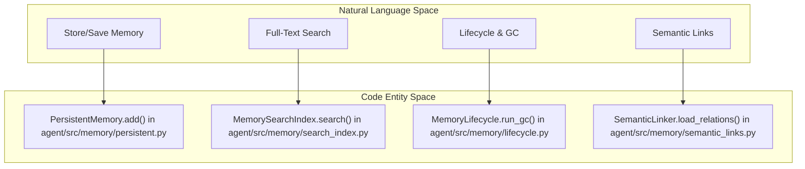
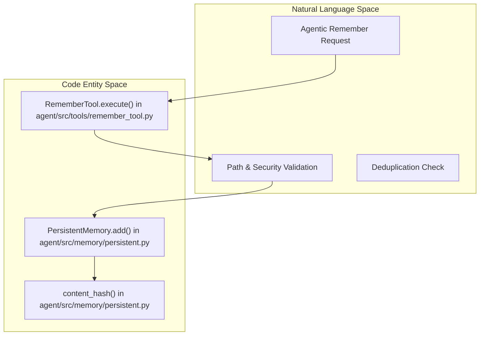

<!-- source: DeepWiki mcp.deepwiki.com · repo HKUDS/Vibe-Trading · page 12.1 PersistentMemory Store · fetched 2026-11-09 -->

# PersistentMemory Store

Relevant source files

The following files were used as context for generating this wiki page:

- [agent/src/memory/compression.py](agent/src/memory/compression.py)
- [agent/src/memory/hierarchy.py](agent/src/memory/hierarchy.py)
- [agent/src/memory/lifecycle.py](agent/src/memory/lifecycle.py)
- [agent/src/memory/persistent.py](agent/src/memory/persistent.py)
- [agent/src/memory/search_index.py](agent/src/memory/search_index.py)
- [agent/src/memory/semantic_links.py](agent/src/memory/semantic_links.py)
- [agent/src/tools/backtest_summary.py](agent/src/tools/backtest_summary.py)
- [agent/src/tools/fred_macro_tool.py](agent/src/tools/fred_macro_tool.py)
- [agent/src/tools/remember_tool.py](agent/src/tools/remember_tool.py)
- [agent/src/tools/run_artifact_tool.py](agent/src/tools/run_artifact_tool.py)
- [agent/tests/memory/test_lifecycle_index_cleanup.py](agent/tests/memory/test_lifecycle_index_cleanup.py)
- [agent/tests/memory/test_memory_dedup.py](agent/tests/memory/test_memory_dedup.py)
- [agent/tests/memory/test_search_index.py](agent/tests/memory/test_search_index.py)
- [agent/tests/memory/test_semantic_links.py](agent/tests/memory/test_semantic_links.py)
- [agent/tests/memory/test_tier2_integration.py](agent/tests/memory/test_tier2_integration.py)
- [agent/tests/test_backtest_summary.py](agent/tests/test_backtest_summary.py)
- [agent/tests/test_cli_memory.py](agent/tests/test_cli_memory.py)
- [agent/tests/test_fred_macro_tool.py](agent/tests/test_fred_macro_tool.py)
- [agent/tests/test_memory_gc.py](agent/tests/test_memory_gc.py)
- [agent/tests/test_memory_lifecycle.py](agent/tests/test_memory_lifecycle.py)
- [agent/tests/test_memory_orphan_recovery.py](agent/tests/test_memory_orphan_recovery.py)
- [agent/tests/test_memory_runtime_root.py](agent/tests/test_memory_runtime_root.py)
- [agent/tests/test_persistent_memory.py](agent/tests/test_persistent_memory.py)
- [agent/tests/test_remember_tool_security.py](agent/tests/test_remember_tool_security.py)
- [agent/tests/test_run_artifact_tool.py](agent/tests/test_run_artifact_tool.py)

The `PersistentMemory` system provides a zero-dependency, file-based storage layer for long-term memory that survives across agent sessions. It is designed to be lightweight, human-readable, and searchable using a keyword-based retrieval mechanism as well as an optional SQLite FTS5 backend that supports multi-language scripts.

## Overview and Storage Layout

Persistent memory is stored in the user's runtime root directory to ensure data persistence across different versions of the codebase or container restarts.

- **Base Directory**: `~/.vibe-trading/memory/` [agent/src/memory/persistent.py:21-22]().
- **Index File**: `MEMORY.md` serves as a human-readable index of all stored memories, limited to the most recent 200 lines to maintain performance and prompt cache efficiency [agent/src/memory/persistent.py:22-25](), [agent/src/memory/persistent.py:205-206]().
- **Entry Files**: Individual memories are stored as Markdown files with YAML frontmatter. Filenames follow the pattern: `{memory_type}_{slug}.md` [agent/src/memory/persistent.py:239-241]().

### Natural Language Space to Code Entity Space: Memory Architecture

The following diagram bridges natural language memory concepts to the exact Python classes and functions that implement them in `agent/src/memory/`.

Sources: [agent/src/memory/persistent.py:21-26](), [agent/src/memory/persistent.py:210-247](), [agent/src/memory/search_index.py:1-25](), [agent/src/memory/lifecycle.py:71-100](), [agent/src/memory/semantic_links.py:1-20]()

## Tokenization, Slug Generation, and FTS5 Storage

To support cross-language search and reliable file naming, the system implements specialized algorithms for tokenization and slug generation, complemented by SQLite FTS5 full-text indexing [agent/src/memory/search_index.py:1-9]().

### CJK-Safe Tokenization
The `_tokenize` function splits text into searchable units. It handles both English (ASCII) and non-Latin scripts (CJK, Thai, Arabic, Hebrew, Cyrillic) [agent/src/memory/persistent.py:109-123]():
1.  **ASCII**: Extracts words with 2 or more characters, converted to lowercase [agent/src/memory/persistent.py:120-120](). This minimum length matches the FTS5 query sanitizer to ensure consistency in retrieval regardless of whether FTS is enabled [agent/tests/test_persistent_memory.py:71-78]().
2.  **Non-Latin**: Extracts every individual character as a token based on defined script ranges [agent/src/memory/persistent.py:109-116](), [agent/src/memory/persistent.py:120-120]().
3.  **Boundaries**: Underscores (`_`) are treated as word boundaries. This ensures that a `snake_case` title matches natural language queries [agent/tests/test_persistent_memory.py:96-101]().

### Slug Generation Algorithm
When saving a memory, the `name` is converted into a filename-safe slug. Unlike standard sluggers that strip non-ASCII characters, `PersistentMemory` preserves CJK and other non-Latin characters to prevent filename collisions and ensure unique paths for international content [agent/src/memory/persistent.py:239-241]().

### SQLite FTS5 Full-Text Search
When `VT_MEMORY_FTS_INDEX` is active, `MemorySearchIndex` creates an inverted index in `~/.vibe-trading/memory_index.db` (separate from session databases) [agent/src/memory/search_index.py:1-9](). It utilizes unigram and bigram expansions for CJK ideographs to ensure accurate snippet highlighting and phrase matching without character duplication [agent/src/memory/search_index.py:35-64](), [agent/tests/memory/test_search_index.py:158-181]().

Sources: [agent/src/memory/persistent.py:109-123](), [agent/src/memory/persistent.py:239-241](), [agent/src/memory/search_index.py:1-64](), [agent/tests/test_persistent_memory.py:59-118](), [agent/tests/memory/test_search_index.py:158-181]()

## Memory Operations (CRUD)

### Create: `add()`
The `add` method creates a new memory entry. It performs several sanitization steps:
- **Control Character Stripping**: Removes C0/C1 control bytes (except `\t` and `\n`) via `_sanitize_body` [agent/src/memory/persistent.py:158-161]().
- **Truncation**: Content is clipped to `MAX_ENTRY_CHARS` (8000). If exceeded, a `_TRUNCATION_MARKER` is appended [agent/src/memory/persistent.py:24-24](), [agent/src/memory/persistent.py:163-170]().
- **Persistence**: Writes the Markdown file with YAML frontmatter and updates `MEMORY.md` [agent/src/memory/persistent.py:239-247]().
- **Security**: Validates that `memory_type` is one of the allowed categories (`user`, `feedback`, `project`, `reference`) [agent/src/memory/persistent.py:27-27](), [agent/src/memory/persistent.py:214-217]().

### Read/Search: `find_relevant()`
The system uses weighted keyword matching or FTS5 queries:
- **Scoring**: Metadata hits (title/description) are weighted at **2.0x** (`METADATA_WEIGHT`), while body hits are weighted at **1.0x** [agent/src/memory/persistent.py:26-26](), [agent/src/memory/persistent.py:201-203]().
- **Ranking**: Results are sorted by importance descending, then modification time descending [agent/src/memory/persistent.py:205-205]().

### Delete: `remove()`
The `remove` method identifies an entry by title or slug, deletes the `.md` file, and rebuilds the `MEMORY.md` index and FTS entries [agent/src/memory/persistent.py:249-266]().

Sources: [agent/src/memory/persistent.py:24-27](), [agent/src/memory/persistent.py:158-170](), [agent/src/memory/persistent.py:201-266](), [agent/src/memory/search_index.py:1-30]()

## Hierarchy, Tiering, and Compression

### Hierarchical Storage
When `VT_MEMORY_HIERARCHY` is enabled, memory entries route into subdirectories based on their `memory_type` (`user/`, `project/`, `feedback/`, `reference/`) [agent/src/memory/hierarchy.py:35-38](), [agent/src/memory/hierarchy.py:70-90]().

### Compression Pipeline
The `CompressionPipeline` implements a three-level compression strategy (`raw` -> `daily` -> `digest`) to reduce storage footprints for older entries [agent/src/memory/compression.py:1-7]().
- **Daily**: Triggered after `DAILY_THRESHOLD_DAYS` (7 days), compresses content using TF-IDF sentence extraction [agent/src/memory/compression.py:25-25](), [agent/src/memory/compression.py:189-191]().
- **Digest**: Triggered after `DIGEST_THRESHOLD_DAYS` (30 days), reduces content to `DIGEST_MAX_TOKENS` (50 tokens) and core keywords [agent/src/memory/compression.py:26-26](), [agent/src/memory/compression.py:208-217]().
- **Archiving**: Original content moves to `archive/` [agent/src/memory/compression.py:168-169](). FTS5 indices re-index automatically [agent/tests/memory/test_lifecycle_index_cleanup.py:148-152]().

Sources: [agent/src/memory/hierarchy.py:35-90](), [agent/src/memory/compression.py:1-26](), [agent/src/memory/compression.py:168-217](), [agent/tests/memory/test_lifecycle_index_cleanup.py:148-152]()

## Lifecycle Management, Importance Decay, and Garbage Collection

The `MemoryLifecycle` class governs importance decay and garbage collection [agent/src/memory/lifecycle.py:71-77]().

### Importance Scoring & Decay
Importance is calculated via an Ebbinghaus-inspired decay formula with a 14-day half-life (`HALF_LIFE_DAYS = 14.0`), modulated by access counts and quality scores [agent/src/memory/persistent.py:76-92](). Quality scores are updated via `reinforce()` based on feedback events (`task_success`, `user_confirm`, etc.) [agent/src/memory/lifecycle.py:112-122]().

### Garbage Collection
`run_gc()` evaluates entries against `ARCHIVE_THRESHOLD` (0.15) and `DELETE_THRESHOLD` (0.05), respecting `MIN_AGE_DAYS` (7 days) and `MAX_MEMORY_COUNT` (500) [agent/src/memory/lifecycle.py:93-97](), [agent/tests/test_memory_gc.py:111-171](). In Tier 1, deletion is disabled (`ENABLE_DELETE = False`), so low-importance items are archived [agent/src/memory/lifecycle.py:97-97](), [agent/tests/test_memory_gc.py:158-171]().

Sources: [agent/src/memory/persistent.py:76-92](), [agent/src/memory/lifecycle.py:71-122](), [agent/src/memory/lifecycle.py:183-193](), [agent/tests/test_memory_gc.py:111-171]()

## Semantic Links and Consolidation Jobs

The `SemanticLinker` builds relationships between memory entries by analyzing term overlap and co-citation, writing sidecar `.relations.json` files alongside entries [agent/tests/memory/test_tier2_integration.py:139-170](). Consolidation jobs periodically run to merge fragmented notes or promote daily notes into project references.

Sources: [agent/src/memory/semantic_links.py:1-30](), [agent/tests/memory/test_tier2_integration.py:139-170]()

## Deduplication, Orphan Recovery, and Security Constraints

### Deduplication
`PersistentMemory.add()` uses `content_hash()` and a 30-second sliding window (`DEDUP_WINDOW_SECONDS = 30.0`) to suppress rapid-fire duplicate writes caused by retry loops or parallel agent calls [agent/src/memory/persistent.py:31-39](), [agent/src/memory/persistent.py:220-229]().

### Orphan Recovery
`MemoryHierarchy.recover_extensionless_entries()` detects extensionless files written to subdirectories during past errors and restores their `.md` suffix to make them discoverable [agent/src/memory/hierarchy.py:92-143]().

### `RememberTool` Security Constraints
The `RememberTool` exposes `save`, `recall`, `forget`, and `reinforce` actions to the agent [agent/src/tools/remember_tool.py:13-34]().
- **Path Traversal Protection**: `memory_type` is validated against allowed enums (`user`, `feedback`, `project`, `reference`) [agent/src/tools/remember_tool.py:44-51]().
- **Content Limits**: Input bodies are bounded by `MAX_ENTRY_CHARS` and sanitized of control bytes [agent/src/memory/persistent.py:24-24](), [agent/src/memory/persistent.py:158-161]().
- **Feedback Discounting**: System-sourced reinforcement events are discounted by 0.7x relative to user-confirmed events [agent/src/tools/remember_tool.py:61-64](), [agent/src/memory/lifecycle.py:130-133]().

### Natural Language Space to Code Entity Space: Tool Execution Flow

Sources: [agent/src/tools/remember_tool.py:80-100](), [agent/src/memory/persistent.py:36-39](), [agent/src/memory/persistent.py:210-230]()

---

