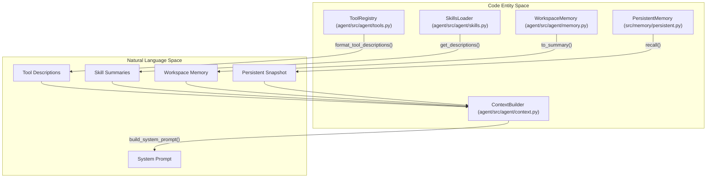
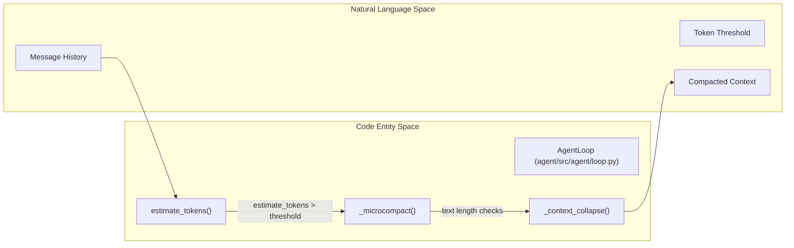

<!-- source: DeepWiki mcp.deepwiki.com · repo HKUDS/Vibe-Trading · page 12.2 Context Assembly and System Prompt Construction · fetched 2026-11-09 -->

# Context Assembly and System Prompt Construction

Relevant source files

The following files were used as context for generating this wiki page:

- [agent/cli/ui/rail.py](agent/cli/ui/rail.py)
- [agent/src/agent/context.py](agent/src/agent/context.py)
- [agent/src/agent/frontmatter.py](agent/src/agent/frontmatter.py)
- [agent/src/agent/grounding/evidence.py](agent/src/agent/grounding/evidence.py)
- [agent/src/agent/grounding/figures.py](agent/src/agent/grounding/figures.py)
- [agent/src/agent/grounding/ledger.py](agent/src/agent/grounding/ledger.py)
- [agent/src/agent/grounding/policies.py](agent/src/agent/grounding/policies.py)
- [agent/src/agent/grounding/release.py](agent/src/agent/grounding/release.py)
- [agent/src/agent/memory.py](agent/src/agent/memory.py)
- [agent/src/agent/skills.py](agent/src/agent/skills.py)
- [agent/src/memory/__init__.py](agent/src/memory/__init__.py)
- [agent/src/skills/correlation-analysis/SKILL.md](agent/src/skills/correlation-analysis/SKILL.md)
- [agent/src/skills/etf-analysis/SKILL.md](agent/src/skills/etf-analysis/SKILL.md)
- [agent/src/skills/financial-statement/SKILL.md](agent/src/skills/financial-statement/SKILL.md)
- [agent/src/skills/ml-strategy/SKILL.md](agent/src/skills/ml-strategy/SKILL.md)
- [agent/src/skills/multi-factor/example_signal_engine.py](agent/src/skills/multi-factor/example_signal_engine.py)
- [agent/src/skills/multi-factor/zoo_signal_engine.py](agent/src/skills/multi-factor/zoo_signal_engine.py)
- [agent/src/skills/pine-script/SKILL.md](agent/src/skills/pine-script/SKILL.md)
- [agent/src/skills/strategy-dev-manager/templates/factor_signal_engine.py](agent/src/skills/strategy-dev-manager/templates/factor_signal_engine.py)
- [agent/src/skills/volatility/example_signal_engine.py](agent/src/skills/volatility/example_signal_engine.py)
- [agent/src/tools/redaction.py](agent/src/tools/redaction.py)
- [agent/src/tools/skill_writer_tool.py](agent/src/tools/skill_writer_tool.py)
- [agent/tests/test_agent_output_discipline.py](agent/tests/test_agent_output_discipline.py)
- [agent/tests/test_cli_rail_dashboard.py](agent/tests/test_cli_rail_dashboard.py)
- [agent/tests/test_context_attribution_layers.py](agent/tests/test_context_attribution_layers.py)
- [agent/tests/test_correlation_analysis_skill.py](agent/tests/test_correlation_analysis_skill.py)
- [agent/tests/test_grounding_backtest_outputs.py](agent/tests/test_grounding_backtest_outputs.py)
- [agent/tests/test_grounding_blank_corner_matrix.py](agent/tests/test_grounding_blank_corner_matrix.py)
- [agent/tests/test_grounding_figures_contract.py](agent/tests/test_grounding_figures_contract.py)
- [agent/tests/test_grounding_keyed_metric_paths.py](agent/tests/test_grounding_keyed_metric_paths.py)
- [agent/tests/test_grounding_percent_unit_fields.py](agent/tests/test_grounding_percent_unit_fields.py)
- [agent/tests/test_grounding_release.py](agent/tests/test_grounding_release.py)
- [agent/tests/test_grounding_role_hardening.py](agent/tests/test_grounding_role_hardening.py)
- [agent/tests/test_grounding_shape_hardening.py](agent/tests/test_grounding_shape_hardening.py)
- [agent/tests/test_ml_strategy_skill.py](agent/tests/test_ml_strategy_skill.py)
- [agent/tests/test_multi_factor_strategy_template.py](agent/tests/test_multi_factor_strategy_template.py)
- [agent/tests/test_redaction.py](agent/tests/test_redaction.py)
- [agent/tests/test_redaction_channel_and_provider_tokens.py](agent/tests/test_redaction_channel_and_provider_tokens.py)
- [agent/tests/test_redaction_cookie_headers.py](agent/tests/test_redaction_cookie_headers.py)
- [agent/tests/test_redaction_shared.py](agent/tests/test_redaction_shared.py)
- [agent/tests/test_skill_pct_change_guard.py](agent/tests/test_skill_pct_change_guard.py)
- [agent/tests/test_skill_writer_tools.py](agent/tests/test_skill_writer_tools.py)
- [agent/tests/test_skills.py](agent/tests/test_skills.py)
- [agent/tests/test_system_prompt_cache_stability.py](agent/tests/test_system_prompt_cache_stability.py)
- [agent/tests/test_trade_journal_fiat_pairs_not_crypto.py](agent/tests/test_trade_journal_fiat_pairs_not_crypto.py)

The purpose of this page is to document the context assembly subsystem centered around `ContextBuilder` in `agent/src/agent/context.py`. This component handles system prompt construction by integrating specialist skills, memory recalls, tool descriptions, and data source catalogs while interacting with the multi-layer compaction engine in `agent/src/agent/loop.py`.

## System Prompt Architecture

The system prompt is constructed using a structured template that defines the ReAct agent's identity, active capabilities, and strict task routing guidelines [agent/src/agent/context.py:23-114](). The `ContextBuilder` dynamically injects counts and descriptions to keep the LLM synchronized with its runtime environment.

### Component Injection
The prompt assembly process executes the following injections:
*   **Tool Descriptions**: Formatted summaries of all registered tools from `ToolRegistry` [agent/src/agent/context.py:143-145]().
*   **Skill Summaries**: One-line descriptions of all available skills via `SkillsLoader` [agent/src/agent/context.py:144-146]().
*   **Workspace Memory**: Session state summaries including `run_dir` and invocation stats [agent/src/agent/context.py:145-147]().
*   **Persistent Memory**: Relevant cross-session memory snapshots retrieved from `PersistentMemory` [agent/src/agent/context.py:134-138]().
*   **Temporal Context**: Local date and time stamps [agent/src/agent/context.py:147-148]().
*   **Data Source Count**: Dynamic count of active data sources derived from registry constants [agent/src/agent/context.py:120-123]().

**System Prompt Construction Pipeline**

Sources: [agent/src/agent/context.py:1-150](), [agent/src/agent/memory.py:11-12]()

## Skills Integration and Progressive Disclosure

The system utilizes a progressive disclosure pattern to manage the token budget for its 87+ specialist skills:
1.  **System Prompt Level**: `SkillsLoader` provides only names and concise one-line descriptions via `get_descriptions()` [agent/src/agent/context.py:146]().
2.  **On-Demand Level**: The agent uses the `load_skill` tool to read the full `SKILL.md` content (including API contracts and calculation examples) when a skill becomes relevant [agent/src/agent/context.py:30-32]().

The `SkillsLoader` handles loading from both bundled directories and user-defined locations, enabling runtime skill creation [agent/src/agent/context.py:12-14]().

Sources: [agent/src/agent/context.py:12-14](), [agent/src/agent/context.py:30-32](), [agent/src/agent/context.py:146]()

## Post-Backtest Attribution Layers

The system prompt enforces a standardized four-layer attribution analysis workflow for backtest results [agent/src/agent/context.py:41-114]().

| Layer | Name | Trigger Condition | Primary Methodology |
| :--- | :--- | :--- | :--- |
| **Layer 1** | Trade Attribution | Always (if `artifacts/trades.csv` exists) | PnL ranking, exit-reason breakdown, holding-period buckets [agent/src/agent/context.py:96-102]() |
| **Layer 2** | Beta Regression | > 60 trading days | OLS regression: $R_{strategy} = \alpha + \beta \times R_{benchmark}$ [agent/src/agent/context.py:103-112]() |
| **Layer 3** | Regime Analysis | > 1 year + benchmark data | `correlation-analysis` skill regime classification (bull/bear/vol) [agent/src/agent/context.py:113-114]() |

Sources: [agent/src/agent/context.py:41-114]()

## Context Compaction and Token Management

To handle long execution sessions without overflowing LLM token limits, `AgentLoop` implements a multi-layer compaction strategy [agent/src/agent/loop.py:3-8]().

### Compaction Layers
*   **Layer 1 (`_microcompact`)**: Prunes old tool results when hitting `MICROCOMPACT_THRESHOLD`, replacing content with sentinel markers [agent/src/agent/loop.py:4]().
*   **Layer 2 (`_context_collapse`)**: Folds the middle of long text blocks exceeding `COLLAPSE_TEXT_MIN` while preserving recent messages [agent/src/agent/loop.py:5]().
*   **Layer 3 (`auto_compact`)**: Triggers an LLM-driven structured summary when approaching context limits [agent/src/agent/loop.py:6]().
*   **Layer 4 (`compact` tool)**: Invoked explicitly by the model to trigger LLM-driven summarization [agent/src/agent/loop.py:7]().
*   **Layer 5 (Iterative update)**: Updates previous compaction summaries incrementally rather than rebuilding from scratch [agent/src/agent/loop.py:8]().

**Token Management Lifecycle**

Sources: [agent/src/agent/loop.py:3-8](), [agent/tests/test_loop_helpers.py:11-22]()

## Security, Redaction, and Grounding

Context assembly interfaces directly with redaction and grounding ledgers to scrub sensitive arguments and maintain output discipline [src/tools/redaction.py:1-33](). Path redaction rules (`redact_internal_paths`) ensure internal topology markers are scrubbed before payload persistence [src/tools/redaction.py:5-10]().

Sources: [src/tools/redaction.py:1-33](), [agent/src/agent/grounding/ledger.py:1-30]()

---

