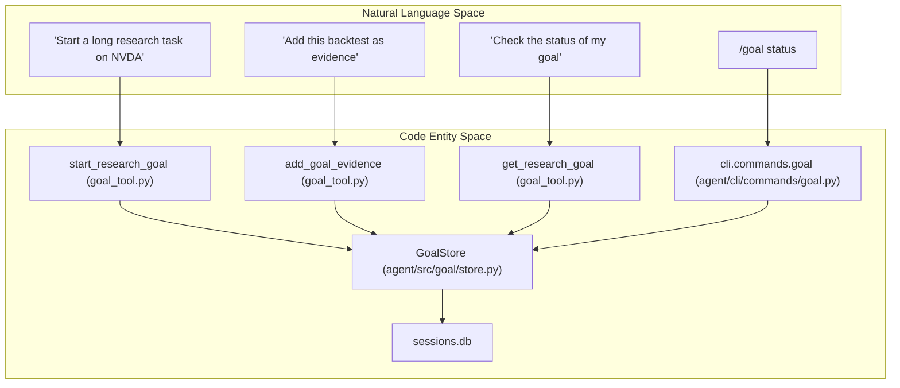
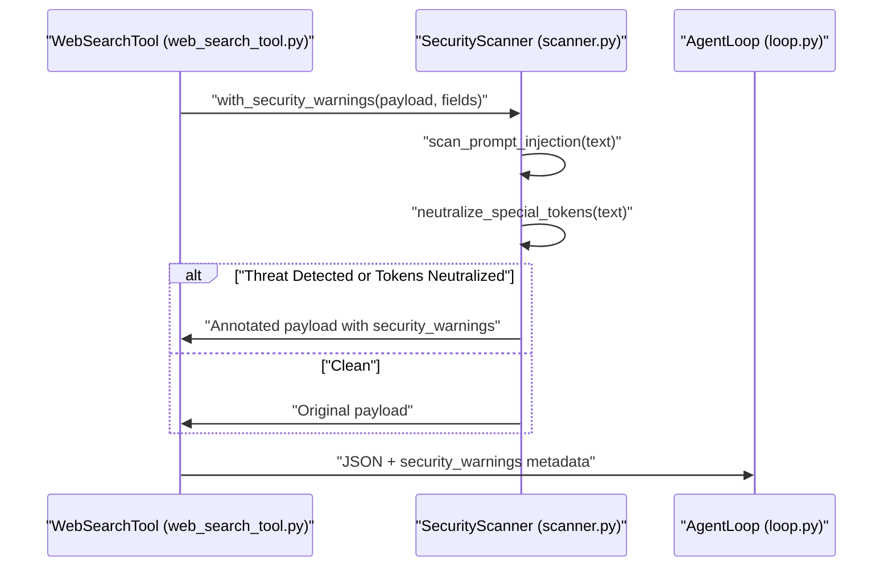
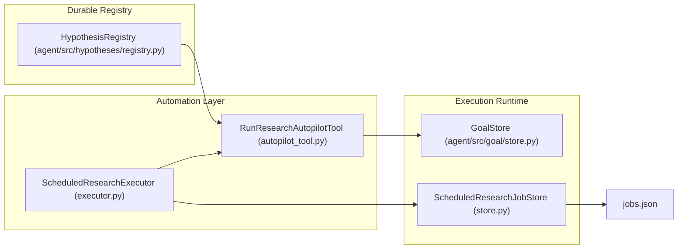

<!-- source: DeepWiki mcp.deepwiki.com · repo HKUDS/Vibe-Trading · page 13 Research Goal System, Hypothesis Registry, and Scheduled Research · fetched 2026-11-09 -->

# Research Goal System, Hypothesis Registry, and Scheduled Research

Relevant source files

The following files were used as context for generating this wiki page:

- [agent/src/api/scheduled_guards.py](agent/src/api/scheduled_guards.py)
- [agent/src/api/scheduled_routes.py](agent/src/api/scheduled_routes.py)
- [agent/src/hypotheses/__init__.py](agent/src/hypotheses/__init__.py)
- [agent/src/hypotheses/registry.py](agent/src/hypotheses/registry.py)
- [agent/src/scheduled_research/executor.py](agent/src/scheduled_research/executor.py)
- [agent/src/scheduled_research/internal_dispatch.py](agent/src/scheduled_research/internal_dispatch.py)
- [agent/src/scheduled_research/models.py](agent/src/scheduled_research/models.py)
- [agent/src/scheduled_research/store.py](agent/src/scheduled_research/store.py)
- [agent/src/security/__init__.py](agent/src/security/__init__.py)
- [agent/src/security/scanner.py](agent/src/security/scanner.py)
- [agent/src/tools/hypothesis_tool.py](agent/src/tools/hypothesis_tool.py)
- [agent/src/tools/web_search_tool.py](agent/src/tools/web_search_tool.py)
- [agent/tests/scheduling/conftest.py](agent/tests/scheduling/conftest.py)
- [agent/tests/scheduling/test_internal_dispatch.py](agent/tests/scheduling/test_internal_dispatch.py)
- [agent/tests/scheduling/test_registry.py](agent/tests/scheduling/test_registry.py)
- [agent/tests/test_autopilot_backtest_validation_evidence.py](agent/tests/test_autopilot_backtest_validation_evidence.py)
- [agent/tests/test_hypothesis_registry.py](agent/tests/test_hypothesis_registry.py)
- [agent/tests/test_scheduled_delivery_outbox.py](agent/tests/test_scheduled_delivery_outbox.py)
- [agent/tests/test_scheduled_research_executor.py](agent/tests/test_scheduled_research_executor.py)
- [agent/tests/test_scheduled_research_model_compat.py](agent/tests/test_scheduled_research_model_compat.py)
- [agent/tests/test_scheduled_research_store.py](agent/tests/test_scheduled_research_store.py)
- [agent/tests/test_scheduled_routes.py](agent/tests/test_scheduled_routes.py)
- [agent/tests/test_scheduling_lifespan_owner.py](agent/tests/test_scheduling_lifespan_owner.py)
- [agent/tests/test_security_scanner.py](agent/tests/test_security_scanner.py)
- [agent/tests/test_special_token_neutralization.py](agent/tests/test_special_token_neutralization.py)
- [agent/tests/test_web_search_tool.py](agent/tests/test_web_search_tool.py)

The **Vibe-Trading** research workflow transcends ephemeral chat interactions by providing durable systems for tracking research objectives, testing investment theses, discovering trading strategies, and automating periodic market execution and system jobs. This subsystem is architected across five primary domains: the Finance Research Goal Ledger, the Hypothesis Registry and Security Scanner, Scheduled Research and Research Autopilot, Strategy Discovery and Evidence Harness, and the Scheduling Kernel and System Jobs.

## Finance Research Goal Ledger

The Goal Ledger supplies a structured, SQLite-backed persistence layer for long-running research workflows. Unlike transient chat histories, research goals are formal records managed in `agent/src/goal/store.py` that track explicit criteria, evidence artifacts, and compliance validation.

The ledger enforces a strict research-only boundary: `GoalStore` and its associated tool wrappers explicitly reject objectives or risk tiers associated with live trading orders or capital execution. For full implementation details, lifecycle states, risk tier enforcement, and CLI commands, see [Finance Research Goal Ledger](#13.1).

**Natural Language to Code Mapping: Research Goals**

Sources: [agent/src/goal/store.py:102-210](), [agent/cli/commands/goal.py:154-195]()

## Hypothesis Registry and Security Scanner

The **Hypothesis Registry** (`agent/src/hypotheses/registry.py`) maintains durable records of investment hypotheses, tracking their lifecycle stages from `exploring` to `testing`, `validated`, `rejected`, or `monitoring` [agent/src/hypotheses/registry.py:20-26](). The registry uses local JSON persistence and provides full-text search capabilities alongside agent tool wrappers [agent/src/hypotheses/registry.py:145-157](), [agent/src/tools/hypothesis_tool.py:20-179]().

Operating alongside external data acquisition, the **Security Scanner** (`agent/src/security/scanner.py`) inspects untrusted tool outputs using rule-based patterns to detect instruction overrides, prompt injections, and role impersonation [agent/src/security/scanner.py:27-77](). It neutralizes special control tokens and annotates payloads with warning metadata [agent/src/security/scanner.py:117-139](), [agent/src/security/scanner.py:177-183](). For deep technical details, see [Hypothesis Registry and Security Scanner](#13.2).

**Data Flow: Secure Research Input**

Sources: [agent/src/security/scanner.py:177-183](), [agent/src/security/scanner.py:117-139](), [agent/src/tools/web_search_tool.py:22-31]()

## Scheduled Research and Research Autopilot

The **Scheduled Research** subsystem enables deferred, periodic execution of research jobs and automated reporting. Supported by atomic JSON storage (`ScheduledResearchJobStore`) and cron/interval execution polling in `agent/src/scheduled_research/executor.py`, it manages job lifecycles and delivery outboxes [agent/src/scheduled_research/executor.py:145-171](), [agent/src/scheduled_research/store.py:78-88]().

The **Research Autopilot** bridges hypotheses to backtests by scaffolding goal records, generating signal engine stubs, and executing automated validation runs. For complete architecture and routing details, see [Scheduled Research and Research Autopilot](#13.3).

**System Architecture: Autopilot and Scheduler**

Sources: [agent/src/scheduled_research/executor.py:122-170](), [agent/src/scheduled_research/models.py:85-108](), [agent/src/hypotheses/registry.py:145-157]()

## Strategy Discovery and Evidence Harness

The **Strategy Discovery** subsystem (`agent/src/strategy_discovery/`) provides rigorous evidence harnesses, artifact collection, and automated adaptation logic. It bridges raw quantitative findings with the central strategy store, establishing a verifiable backtest evidence chain for discovered alphas.

For details on run artifacts, evidence validation, and adaptation pipelines, see [Strategy Discovery and Evidence Harness](#13.4).

Sources: [agent/src/strategy_discovery/]()

## Scheduling Kernel and System Jobs

The **Scheduling Kernel** (`agent/src/scheduling/`) supplies the core event loop, trigger management, sleep hints, and scheduler unification shared by both scheduled research executors and live system jobs. System jobs handle periodic maintenance tasks such as persistent memory consolidation and market data synchronization (`br_data sync`).

For detailed coverage of kernel loops, trigger types, and system job registrations, see [Scheduling Kernel and System Jobs](#13.5).

Sources: [agent/src/scheduling/]()

## Child Pages Reference
*   [Finance Research Goal Ledger](#13.1) — GoalStore SQLite ledger, GoalRecord lifecycle, RiskTier, criteria and evidence records, audit completion protocol, goal_tool, CLI `/goal`, AgentLoop goal continuation.
*   [Hypothesis Registry and Security Scanner](#13.2) — `agent/src/hypotheses/registry.py` CRUD and FTS, hypothesis tools and CLI, web_search tool, and `agent/src/security/scanner.py` prompt-injection annotation.
*   [Scheduled Research and Research Autopilot](#13.3) — `agent/src/scheduled_research/`: job model, store atomic writes/quarantine, executor polling with cron/interval, delivery outbox, internal dispatch, scheduled_routes; plus autopilot_tool bridging hypotheses to backtests.
*   [Strategy Discovery and Evidence Harness](#13.4) — `agent/src/strategy_discovery/`: evidence harness, run artifacts, adaptation logic, and how discovered strategies feed the strategy store and backtest evidence chain.
*   [Scheduling Kernel and System Jobs](#13.5) — `agent/src/scheduling/`: kernel event loop and sleep hints, trigger types, job registry, system_jobs (memory consolidation, br_data sync), and the live runtime scheduler that shares the kernel.

---

