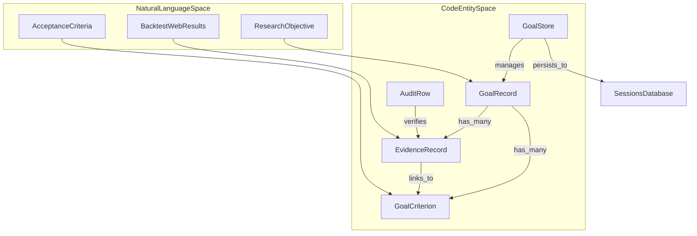
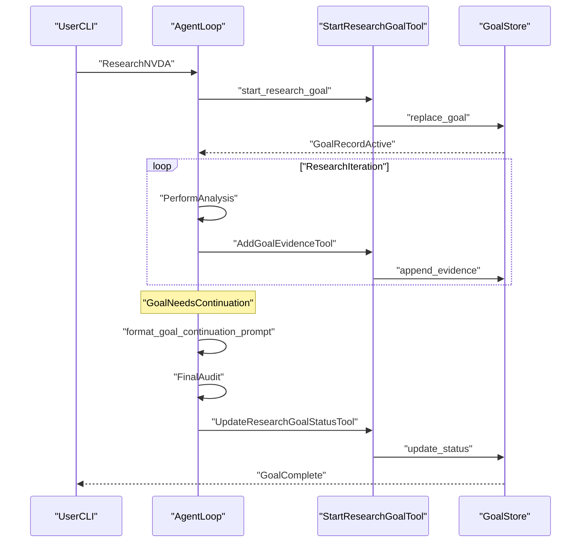

<!-- source: DeepWiki mcp.deepwiki.com · repo HKUDS/Vibe-Trading · page 13.1 Finance Research Goal Ledger · fetched 2026-11-09 -->

# Finance Research Goal Ledger

Relevant source files

The following files were used as context for generating this wiki page:

- [agent/src/agent/loop.py](agent/src/agent/loop.py)
- [agent/src/api/sessions_routes.py](agent/src/api/sessions_routes.py)
- [agent/src/session/models.py](agent/src/session/models.py)
- [agent/src/session/service.py](agent/src/session/service.py)
- [agent/src/tools/image_vision_tool.py](agent/src/tools/image_vision_tool.py)
- [agent/src/trading/connectors/robinhood/classification.py](agent/src/trading/connectors/robinhood/classification.py)
- [agent/src/trading/connectors/robinhood/mcp.py](agent/src/trading/connectors/robinhood/mcp.py)
- [agent/src/trading/connectors/robinhood/profiles.py](agent/src/trading/connectors/robinhood/profiles.py)
- [agent/tests/test_agent_loop_dedup_arguments.py](agent/tests/test_agent_loop_dedup_arguments.py)
- [agent/tests/test_default_deny_unknown_robinhood_tool.py](agent/tests/test_default_deny_unknown_robinhood_tool.py)
- [agent/tests/test_goal_api.py](agent/tests/test_goal_api.py)
- [agent/tests/test_image_vision_tool.py](agent/tests/test_image_vision_tool.py)
- [agent/tests/test_loop_helpers.py](agent/tests/test_loop_helpers.py)
- [agent/tests/test_robinhood_mcp_mapping.py](agent/tests/test_robinhood_mcp_mapping.py)
- [agent/tests/test_session_events_replay_start.py](agent/tests/test_session_events_replay_start.py)
- [agent/tests/test_session_load_metrics.py](agent/tests/test_session_load_metrics.py)
- [agent/tests/test_session_search_title_updates.py](agent/tests/test_session_search_title_updates.py)
- [agent/tests/test_session_service_lifecycle.py](agent/tests/test_session_service_lifecycle.py)
- [frontend/src/pages/__tests__/agentToolTimeline.test.ts](frontend/src/pages/__tests__/agentToolTimeline.test.ts)
- [frontend/src/pages/agentToolTimeline.ts](frontend/src/pages/agentToolTimeline.ts)

The Finance Research Goal Ledger is a durable, SQLite-backed system designed to track multi-step research objectives, verify evidence, and maintain a rigorous audit trail of financial conclusions [agent/src/goal/store.py:1-40](). Unlike transient chat memory, the goal system ensures that research tasks persist across sessions, enforce risk boundaries, and require verifiable evidence before a conclusion is marked as complete [agent/src/goal/store.py:100-130]().

---

## Core Architecture and GoalStore SQLite Ledger

The system is centered around the `GoalStore` class, which manages a local SQLite database located at `~/.vibe-trading/sessions.db` [agent/src/goal/store.py:34-34](), [agent/src/goal/store.py:105-121](). It implements a structured lifecycle for research-only tasks, strictly separating them from live trading execution through database constraints like the `idx_goals_one_current_per_session` index which ensures only one research goal is active per session [agent/src/goal/store.py:150-160]().

### Data Models and Entity Relationships

The ledger uses several interconnected models to track the state of a research objective [agent/src/goal/store.py:20-30]():
* `GoalRecord`: The top-level research objective (`goal_id`, `status`, `objective`, `risk_tier`, `token_budget`, `turns_used`) [agent/src/goal/store.py:26]().
* `GoalCriterion`: Specific acceptance criteria for the goal (`criterion_id`, `text`, `status`, `required`) [agent/src/goal/store.py:25]().
* `EvidenceRecord`: Verifiable proof linked to a criterion (`evidence_id`, `text`, `run_id`, `artifact_hash`, `verification_status`) [agent/src/goal/store.py:23]().
* `AuditRow`: The completion protocol entry (`criterion_id`, `result`, `evidence_ids`) [agent/src/goal/store.py:21]().
* `GoalClaim`: Assertions made during research (`claim_type`, `text`, `status`) [agent/src/goal/store.py:24]().

Title: Goal System Data Flow and Entity Mapping

Sources: [agent/src/goal/store.py:20-160]()

---

## Goal Lifecycle and Risk Tiers

The ledger enforces a strict status lifecycle and risk-based classification to maintain research integrity.

### Goal Statuses
A `GoalRecord` transitions through several states defined in `GoalStatus`:
* **Active States**: `active`, `paused`, `waiting_user`, `needs_refresh`, `insufficient_evidence`, `compliance_blocked`, `budget_limited` [agent/src/goal/store.py:37-45]().
* **Terminal States**: `complete`, `cancelled`, `superseded` [agent/src/goal/store.py:27]().

### RiskTier Classification
Every goal is assigned a `RiskTier` to ensure it remains within research boundaries [agent/src/goal/store.py:28]():
1. `research_general` [agent/src/tools/goal_tool.py:171-171]().
2. `market_specific_short_term` [agent/src/tools/goal_tool.py:172-172]().
3. `personalized_advice_or_position_sizing` [agent/src/tools/goal_tool.py:173-173]().
4. `live_trading_or_execution`: **PROHIBITED**. The system explicitly rejects objectives or tiers matching this level via `reject_live_execution_objective` [agent/src/goal/policy.py:31-31](), [agent/src/tools/goal_tool.py:149-150]().

Sources: [agent/src/goal/store.py:37-45](), [agent/src/goal/policy.py:31-31](), [agent/src/tools/goal_tool.py:168-176]()

---

## Tool Integration and CLI (`/goal`)

The agent and user interact with the ledger through specialized tools and CLI commands.

### Goal Tool Catalog (`goal_tool.py`)
These tools allow the `AgentLoop` to manage the ledger during its ReAct cycle [agent/src/tools/goal_tool.py:10-16]():
* `start_research_goal` (`StartResearchGoalTool`): Initializes or replaces a goal in the current session [agent/src/tools/goal_tool.py:142-150]().
* `get_research_goal` (`GetResearchGoalTool`): Retrieves the current goal snapshot for context [agent/src/tools/goal_tool.py:228-232]().
* `add_goal_evidence` (`AddGoalEvidenceTool`): Attaches text or artifact-backed evidence to a criterion [agent/src/tools/goal_tool.py:261-266]().
* `update_research_goal_status` (`UpdateResearchGoalStatusTool`): Updates status and submits completion audits [agent/src/tools/goal_tool.py:365-370]().

### CLI `/goal` Command
Users can manage goals directly from the terminal using the command handler in `agent/cli/commands/goal.py` [agent/cli/commands/goal.py:1-1]():
* `/goal <objective>`: Starts a new research goal using `cmd_start` [agent/cli/commands/goal.py:168-195]().
* `/goal status`: Displays a rich-formatted card of progress and evidence via `cmd_status` [agent/cli/commands/goal.py:154-165]().
* `/goal evidence <index> <text>`: Manually adds evidence to a specific criterion [agent/cli/commands/goal.py:199-238]().
* `/goal cancel`: Ends the current goal using terminal status via `cmd_cancel` [agent/cli/commands/goal.py:240-258]().

Sources: [agent/src/tools/goal_tool.py:142-400](), [agent/cli/commands/goal.py:1-260]()

---

## AgentLoop Integration and Goal Continuation

The `AgentLoop` integrates goals into the reasoning cycle using a continuation mechanism to ensure long-running tasks are completed.

### Goal Continuation Mechanism
* `_goal_max_continuations()`: Limits how many times the agent can self-trigger to finish a goal (default: 3) [agent/src/agent/tuning.py:35-35]().
* `format_goal_continuation_prompt()`: Generates a specific prompt focusing on open criteria and recent evidence to prevent the agent from forgetting the ledger state [agent/src/goal/context.py:86-90]().
* `goal_needs_continuation()`: Logic to determine if the agent should persist in the research loop [agent/src/goal/context.py:88-88]().

Title: Goal Execution Lifecycle and Continuation Sequence

Sources: [agent/src/agent/loop.py:85-90](), [agent/src/agent/tuning.py:35-35](), [agent/src/tools/goal_tool.py:142-400]()

---

## Research-Goal Skill Workflow

The `research-goal` skill defines the standard operating procedure for the agent when handling goals [agent/src/skills/research-goal/SKILL.md:1-5]():
1. **Attachment**: Start a goal for multi-step tasks, comparisons, or audits [agent/src/skills/research-goal/SKILL.md:11-20]().
2. **Tool Flow**: Sequential use of `start_research_goal`, `get_research_goal`, `add_goal_evidence`, and `update_research_goal_status` [agent/src/skills/research-goal/SKILL.md:22-30]().
3. **Evidence Rules**: Evidence must be short, concrete, and ideally artifact-backed (citing `run_id` and `artifact_path`) [agent/src/skills/research-goal/SKILL.md:40-47]().
4. **Verification**: Evidence from tool outputs is automatically verified by the runtime using SHA-256 hashes of the artifacts [agent/src/tools/goal_tool.py:63-102]().
5. **Audit Protocol**: Completion requires `update_research_goal_status(status="complete")` only after every required criterion has an audit row citing verified evidence [agent/src/skills/research-goal/SKILL.md:49-54]().

Sources: [agent/src/skills/research-goal/SKILL.md:1-57](), [agent/src/tools/goal_tool.py:63-102]()

---

