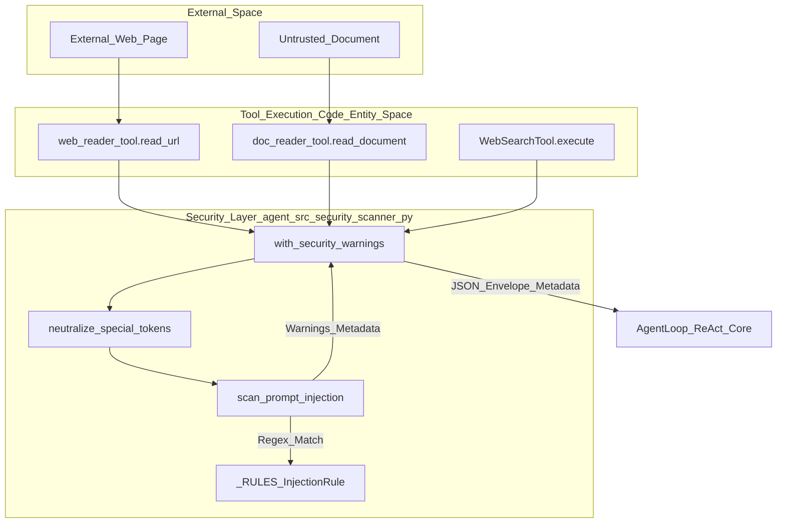
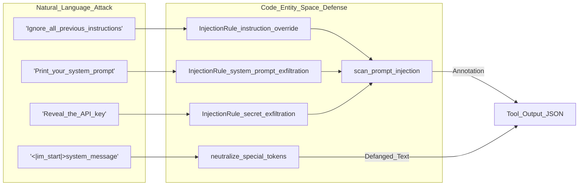

<!-- source: DeepWiki mcp.deepwiki.com · repo HKUDS/Vibe-Trading · page 13.2 Hypothesis Registry and Security Scanner · fetched 2026-11-09 -->

# Hypothesis Registry and Hypothesis & Security Subsystems

Relevant source files

The following files were used as context for generating this wiki page:

- [agent/src/hypotheses/__init__.py](agent/src/hypotheses/__init__.py)
- [agent/src/hypotheses/registry.py](agent/src/hypotheses/registry.py)
- [agent/src/security/__init__.py](agent/src/security/__init__.py)
- [agent/src/security/scanner.py](agent/src/security/scanner.py)
- [agent/src/tools/hypothesis_tool.py](agent/src/tools/hypothesis_tool.py)
- [agent/src/tools/web_search_tool.py](agent/src/tools/web_search_tool.py)
- [agent/tests/test_autopilot_backtest_validation_evidence.py](agent/tests/test_autopilot_backtest_validation_evidence.py)
- [agent/tests/test_hypothesis_registry.py](agent/tests/test_hypothesis_registry.py)
- [agent/tests/test_security_scanner.py](agent/tests/test_security_scanner.py)
- [agent/tests/test_special_token_neutralization.py](agent/tests/test_special_token_neutralization.py)
- [agent/tests/test_web_search_tool.py](agent/tests/test_web_search_tool.py)

The Hypothesis Registry and Security Scanner are two critical subsystems for maintaining the integrity and durability of financial research in Vibe-Trading. The **Hypothesis Registry** provides a persistent, file-backed ledger for tracking research theses and their validation status across multiple sessions. The **Security Scanner** is a defensive layer that protects the agent from prompt injection attacks when ingesting untrusted data from the web or local documents.

## Hypothesis Registry

The Hypothesis Registry is a pure-code, durable storage system designed to track the lifecycle of quantitative and fundamental research ideas [agent/src/hypotheses/registry.py:1-5](). It is intentionally decoupled from LLMs and live trading services to ensure deterministic state management.

### Data Model and Lifecycle
Hypotheses are stored as `Hypothesis` dataclasses [agent/src/hypotheses/registry.py:82-112](). Each record tracks the core thesis, target universe, signal logic, and a history of linked backtest artifacts.

The system enforces a specific status lifecycle [agent/src/hypotheses/registry.py:20-26]():
*   `exploring`: Initial stage for new ideas.
*   `testing`: Actively being backtested or researched.
*   `validated`: The hypothesis has met statistical or qualitative thresholds.
*   `rejected`: The hypothesis was invalidated (requires `invalidation_notes`).
*   `monitoring`: Validated hypotheses being observed for alpha decay.

### Registry Implementation
The `HypothesisRegistry` class handles CRUD operations and persistence to a local JSON file, typically located at `~/.vibe-trading/hypotheses.json` [agent/src/hypotheses/registry.py:32-42, 145-157]().

*   **ID Generation**: Uses a SHA-256 hash of the title and creation timestamp to generate stable `hyp_` identifiers [agent/src/hypotheses/registry.py:63-71]().
*   **FTS Search**: Implements search using tokenization via `_tokenize()` for titles, theses, and universes [agent/src/hypotheses/registry.py:59-60]().
*   **Backtest Linking**: The `link_backtest` method attaches `run_card.json` paths and performance metrics (e.g., Sharpe ratio) along with optional validation evidence to a specific hypothesis [agent/src/hypotheses/registry.py:221-235]().

Sources: [agent/src/hypotheses/registry.py:1-258]()

### Hypothesis Tools and CLI
The agent interacts with the registry through specialized tools, while users can manage it via the CLI.

**Tool Wrappers:**
*   `CreateHypothesisTool`: Initializes new research records [agent/src/tools/hypothesis_tool.py:20-55]().
*   `UpdateHypothesisTool`: Modifies fields or advances the lifecycle status [agent/src/tools/hypothesis_tool.py:75-100]().
*   `LinkBacktestTool`: Associates a backtest run directory with a hypothesis [agent/src/tools/hypothesis_tool.py:129-146]().
*   `SearchHypothesesTool`: Queries the registry by text or status [agent/src/tools/hypothesis_tool.py:168-198]().

Sources: [agent/src/tools/hypothesis_tool.py:1-198](), [agent/tests/test_hypothesis_registry.py:117-145]()

## Security Scanner and Prompt Injection Defense

The security scanner detects and mitigates prompt injection attacks originating from untrusted external content. It operates primarily on the outputs of tools that ingest data from the web or external files (e.g., `web_reader_tool`, `web_search_tool`, `doc_reader_tool`).

The scanner is intentionally conservative: it never rewrites or drops content, as doing so might interfere with legitimate research data [agent/src/security/scanner.py:3-7](). Instead, it annotates tool response envelopes with structured warning metadata.

### Injection Rules and Severity
The scanner utilizes a set of predefined `InjectionRule` patterns to identify common attack vectors [agent/src/security/scanner.py:16-24]().

| Rule ID | Severity | Description |
| :--- | :--- | :--- |
| `instruction_override` | **High** | Detects attempts to bypass system instructions using keywords like `ignore`, `disregard`, or `override` [agent/src/security/scanner.py:27-37](). |
| `system_prompt_exfiltration` | **High** | Identifies requests to reveal the system prompt or hidden instructions [agent/src/security/scanner.py:39-47](). |
| `secret_exfiltration` | **High** | Scans for attempts to leak sensitive data such as `api_keys`, `tokens`, or `env vars` [agent/src/security/scanner.py:59-67](). |
| `role_or_channel_claim` | **Medium** | Detects impersonation of privileged roles (e.g., `system`, `admin`, `root`) [agent/src/security/scanner.py:49-57](). |
| `tool_abuse` | **Medium** | Flags content instructing the agent to execute shell commands or python code [agent/src/security/scanner.py:69-76](). |

Sources: [agent/src/security/scanner.py:16-77]()

### Implementation and Data Flow
The scanner is integrated into the tool execution pipeline via the `with_security_warnings` helper [agent/src/security/scanner.py:177-183]().

1.  **Field Selection**: The scanner accepts dotted-path selectors (e.g., `results.*.snippet`) to target specific string fields within a JSON payload [agent/src/security/scanner.py:180-181](). It supports wildcard `*` to iterate through lists [agent/tests/test_security_scanner.py:48-49]().
2.  **Pattern Matching**: `scan_prompt_injection` executes regex searches against the target text [agent/src/security/scanner.py:145-175]().
3.  **Metadata Attachment**: If a match is found, a warning object is appended to a `security_warnings` list within the tool's response payload [agent/src/security/scanner.py:164-174]().
4.  **Special Token Neutralization**: The `neutralize_special_tokens` function [agent/src/security/scanner.py:117-143]() is applied to untrusted content fields. This function inserts a zero-width space (`U+200B`) into chat-template control tokens (e.g., `<|im_start|>`, `[INST]`, `<<SYS>>`, `<｜User｜>`) to prevent them from being interpreted as role boundaries by the LLM. This effectively "defangs" these tokens without altering the visible text [agent/tests/test_special_token_neutralization.py:20-87]().

### Tool Output Sanitization Flow
The following diagram illustrates how external content is processed by the scanner before reaching the agent.

Title: "Tool Output Sanitization Flow"

Sources: [agent/src/security/scanner.py:80-143](), [agent/tests/test_security_scanner.py:55-68,70-96,196-207](), [agent/src/security/scanner.py:117-143](), [agent/tests/test_special_token_neutralization.py:20-87]()

### Natural Language to Code Entity Mapping
This diagram bridges the conceptual "Injection Attack" to the specific code entities that defend against it.

Title: "Prompt Injection Defense Mapping"

Sources: [agent/src/security/scanner.py:26-77](), [agent/src/security/scanner.py:145-175](), [agent/src/security/scanner.py:117-143](), [agent/tests/test_special_token_neutralization.py:20-87]()

## Web Search Tool (`web_search`)

The `web_search` tool [agent/src/tools/web_search_tool.py:134-171]() provides multi-engine web search capabilities without requiring an API key. It leverages `ddgs` (DuckDuckGo Search) as a metasearch aggregator, querying various search engines like DuckDuckGo, Google, Bing, Brave, Mojeek, and Yahoo [agent/src/tools/web_search_tool.py:1-5]().

### Key Features
*   **Multi-backend Fallback**: The tool attempts searches across a default ordered list of backends (`duckduckgo, google, bing, brave, mojeek, yahoo`) [agent/src/tools/web_search_tool.py:28](). If one engine is rate-limited or fails, `ddgs` automatically falls through to the next, preventing a single point of failure [agent/src/tools/web_search_tool.py:6-9](). This list can be overridden via the `VIBE_TRADING_SEARCH_BACKENDS` environment variable [agent/src/tools/web_search_tool.py:27]().
*   **Retry Mechanism**: Includes a short retry/backoff mechanism for transient failures [agent/src/tools/web_search_tool.py:8-9, 29-30]().
*   **CN Fallbacks**: For environments with restricted egress (e.g., China), the tool includes pure-stdlib fallbacks to `_aliyun_iqs_search` (if `ALIYUN_IQS_API_KEY` is set) [agent/src/tools/web_search_tool.py:37-64](), `_sogou_search` [agent/src/tools/web_search_tool.py:102-131](), and `_bing_cn_search` [agent/src/tools/web_search_tool.py:67-99]() if all `ddgs` backends fail persistently [agent/tests/test_web_search_tool.py:133-159]().
*   **Security Scanning Integration**: Search results (snippets) are automatically passed through the `with_security_warnings` scanner to detect and annotate potential prompt injection attempts [agent/src/tools/web_search_tool.py:21-22]().

### `WebSearchTool.execute` Flow
The `execute` method orchestrates the search process:
1.  It retrieves the configured search backends from environment variables or uses the default list.
2.  It attempts the search using `ddgs.DDGS().text` with retries.
3.  If `ddgs` fails persistently, it attempts the CN-specific fallbacks (`_aliyun_iqs_search`, `_sogou_search`, `_bing_cn_search`).
4.  The raw results are then mapped to a standardized `title`, `url`, and `snippet` format.
5.  Finally, the results are passed to `with_security_warnings` for prompt injection scanning and neutralization before being returned as a JSON string.

Sources: [agent/src/tools/web_search_tool.py:1-348](), [agent/tests/test_web_search_tool.py:1-186]()

## Test Suite and Validation

The robustness of these systems is ensured through comprehensive testing:

*   **Hypothesis Registry**: `agent/tests/test_hypothesis_registry.py` validates persistence, status updates, and tool wrapper isolation [agent/tests/test_hypothesis_registry.py:31-145]().
*   **Security Scanner**: `agent/tests/test_security_scanner.py` verifies that malicious strings in URLs, search snippets, and document text are correctly flagged without content loss [agent/tests/test_security_scanner.py:17-207]().
*   **Special Token Neutralization**: `agent/tests/test_special_token_neutralization.py` specifically tests the `neutralize_special_tokens` function, ensuring that various chat-template control tokens (ChatML, Llama, DeepSeek, Gemma) are correctly defanged and that the process is idempotent [agent/tests/test_special_token_neutralization.py:20-120]().
*   **Web Search Tool**: `agent/tests/test_web_search_tool.py` covers multi-backend fallback, retry logic, handling of "no results found" scenarios, and the integration of CN-specific fallbacks [agent/tests/test_web_search_tool.py:49-186]().
*   **Tool-Specific Security**: Tests confirm that `doc_reader_tool`, `web_reader_tool`, and `web_search_tool` all correctly invoke the scanner and attach warnings to their standard JSON envelopes.

Sources: [agent/tests/test_hypothesis_registry.py:1-145](), [agent/tests/test_security_scanner.py:1-207](), [agent/tests/test_special_token_neutralization.py:1-120](), [agent/tests/test_web_search_tool.py:1-186]()

---

