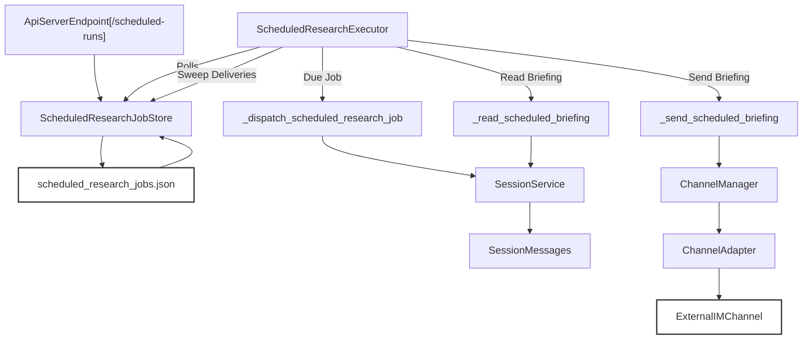
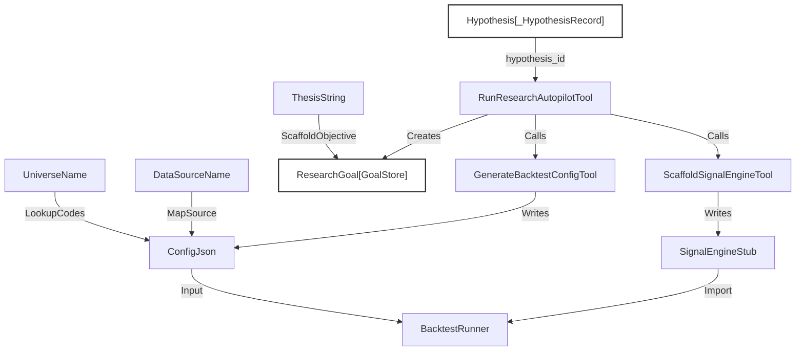
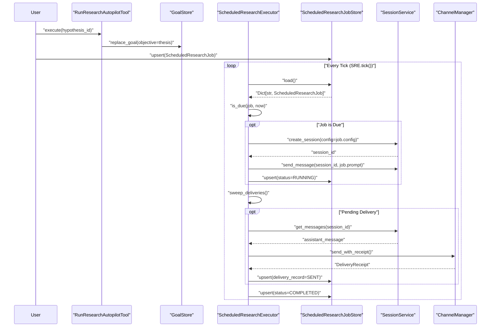

<!-- source: DeepWiki mcp.deepwiki.com · repo HKUDS/Vibe-Trading · page 13.3 Scheduled Research and Research Autopilot · fetched 2026-11-09 -->

# Scheduled Research and Research Autopilot

Relevant source files

The following files were used as context for generating this wiki page:

- [agent/backtest/loaders/cn_adjust.py](agent/backtest/loaders/cn_adjust.py)
- [agent/backtest/loaders/gildata_codes.py](agent/backtest/loaders/gildata_codes.py)
- [agent/src/api/scheduled_guards.py](agent/src/api/scheduled_guards.py)
- [agent/src/api/scheduled_routes.py](agent/src/api/scheduled_routes.py)
- [agent/src/factors/bench_runner.py](agent/src/factors/bench_runner.py)
- [agent/src/scheduled_research/executor.py](agent/src/scheduled_research/executor.py)
- [agent/src/scheduled_research/internal_dispatch.py](agent/src/scheduled_research/internal_dispatch.py)
- [agent/src/scheduled_research/models.py](agent/src/scheduled_research/models.py)
- [agent/src/scheduled_research/store.py](agent/src/scheduled_research/store.py)
- [agent/src/tools/alpha_bench_tool.py](agent/src/tools/alpha_bench_tool.py)
- [agent/src/tools/autopilot_tool.py](agent/src/tools/autopilot_tool.py)
- [agent/tests/scheduling/conftest.py](agent/tests/scheduling/conftest.py)
- [agent/tests/scheduling/test_internal_dispatch.py](agent/tests/scheduling/test_internal_dispatch.py)
- [agent/tests/scheduling/test_registry.py](agent/tests/scheduling/test_registry.py)
- [agent/tests/test_alpha_bench_meta_survivorship.py](agent/tests/test_alpha_bench_meta_survivorship.py)
- [agent/tests/test_alpha_bench_qfq.py](agent/tests/test_alpha_bench_qfq.py)
- [agent/tests/test_alpha_bench_sector_tag.py](agent/tests/test_alpha_bench_sector_tag.py)
- [agent/tests/test_alpha_bench_top_zero.py](agent/tests/test_alpha_bench_top_zero.py)
- [agent/tests/test_alpha_bench_universe_metadata.py](agent/tests/test_alpha_bench_universe_metadata.py)
- [agent/tests/test_autopilot_phase3.py](agent/tests/test_autopilot_phase3.py)
- [agent/tests/test_autopilot_tool.py](agent/tests/test_autopilot_tool.py)
- [agent/tests/test_bench_multiple_testing.py](agent/tests/test_bench_multiple_testing.py)
- [agent/tests/test_bench_single_ic_observation.py](agent/tests/test_bench_single_ic_observation.py)
- [agent/tests/test_classification.py](agent/tests/test_classification.py)
- [agent/tests/test_oauth_token_cache.py](agent/tests/test_oauth_token_cache.py)
- [agent/tests/test_readonly_default.py](agent/tests/test_readonly_default.py)
- [agent/tests/test_runtime_root_cache_report_dirs.py](agent/tests/test_runtime_root_cache_report_dirs.py)
- [agent/tests/test_scheduled_delivery_outbox.py](agent/tests/test_scheduled_delivery_outbox.py)
- [agent/tests/test_scheduled_research_executor.py](agent/tests/test_scheduled_research_executor.py)
- [agent/tests/test_scheduled_research_model_compat.py](agent/tests/test_scheduled_research_model_compat.py)
- [agent/tests/test_scheduled_research_store.py](agent/tests/test_scheduled_research_store.py)
- [agent/tests/test_scheduled_routes.py](agent/tests/test_scheduled_routes.py)
- [agent/tests/test_scheduling_lifespan_owner.py](agent/tests/test_scheduling_lifespan_owner.py)

The Scheduled Research and Research Autopilot subsystems provide the durable infrastructure for deferred execution and autonomous research workflows. While the **Scheduled Research** system handles the lifecycle of recurring or delayed research tasks, the **Research Autopilot** acts as a bridge between the [Hypothesis Registry](13.2) and the [Research Goal Ledger](13.1), automating the transition from natural language ideas to executable backtests.

Sources: [agent/src/scheduled_research/executor.py:1-19](), [agent/src/tools/autopilot_tool.py:1-8]()

---

## Scheduled Research Subsystem

The scheduled research system (located in `agent/src/scheduled_research/`) is responsible for persisting and executing research jobs according to a defined schedule. It supports both interval-based (milliseconds) and cron-based execution.

### Data Model and Lifecycle
The core entity is the `ScheduledResearchJob`, which records the prompt, schedule, and an opaque `config` dict for future backtest parameters [agent/src/scheduled_research/models.py:1-16](). Schedule grammar is unified via `src.scheduling.triggers` [agent/src/scheduled_research/models.py:22-29]().

| Status | Description |
| :--- | :--- |
| `PENDING` | Initial state; waiting for its `next_run_at` timestamp [agent/src/scheduled_research/models.py:39-42](). |
| `RUNNING` | Currently being processed by the executor [agent/src/scheduled_research/models.py:43](). |
| `COMPLETED` | Successfully executed; schedule advanced to next interval [agent/src/scheduled_research/models.py:44](). |
| `FAILED` | Execution failed; terminal state to prevent infinite retry loops [agent/src/scheduled_research/models.py:45](). |
| `CANCELLED` | Manually terminated by the user [agent/src/scheduled_research/models.py:46](). |
| `EXPIRED` | Job has passed its `end_at` timestamp and will no longer run [agent/src/scheduled_research/models.py:47](). |

Sources: [agent/src/scheduled_research/models.py:1-153]()

### ScheduledResearchJobStore and Atomic Persistence
Persistence is handled by `ScheduledResearchJobStore`, which implements an **atomic write pattern** to prevent data corruption during system crashes or SIGKILL events [agent/src/scheduled_research/store.py:1-10]().

1.  **Atomic Write Sequence**: The store writes a temporary file in the same directory (`.{target.name}.{os.getpid()}.tmp`), calls `fsync` on the file descriptor, uses `os.replace` to atomically overwrite the target, and finally `fsync`s the parent directory [agent/src/scheduled_research/store.py:132-155]().
2.  **Quarantine Mechanism**: If the store file exists but fails to parse (due to corruption or schema mismatch), the system renames the file to a `.corrupt` extension (quarantine) and raises a `CorruptStoreError` rather than silently losing data [agent/src/scheduled_research/store.py:60-76](), [agent/src/scheduled_research/store.py:116-127]().

Sources: [agent/src/scheduled_research/store.py:1-168]()

### ScheduledResearchExecutor and Scheduler Kernel
The `ScheduledResearchExecutor` runs a background polling loop to dispatch due jobs [agent/src/scheduled_research/executor.py:145-154](). 

*   **Kernel Unification**: Loop machinery—such as the tick loop, wakeup event, start/stop lifecycle, and retry backoff—is delegated to `src.scheduling.kernel.SchedulerKernel` [agent/src/scheduled_research/executor.py:8-13]().
*   **Internal Dispatch**: Jobs with `executor_kind == "internal"` are dispatched non-blockingly through `InternalRunSupervisor`, executing registry-resolved callables in background threads so that long-running tasks never freeze the serialized execution tick [agent/src/scheduled_research/executor.py:14-19]().
*   **Gating**: Execution is controlled via the `VIBE_TRADING_ENABLE_SCHEDULER` environment flag [agent/src/scheduled_research/executor.py:72-106]().

Sources: [agent/src/scheduled_research/executor.py:1-171]()

### Delivery Outbox
Briefing delivery is handled via an outbox pattern backed by `DeliveryRecord` [agent/src/scheduled_research/models.py:74-98](). 

When a job is dispatched, a `DeliveryRecord` tracks the output state (`PENDING`, `SENDING`, `SENT`, `FAILED`) [agent/src/scheduled_research/models.py:50-71](). The executor sweeps these records, reads the briefing from the session service, and attempts delivery via the configured channel sender, ensuring retry robustness across system restarts [agent/src/scheduled_research/executor.py:167-170]().

Sources: [agent/src/scheduled_research/models.py:50-153](), [agent/src/scheduled_research/executor.py:145-171]()

### Scheduled Research API Routes
The `scheduled_routes.py` module exposes FastAPI endpoints for managing scheduled research jobs [agent/src/api/scheduled_routes.py:1-4]().

*   `POST /scheduled-runs`: Creates a new scheduled research job, persisting it via `ScheduledResearchJobStore` [agent/src/api/scheduled_routes.py:48-55]().
*   `GET /scheduled-runs`: Lists scheduled jobs with optional status filtering [agent/src/api/scheduled_routes.py:120-145]().
*   `DELETE /scheduled-runs/{job_id}`: Cancels and removes a scheduled job.

The FastAPI lifespan serves as the sole writer owner for the singleton executor instance [agent/src/api/scheduled_routes.py:155-176]().

Sources: [agent/src/api/scheduled_routes.py:1-176]()

**Scheduled Research Data Flow**

Sources: [agent/src/scheduled_research/store.py:38-58](), [agent/src/scheduled_research/executor.py:145-171](), [agent/src/api/scheduled_routes.py:48-153]()

---

## Research Autopilot

The Research Autopilot (`RunResearchAutopilotTool`) automates the "Hypothesis $\rightarrow$ Backtest $\rightarrow$ Evidence" loop by connecting saved hypotheses to durable research goals [agent/src/tools/autopilot_tool.py:1-8]().

### Autopilot Tooling and Data Flow

The `RunResearchAutopilotTool` performs three primary functions:
1.  **Goal Scaffolding**: Reads a hypothesis from `HypothesisRegistry` and replaces the session's active research goal via `GoalStore.replace_goal` using a `thesis_review` protocol [agent/src/tools/autopilot_tool.py:49-65](), [agent/src/tools/autopilot_tool.py:144-156]().
2.  **Config Generation**: Automatically maps natural language universes to ticker symbols and generates a `config.json` [agent/src/tools/autopilot_tool.py:1-8]().
3.  **Code Scaffolding**: Scaffolds a contract-correct `signal_engine.py` stub implementing the `SignalEngine` interface for agent execution [agent/src/tools/autopilot_tool.py:1-8]().

Sources: [agent/src/tools/autopilot_tool.py:1-178]()

### Bridge Logic: Natural Language Space to Code Entity Space

The following diagram bridges high-level hypothesis descriptions to concrete runtime artifacts and goal ledger entities.

**Autopilot Entity Mapping**

Sources: [agent/src/tools/autopilot_tool.py:49-178]()

### System Architecture: Scheduled Research & Autopilot
This sequence diagram shows the combined interaction between the executor poller, the session service, and delivery dispatching.

**Scheduled Research & Autopilot Architecture**

Sources: [agent/src/scheduled_research/executor.py:145-171](), [agent/src/scheduled_research/store.py:129-168](), [agent/src/tools/autopilot_tool.py:145-157]()

---

