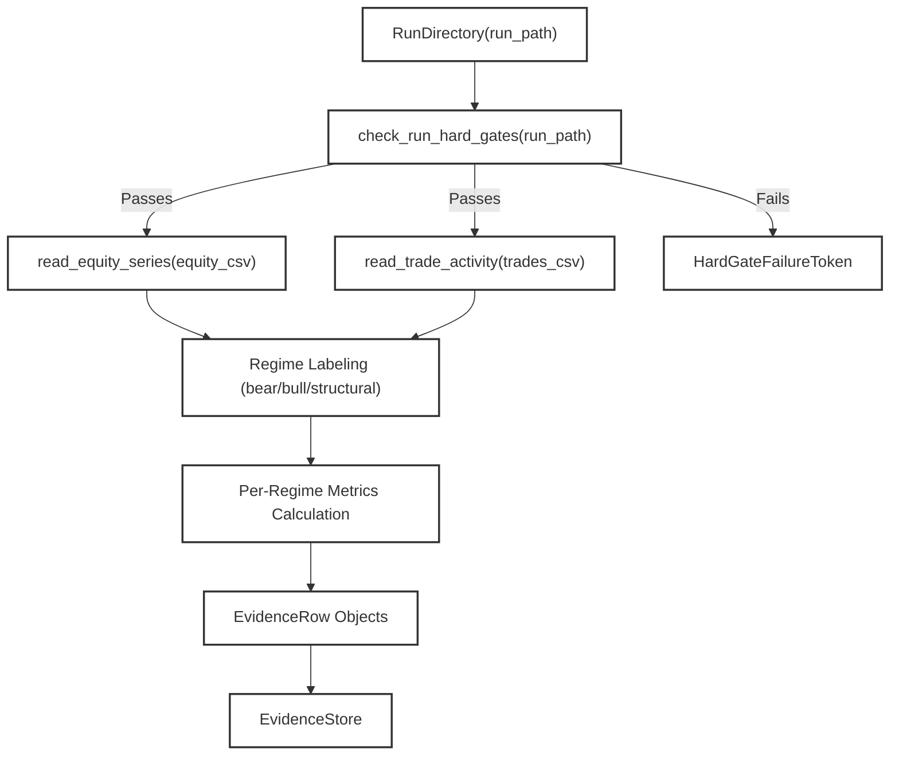
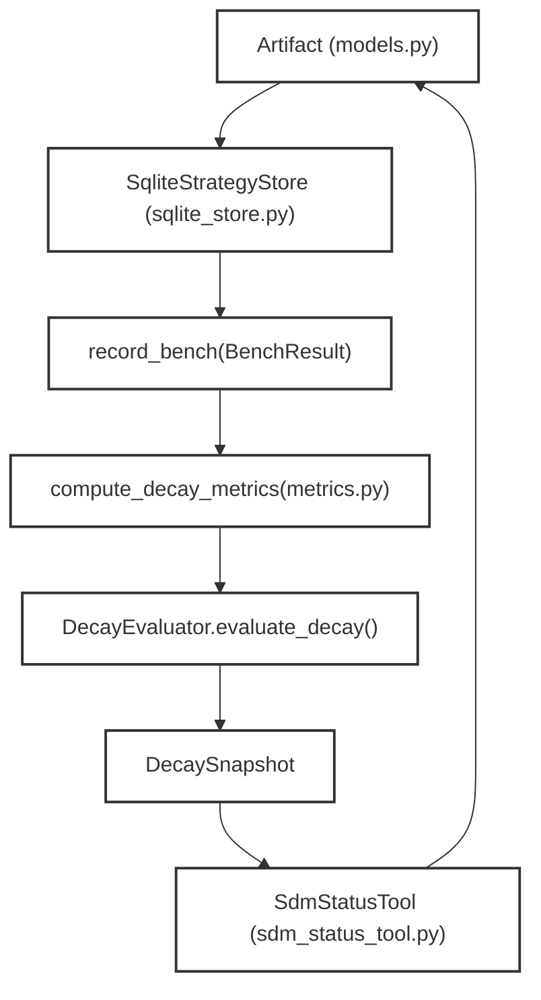

<!-- source: DeepWiki mcp.deepwiki.com · repo HKUDS/Vibe-Trading · page 13.4 Strategy Discovery and Evidence Harness · fetched 2026-11-09 -->

# Strategy Discovery and Evidence Harness

Relevant source files

The following files were used as context for generating this wiki page:

- [agent/backtest/engines/china_futures.py](agent/backtest/engines/china_futures.py)
- [agent/backtest/engines/global_futures.py](agent/backtest/engines/global_futures.py)
- [agent/backtest/engines/india_equity.py](agent/backtest/engines/india_equity.py)
- [agent/src/skills/strategy-dev-manager/SKILL.md](agent/src/skills/strategy-dev-manager/SKILL.md)
- [agent/src/strategy_discovery/evidence_harness.py](agent/src/strategy_discovery/evidence_harness.py)
- [agent/src/strategy_discovery/run_artifacts.py](agent/src/strategy_discovery/run_artifacts.py)
- [agent/src/strategy_store/metrics.py](agent/src/strategy_store/metrics.py)
- [agent/src/strategy_store/models.py](agent/src/strategy_store/models.py)
- [agent/src/strategy_store/sqlite_store.py](agent/src/strategy_store/sqlite_store.py)
- [agent/src/strategy_store/store.py](agent/src/strategy_store/store.py)
- [agent/src/tools/backtest_tool.py](agent/src/tools/backtest_tool.py)
- [agent/src/tools/sdm_decay_scan_tool.py](agent/src/tools/sdm_decay_scan_tool.py)
- [agent/src/tools/sdm_status_tool.py](agent/src/tools/sdm_status_tool.py)
- [agent/tests/test_backtest_records_bench.py](agent/tests/test_backtest_records_bench.py)
- [agent/tests/test_backtest_tool_state.py](agent/tests/test_backtest_tool_state.py)
- [agent/tests/test_china_futures_engine.py](agent/tests/test_china_futures_engine.py)
- [agent/tests/test_china_futures_pricing_assumptions.py](agent/tests/test_china_futures_pricing_assumptions.py)
- [agent/tests/test_composite_market_rules.py](agent/tests/test_composite_market_rules.py)
- [agent/tests/test_global_futures_engine.py](agent/tests/test_global_futures_engine.py)
- [agent/tests/test_india_equity_engine.py](agent/tests/test_india_equity_engine.py)
- [agent/tests/test_sdm_finite_metrics.py](agent/tests/test_sdm_finite_metrics.py)
- [agent/tests/test_strategy_discovery_harness.py](agent/tests/test_strategy_discovery_harness.py)
- [agent/tests/test_strategy_store.py](agent/tests/test_strategy_store.py)

## Purpose and Scope

This page details the strategy discovery and evidence harness subsystem within `agent/src/strategy_discovery/` [agent/src/strategy_discovery/evidence_harness.py:1-25]() and `agent/src/strategy_store/` [agent/src/strategy_store/store.py:1-25](). It explains how discovered quantitative strategies and factors are processed, validated via hard gates, adapted across universes, and persisted within the `StrategyStore` backtest evidence chain.

Sources:
- [agent/src/strategy_discovery/evidence_harness.py:1-25]()
- [agent/src/strategy_store/store.py:1-25]()

---

## Evidence Harness

The evidence harness, implemented in `agent/src/strategy_discovery/evidence_harness.py` [agent/src/strategy_discovery/evidence_harness.py:1-20](), extracts and processes performance evidence from backtest run directories. It serves as the primary gatekeeper before any strategy evaluation or promotion occurs.

### Key Conventions
* **Trade Counting**: Distinguishes between entry and exit rows in `trades.csv`. Only exit rows carrying realized profit-and-loss (`pnl`) count as a completed round trip [agent/src/strategy_discovery/evidence_harness.py:6-11]().
* **Regime Labeling**: Bars in the equity curve are classified into market regimes (`bear`, `bull`, or `structural`) using rolling cumulative benchmark returns over `DEFAULT_BENCHMARK_WINDOW` (252 days) [agent/src/strategy_discovery/evidence_harness.py:12-16, 70-77]().
* **Per-Regime Metrics**: Returns, Sharpe ratios, and max drawdowns are calculated strictly over bars within each classified regime [agent/src/strategy_discovery/evidence_harness.py:18-22](). Annualization uses `SHARPE_ANNUALIZATION_BARS` (252) [agent/src/strategy_discovery/evidence_harness.py:79-80]().

### Hard Gates
Before evidence extraction succeeds, `check_run_hard_gates()` evaluates run artifacts against strict criteria [agent/src/strategy_discovery/evidence_harness.py:111-162]():
1. **State Validity**: `state.json` must exist and report `{"status": "success"}` [agent/src/strategy_discovery/evidence_harness.py:94-96, 140-146]().
2. **Metrics Presence**: `artifacts/metrics.csv` must be non-empty [agent/src/strategy_discovery/evidence_harness.py:97-99, 148-157]().
3. **Trade Activity**: `trade_count` must exceed zero [agent/src/strategy_discovery/evidence_harness.py:100-102, 159-162]().
4. **Equity Integrity**: `artifacts/equity.csv` must exist and contain finite numerical values without `NaN` or infinities [agent/src/strategy_discovery/evidence_harness.py:103-108]().

Title: Evidence Harness Processing Pipeline
Sources:
- [agent/src/strategy_discovery/evidence_harness.py:94-162]()
- [agent/src/strategy_discovery/run_artifacts.py]()

---

## Run Artifacts and State Management

Backtest runs generate file artifacts under `artifacts/` and root run directories [agent/src/tools/backtest_tool.py:1-25](). The execution runner and tool wrappers ensure all lifecycle states are recorded persistently.

* `trades.csv`: Timestamp, symbol (`code`), `side`, `price`, `qty`, `pnl`, and holding metrics [agent/tests/test_strategy_discovery_harness.py:69-79]().
* `equity.csv`: Equity series, drawdown curves, benchmark equity, and active returns [agent/tests/test_strategy_discovery_harness.py:80]().
* `state.json`: Lifecycle status (`success` or `failed`) written by `run_backtest` in `agent/src/tools/backtest_tool.py` [agent/tests/test_backtest_tool_state.py:48-61]().
* `metrics.csv`: Summary metrics (`sharpe`, `annual_return`, `max_drawdown`, `calmar`, `trade_count`) consumed by `_read_bench_metrics()` [agent/src/tools/backtest_tool.py:75-103]().

Sources:
- [agent/src/tools/backtest_tool.py:75-103]()
- [agent/tests/test_backtest_tool_state.py:48-61]()

---

## Adaptation Logic

Strategy adaptation allows generating new strategy `Artifact` models from existing parent strategies via `adaptation.py` [agent/src/strategy_store/adaptation.py:1-45]().

### Constraints and Patching
* **Allowed Target Types**: Only `ArtifactType.STRATEGY` instances may be adapted [agent/src/strategy_store/adaptation.py:40-44]().
* **AdaptationPatch**: Modifies parameters such as `universe`, `name`, and `position_sizing`. Core signal logic remains immutable during patching [agent/src/strategy_store/adaptation.py:24-30]().
* **Mutation Requirement**: Adaptations must alter either `universe` or `name` to prevent redundant no-op versions [agent/src/strategy_store/adaptation.py:48-51]().
* **Field Inheritance & Reset**: The child artifact inherits metadata (`signal_definition`, `entry_rules`, `exit_rules`, `theme`) but resets its identifier (`id` cleared, `derived_from` set to parent ID), status (`CREATED`), and validation/governance approvals [agent/src/strategy_store/adaptation.py:64-88]().

Sources:
- [agent/src/strategy_store/adaptation.py:24-88]()

---

## Strategy Store and Backtest Evidence Chain

The strategy store manages factor/strategy persistence, benchmark results, and decay monitoring snapshots. It is backed by either `InMemoryStrategyStore` or `SqliteStrategyStore` [agent/src/strategy_store/sqlite_store.py:126-154](), [agent/src/strategy_store/store.py:143-187]().

### Core Models
* `Artifact`: Represents a registered strategy or factor with state machine tracking (`created`, `benching`, `active`, `monitoring`, `decayed`, `disabled`) [agent/src/strategy_store/models.py:10-40]().
* `BenchResult`: Stores point-in-time performance metrics (`ic_mean`, `ir`, `sharpe`, `t_stat`) [agent/src/strategy_store/models.py:43-57]().
* `DecaySnapshot`: Captures rolling performance metrics against baseline values, yielding a `DecaySignal` (`HEALTHY`, `WARNING`, `DECAYED`, `INSUFFICIENT_DATA`) via `compute_decay_metrics()` [agent/src/strategy_store/metrics.py:29-109]() and `DecayEvaluator` [agent/src/strategy_store/decay.py:1-25]().

Title: Strategy Store and Evidence Chain Architecture
Sources:
- [agent/src/strategy_store/sqlite_store.py:126-154]()
- [agent/src/strategy_store/metrics.py:29-109]()
- [agent/src/tools/sdm_status_tool.py:77-136]()

---

