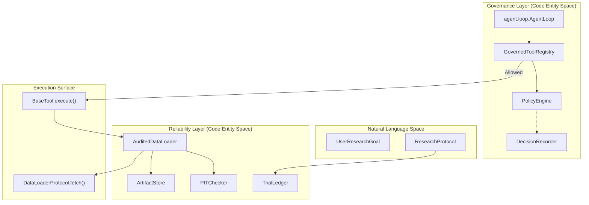
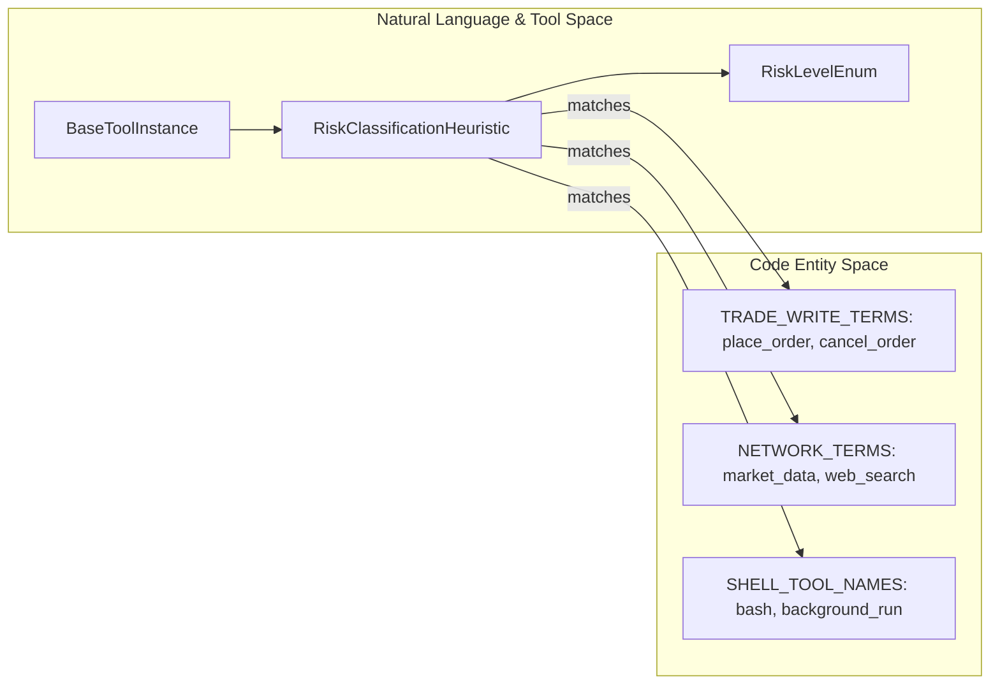

<!-- source: DeepWiki mcp.deepwiki.com · repo HKUDS/Vibe-Trading · page 14 IRR-AGL: Governance, Reliability, and Research Integrity · fetched 2026-11-09 -->

# IRR-AGL: Governance, Reliability, and Research Integrity

Relevant source files

The following files were used as context for generating this wiki page:

- [agent/backtest/factor_costs.py](agent/backtest/factor_costs.py)
- [agent/src/api/portfolio_routes.py](agent/src/api/portfolio_routes.py)
- [agent/src/governance/__init__.py](agent/src/governance/__init__.py)
- [agent/src/governance/ledger.py](agent/src/governance/ledger.py)
- [agent/src/governance/manifest.py](agent/src/governance/manifest.py)
- [agent/src/portfolio/config.py](agent/src/portfolio/config.py)
- [agent/src/portfolio/longbridge_worker.py](agent/src/portfolio/longbridge_worker.py)
- [agent/src/portfolio/normalization.py](agent/src/portfolio/normalization.py)
- [agent/src/portfolio/oauth_worker.py](agent/src/portfolio/oauth_worker.py)
- [agent/src/portfolio/store.py](agent/src/portfolio/store.py)
- [agent/src/quantlib/credit.py](agent/src/quantlib/credit.py)
- [agent/src/quantlib/eventstudy.py](agent/src/quantlib/eventstudy.py)
- [agent/src/quantlib/factormodel.py](agent/src/quantlib/factormodel.py)
- [agent/src/tools/portfolio_tool.py](agent/src/tools/portfolio_tool.py)
- [agent/tests/quantlib/test_credit.py](agent/tests/quantlib/test_credit.py)
- [agent/tests/quantlib/test_eventstudy.py](agent/tests/quantlib/test_eventstudy.py)
- [agent/tests/quantlib/test_factormodel.py](agent/tests/quantlib/test_factormodel.py)
- [agent/tests/quantlib/test_factormodel_negative_specific_variance.py](agent/tests/quantlib/test_factormodel_negative_specific_variance.py)
- [agent/tests/test_alpha_bench_cache.py](agent/tests/test_alpha_bench_cache.py)
- [agent/tests/test_cds_final_stub_regressions.py](agent/tests/test_cds_final_stub_regressions.py)
- [agent/tests/test_feishu_login_persistence.py](agent/tests/test_feishu_login_persistence.py)
- [agent/tests/test_governance.py](agent/tests/test_governance.py)
- [agent/tests/test_local_connections.py](agent/tests/test_local_connections.py)
- [agent/tests/test_lockup_expiry_integer_code.py](agent/tests/test_lockup_expiry_integer_code.py)
- [agent/tests/test_portfolio_config.py](agent/tests/test_portfolio_config.py)
- [agent/tests/test_portfolio_routes.py](agent/tests/test_portfolio_routes.py)
- [agent/tests/test_portfolio_summary_tool_snapshot.py](agent/tests/test_portfolio_summary_tool_snapshot.py)
- [agent/tests/test_style_missing_exposures_regressions.py](agent/tests/test_style_missing_exposures_regressions.py)
- [frontend/src/components/portfolio/PortfolioSourceEditor.tsx](frontend/src/components/portfolio/PortfolioSourceEditor.tsx)

The **Institutional Research Reliability and Agent Governance Layer (IRR-AGL)** is an additive, cross-cutting framework designed to bring institutional-grade rigor to AI-driven financial research and execution. It overlays existing system surfaces—including the ReAct `AgentLoop` [agent/src/agent/loop.py:1-50](), `ToolRegistry`, data loaders, and backtest engines—to ensure that every action is governed and every conclusion is backed by a verifiable audit trail.

IRR-AGL operates on two primary axes:
1. **Governance**: Controlling tool access and resource consumption based on risk levels and execution context.
2. **Reliability**: Ensuring data integrity (Point-in-Time correctness), tracking research lineage, and scoring the statistical validity of quantitative findings.

Sources: [agent/src/tools/__init__.py:89-92](), [agent/src/tools/__init__.py:138-140](), [agent/src/config/loader.py:107-115]()

---

## Governance and Reliability Modes

The system introduces two global environment flags to control the strictness of the IRR-AGL layer: `VIBE_TRADING_GOVERNANCE_MODE` and `VIBE_TRADING_RELIABILITY_MODE`. Both support four distinct levels:

| Mode | Description |
| :--- | :--- |
| `off` | IRR-AGL is completely bypassed. Standard system behavior. |
| `observe` | Logic runs and records decisions/artifacts but never blocks execution. |
| `warn` | Logic records findings and emits warnings to the user/trace but does not block. |
| `enforce` | Logic blocks execution on policy denials or reliability failures (Fail-Closed). |

> [!IMPORTANT]
> High-risk actions (e.g., `R5_SHELL` or `R4_TRADE_WRITE`) implement **Shadow Deny** behavior: even in `observe` or `warn` modes, these tools will be blocked if the policy engine denies them, preventing accidental high-risk execution during monitoring phases.

Sources: [agent/src/tools/__init__.py:89-92](), [agent/src/tools/__init__.py:138-140](), [agent/src/config/loader.py:107-115]()

---

## System Architecture Overview

The IRR-AGL architecture bridges the gap between natural language reasoning and secure, reliable code execution.

### Logic Flow: From Intent to Governed Execution

The following diagram illustrates how a user's natural language goal is processed through the governance and reliability layers before interacting with the core system entities.

Title: IRR-AGL Execution Bridge

Sources: [agent/src/tools/__init__.py:66-76](), [agent/src/tools/__init__.py:116-135](), [agent/src/tools/financial_rigor_tool.py:37-40]()

---

## Key Sub-Components

### 1. GovernedToolRegistry and PolicyEngine
The Agent Governance Layer wraps the standard `ToolRegistry` with a `GovernedToolRegistry`. It classifies every tool into a `RiskLevel` (from `R0_READ` to `R5_SHELL`) and evaluates execution against a `PolicyEngine`.
* **Shadow Deny**: Prevents `R4` (Trade Write) and `R5` (Shell) execution even in non-enforcement modes.
* **Budgeting**: Tracks `max_tool_calls` and `max_network_calls` to prevent agent runaway.
* For details, see [GovernedToolRegistry and PolicyEngine](#14.1).

Sources: [agent/src/tools/__init__.py:30-31](), [agent/src/tools/__init__.py:138-140]()

### 2. ArtifactStore, AuditedDataLoader, and PIT Checker
Reliability is managed through content-addressed storage and strict data auditing.
* **ArtifactStore**: A SHA-256 Content-Addressed Storage (CAS) system for all research outputs.
* **PITChecker**: Enforces Point-in-Time (PIT) integrity by verifying that `available_at <= as_of` for every data point used in a backtest.
* **AuditedDataLoader**: A wrapper that generates audit reports for every fetch operation.
* For details, see [ArtifactStore, AuditedDataLoader, and PIT Checker](#14.2).

Sources: [agent/src/tools/__init__.py:89-92](), [agent/src/config/loader.py:107-115]()

### 3. Quant Reliability Scorecard and Research Card
To move from "exploratory" to "paper trade candidate," research must pass the **Quant Reliability Scorecard**.
* **Scorecard**: Evaluates multiple dimensions including Lookahead (PIT), Overfitting (DSR/PBO), and Cost Sensitivity.
* **Research Card**: A persistent JSON artifact summarizing the protocol, data audit, and scorecard results.
* **Financial Rigor**: Provides exact decimal arithmetic to prevent float drift in valuation checks.
* For details, see [Quant Reliability Scorecard and Research Card](#14.3).

Sources: [agent/src/tools/financial_rigor_tool.py:34-42](), [agent/src/tools/report_audit_tool.py:7-14]()

### 4. Research Protocol, Trial Ledger, and Agent Eval
The system uses formal `ResearchProtocol` definitions to ensure experiments are reproducible.
* **TrialLedger**: An append-only, hash-chained ledger that records every experiment trial to prevent cherry-picking.
* **AgentEvalRunner**: A deterministic replay environment used in CI to verify that governance policies correctly block or allow specific agent behaviors.
* **Report Audit**: Provides a two-phase quality gate for research reports.
* For details, see [Research Protocol, Trial Ledger, and Agent Eval](#14.4).

Sources: [agent/src/tools/report_audit_tool.py:178-183](), [agent/tests/test_mcp_server_smoke.py:55-63]()

---

## Risk Classification Mapping

The system automatically discovers and classifies tools based on their module paths and naming conventions to assign a `RiskLevel`.

| Risk Level | Description | Example Entities |
| :--- | :--- | :--- |
| `R0_READ` | Local read-only research | `src.factors`, `src.memory` |
| `R1_WRITE_LOCAL` | Local state mutation | `write_file_tool`, `save_skill_tool` |
| `R2_NETWORK` | External data dependency | `web_search_tool`, `yfinance_loader` |
| `R3_TRADE_READ` | Broker account/position read | `trading_positions`, `trading_account` |
| `R4_TRADE_WRITE` | Order placement/mutation | `trading_orders` (write), `place_order` |
| `R5_SHELL` | Arbitrary code execution | `bash`, `background_run` |

Title: Risk Classification Mapping

Sources: [agent/src/tools/__init__.py:30-31](), [agent/src/tools/__init__.py:138-140](), [agent/src/tools/report_audit_tool.py:178-183](), [agent/tests/test_mcp_server_smoke.py:55-63]()

---

## Phase-Based Rollout

The IRR-AGL layer is implemented in stages to ensure stability:
* **Phase 0 (Baseline)**: Tool inventory audit and registry auto-discovery.
* **Phase 1 (Artifacts)**: Implementation of the `ArtifactStore` and content-addressed storage.
* **Phase 2 (Reliability)**: `AuditedDataLoader` and `PITChecker` integration, along with replay caches and tool progress trackers.
* **Phase 3 (Governance)**: `PolicyEngine`, `GovernedToolRegistry`, and `R4/R5` shadow-deny enforcement.
* **Phase 4 (Integrity)**: `ResearchProtocol`, `TrialLedger`, and the `BacktestReliabilityScorecard`.

Sources: [agent/src/tools/__init__.py:1-9](), [agent/tests/test_mcp_regression.py:38-47](), [agent/tests/test_report_audit_tool.py:113-162](), [agent/tests/test_readonly_replay_after_microcompact.py:104-132](), [agent/tests/test_agent_loop_repeatable_tools.py:121-191](), [agent/src/agent/tool_progress.py:28-108]()

---

