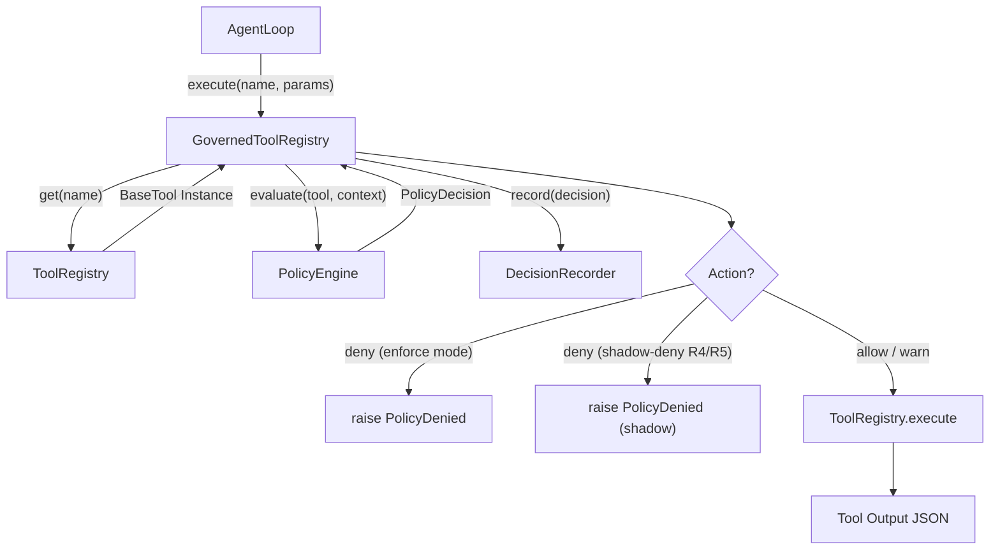
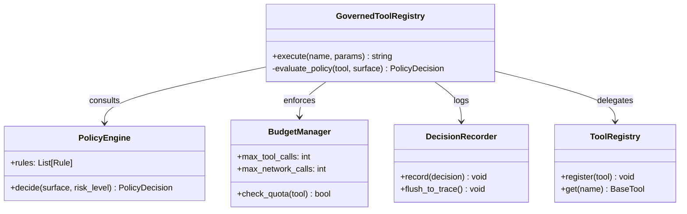

<!-- source: DeepWiki mcp.deepwiki.com · repo HKUDS/Vibe-Trading · page 14.1 GovernedToolRegistry and PolicyEngine · fetched 2026-11-09 -->

# GovernedToolRegistry and PolicyEngine

Relevant source files

The following files were used as context for generating this wiki page:

- [agent/src/agent/tool_progress.py](agent/src/agent/tool_progress.py)
- [agent/src/agent/tools.py](agent/src/agent/tools.py)
- [agent/src/api/portfolio_routes.py](agent/src/api/portfolio_routes.py)
- [agent/src/governance/ledger.py](agent/src/governance/ledger.py)
- [agent/src/portfolio/config.py](agent/src/portfolio/config.py)
- [agent/src/portfolio/longbridge_worker.py](agent/src/portfolio/longbridge_worker.py)
- [agent/src/portfolio/normalization.py](agent/src/portfolio/normalization.py)
- [agent/src/portfolio/oauth_worker.py](agent/src/portfolio/oauth_worker.py)
- [agent/src/portfolio/store.py](agent/src/portfolio/store.py)
- [agent/src/skills/web-reader/SKILL.md](agent/src/skills/web-reader/SKILL.md)
- [agent/src/tools/__init__.py](agent/src/tools/__init__.py)
- [agent/src/tools/bash_tool.py](agent/src/tools/bash_tool.py)
- [agent/src/tools/portfolio_tool.py](agent/src/tools/portfolio_tool.py)
- [agent/src/tools/web_reader_tool.py](agent/src/tools/web_reader_tool.py)
- [agent/tests/test_agent_loop_deterministic_cache.py](agent/tests/test_agent_loop_deterministic_cache.py)
- [agent/tests/test_agent_loop_no_progress.py](agent/tests/test_agent_loop_no_progress.py)
- [agent/tests/test_agent_loop_repeatable_tools.py](agent/tests/test_agent_loop_repeatable_tools.py)
- [agent/tests/test_alpha_bench_cache.py](agent/tests/test_alpha_bench_cache.py)
- [agent/tests/test_bash_tool.py](agent/tests/test_bash_tool.py)
- [agent/tests/test_compaction_call_identity.py](agent/tests/test_compaction_call_identity.py)
- [agent/tests/test_feishu_login_persistence.py](agent/tests/test_feishu_login_persistence.py)
- [agent/tests/test_governance.py](agent/tests/test_governance.py)
- [agent/tests/test_local_connections.py](agent/tests/test_local_connections.py)
- [agent/tests/test_lockup_expiry_integer_code.py](agent/tests/test_lockup_expiry_integer_code.py)
- [agent/tests/test_mcp_regression.py](agent/tests/test_mcp_regression.py)
- [agent/tests/test_portfolio_config.py](agent/tests/test_portfolio_config.py)
- [agent/tests/test_portfolio_routes.py](agent/tests/test_portfolio_routes.py)
- [agent/tests/test_portfolio_summary_tool_snapshot.py](agent/tests/test_portfolio_summary_tool_snapshot.py)
- [agent/tests/test_tool_progress.py](agent/tests/test_tool_progress.py)
- [agent/tests/test_tool_registry_diagnostics.py](agent/tests/test_tool_registry_diagnostics.py)
- [agent/tests/test_web_reader_privacy.py](agent/tests/test_web_reader_privacy.py)
- [frontend/src/components/portfolio/PortfolioSourceEditor.tsx](frontend/src/components/portfolio/PortfolioSourceEditor.tsx)

This leaf page covers the technical implementation of the Institutional Research Reliability and Agent Governance Layer (IRR-AGL), focusing on the `GovernedToolRegistry` wrapper, the `PolicyEngine` priority-match rule system, `RiskLevel` classifications (R0–R5), `ToolSurface` contexts, `BudgetManager`, `DecisionRecorder`, and environment flag configuration.

---

## 1. Governance Architecture & Code Entity Space

The governance subsystem intercepts tool executions between the agent loop and underlying tool implementations without altering the standard `BaseTool.execute` and `ToolRegistry.execute` contracts [agent/src/agent/tools.py:107-150](). When configured via environment flags or manifest definitions, `build_registry` wraps discovered tool components to enforce security policies and track execution audits [agent/src/tools/__init__.py:76-125]().

### Code Entity Space Mapping

| Natural Language Term | Code Entity / Module | Role |
| :--- | :--- | :--- |
| Governed Registry Wrapper | `src.governance.registry.GovernedToolRegistry` | Intercepts `execute()` calls to evaluate policy rules before passing to the base registry. |
| Policy Engine | `src.governance.engine.PolicyEngine` | Evaluates priority-ordered rule sequences against runtime tool requests and surfaces. |
| Underlying Tool Registry | `src.agent.tools.ToolRegistry` | Container holding auto-discovered `BaseTool` instances [agent/src/agent/tools.py:68-79](). |
| Decision Recorder | `src.governance.ledger.DecisionRecorder` | Persists audit decisions into the run trace database for UI visibility. |
| Budget Manager | `src.governance.budget.BudgetManager` | Enforces resource constraints such as max tool calls and network request caps. |

Sources: [agent/src/agent/tools.py:68-150](), [agent/src/tools/__init__.py:76-125]()

### Governed Tool Execution Flow

Title: "Governed Tool Execution Flow"

Sources: [agent/src/agent/tools.py:107-150](), [agent/src/tools/__init__.py:76-125]()

---

## 2. Risk Classification (RiskLevel R0–R5)

Tools are categorized into a hierarchical risk ladder (R0 through R5) which dictates their policy evaluation path and permission requirements across different operational surfaces [agent/src/tools/__init__.py:31-32]().

| Level | Identifier | Criteria & Scope | Example Tools |
| :--- | :--- | :--- | :--- |
| **R0** | `R0_READ` | Local read-only data, calculation, or analysis functions. | `FinancialRigorTool`, `analyze_options` |
| **R1** | `R1_WRITE_LOCAL` | Local file modifications, skill generation, or persistent memory updates. | `WriteFileTool`, `SaveSkillTool`, `RememberTool` |
| **R2** | `R2_NETWORK` | Outbound network queries, web scraping, and external data fetching. | `WebReaderTool`, `MarketDataTool`, `GetFundamentalsTool` |
| **R3** | `R3_TRADE_READ` | Read operations for broker accounts, positions, and active orders. | `trading_positions`, `trading_account`, `trading_orders` |
| **R4** | `R4_TRADE_WRITE` | Live execution actions including placing, modifying, or cancelling orders. | `trading_place_order`, `commit_mandate` |
| **R5** | `R5_SHELL` | Unconstrained subprocess execution or shell script invocation. | `BashTool`, `BackgroundRunTool` |

Sources: [agent/src/tools/__init__.py:31-32](), [agent/src/tools/bash_tool.py:60-80](), [agent/src/tools/web_reader_tool.py:134-165]()

---

## 3. PolicyEngine and Priority Rules (P10–P999)

The `PolicyEngine` evaluates requests using a first-match paradigm over ordered priority rules. Rules range from P10 (highest priority, system-critical security guards) to P999 (fallback policies).

### Built-in Priority Rules

*   **P10 (Fail-Closed Connector):** Rejects unknown or unauthorized live broker connector tools unless explicitly allowlisted in active configuration [agent/src/tools/__init__.py:154-160]().
*   **P20 (Remote Shell Denial):** Blocks `R5_SHELL` tool executions (`bash`, `background_run`) whenever the request origin is not an interactive local TTY [agent/src/tools/__init__.py:156-159]().
*   **P30 (Scheduler Write Denial):** Prevents background research worker jobs from invoking `R1` local writes or `R4` live trading modifications.
*   **P35 (Swarm Injection Guard):** Scans MCP tool arguments in multi-agent swarm passes for prompt-injection payloads or unauthorized cross-session leakage.
*   **P40 (Mandate Gate Mandate):** Enforces that `R4_TRADE_WRITE` tools proceed only when a valid cryptographic mandate is active and verified by `LiveOrderGuard`.
*   **P100 (MCP Stdio Allow):** Grants standard execution rights to validated local MCP stdio servers discovered at bootstrap [agent/src/tools/__init__.py:164-166]().
*   **P999 (Fail-Safe Deny):** Default terminal rule denying any execution request that fails to match preceding rules.

Sources: [agent/src/tools/__init__.py:154-166](), [agent/src/tools/bash_tool.py:60-80]()

---

## 4. ToolSurfaces and Governance Manifests

Governance enforcement adapts dynamically based on the originating `ToolSurface` context and environment configuration flags (`VIBE_TRADING_GOVERNANCE_MODE`).

### Recognized Tool Surfaces

*   `local_agent`: Interactive CLI or local TUI sessions (permits shell tool inclusion if explicitly flagged) [agent/src/tools/__init__.py:99-102]().
*   `mcp_stdio` / `mcp_sse`: External Model Context Protocol servers connected via standardized pipes or SSE [agent/src/tools/__init__.py:103-106]().
*   `remote_api`: HTTP requests routed through `api_server.py`.
*   `scheduler`: Cron-driven background execution threads governed by `ScheduledResearchExecutor`.
*   `swarm`: Topological DAG worker instances managed by `SwarmRuntime` [agent/src/tools/__init__.py:148-150]().
*   `channel_bot`: External messaging bridge requests originating from adapters like Telegram or Slack.

Sources: [agent/src/tools/__init__.py:99-150](), [agent/src/tools/web_reader_tool.py:134-165]()

---

## 5. Sandbox Hardening, BudgetManager, and Shadow Deny

When executing high-risk research scripts or backtests, the governance layer delegates to os-level sandboxing and resource metering.

### Subprocess Sandbox Controls
*   **Privilege Dropping:** Attempts dropping active execution processes to unprivileged user contexts (`vibe-sandbox`).
*   **Ephemeral HOME:** Mounts temporary execution directories, exposing only necessary loader configs (`qveris.json`, cached ledgers) while shielding `.env` credentials and `sessions.db`.
*   **Address Space Limits (`RLIMIT_AS`):** Restricts maximum virtual address space allocations (default 4GB) to prevent memory exhaustion attacks.
*   **Environment Scrubbing:** Strips sensitive API keys (`OPENAI_API_KEY`, broker secrets) from spawned subprocesses.

### BudgetManager and Shadow Deny Logic
*   **BudgetManager:** Tracks per-run metric quotas such as `max_tool_calls` and `max_network_calls` (`R2_NETWORK`) to constrain agent exploration loops.
*   **Shadow Deny:** For high-risk `R4_TRADE_WRITE` and `R5_SHELL` tools, `GovernedToolRegistry` forces a shadow block in non-enforcement modes (`observe`, `warn`), ensuring high-impact side-effects cannot execute accidentally.

Sources: [agent/src/tools/bash_tool.py:22-58](), [agent/src/tools/web_reader_tool.py:24-58]()

### Governance System Class Structure

Title: "Governance System Class Structure"

Sources: [agent/src/agent/tools.py:68-150](), [agent/src/tools/__init__.py:76-125]()

---

