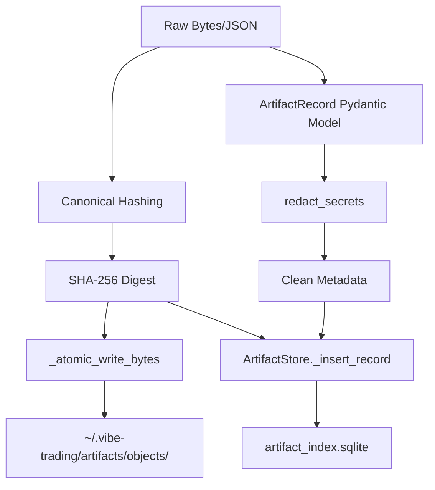
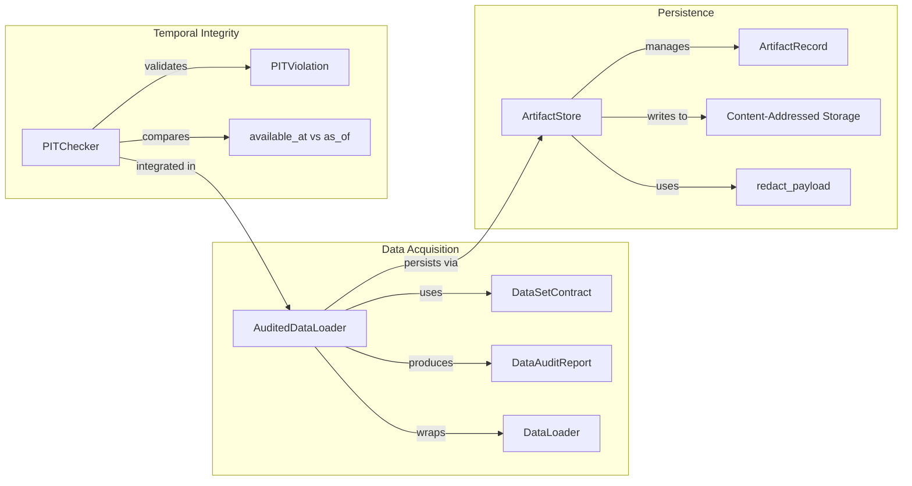

<!-- source: DeepWiki mcp.deepwiki.com · repo HKUDS/Vibe-Trading · page 14.2 ArtifactStore, AuditedDataLoader, and PIT Checker · fetched 2026-11-09 -->

# ArtifactStore, AuditedDataLoader, and PIT Checker

Relevant source files

The following files were used as context for generating this wiki page:

- [agent/backtest/loaders/registry.py](agent/backtest/loaders/registry.py)
- [agent/cli/ui/rail.py](agent/cli/ui/rail.py)
- [agent/src/agent/frontmatter.py](agent/src/agent/frontmatter.py)
- [agent/src/agent/memory.py](agent/src/agent/memory.py)
- [agent/src/agent/skills.py](agent/src/agent/skills.py)
- [agent/src/market_data.py](agent/src/market_data.py)
- [agent/src/memory/__init__.py](agent/src/memory/__init__.py)
- [agent/src/skills/data-routing/SKILL.md](agent/src/skills/data-routing/SKILL.md)
- [agent/src/tools/market_data_tool.py](agent/src/tools/market_data_tool.py)
- [agent/src/tools/redaction.py](agent/src/tools/redaction.py)
- [agent/src/tools/skill_writer_tool.py](agent/src/tools/skill_writer_tool.py)
- [agent/tests/test_cli_rail_dashboard.py](agent/tests/test_cli_rail_dashboard.py)
- [agent/tests/test_market_data.py](agent/tests/test_market_data.py)
- [agent/tests/test_market_data_serving_source.py](agent/tests/test_market_data_serving_source.py)
- [agent/tests/test_market_data_tool.py](agent/tests/test_market_data_tool.py)
- [agent/tests/test_price_caliber.py](agent/tests/test_price_caliber.py)
- [agent/tests/test_redaction.py](agent/tests/test_redaction.py)
- [agent/tests/test_redaction_channel_and_provider_tokens.py](agent/tests/test_redaction_channel_and_provider_tokens.py)
- [agent/tests/test_redaction_cookie_headers.py](agent/tests/test_redaction_cookie_headers.py)
- [agent/tests/test_redaction_shared.py](agent/tests/test_redaction_shared.py)
- [agent/tests/test_registry.py](agent/tests/test_registry.py)
- [agent/tests/test_skill_writer_tools.py](agent/tests/test_skill_writer_tools.py)
- [agent/tests/test_skills.py](agent/tests/test_skills.py)
- [agent/tests/test_trade_journal_fiat_pairs_not_crypto.py](agent/tests/test_trade_journal_fiat_pairs_not_crypto.py)

The reliability infrastructure provides the foundation for the **Institutional Research Reliability and Agent Governance Layer (IRR-AGL)**. It ensures that every piece of data consumed and every research artifact produced is content-addressed, audited for Point-in-Time (PIT) integrity, and protected against data leakage or lookahead bias. This system is particularly critical for PIT-safe fundamental analysis and factor research.

## ArtifactStore and Content-Addressed Storage (CAS)

The `ArtifactStore` is a specialized persistence layer designed for research integrity. It utilizes a Content-Addressed Storage (CAS) pattern where the physical filename is derived from the SHA-256 hash of its contents, ensuring immutability and deduplication.

### Key Implementation Details
- **Atomic Writes**: Uses `_atomic_write_bytes` to ensure that artifacts are never partially written, preventing corruption during system crashes.
- **SQLite WAL Index**: Metadata is indexed in a SQLite database (`artifact_index.sqlite`) using Write-Ahead Logging (WAL) for high concurrency.
- **Exponential Backoff**: Metadata insertion implements a retry strategy with exponential backoff to handle database locks in multi-threaded environments.
- **Path Security**: The `resolve_under_root` function strictly enforces that all artifact paths remain within the configured `VIBE_TRADING_ARTIFACT_ROOT`, preventing path traversal attacks.
- **HMAC-Authenticated Cache**: Factor results and benchmarks are stored in a cache that uses HMAC authentication to prevent tampering.

### Canonical Hashing (`sha256_json`)
To ensure that the same logical JSON object always produces the same hash, the system uses `sha256_json`. This function enforces strict rules:
- **Sorted Keys**: Dictionary keys are sorted alphabetically.
- **No NaN/Inf**: Rejects floating-point values that are not finite.
- **Type Safety**: Rejects `datetime`, `UUID`, and `pandas` objects directly; these must be converted to primitives first.

### Artifact Models and Lineage
Artifacts are tracked via Pydantic models that define their identity and relationship to other data.

| Class | Description |
| :--- | :--- |
| `ArtifactRef` | A lightweight reference containing `artifact_id`, `sha256`, and `uri`. |
| `ArtifactRecord` | Full metadata including `parent_artifacts`, `generated_by`, and `metadata`. |
| `ArtifactLineageEdge` | Represents a DAG edge between a parent and child artifact. |

Sources: [agent/src/reliability/artifacts/store.py:38-191](), [agent/src/reliability/artifacts/hashing.py:33-76](), [agent/src/reliability/artifacts/model.py:18-66](), [agent/src/reliability/artifacts/lineage.py:10-28]().

## Secret Redaction

The reliability layer automatically redacts sensitive information from artifact metadata to prevent accidental leakage of credentials into the research audit trail.

- **Key-based Redaction**: Any dictionary key containing fragments like `api_key`, `token`, `password`, or `secret` is automatically redacted [agent/src/tools/redaction.py:88-97]().
- **Value-based Regex**: Values matching patterns for Bearer tokens, GitHub PATs, or long random strings (high entropy) are replaced with `[redacted]`. This is handled by `redact_text` [agent/src/tools/redaction.py:135-167]().
- **Sink-aware Redaction**: `redact_payload` and `is_sensitive_arg` use `ARGUMENTS_SINK` (default, strict) and `RESULT_SINK` (more permissive for tool results) to control what is redacted. For example, `content` is redacted in `ARGUMENTS_SINK` but released in `RESULT_SINK` [agent/src/tools/redaction.py:54-55]().

Sources: [agent/src/tools/redaction.py:1-168](), [agent/tests/test_redaction.py:1-167]().

## AuditedDataLoader

The `AuditedDataLoader` is a wrapper around standard data acquisition tools like `DataLoader`. It ensures that every data fetch complies with a `DataSetContract` and generates a `DataAuditReport`.

### Data Contracts and Manifests
- **DataSetContract**: Defines the expected schema, frequency, and source of a dataset.
- **DataAccessContract**: Defines the permissions and limits for accessing a specific source.
- **SourceManifest**: A signed record of the data source's state at the time of access.

### Reliability Mechanisms
- **Circuit Breaker Snapshots**: Captures the state of the data provider's health to explain missing data in research.
- **DataAuditReport**: A persisted artifact that links a specific data fetch to the `ArtifactStore`, allowing researchers to prove exactly what data was visible to the agent at a specific timestamp.
- **Retry Helpers**: `retry_with_budget` and `check_budget` provide a canonical pattern for handling flaky external APIs with a wall-clock deadline and backoff for transient exceptions. This ensures that data loading attempts are robust and respect defined time limits.

Sources: [agent/src/reliability/data/loader_wrapper.py:1-50](), [agent/src/reliability/data/contracts.py:1-30](), [agent/backtest/loaders/registry.py:1-179]().

## PIT Checker (Point-in-Time Integrity)

The `PITChecker` is critical for quantitative reliability, particularly when handling financial statements and filings. It prevents "lookahead bias" by verifying the temporal validity of every data point.

### The Five-Timestamp Model
The system tracks five distinct timestamps for every observation:

1.  **`effective_at`**: When the event actually occurred in the real world.
2.  **`published_at`**: When the data was first made public by the source.
3.  **`ingested_at`**: When the Vibe-Trading system first received the data.
4.  **`available_at`**: The earliest time this data could have been used in a trade (accounting for lags).
5.  **`as_of`**: The simulation "current time" or the observer's horizon.

### Hard Failure Condition
The `PITChecker` enforces a strict rule: **`available_at` <= `as_of`**.
If any data point has an `available_at` timestamp greater than the simulation `as_of` time, a `PITViolation` is recorded. In `enforce` mode, this triggers a hard failure.

Sources: [agent/src/reliability/pit/model.py:1-30](), [agent/src/reliability/pit/checker.py:1-45](), [agent/src/reliability/pit/violations.py:1-20]().

## System Flow and Configuration

The reliability layer behavior is controlled by the `VIBE_TRADING_RELIABILITY_MODE` environment flag.

| Mode | Behavior |
| :--- | :--- |
| `off` | Reliability checks and artifact writing are disabled. |
| `observe` | Artifacts are written; violations are logged but do not stop execution. |
| `warn` | Violations are logged as high-priority warnings in the agent trace. |
| `enforce` | Any PIT violation or contract breach raises a `ReliabilityError` and halts the run. |

### Data Flow Diagram: Artifact Persistence
Title: "Artifact Persistence and Indexing Flow"

Sources: [agent/src/reliability/artifacts/store.py:51-110](), [agent/src/reliability/artifacts/hashing.py:33-48](), [agent/src/tools/redaction.py:1-98]()

### Entity Mapping: Reliability Logic to Code
Title: "Reliability Layer Code Entities"

Sources: [agent/src/reliability/data/loader_wrapper.py:1-20](), [agent/src/reliability/pit/checker.py:1-20](), [agent/src/reliability/artifacts/store.py:38-60](), [agent/src/tools/redaction.py:1-98]()

---

