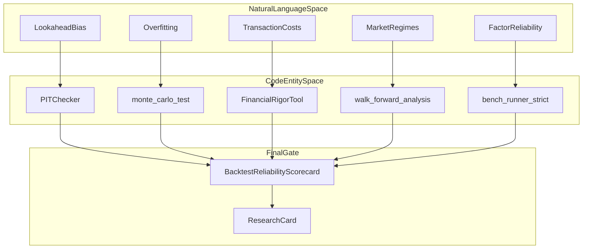
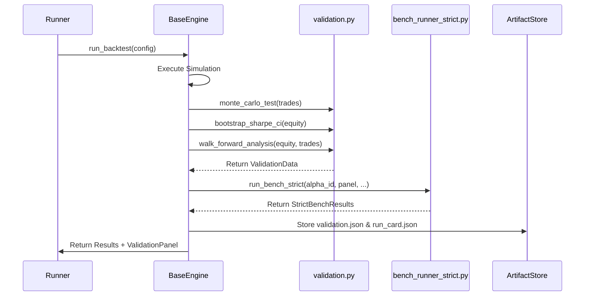

<!-- source: DeepWiki mcp.deepwiki.com · repo HKUDS/Vibe-Trading · page 14.3 Quant Reliability Scorecard and Research Card · fetched 2026-11-09 -->

# Quant Reliability Scorecard and Research Card

Relevant source files

The following files were used as context for generating this wiki page:

- [agent/backtest/run_card.py](agent/backtest/run_card.py)
- [agent/backtest/validation.py](agent/backtest/validation.py)
- [agent/src/agent/trace.py](agent/src/agent/trace.py)
- [agent/src/factors/bench_runner_strict.py](agent/src/factors/bench_runner_strict.py)
- [agent/src/factors/cli_handlers.py](agent/src/factors/cli_handlers.py)
- [agent/tests/factors/test_bench_strict.py](agent/tests/factors/test_bench_strict.py)
- [agent/tests/test_agent_loop_strategy_provenance.py](agent/tests/test_agent_loop_strategy_provenance.py)
- [agent/tests/test_alpha_bench_strict_cli.py](agent/tests/test_alpha_bench_strict_cli.py)
- [agent/tests/test_alpha_cli_dotenv.py](agent/tests/test_alpha_cli_dotenv.py)
- [agent/tests/test_load_equity_aliases.py](agent/tests/test_load_equity_aliases.py)
- [agent/tests/test_run_card_training_cutoff.py](agent/tests/test_run_card_training_cutoff.py)
- [agent/tests/test_trace_writer.py](agent/tests/test_trace_writer.py)
- [agent/tests/test_validation.py](agent/tests/test_validation.py)
- [agent/tests/test_validation_cli.py](agent/tests/test_validation_cli.py)
- [agent/tests/test_validation_cli_settings.py](agent/tests/test_validation_cli_settings.py)

## Purpose and Scope

This page covers the Institutional Research Reliability and Agent Governance Layer (IRR-AGL) subsystem responsible for evaluating quantitative research results. Specifically, it details the `BacktestReliabilityScorecard` dimensions, hard failure codes, conclusion caps, Deflated Sharpe Ratio (DSR) and Probability of Backtest Overfitting (PBO) calculations, cost sensitivity, IC horizon and crowding analysis via strict benchmarking (`bench_runner_strict.py`), and the generation of immutable `ResearchCard` artifacts alongside run card execution graphs.

Sources: [agent/backtest/validation.py:1-10](), [agent/backtest/run_card.py:1-45](), [agent/src/factors/bench_runner_strict.py:1-46]()

---

## Quant Reliability Scorecard

The `BacktestReliabilityScorecard` provides a structured evaluation of a backtest methodology and its statistical robustness. It enforces a formal evidence gate before a strategy or factor is permitted to graduate to live testing or paper trading.

### Scorecard Dimensions

The scorecard audits 13 distinct dimensions to protect against common quantitative research pitfalls:

| Dimension | Description |
| :--- | :--- |
| `pit_clean` | Checks for lookahead bias via `PITChecker`. |
| `oos_split` | Verifies the presence of Out-Of-Sample (OOS) evaluation periods and train/test separation. |
| `cost_model` | Ensures a realistic commission, tax, and slippage model was applied. |
| `benchmark` | Validates that strategy performance is measured against a relevant market index. |
| `trial_count` | Tracks iteration counts to adjust for multiple testing bias (DSR/PBO). |
| `execution_realism` | Checks execution timestamp logic (signal generation vs. fill time). |
| `universe_pit` | Verifies Point-In-Time universe selection to avoid survivorship bias. |
| `capacity` | Estimates Average Daily Volume (ADV) participation limits. |
| `cost_sensitivity` | Stress tests strategy edges across a basis point (bps) fee grid. |
| `ic_stability` | Analyzes Information Coefficient (IC) stability across evaluation horizons. |
| `regime_stability` | Evaluates performance consistency across bull, bear, and sideways regimes. |
| `crowding_risk` | Estimates cross-sectional correlation with known risk and factor benchmarks. |
| `random_control` | Compares results against a same-universe random shuffle control [agent/src/factors/bench_runner_strict.py:1-30](). |

Sources: [agent/backtest/validation.py:1-10](), [agent/src/factors/bench_runner_strict.py:1-46]()

### ConclusionCap Levels

Based on scorecard evaluations, backtest outcomes are assigned a strict `ConclusionCap`:
*   **Not Reliable**: Triggered by hard failure codes (e.g., `PIT_FUTURE_DATA`, `QUANT_NO_COST_MODEL`). Results are locked out of execution pipelines.
*   **Exploratory**: Initial agent findings characterized by significant methodology gaps or missing OOS splits.
*   **Research Candidate**: Passed basic statistical gates and cost models, but lacks rigorous out-of-sample stress testing.
*   **Paper Trade Candidate**: High-integrity research output ready for forward-testing via the `Paper Trading Engine`.

Sources: [agent/backtest/run_card.py:168-183]()

---

## Research Card and Code Entity Mapping

The `ResearchCard` bundles the `BacktestReliabilityScorecard`, model provenance metadata [agent/backtest/run_card.py:47-165](), and validation metrics into an immutable artifact.

### Code Entity Mapping: Reliability Logic

Title: "Quant Reliability Code Map"

Sources: [agent/backtest/validation.py:28-50](), [agent/backtest/validation.py:144-168](), [agent/src/factors/bench_runner_strict.py:1-46]()

### Research Card Schema

The serialized run card record (`run_card.json`) maintains a strict schema version (`SCHEMA_VERSION = "1.0"`):
*   `card_id`: Unique cryptographic SHA-256 hash of the configuration, metrics, and provenance.
*   `conclusion_level`: The enforced `ConclusionCap`.
*   `provenance`: File-level provider and model identification for `config.json` and `code/signal_engine.py` [agent/backtest/run_card.py:75-118]().
*   `hard_failures`: List of violated governance or reliability codes.

Sources: [agent/backtest/run_card.py:1-45](), [agent/backtest/run_card.py:131-165]()

---

## Quant Reliability Modules

### Overfit Diagnostics (Monte Carlo & Bootstrap)
Statistical validation routines compute empirical significance boundaries:
*   **Monte Carlo Permutation Test**: Shuffles round-trip trade PnL arrays to test path significance against the null hypothesis that observed performance is random [agent/backtest/validation.py:30-53](). It computes `p_value_sharpe`, `p_value_max_dd`, and simulated percentile bands [agent/backtest/validation.py:88-117]().
*   **Bootstrap Sharpe CI**: Resamples daily returns with replacement to estimate confidence intervals and `prob_positive` (fraction of bootstrap paths yielding positive Sharpe ratios) [agent/backtest/validation.py:144-168]().

Sources: [agent/backtest/validation.py:28-168]()

### Cost Sensitivity and Capacity
*   **Financial Rigor Tool**: Enforces exact decimal arithmetic and valuation checks, confirming market capitalizations (`price * shares`) against reported balance sheet data to prevent floating-point discrepancies in research outputs.
*   **Scenario Analysis**: Evaluates multi-scenario asset valuations under bull, base, and bear growth assumptions.

Sources: [agent/tests/test_validation.py:1-45]()

### IC Horizon and Crowding Analysis (`bench_runner_strict.py`)
Standard alpha benchmarking evaluates Information Coefficients (IC) against zero, which can yield false positives driven by cross-sectional market or size betas. The strict bench runner introduces rigorous controls:

*   **`_shuffle_within_rows()`**: Cross-sectionally permutes finite factor values within each date row, destroying instrument mapping while preserving cross-sectional distributions to establish a fair random control baseline [agent/src/factors/bench_runner_strict.py:99-138]().
*   **`compute_random_ic_series()`**: Averages IC performance across multiple seeds of row-shuffled random controls [agent/src/factors/bench_runner_strict.py:141-175]().
*   **`categorise_strict()`**: Classifies factors into `confirmed_alive`, `train_only`, `reversed_strict`, or `noise` based on out-of-sample split tests and t-statistic thresholds (supporting Harvey-Liu-Zhu 2016 multi-testing thresholds such as $|t| > 3.5$) [agent/src/factors/bench_runner_strict.py:74-95]().

Sources: [agent/src/factors/bench_runner_strict.py:1-175](), [agent/tests/factors/test_bench_strict.py:1-120]()

---

## Implementation Data Flow

The following sequence diagram outlines the validation pipeline executed during backtest runs.

Title: "Reliability Validation Flow"

Sources: [agent/backtest/validation.py:1-25](), [agent/backtest/run_card.py:168-183](), [agent/src/factors/bench_runner_strict.py:1-46]()

---

## Hard Failure Codes

Hard failures immediately cap the conclusion level to `not_reliable`. Key codes include:
*   **`PIT_FUTURE_DATA`**: Lookahead bias detected in data loading routines.
*   **`QUANT_NO_COST_MODEL`**: Strategy claims execution capability but specifies zero transaction fees.
*   **`REPORT_AUDIT_FAIL`**: Significant discrepancies uncovered during report verification passes.
*   **`BENFORD_NON_CONFORMING`**: Financial statement values fail first-digit distribution validation.

Sources: [agent/backtest/run_card.py:1-35](), [agent/src/agent/trace.py:54-61]()

---

