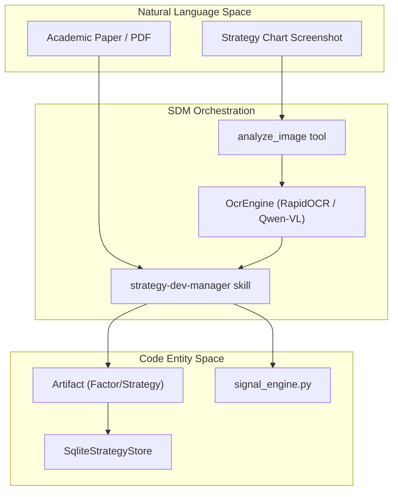
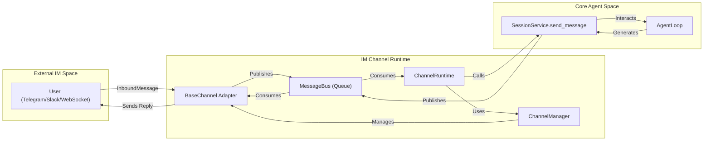

<!-- source: DeepWiki mcp.deepwiki.com · repo HKUDS/Vibe-Trading · page 15 IM Channel Runtime and Strategy Development Manager · fetched 2026-11-09 -->

# IM Channel Runtime and Strategy Development Manager

Relevant source files

The following files were used as context for generating this wiki page:

- [agent/src/channels/attempt_progress.py](agent/src/channels/attempt_progress.py)
- [agent/src/channels/manager.py](agent/src/channels/manager.py)
- [agent/src/channels/pairing/store.py](agent/src/channels/pairing/store.py)
- [agent/src/channels/runtime.py](agent/src/channels/runtime.py)
- [agent/src/channels/websocket.py](agent/src/channels/websocket.py)
- [agent/src/providers/claude_cli.py](agent/src/providers/claude_cli.py)
- [agent/src/skills/strategy-dev-manager/SKILL.md](agent/src/skills/strategy-dev-manager/SKILL.md)
- [agent/src/strategy_store/metrics.py](agent/src/strategy_store/metrics.py)
- [agent/src/strategy_store/models.py](agent/src/strategy_store/models.py)
- [agent/src/strategy_store/sqlite_store.py](agent/src/strategy_store/sqlite_store.py)
- [agent/src/strategy_store/store.py](agent/src/strategy_store/store.py)
- [agent/src/tools/backtest_tool.py](agent/src/tools/backtest_tool.py)
- [agent/src/tools/sdm_decay_scan_tool.py](agent/src/tools/sdm_decay_scan_tool.py)
- [agent/src/tools/sdm_status_tool.py](agent/src/tools/sdm_status_tool.py)
- [agent/tests/test_backtest_records_bench.py](agent/tests/test_backtest_records_bench.py)
- [agent/tests/test_backtest_tool_state.py](agent/tests/test_backtest_tool_state.py)
- [agent/tests/test_channel_manager_health.py](agent/tests/test_channel_manager_health.py)
- [agent/tests/test_channel_manager_reload.py](agent/tests/test_channel_manager_reload.py)
- [agent/tests/test_channels_api.py](agent/tests/test_channels_api.py)
- [agent/tests/test_channels_attempt_progress.py](agent/tests/test_channels_attempt_progress.py)
- [agent/tests/test_channels_runtime.py](agent/tests/test_channels_runtime.py)
- [agent/tests/test_claude_cli_provider.py](agent/tests/test_claude_cli_provider.py)
- [agent/tests/test_scheduled_research_confirmation.py](agent/tests/test_scheduled_research_confirmation.py)
- [agent/tests/test_sdm_finite_metrics.py](agent/tests/test_sdm_finite_metrics.py)
- [agent/tests/test_strategy_store.py](agent/tests/test_strategy_store.py)
- [agent/tests/test_websocket_channel_start.py](agent/tests/test_websocket_channel_start.py)

This page provides an overview of two core integration and management subsystems in Vibe-Trading: the **IM Channel Runtime**, which bridges agent execution to 16 different instant messaging adapters, and the **Strategy Development Manager (SDM)**, which provides a structured workflow for converting financial research and papers into persistent trading artifacts. It also introduces the **Pixel Office and Agent Personas** visualization surface.

For deep technical details, see the child pages:
- [IM Channel Runtime (16 Adapters)](#15.1)
- [Strategy Development Manager (SDM)](#15.2)
- [Pixel Office and Agent Personas](#15.3)

---

## IM Channel Runtime (16 Adapters)

The IM Channel Runtime enables multi-platform research delivery, alert broadcasting, and agent interaction over 16 built-in messaging adapters [agent/tests/test_channels_runtime.py:155-173](). It centers around a unified `BaseChannel` interface [agent/src/channels/manager.py:14]() and an asynchronous `MessageBus` queue, coordinated by the `ChannelManager` [agent/src/channels/manager.py:63-70]() and `ChannelRuntime` [agent/src/channels/runtime.py:35-36]().

The runtime manages adapter lifecycles, configuration hot-reloading [agent/src/channels/manager.py:85-88](), rate-limiting, and inbound/outbound duplicate message suppression [agent/src/channels/manager.py:40-41](). Inbound media attachments are safely routed to sandboxed upload directories, and pairing management commands are restricted to authorized operators.

For details, see [IM Channel Runtime (16 Adapters)](#15.1).

**Sources:** [agent/src/channels/manager.py:14](), [agent/src/channels/manager.py:40-41](), [agent/src/channels/manager.py:63-70](), [agent/src/channels/manager.py:85-88](), [agent/src/channels/runtime.py:35-36](), [agent/tests/test_channels_runtime.py:155-173]().

---

## Strategy Development Manager (SDM)

The Strategy Development Manager (SDM) bridges unstructured academic research and quantitative strategies into formal code entities via a 5-phase workflow (`INGEST` → `EXTRACT` → `IMPLEMENT` → `EVALUATE` → `MONITOR`). 

Backed by `SqliteStrategyStore` [agent/src/strategy_store/sqlite_store.py:126-132]() implementing `StrategyStoreProtocol` [agent/src/strategy_store/store.py:68-74](), SDM tracks artifacts (factors and strategies) through strict lifecycle stages and model governance validations. The `DecayEvaluator` and metrics utilities continuously monitor rolling performance indicators against historical benchmarks, flagging performance degradation or model decay.

For details, see [Strategy Development Manager (SDM)](#15.2).

**Sources:** [agent/src/strategy_store/store.py:68-74](), [agent/src/strategy_store/sqlite_store.py:126-132](), [agent/src/strategy_store/metrics.py:29-31]().

---

## Pixel Office and Agent Personas

The Pixel Office subsystem provides a visual office interface (`pixel-office`) to monitor agent states, planning boards, and task allocations across specialist agent personas [agent/src/pixel_agents/]. Agent ranks and titles function purely as visual labels and role indicators without granting trading privileges or bypassing core security guardrails.

For details, see [Pixel Office and Agent Personas](#15.3).

**Sources:** [agent/src/pixel_agents/]().

---

## System Interaction Diagrams

### Natural Language to Code Entity Mapping: SDM Workflow
The following diagram illustrates how unstructured research papers and charts are processed into structured code entities and persisted records.

**Sources:** [agent/src/strategy_store/sqlite_store.py:126-132](), [agent/src/strategy_store/store.py:68-74]().

### IM Channel Runtime: Message Flow
This diagram shows how inbound messages from external chat platforms flow through the `ChannelManager` and `MessageBus` into Vibe-Trading session services.

**Sources:** [agent/src/channels/manager.py:63-70](), [agent/src/channels/runtime.py:35-36](), [agent/src/channels/bus/queue.py]().

---

